# CAPCOM DL-0311 (CPS-A-01) Gate-Level Netlist

<table align="center">
  <tr>
    <td align="center" style="padding: 10px;">
      
    </td>
  </tr>
</table>

## CAPCOM DL-0311 (CPS-A-01) Overview

This is a gate-level Verilog netlist of the CP System's video controller, traced from the die and checked against it cell by cell. The CAPCOM DL-0311 (CPS-A-01) contains 2208 Ricoh A5C gate-array cells, every connection between them and its 160 pads. The chip makes the video timing and the frame and line interrupts, fetches the scroll maps into its on-chip SRAM and the sprite list from the GFX RAM, drives the graphics ROM address bus, runs the sprite frame buffer and copies the palette, taking the CPU bus for each fetch.

The CAPCOM DL-0311 (CPS-A-01) netlist is provided in two forms. The synchronous netlist keeps every cell and connection of the die, with all registers clocked from a single system clock, for use in FPGA-based applications. The traced netlist is retained for simulation and models the latches, charge-storage nets, the on-chip SRAM and internally generated clocks as they are on the silicon.

<p align="center"><ins><b>The netlist, wrapper, simulation, and cell zoo will be published at a later date.</b></ins></p>

### Features

<small>

- **Gate-Level Netlist**: 2208 cells of 58 types, each in the module's own cell library, on the 160 pads in package order, with pads 61 to 65 as the die bonds them. The nets are as on the silicon, with the pad joins, the charge-storage and wired-OR nets, the latches, the on-chip SRAM and the clocks made by logic.
- **Synchronous Netlist**: The same cells and connections. The pads are inputs, outputs and `_IN` / `_OUT` / `_OE`, the tri-state and wired-OR nets are ORs of their drivers, the latches are pass-and-hold, the SRAM is synchronous block RAM, and every register loads on the rise of `CLK` with `CEN` or `CEN_F` in its enable. The 193 charge-storage nets are held on `CLK`, and the cell delays apply only under `SIMULATION`.
- **System Testbench**: The netlist with the CPS-B-21 netlist, the frame buffer, the graphics ROM and the palette RAM, loaded with one frame of game state. One gameplay frame from each of the 156 supported romsets comes out exact.
- **Die Images**: The floorplan of the cell rows, the cells by function and the extracted layers, on photographs of the die.
- **Cell Zoo**: A page for each of the 58 cell types, with the cell on the die at three layers, what it does, how it was read and its model in the cell library.

</small>

## Table of Contents

| # | Section | Description |
|---|---------|-------------|
| 1 | [System Architecture](#system-architecture) | Block diagram of the CPS-A-01: video timing, bus requests, scroll layers, sprites, graphics ROM address, frame buffer, CPU bus; die imaging |
| 2 | [Module Hierarchy](#module-hierarchy) | Source-file listing with each module's role and approximate line count |
| 3 | [Traced Netlist](#traced-netlist) | Cells, pads and nets of the traced netlist, and the corrections to the trace |
| 4 | [Cell Zoo](#cell-zoo) | The 58 cell types on the die, how each was read, and its model |
| 5 | [Synchronous Netlist](#synchronous-netlist) | What the synchronous netlist changes, and what it keeps |
| 6 | [Clocking](#clocking) | `CLK` and the registers' enables |
| 7 | [Control Interface](#control-interface) | Verilog port-level reference: `capcom_cps_a_01` ports |
| 8 | [Design Usage](#design-usage) | Clock enables, instantiation example, timing constraints and bus timing rules |
| 9 | [Device Usage](#device-usage) | FPGA resource usage, timing and Fmax of a standalone compile on two Cyclone V parts |
| 10 | [Project Structure](#project-structure) | Directory tree of the IP package |
| 11 | [Design Verification](#design-verification) | The system testbench, its board model and its checks |
| 12 | [Design References](#design-references) | The die trace and the die photographs |
| 13 | [License](#license) | Creative Commons Attribution-NonCommercial 4.0 International |
| 14 | [Support](#support) | Back ongoing Coin-Op Collection FPGA core development on Patreon |

## System Architecture

```
┌───────────────────────────────────────────────────────────────────────────────────────────┐
│                                       capcom_dl0311                                       │
│                                                                                           │
│  ┌─────────────────────────┐   ┌─────────────────────────┐   ┌─────────────────────────┐  │
│  │      Video Timing       │   │      Bus Requests       │   │         CPU Bus         │  │
│  │                         │   │                         │   │                         │  │
│  │ 8 / 4 MHz dividers      │   │ intentions and state    │   │ address decoder         │  │
│  │ video counter, timings  │   │ /BR, /BGACK, bus master │   │ CPU data and address    │  │
│  │ LI, FI, CK125, CK250    │   │ scroll and list fetches │   │ registers, CPS-ID       │  │
│  └─────────────────────────┘   └─────────────────────────┘   └─────────────────────────┘  │
│                                                                                           │
│  ┌─────────────────────────┐   ┌─────────────────────────┐   ┌─────────────────────────┐  │
│  │      Scroll Layers      │   │         Sprites         │   │      Graphics ROM       │  │
│  │                         │   │                         │   │                         │  │
│  │ scroll 1-3 positions    │   │ sprite list entries     │   │ ROMA address bus        │  │
│  │ row scroll, stars       │   │ lookup, tiles           │   │ CB, CPC, XS, XSEL       │  │
│  │ scroll map addresses    │   │ block counter           │   │ palette copy (WSTLUT)   │  │
│  │ SRAM, 2 x 256 words     │   │                         │   │ ROM write (WSTROM)      │  │
│  └─────────────────────────┘   └─────────────────────────┘   └─────────────────────────┘  │
│                                                                                           │
│  ┌─────────────────────────────────────────────────────────────────────────────────────┐  │
│  │                                     Frame Buffer                                    │  │
│  │                                                                                     │  │
│  │ sprite frame buffer controller: banks A and B, write and read addresses, timings    │  │
│  │ RAS, CAS, DT/OE, serial clocks and enables, FRAME, OBJEO, /REWEN from the CPS-B-21  │  │
│  └─────────────────────────────────────────────────────────────────────────────────────┘  │
└───────────────────────────────────────────────────────────────────────────────────────────┘
```

### CAPCOM DL-0311 (CPS-A-01) Imaging

Three views of the die show the floorplan of its cell rows and blocks with the package pins at the pads, the layers extracted from the photographs, and every cell colored by the function it belongs to. Below them are the photographs of the whole die as decapped and after two of its delayering steps, and the die folder also has the other delayering steps. The last row shows the wires extracted from the top-metal photograph, on their own and over the last delayering step, and the poly extracted from step 4 over the last step.

<table align="center">
  <tr>
    <td align="center" style="padding: 10px;">
      <a href="doc/die/views/capcom_dl0311_die_floorplan.jpg">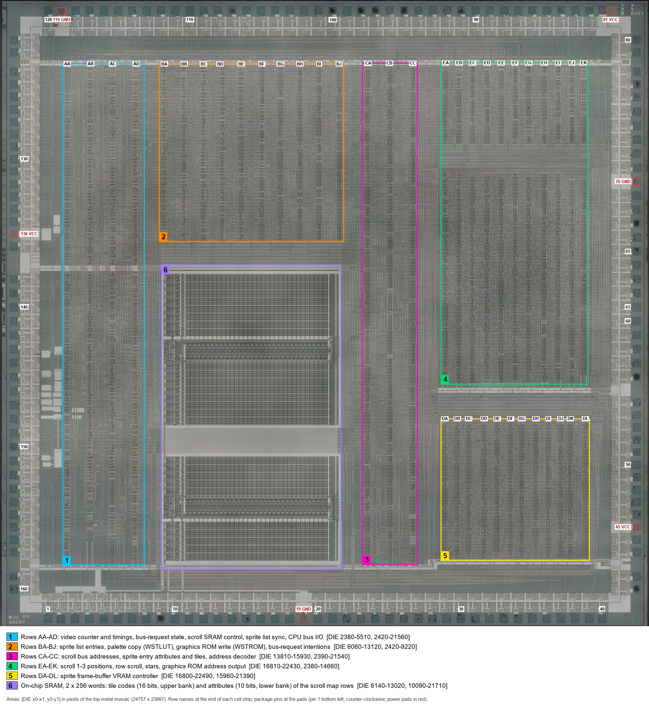</a>
    </td>
    <td align="center" style="padding: 10px;">
      <a href="doc/die/views/capcom_dl0311_die_layers.jpg">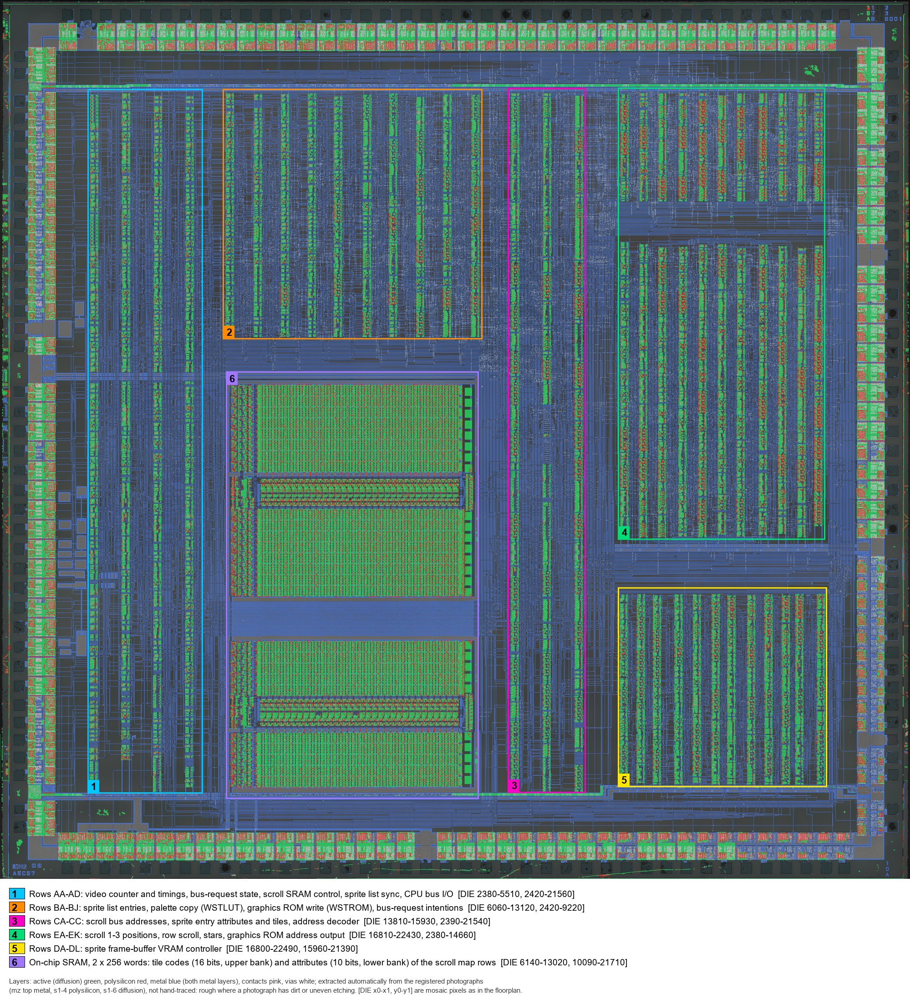</a>
    </td>
    <td align="center" style="padding: 10px;">
      <a href="doc/die/views/capcom_dl0311_die_areas.jpg">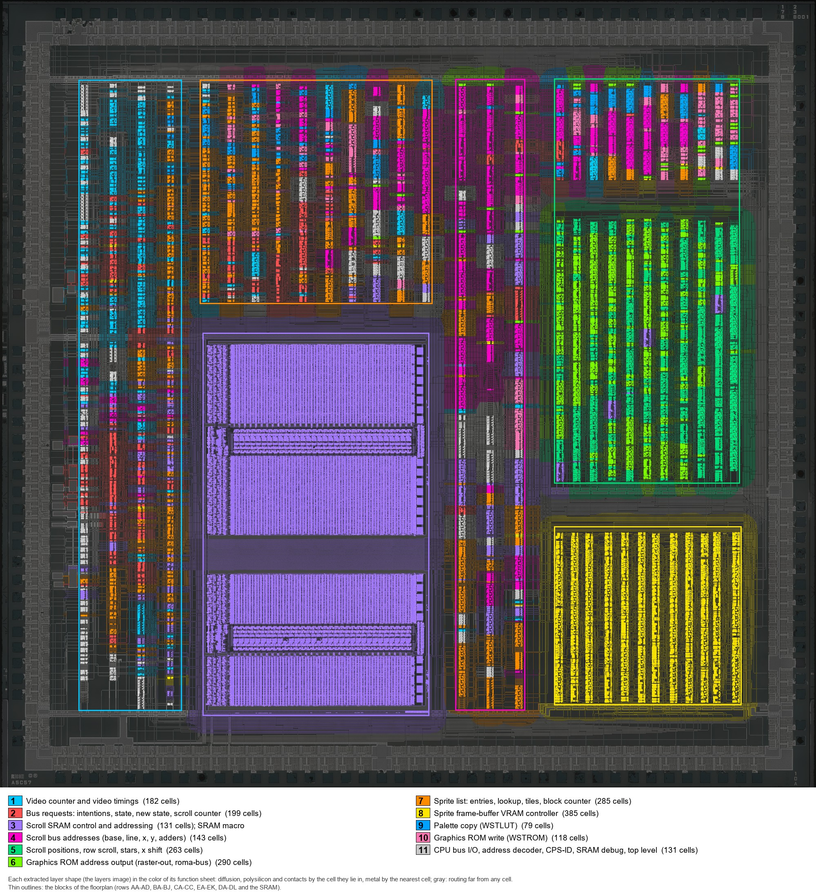</a>
    </td>
  </tr>
  <tr>
    <td align="center"><b>Block Floorplan</b></td>
    <td align="center"><b>Extracted Layers</b></td>
    <td align="center"><b>Cells By Function</b></td>
  </tr>
  <tr>
    <td align="center" style="padding: 10px;">
      <a href="doc/die/photos/5x/capcom_dl-0311_unknown_mz_5x.jpg">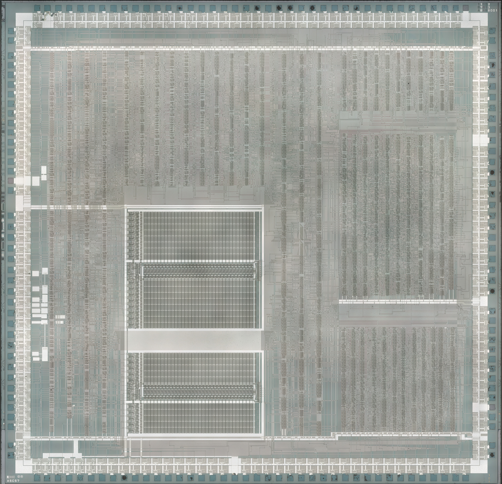</a>
    </td>
    <td align="center" style="padding: 10px;">
      <a href="doc/die/photos/5x/capcom_dl-0311_unknown_s1-3_5x.jpg">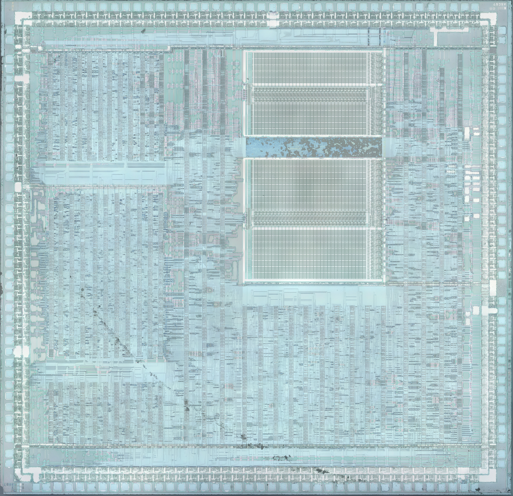</a>
    </td>
    <td align="center" style="padding: 10px;">
      <a href="doc/die/photos/5x/capcom_dl-0311_unknown_s1-6_5x.jpg">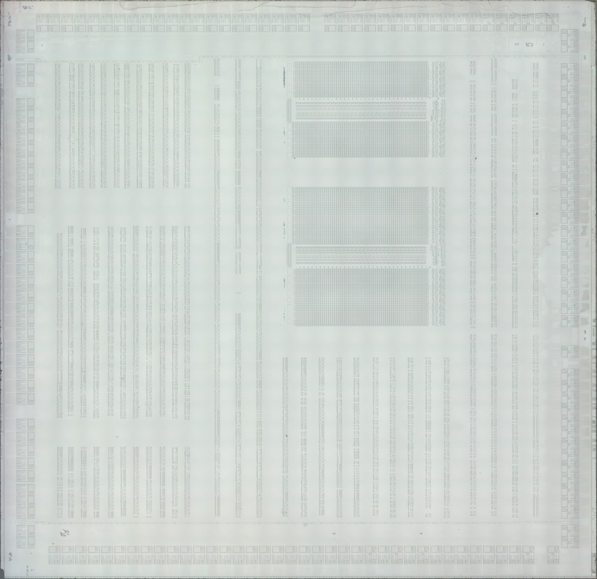</a>
    </td>
  </tr>
  <tr>
    <td align="center"><b>Top Metal</b></td>
    <td align="center"><b>Delayering Step 3</b></td>
    <td align="center"><b>Delayering Step 6</b></td>
  </tr>
  <tr>
    <td align="center" style="padding: 10px;">
      <a href="doc/die/views/capcom_dl0311_die_wires_5x.jpg">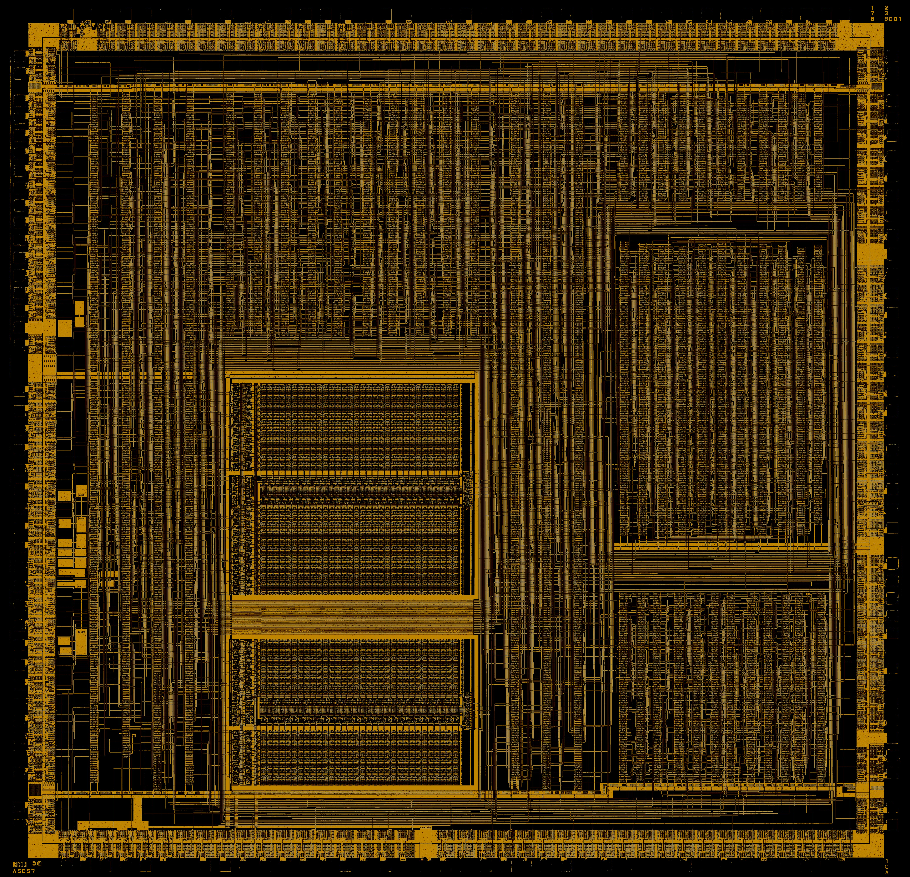</a>
    </td>
    <td align="center" style="padding: 10px;">
      <a href="doc/die/views/capcom_dl0311_die_wires_on_s1-6_5x.jpg">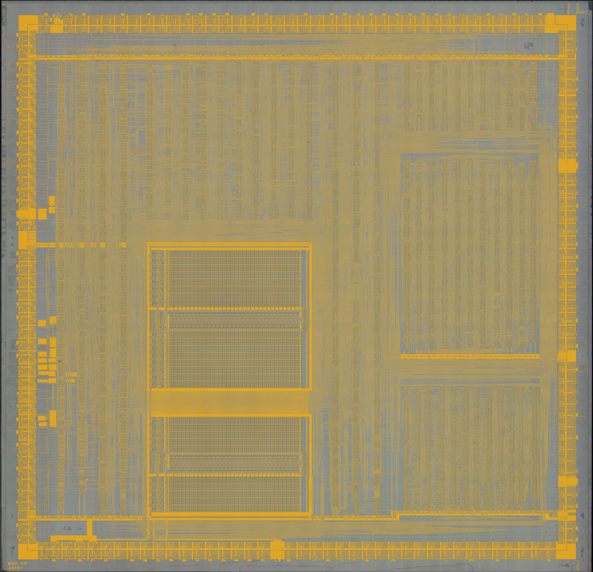</a>
    </td>
    <td align="center" style="padding: 10px;">
      <a href="doc/die/views/capcom_dl0311_die_poly_on_s1-6_5x.jpg">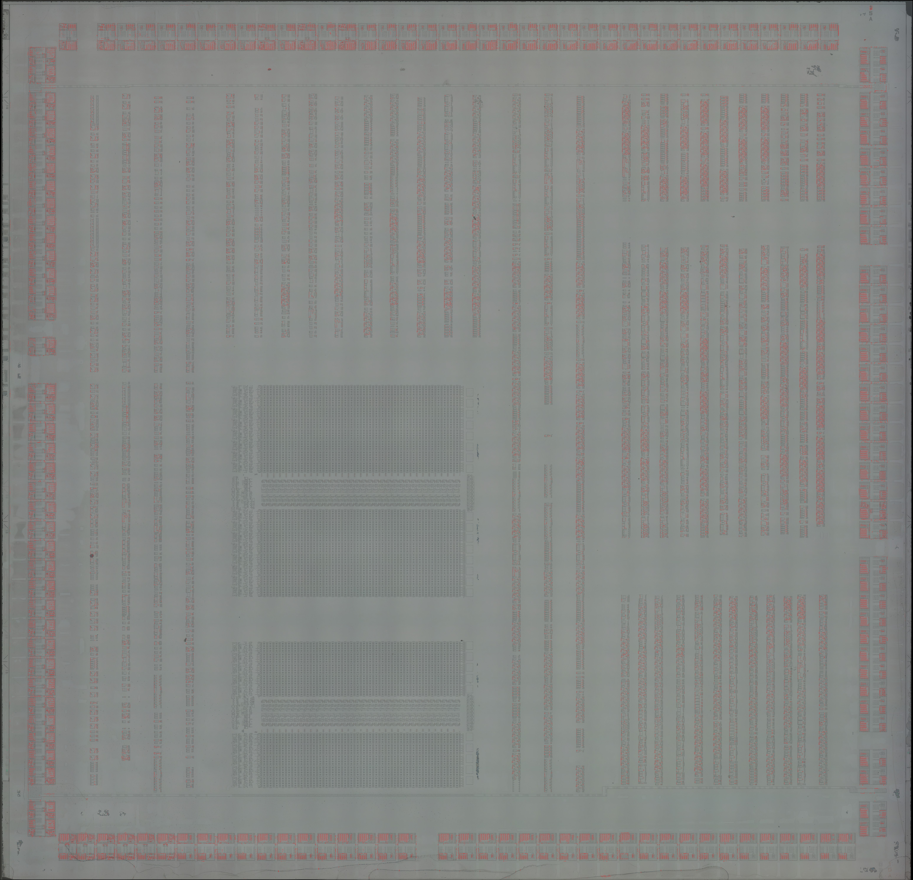</a>
    </td>
  </tr>
  <tr>
    <td align="center"><b>Wires</b></td>
    <td align="center"><b>Wires On Step 6</b></td>
    <td align="center"><b>Poly On Step 6</b></td>
  </tr>
</table>

## Module Hierarchy

| Module | Description | Lines |
|--------|-------------|-------|
| `capcom_cps_a_01.v` | Top-level wrapper: port surface with the chip's pins by name, `CEN` / `CEN_F`, the bidirectional pins as input, output and output enable, the power pads tied | ~383 |
| `capcom_dl0311.v` | Synchronous netlist: the 160 pads; video counter and timings; bus requests (intentions, state, new state, scroll counter); scroll positions, row scroll and stars; scroll bus addresses and the scroll SRAM; sprite list entries, lookup, tiles and block counter; graphics ROM address output; frame buffer controller; palette copy and graphics ROM write; address decoder, CPS-ID and CPU bus I/O; the clock enables and the charge-storage holds | ~24739 |
| `capcom_dl0311_cells.v` | Cell library: the 58 Ricoh A5C cell types (buffers, gates, AND-OR and OR-AND gates, adders, tri-state drivers, multiplexers, decoders, flip-flops, registers, latches, the SRAM banks), the latches as pass-and-hold, the cells with enables | ~1684 |

## Traced Netlist

The netlist is a single flat module with the chip's 160 pads as its ports, in package order and named by pin number and signal, where a leading n_ marks an active-low pin. The cells are grouped by functional block, with one connection per line. A separate cell library defines the 58 cell types, one module per type, covering buffers, logic gates, AND-OR and OR-AND gates, adders, tri-state drivers, multiplexers, decoders, flip-flops, registers, latches and the two SRAM banks. Every cell output has a gate delay of 0.1 ns, and every register output a further 2 ns.

The nets are declared by kind.

<small>

- **Nets**: one driver each.
- **Wired-OR Nets**: the 6 nets with several drivers ORed on the die.
- **Charge-Storage Nets**: the 193 tri-state nets that hold their value while no driver is on.
- **Pads**: each pad joined to its net; the CPU data bus (CD0-CD15), the CPU address bus (CA1-CA23) and /RD are bidirectional, the chip driving them while it is bus master, and CK125 and CK250 are each driven by two buffers.

</small>

### Trace Corrections

The netlist starts from Loïc "WydD" Petit's KiCad trace of the DL-0311, published in [cps2-reverse](https://gitlab.com/loic.petit/cps2-reverse) (commit `cbd37b3`). The trace records the cells and their wiring sheet by sheet, but as published it does not work as a chip. Simulated with the CPS-B-21 on a model of the board, its bus request never changes, no scroll fetch ever ends, the sprite list is read from the wrong area and nothing is written to the sprite frame buffer, among the faults below.

Most of the faults showed up when the simulated frames were compared with MAME, and the rest came from reading the die. Each was traced to the wires or cells responsible and then checked on the die photographs, so every correction below is what the silicon shows, not a fit to the emulator. With all of them in place the simulated frames match MAME's. The cells the corrections retype are also marked in the [cell zoo](doc/zoo/README.md).

| Correction | Where | Why |
|------------|-------|-----|
| The bus-request state's ~CLK4M sheet pin on the ~CLK4M net | Bus requests, the clock of UBH40 | As traced it sat on the reset rail, so /BR never changed |
| The spare inputs of the four scroll-end decoders on VCC | Scroll counter, UCB458, UCC469, UEA272 and UEA280 | On GND they held the decoders off, so no scroll fetch ever ended |
| UEH16 is an AND04 | Scroll Y, UEH16 | As a NAND04 it turned the scroll Y address drivers on outside the scroll and star slots, against the sprite driver on CB0-4 |
| Each column inverter's output on the ~COL net of its own input | Frame buffer timing, UDJ87, UDK98, UDK99, UDL87, UDL88 and UDL61 | The output labels ran in reverse, so each ~COLn came from COL(10-n) and the write, precharge and CAS timing fell on the wrong columns |
| Address bit 14 of the sprite list from UAC285's Q | Sprite list address, the second input of UAC290 | From ~Q the entries were read from the lookup area and the lookup from the entries |
| The frame buffer X and Y counter buses crossed back | Frame buffer write address, WX-C and WY-C | As traced the pixel counter moved the row and the slot counter the column, so every slot wrote one cell 16 times |
| The frame buffer's palette bits on the _CB bus | The top sheet, the _CB input of the frame buffer controller | As traced the bus ran to the tile row address, so the frame buffer stored the tile row in place of the palette |
| The high Y tile counter on ~CLK8M4M | Frame buffer write address, UDE89 and UDG109 | On the 8 MHz clock it stepped twice per tile row, so the second row of a sprite landed 32 lines down |
| Pads 61 to 65 carry XS0 to XS4 | The pads, from UED72, UEG71, UEH66, UEJ38 and UEI65 | The pad labels ran in reverse, against the pinout and the A-board drawing |
| UBH130 is an M368C | Palette copy address, UBH130 | As a non-inverting M367C the palette copy read from 0x600000 instead of 0x900000 |
| LUTPRO on the other input of UAD440 and UBA52 | Palette protect, UAD440 and UBA52 | The die wiring, with the same logic |
| Four OR02 are NOR02 | Frame buffer controller, UDL42, UDK36, UDL83 and UDI44 | As OR02 every RAS cycle was a transfer so nothing was written, both CAS selectors fired on every pixel, and the display transfer started at the wrong column, putting the sprites 4 pixels behind the scroll layers |
| The frame bank toggle clocked at 4 MHz | Frame buffer write data, UDD88 | On the 8 MHz clock it took SCAN-243 twice and flipped twice, so the banks never swapped |
| UDL97 takes WRITE-MODE from UDK53's Q3 | Frame buffer controller, UDL97 | From ~Q3 the raster clear reached both banks and erased the sprites |
| COL4 on the OR pair of the two serial-clock gates | Frame buffer serial control, UDJ72 and UDJ77 | As traced the drawn bank's serial clock flipped on FWE and COL4, and the displayed bank's followed SPRITE-X0 |
| The tile offset buses in counting order, and the block counters' address outputs in reverse | Sprite block counters, the adders UBI50, UBI155, UCB333, UBG100, UBG63 and UBF52, and UBI0 and UEE254 | As traced the tile counters counted from their top bit, so a two-tile sprite fetched its second tile eight tiles on |
| The first tile X stage toggles on the slot signal | Scroll positions, UEG167, UEF57 and UEA33 | As traced it toggled outside the layer's slot, so every fetch of a line read SRAM address 0 |
| The bus-request decoder's two buffer outputs exchanged | Bus request state, UCB330 and UCB349 | As traced the scroll 1 request used the scroll 3 base, stride and SRAM area, and the scroll 3 request scroll 1's |
| The scroll SRAM write half on LINE3, LINE4 and ~LINE5 | SRAM write address, UBG0 and UBG10 | As traced two of four scroll 1 rows and every other scroll 2 row read a half that was never written |
| The new-state logic on STATE0 and ~ROWSCROLL | Bus request new state, UAB168 and UAC203 | As traced the sprite fetch repeated for a whole burst, and Ghouls'n Ghosts lost its scroll 2 and 3 rows |
| The scroll 2 X register in bit order at its adder | Scroll 2 row scroll, UEK53, UEJ63 and UEI26 | As traced the nibble was reversed, and Ghouls'n Ghosts' scroll 2 landed 7 pixels off |
| The staged tile row on channel A and the live one on channel B | Graphics ROM address bits 0 to 2, UEE10 and UEG11 | As traced each 8x8 tile of a pair took its partner's row and Y flip, and the corners of Varth's text box came out unflipped |

## Cell Zoo

The [cell zoo](doc/zoo/README.md) has a folder for each of the 58 cell types, with one instance of the cell on the die at top metal and after two delayering steps, what it does, how it was read and its model in the cell library. 50 cells are confirmed against their drawings in the trace, 6 are confirmed with fixes and 2 are original, read from the die where the trace has no drawing.

<p align="center">
  <a href="doc/zoo/SSR256_16/SSR256_16_die.jpg">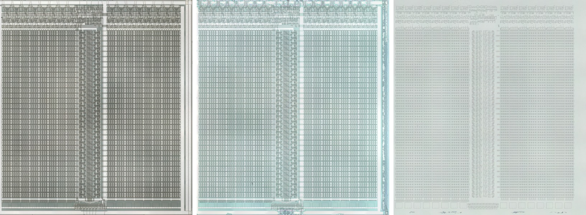</a>
</p>

<p align="center"><i>(<a href="doc/zoo/SSR256_16/README.md">SSR256_16, the 16-bit bank of the scroll SRAM read from the die, at top metal and after delayering steps 3 and 6</a>)</i></p>

## Synchronous Netlist

The synchronous netlist keeps all 2208 cells and their connections in a form that synthesis tools accept. It adds 101 gates, copies of the logic that makes the internal clocks, to build the register enables.

<small>

- **Pads**: Each input and output pad is a port of the same direction. The 40 bidirectional pads, the CPU data and address buses and /RD, each have separate input, output and output-enable ports. CK125 and CK250, each driven by two buffers on the die, are outputs.
- **Tri-State and Wired-OR Nets**: Each tri-state net is the OR of its enabled drivers, and each wired-OR net is the OR of all its drivers.
- **Latches**: The four latches on the CPU write strobe, the address latches L and L4LH and the two L8L data latches, pass their input while open and hold the value they had when they closed.
- **SRAM**: The two banks of the scroll SRAM, 256 words of 16 and 10 bits, take their address and write on the rise of `CLK` with an enable each, the form a block RAM takes.
- **Clocks**: Every register is clocked by CLK (see [Clocking](#clocking)).
- **Asynchronous Clears**: Two of the chip's resets are decoded by gates whose inputs can change together, one from SCAN-243 for the sprite block registers and one from FI for the row-scroll registers. Both are held in registers on CLK that follow them at every edge of the chip clock, so a glitch of either gate cannot reach the 15 registers they clear. These registers see each change of their reset at the next edge of the chip clock, and the held resets power up asserted.
- **Charge Storage**: Each of the 193 charge-storage nets follows its drivers while one is enabled and otherwise holds the last driven value, kept in a register that loads on CEN.
- **Delays**: The cell delays apply only when SIMULATION is defined. Net names that contain a vertical bar in the traced netlist use a slash instead.

</small>

## Clocking

CLK, on pin 4, is the chip's 16 MHz clock input. The chip divides it down to 8 and 4 MHz, puts those out on CK125 and CK250, and derives the clocks of its blocks from them, among them the video counter's column bit that clocks the graphics ROM write counter. The remaining registers are clocked by the CPU write strobe and the address decode.

In the synchronous netlist CLK is the system clock, at least twice the chip's 16 MHz, and every register loads on its rising edge. CEN is high on the CLK cycles where the chip clock rises and CEN_F on those where it falls. A register on an internally generated clock loads on the CEN where that clock has its edge, through an enable built from copies of the gates that generate the clock. A register on the CPU write strobe or the address decode loads on the first CEN_F after its clock edge. Apart from the registers on the held resets, every register loads the same values on the same chip clock cycles as in the traced netlist, provided the pins meet the [bus timing rules](#bus-timing-rules).

## Control Interface

### Chip Ports (capcom_cps_a_01)

| Signal | Direction | Width | Description |
|--------|-----------|-------|-------------|
| `CLK` | Input | 1 | System clock, at least twice the chip's 16 MHz |
| `CEN` | Input | 1 | Clock enable on the chip's clock rising |
| `CEN_F` | Input | 1 | Clock enable on the chip's clock falling |
| `RESETn` | Input | 1 | Reset (active low) |
| `RESETIn` | Output | 1 | Reset to the CPS-B-21 (active low) |
| `CSn` | Input | 1 | CPU chip select (active low) |
| `WRn` | Input | 1 | CPU write strobe (active low) |
| `RDn_IN` | Input | 1 | CPU read strobe in (active low) |
| `RDn_OUT` | Output | 1 | CPU read strobe out, while the chip is bus master (active low) |
| `RDn_OE` | Output | 1 | CPU read strobe output enable |
| `CA_IN` | Input | [23:1] | CPU address in |
| `CA_OUT` | Output | [23:1] | CPU address out, as bus master |
| `CA_OE` | Output | [23:1] | CPU address output enables, one per pad |
| `CD_IN` | Input | 16 | CPU data in |
| `CD_OUT` | Output | 16 | CPU data out |
| `CD_OE` | Output | 1 | CPU data output enable |
| `BRn` | Output | 1 | Bus request to the 68000 (active low) |
| `BGACKn` | Input | 1 | Bus grant acknowledge (active low) |
| `HSYNC` | Input | 1 | Horizontal sync input |
| `VSYNC` | Input | 1 | Vertical sync input |
| `FI` | Output | 1 | Frame interrupt |
| `LI` | Output | 1 | Line interrupt |
| `FLIP` | Output | 1 | Screen flip |
| `CK125` | Output | 1 | 8 MHz clock (125 ns) |
| `CK250` | Output | 1 | 4 MHz clock (250 ns) |
| `XS` | Output | 5 | Scroll X shift to the CPS-B-21 |
| `XSEL` | Output | 1 | XS select |
| `CB` | Output | 5 | Color bank of the tile or sprite |
| `CPC` | Output | 2 | Graphics channel |
| `CDEN` | Output | 1 | Graphics data enable |
| `OBJEO` | Output | 1 | Sprite priority test enable |
| `OBJUPn` | Output | 1 | /OBJUP (active low) |
| `FRAME` | Output | 1 | Frame buffer bank on display |
| `REWENn` | Input | 1 | Frame buffer write enable from the CPS-B-21 (active low) |
| `WSTROMn` | Output | 1 | Graphics ROM write strobe (active low) |
| `WSTLUT` | Output | 1 | Palette copy |
| `WSTOBJn` | Output | 1 | Sprite list copy (active low) |
| `LUTPRO` | Output | 1 | Palette protect |
| `AA` | Output | 8 | Frame buffer bank A address |
| `ACASn` | Output | 2 | Bank A /CAS (active low) |
| `ASOEn` | Output | 2 | Bank A serial output enables (active low) |
| `ASCKn` | Output | 1 | Bank A serial clock (active low) |
| `ADTOEn` | Output | 1 | Bank A DT/OE (active low) |
| `AD` | Output | [12:4] | Bank A data |
| `FWEn` | Output | 1 | Frame buffer write enable (active low) |
| `FRASn` | Output | 1 | Frame buffer /RAS (active low) |
| `BA` | Output | 8 | Frame buffer bank B address |
| `BCASn` | Output | 2 | Bank B /CAS (active low) |
| `BSOEn` | Output | 2 | Bank B serial output enables (active low) |
| `BSCKn` | Output | 1 | Bank B serial clock (active low) |
| `BDTOEn` | Output | 1 | Bank B DT/OE (active low) |
| `BD` | Output | [12:4] | Bank B data |
| `ROMA` | Output | 23 | Graphics ROM address |
| `PLWED` | Output | 4 | PL0WED-PL3WED |
| `TESTn` | Input | [3:1] | Test inputs (active low) |

`CD_OE` is the CD0 pad enable, shared by the bus. `CA_OE` has one enable per pad, CA1-CA11 sharing /RD's and CA12-CA23 one of their own.

## Design Usage

### Clock Enables

CEN and CEN_F are made from the system clock. With a 96 MHz CLK and the chip's 16 MHz clock, CEN is high on one CLK cycle in six and CEN_F three cycles after it, so the two are three cycles apart either way.

```verilog
reg [2:0] cen_cnt = 3'd0;

always @(posedge clk_sys) begin
    cen_cnt <= (cen_cnt == 3'd5) ? 3'd0 : cen_cnt + 3'd1;
end

wire cen16   = (cen_cnt == 3'd0);
wire cen16_f = (cen_cnt == 3'd3);
```

### Instantiation Example

```verilog
capcom_cps_a_01 u_cpsa (
    // Clock and Reset
    .CLK     ( clk_sys     ),
    .CEN     ( cen16       ),
    .CEN_F   ( cen16_f     ),
    .RESETn  ( reset_n     ),
    .RESETIn ( reseti_n    ),

    // CPU Bus
    .CSn     ( cpsa_cs_n   ),
    .WRn     ( wr_n        ),
    .RDn_IN  ( rd_n        ),
    .RDn_OUT ( cpsa_rd_n   ),
    .RDn_OE  ( cpsa_rd_oe  ),
    .CA_IN   ( cpu_a[23:1] ),
    .CA_OUT  ( cpsa_a      ),
    .CA_OE   ( cpsa_a_oe   ),
    .CD_IN   ( cpu_dout    ),
    .CD_OUT  ( cpsa_dout   ),
    .CD_OE   ( cpsa_doe    ),
    .BRn     ( br_n        ),
    .BGACKn  ( bgack_n     ),

    // Video Timing
    .HSYNC   ( 1'b1        ),
    .VSYNC   ( 1'b1        ),
    .FI      ( fi          ),
    .LI      ( li          ),
    .FLIP    ( flip        ),
    .CK125   ( ck125       ),
    .CK250   ( ck250       ),

    // CPS-B-21 Interface
    .XS      ( xs          ),
    .XSEL    ( xsel        ),
    .CB      ( cb          ),
    .CPC     ( cpc         ),
    .CDEN    ( cden        ),
    .OBJEO   ( objeo       ),
    .OBJUPn  ( objup_n     ),
    .FRAME   ( frame       ),
    .REWENn  ( rewen_n     ),
    .WSTROMn ( wstrom_n    ),
    .WSTLUT  ( wstlut      ),
    .WSTOBJn ( wstobj_n    ),
    .LUTPRO  ( lutpro      ),

    // Frame Buffer
    .AA      ( aa          ),
    .ACASn   ( acas_n      ),
    .ASOEn   ( asoe_n      ),
    .ASCKn   ( asck_n      ),
    .ADTOEn  ( adtoe_n     ),
    .AD      ( ad          ),
    .FWEn    ( fwe_n       ),
    .FRASn   ( fras_n      ),
    .BA      ( ba          ),
    .BCASn   ( bcas_n      ),
    .BSOEn   ( bsoe_n      ),
    .BSCKn   ( bsck_n      ),
    .BDTOEn  ( bdtoe_n     ),
    .BD      ( bd          ),

    // Graphics ROM
    .ROMA    ( roma        ),
    .PLWED   ( plwed       ),

    // Test
    .TESTn   ( 3'b111      )
);
```

### Timing Constraints

`capcom_dl0311.qip` adds `hdl/sdc/capcom_dl0311.sdc`, so every design that includes the IP reads it. It finds the netlist by its module name and relaxes the paths between its registers, which all load on CEN or CEN_F. The paths into and out of the chip are left to the design. The design gives one number in its own SDC, the fewest CLK cycles between a CEN and the next CEN_F, which is one half of the chip clock.

```tcl
# ===================================================================================================
# CPS-A-01 clock enables
# ===================================================================================================
# The chip clock runs at 16 MHz on a 96 MHz system clock, so CEN and CEN_F alternate every 3 system
# clocks. capcom_dl0311.sdc relaxes the chip's own paths.
# ===================================================================================================
set capcom_dl0311_cen_div 3
```

| Path | Setup | Hold |
|------|-------|------|
| Netlist registers to each other | `capcom_dl0311_cen_div` | `capcom_dl0311_cen_div` - 1 |

<small>

- **Read Order**: The design's SDC must be read before `capcom_dl0311.sdc`, so its `SDC_FILE` line goes above the `QIP_FILE` line that brings in the IP. A design that does not set `capcom_dl0311_cen_div` gets a critical warning and no relaxation.
- **Ratio**: The shortest gap between a CEN and a CEN_F. With a fractional divider, use the shortest gap.
- **Chip Pins**: The paths into and out of the netlist are constrained in the design's SDC. Registers in the design that load on the same enables can be given the same window.

</small>

### Bus Timing Rules

<small>

- **Inputs**: Every input is sampled on a CEN or CEN_F and is expected to change just after one, as the CPS-B-21 and the CPU bus logic of a core drive them.
- **Asynchronous Inputs**: The CPU strobes (/CS, /WR and /RD) must hold each level for at least one period of the chip clock so that a CEN_F samples it. A shorter pulse, which would clock the traced netlist, is not seen.
- **CPU Bus**: Registering CSn, WRn, RDn_IN, CA_IN and CD_IN into the chip, and CD_OUT and CD_OE out of it, on CEN and CEN_F puts every bus path between registers on the same enables, which the design's SDC can relax to the same window.
- **Bus Grant**: While BGACKn is low the chip is bus master and fetches the scroll maps, the sprite list and the palette from the GFX RAM over CD. CD_IN then comes straight from the bus, not through registers on CEN and CEN_F, so each word reaches the chip within the read cycle that fetches it.

</small>

## Device Usage

The figures below are from a standalone compile of the synchronous netlist in Quartus 22.1std, with its ports as virtual pins, a 96 MHz clock, and the IP's SDC set for three clocks between CEN and CEN_F (a 16 MHz chip clock). The two banks of the scroll SRAM map to two M10Ks.

### Cyclone V 5CSEBA6U23I7

| Module | ALMs | ALUTs | Registers | Block Memory Bits | M10K | DSP |
|--------|------|-------|-----------|-------------------|------|-----|
| `capcom_dl0311` | 706.0 (1.7%) | 1,154 | 887 | 6,656 | 2 | 0 |

Fmax 202.72 MHz. At 96 MHz the setup slack is +16.450 ns and the hold slack +0.140 ns.

### Cyclone V 5CEBA4F23C8

| Module | ALMs | ALUTs | Registers | Block Memory Bits | M10K | DSP |
|--------|------|-------|-----------|-------------------|------|-----|
| `capcom_dl0311` | 704.5 (3.8%) | 1,153 | 887 | 6,656 | 2 | 0 |

Fmax 172.95 MHz. At 96 MHz the setup slack is +13.903 ns and the hold slack +0.157 ns.

## Project Structure

```
capcom_dl0311/
├── doc/
│   ├── die/
│   │   ├── photos/
│   │   │   ├── 5x/
│   │   │   │   ├── capcom_dl-0311_unknown_mz_5x.jpg             # Whole die, top metal
│   │   │   │   ├── capcom_dl-0311_unknown_s1-2_5x.jpg           # Whole die, delayering step 2
│   │   │   │   ├── capcom_dl-0311_unknown_s1-3_5x.jpg           # Whole die, delayering step 3
│   │   │   │   ├── capcom_dl-0311_unknown_s1-4_5x.jpg           # Whole die, delayering step 4
│   │   │   │   └── capcom_dl-0311_unknown_s1-6_5x.jpg           # Whole die, delayering step 6
│   │   │   └── 20x/
│   │   │       ├── capcom_dl-0311_unknown_mz_mit20x.zip.001     # Whole die, top metal (two parts)
│   │   │       ├── capcom_dl-0311_unknown_mz_mit20x.zip.002
│   │   │       ├── capcom_dl-0311_unknown_s1-2_mit20x.zip.001   # Whole die, delayering step 2 (two parts)
│   │   │       ├── capcom_dl-0311_unknown_s1-2_mit20x.zip.002
│   │   │       ├── capcom_dl-0311_unknown_s1-3_mit20x.zip.001   # Whole die, delayering step 3 (two parts)
│   │   │       ├── capcom_dl-0311_unknown_s1-3_mit20x.zip.002
│   │   │       ├── capcom_dl-0311_unknown_s1-4_mit20x.zip.001   # Whole die, delayering step 4 (two parts)
│   │   │       ├── capcom_dl-0311_unknown_s1-4_mit20x.zip.002
│   │   │       ├── capcom_dl-0311_unknown_s1-6_mit20x.zip.001   # Whole die, delayering step 6 (two parts)
│   │   │       └── capcom_dl-0311_unknown_s1-6_mit20x.zip.002
│   │   └── views/
│   │       ├── capcom_dl0311_die_areas.jpg                      # Cells by function
│   │       ├── capcom_dl0311_die_floorplan.jpg                  # Block floorplan
│   │       ├── capcom_dl0311_die_layers.jpg                     # Extracted layers
│   │       ├── capcom_dl0311_die_poly_on_s1-6_5x.jpg            # Poly over delayering step 6, 5x
│   │       ├── capcom_dl0311_die_wires_5x.jpg                   # Wires, 5x
│   │       └── capcom_dl0311_die_wires_on_s1-6_5x.jpg           # Wires over delayering step 6, 5x
│   ├── readme/
│   │   └── tb_capcom_dl0311_log.md                              # Per-test output of the frame standard
│   └── zoo/
│       ├── <cell>/                                              # One folder per cell type (58)
│       │   ├── README.md                                        # The cell's page
│       │   ├── <cell>_die.jpg                                   # One instance on the die, three layers
│       │   ├── <cell>_drawing.png                               # The drawing it was identified by, where one exists
│       │   └── <cell>_drawing_pins.png                          # The drawing with pin numbers, where one exists
│       └── README.md                                            # Index of the 58 cell types
├── hdl/
│   ├── capcom_dl0311.v                                          # Synchronous netlist
│   ├── capcom_dl0311_cells.v                                    # Synchronous netlist's cell library
│   ├── sdc/
│   │   └── capcom_dl0311.sdc                                    # Timing constraints (clock enables)
│   └── netlist/
│       ├── capcom_dl0311.v                                      # Traced netlist
│       └── capcom_dl0311_cells.v                                # Traced netlist's cell library
├── img/
│   ├── 20261104_capcom_dl0311.png                               # ModelSim wave window, sf2hf
│   ├── coc_banner.png
│   └── sf2hf_3900.png                                           # Standard frame beside MAME's snapshot
├── sim/
│   ├── tb_capcom_dl0311.v                                       # System testbench
│   ├── hitachi_hm53461.v                                        # Frame buffer row model
│   ├── scripts/
│   │   ├── run_tb.py                                            # Prepare, compile, run, render and score
│   │   ├── frames.txt                                           # Standard frames, one per romset
│   │   ├── games.py                                             # Per-romset configuration, from games.json
│   │   ├── games.json                                           # Mapper, CPS-B registers, layer enables and keys
│   │   ├── build_gfxrom.py                                      # Graphics ROM image from the romset zip
│   │   ├── gfxloads.json                                        # Graphics ROM load lists
│   │   ├── dump_frames.lua                                      # MAME script, frame state and snapshot
│   │   ├── ref_render.py                                        # Reference render of a frame state
│   │   ├── render_cap.py                                        # Frame from the testbench captures
│   │   ├── luta_diff.py                                         # Layer scores against the reference
│   │   ├── pal_check.py                                         # Palette score
│   │   ├── prio_check.py                                        # Composite score
│   │   └── compare.py                                           # Frame beside MAME's snapshot
│   └── output/
├── capcom_cps_a_01.v                                            # Top-level wrapper
├── capcom_dl0311.qip                                            # Quartus project include file
└── README.md
```

## Design Verification

The system testbench simulates the CPS1 video system at gate level. It models the A-, B- and C-boards with the CPS-A-01 and CPS-B-21 netlists running from one 16 MHz clock, together with the GFX RAM on the CPU bus, the graphics ROM through the game's PAL, the palette RAM and the sprite frame buffer of four HM53461 rows, two per bank. Each run loads one frame of game state, writes the chips' registers over the CPU bus after reset, and records the palette address on every clock along with the palette RAM and the frame buffer at each frame interrupt.

<small>

- **Standard Frames**: One gameplay frame from each of the 156 supported romsets, 32 parents and 124 clones, 110 of them run with the CPS-B-21's configuration key shifted in before reset and the rest in its default mode. Each frame is rendered, scored layer by layer against a reference frame rendered from the same game state, and set beside MAME's snapshot of that frame. All 156 match their reference exactly in every layer, the palette and the final image, with the stars of Forgotten Worlds and Lost Worlds matched apart from their blink step, which follows each machine's own frame count. Twelve of the frames were also compared with the reference simulation and were identical to it, capture for capture.
- **Synchronous Netlist**: Twelve frames of the standard give the same images, scores and captures as the traced netlist, with one difference. The frame buffer words that the first frame writes while their data is still unknown keep more of their bits unknown than in the traced netlist, and the next frame overwrites them.

</small>

The testbench is run from the IP root with the user's own MAME romsets and MAME, and takes the CPS-B-21 netlist from the capcom_dl0921 module beside this one. For each romset the script makes the frame state once. The graphics ROM image comes from the romset zip, the GFX RAM and the chip registers at the frame and MAME's snapshot of it come from a MAME run with `dump_frames.lua`, and the reference render follows from them. The output has a folder for each romset, with the frame, its captures, the frame beside MAME's snapshot and the frame state, and a summary of the scores of every run. The scripts need Python 3 with Pillow, ModelSim and MAME, and the romset folder holds MAME's merged romsets, a clone's files in its parent's zip.

```
python sim/scripts/run_tb.py --roms <romsets> --mame <MAME>   prepare, compile, run, render and score
python sim/scripts/run_tb.py --prepare --roms ... --mame ...   the frame states only
python sim/scripts/run_tb.py --only sf2hf sf2ua                any supported setnames
python sim/scripts/run_tb.py --jobs 16                         sixteen at a time (default)
```

<table align="center">
  <tr>
    <td align="center" style="padding: 10px;">
      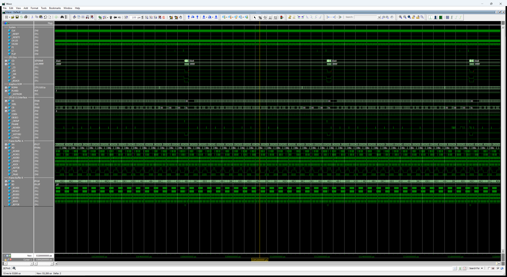
    </td>
  </tr>
</table>

```
=========================================================
  tb_capcom_dl0311 results: 156 / 156 passed (0 failed)
=========================================================
  ALL TESTS PASSED
```

Per-test output: [tb_capcom_dl0311](doc/readme/tb_capcom_dl0311_log.md)

A frame of the standard is shown below, beside MAME's snapshot.

<p align="center">
  <a href="img/sf2hf_3900.png"></a>
</p>

<p align="center"><i>(Street Fighter II': Hyper Fighting, World 921209)</i></p>

## Design References

- [CAPCOM DL-0311 KiCad Die Trace and Ricoh A5C Cell Drawings, cps2-reverse (commit cbd37b3), Loïc "WydD" Petit, CC BY](https://gitlab.com/loic.petit/cps2-reverse)<br>
  <small><i>(Referenced for the cell types and the sheet and net names; every cell, connection and pad of the netlist was retraced and verified against the die)</i></small>
- [CAPCOM DL-0311 (CPS-A-01) Die Photographs, John McMaster](https://siliconpr0n.org/map/capcom/dl-0311/)<br>
  <small><i>(The whole die at top metal and after four delayering steps, traced to verify the netlist)</i></small>
- [ArcadeHacker_CPS1: CPS1 Desuicider, Eduardo Cruz (ArcadeHacker)](https://github.com/ArcadeHacker/ArcadeHacker_CPS1)<br>
  <small><i>(The CPS-B-21 configuration research and the keys used in the gate-level simulation)</i></small>

## License

This work is licensed under the [Creative Commons Attribution-NonCommercial 4.0 International License](../../LICENSE) (CC BY-NC 4.0). You may use, share, and modify this code for non-commercial purposes, provided that proper credit is given.

## Support

Please consider supporting this and future projects by joining the [**Coin-Op Collection Patreon**](https://www.patreon.com/atrac17).

---
