# CAPCOM DL-0921 (CPS-B-21) Gate-Level Netlist

<table align="center">
  <tr>
    <td align="center" style="padding: 10px;">
      
    </td>
  </tr>
</table>

## CAPCOM DL-0921 (CPS-B-21) Overview

This is a gate-level Verilog netlist of the CP System's video mixer, traced from the die and checked against it cell by cell. The CAPCOM DL-0921 (CPS-B-21) contains 1809 Ricoh A5C gate-array cells, every connection between them and its 160 pads. The chip combines the scroll layers, sprites and starfield into the palette address of each pixel, and also provides the raster interrupts, the multiplier and the battery-backed configuration key.

The CAPCOM DL-0921 (CPS-B-21) netlist is provided in two forms. The synchronous netlist keeps every cell and connection of the die, with all registers clocked from a single system clock, for use in FPGA-based applications. The traced netlist is retained for simulation and models the latches, charge-storage nets and internally generated clocks as they are on the silicon.

### Features

<small>

- **Gate-Level Netlist**: 1809 cells of 74 types, each in the module's own cell library, on the 160 pads in package order, with pads 86 and 87 as the die bonds them. The nets are as on the silicon, with the pad joins, the charge-storage and wired-OR nets, the latches and the clocks made by logic.
- **Synchronous Netlist**: The same cells and connections. The pads are inputs, outputs and `_IN` / `_OUT` / `_OE`, the tri-state and wired-OR nets are ORs of their drivers, the latches are registers or pass-and-hold, and every register loads on the rise of `CLK` with `CEN` or `CEN_F` in its enable. The 461 charge-storage nets are held on `CLK`, and the cell delays apply only under `SIMULATION`.
- **System Testbench**: The netlist with the CPS-A-01 netlist, the frame buffer, the graphics ROM and the palette RAM, loaded with one frame of game state. One gameplay frame from each of the 156 supported romsets comes out exact, with the configuration key shifted in through the security pins.
- **Die Images**: The floorplan of the cell rows, the cells by function and the extracted layers, on photographs of the die.
- **Cell Zoo**: A page for each of the 74 cell types, with the cell on the die at three layers, what it does, how it was read and its model in the cell library.

</small>

## Table of Contents

| # | Section | Description |
|---|---------|-------------|
| 1 | [System Architecture](#system-architecture) | Block diagram of the CPS-B-21: scroll layers, sprites, stars, layer assembly, video timing, CPU bus, security; die imaging |
| 2 | [Module Hierarchy](#module-hierarchy) | Source-file listing with each module's role and approximate line count |
| 3 | [Traced Netlist](#traced-netlist) | Cells, pads and nets of the traced netlist, and the corrections to the trace |
| 4 | [Cell Zoo](#cell-zoo) | The 74 cell types on the die, how each was read, and its model |
| 5 | [Synchronous Netlist](#synchronous-netlist) | What the synchronous netlist changes, and what it keeps |
| 6 | [Clocking](#clocking) | `CLK` and the registers' enables |
| 7 | [Configuration Key](#configuration-key) | Loading the 144-bit key through the security pins |
| 8 | [Control Interface](#control-interface) | Verilog port-level reference: `capcom_cps_b_21` ports |
| 9 | [Design Usage](#design-usage) | Clock enables, instantiation example, timing constraints and bus timing rules |
| 10 | [Device Usage](#device-usage) | FPGA resource usage, timing and Fmax of a standalone compile on two Cyclone V parts |
| 11 | [Project Structure](#project-structure) | Directory tree of the IP package |
| 12 | [Design Verification](#design-verification) | The system testbench, its board model and its checks |
| 13 | [Design References](#design-references) | The die trace and the die photographs |
| 14 | [License](#license) | Creative Commons Attribution-NonCommercial 4.0 International |
| 15 | [Support](#support) | Back ongoing Coin-Op Collection FPGA core development on Patreon |

## System Architecture

```
┌───────────────────────────────────────────────────────────────────────────────────────────┐
│                                       capcom_dl0921                                       │
│                                                                                           │
│  ┌─────────────────────────┐   ┌─────────────────────────┐   ┌─────────────────────────┐  │
│  │    Scroll Layers 1-3    │   │         Sprites         │   │          Stars          │  │
│  │                         │   │                         │   │                         │  │
│  │ ROM data latches        │   │ graphics data latches   │   │ star counters           │  │
│  │ shift registers, color  │   │ sprite data bus         │   │ row assembly            │  │
│  │ fine-scroll delay       │   │ frame buffer FAD / FBD  │   │ from the ROM data       │  │
│  └─────────────────────────┘   └─────────────────────────┘   └─────────────────────────┘  │
│                                                                                           │
│  ┌─────────────────────────────────────────────────────────────────────────────────────┐  │
│  │                                    Layer Assembly                                   │  │
│  │                                                                                     │  │
│  │ layer control, draw order, priority masks and transparency, LUT storage, LUT I/O    │  │
│  │ the palette address LUTA from the scroll layers, the sprites and the stars          │  │
│  └─────────────────────────────────────────────────────────────────────────────────────┘  │
│                                                                                           │
│  ┌─────────────────────────┐   ┌─────────────────────────┐   ┌─────────────────────────┐  │
│  │       Video Timing      │   │         CPU Bus         │   │         Security        │  │
│  │                         │   │                         │   │                         │  │
│  │ 8 / 4 MHz dividers      │   │ bus control, registers  │   │ configuration key       │  │
│  │ video counter, syncs    │   │ raster interrupts       │   │ address decoder         │  │
│  │ blanks, ~CLK8M, CK500   │   │ multiplier, CPS-ID      │   │ security check          │  │
│  │ palette copy            │   │ palette control         │   │ key inject              │  │
│  └─────────────────────────┘   └─────────────────────────┘   └─────────────────────────┘  │
└───────────────────────────────────────────────────────────────────────────────────────────┘
```

### CAPCOM DL-0921 (CPS-B-21) Imaging

Three views of the die show the floorplan of its cell rows and blocks with the package pins at the pads, the layers extracted from the photographs, and every cell colored by the function it belongs to. Below them are the photographs of the whole die as decapped and after two delayering steps, and the die folder also has close-ups of the key section and of a register area. The last row shows the wires extracted from the top-metal photograph, on their own and over the last delayering step, and the poly extracted from that step.

<table align="center">
  <tr>
    <td align="center" style="padding: 10px;">
      <a href="doc/die/views/capcom_dl0921_die_floorplan.jpg">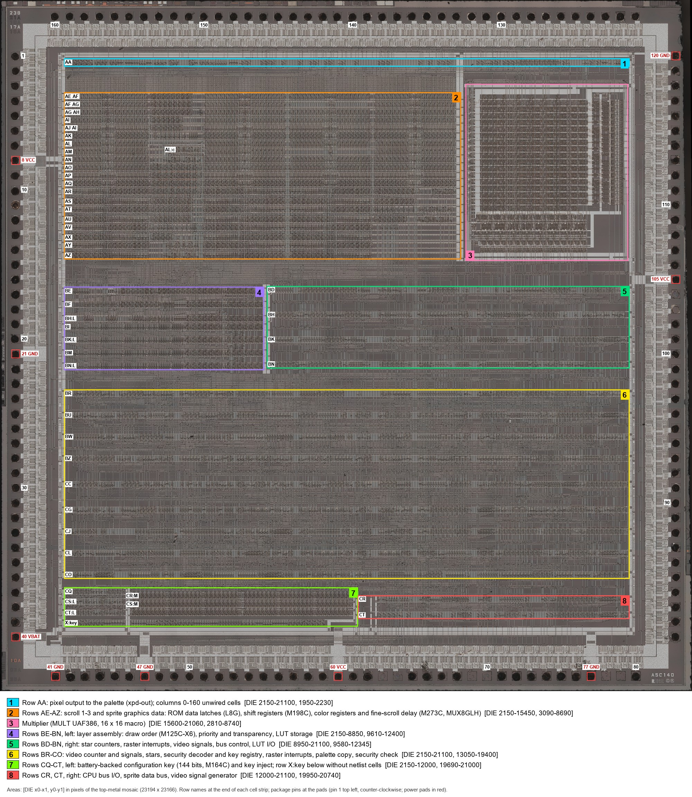</a>
    </td>
    <td align="center" style="padding: 10px;">
      <a href="doc/die/views/capcom_dl0921_die_layers.jpg">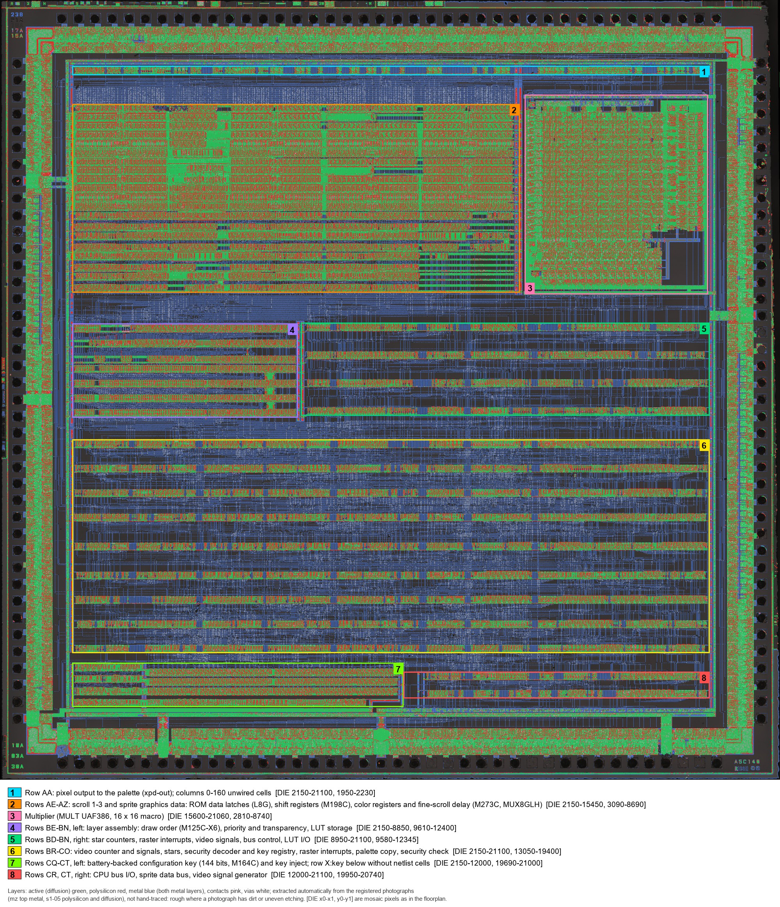</a>
    </td>
    <td align="center" style="padding: 10px;">
      <a href="doc/die/views/capcom_dl0921_die_areas.jpg">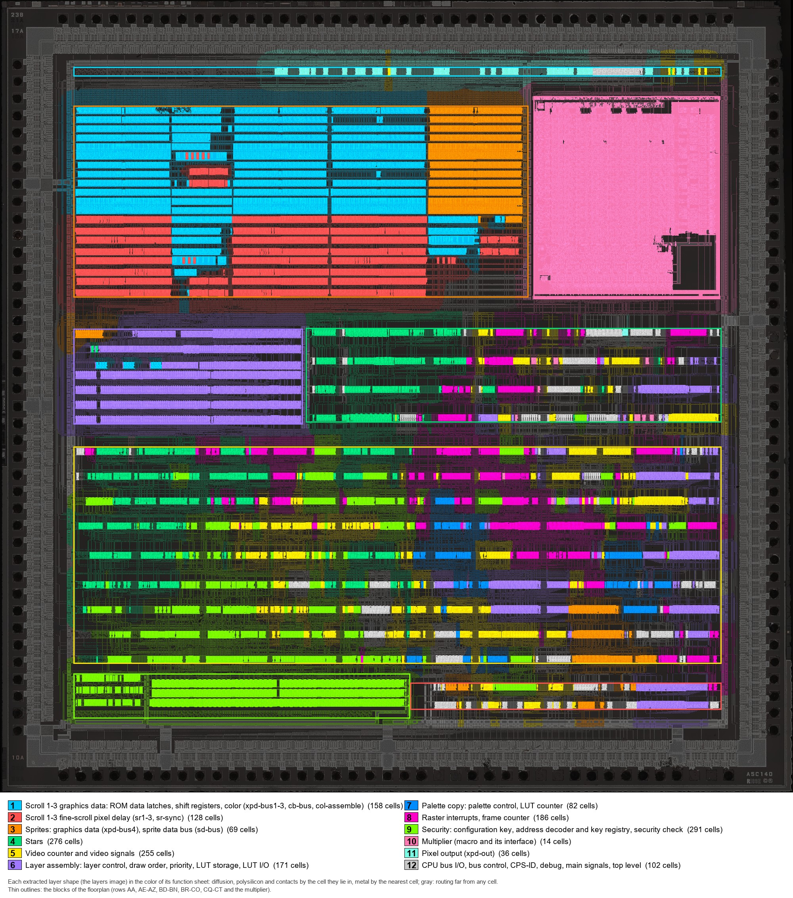</a>
    </td>
  </tr>
  <tr>
    <td align="center"><b>Block Floorplan</b></td>
    <td align="center"><b>Extracted Layers</b></td>
    <td align="center"><b>Cells By Function</b></td>
  </tr>
  <tr>
    <td align="center" style="padding: 10px;">
      <a href="doc/die/photos/5x/capcom_cps-b-21_1bd_46_mz_5x.jpg">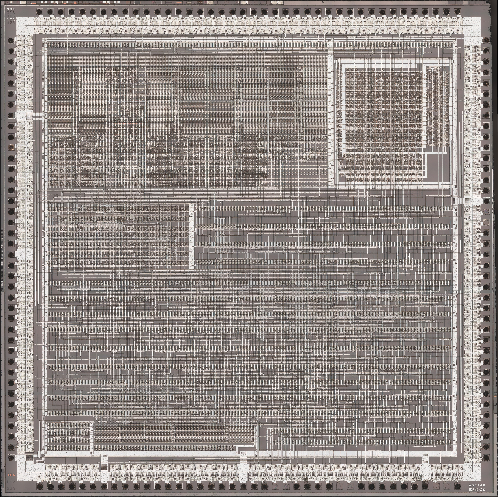</a>
    </td>
    <td align="center" style="padding: 10px;">
      <a href="doc/die/photos/5x/capcom_cps-b-21_1bd_46_s1-03_5x.jpg">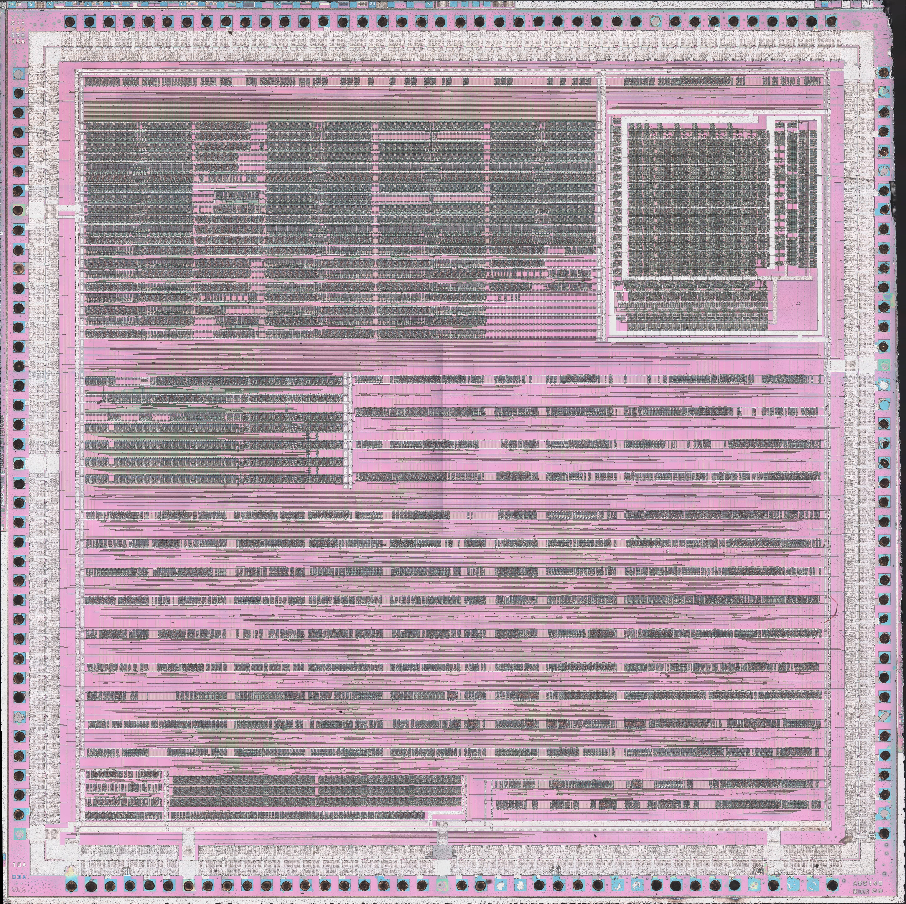</a>
    </td>
    <td align="center" style="padding: 10px;">
      <a href="doc/die/photos/5x/capcom_cps-b-21_1bd_46_s1-05_5x.jpg">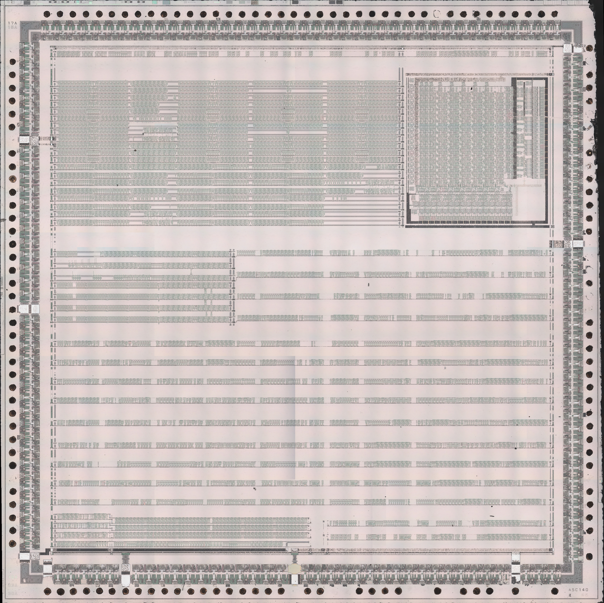</a>
    </td>
  </tr>
  <tr>
    <td align="center"><b>Top Metal</b></td>
    <td align="center"><b>Delayering Step 3</b></td>
    <td align="center"><b>Delayering Step 5</b></td>
  </tr>
  <tr>
    <td align="center" style="padding: 10px;">
      <a href="doc/die/views/capcom_dl0921_die_wires_5x.jpg">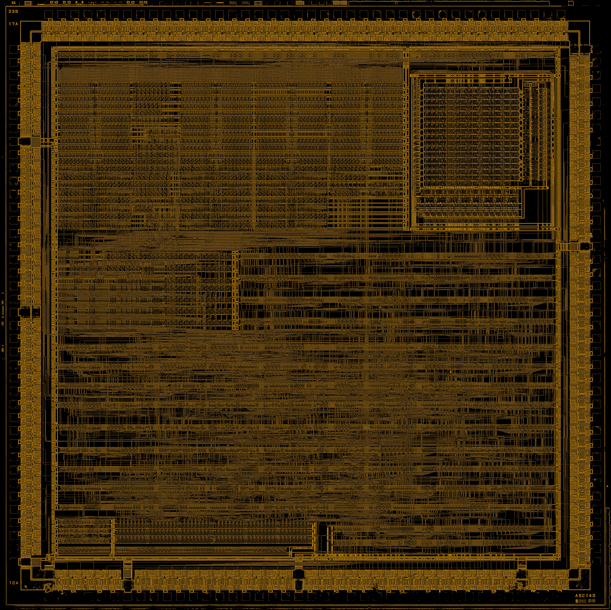</a>
    </td>
    <td align="center" style="padding: 10px;">
      <a href="doc/die/views/capcom_dl0921_die_wires_on_s1-05_5x.jpg">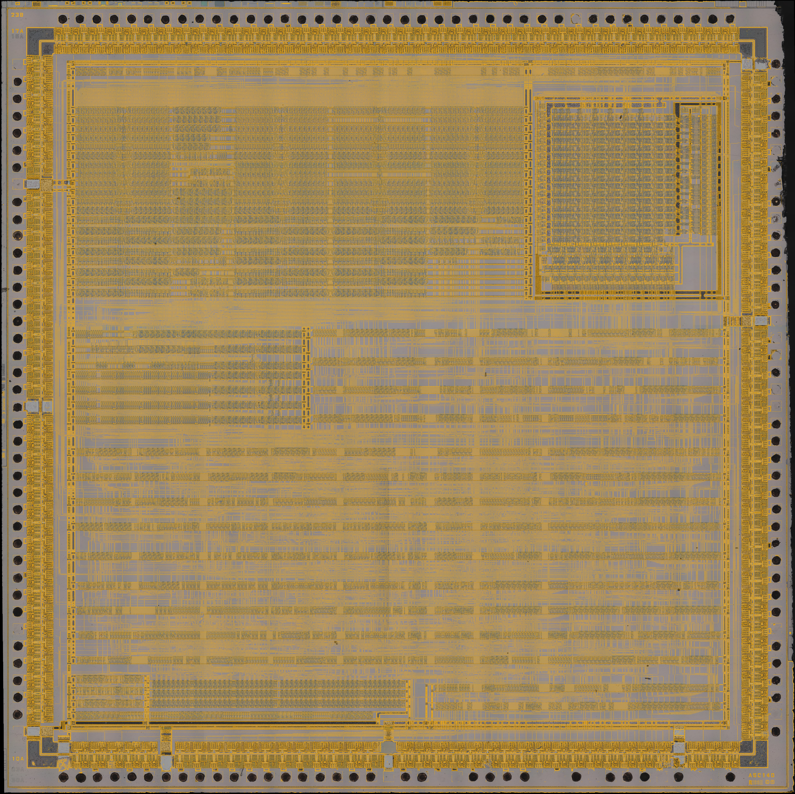</a>
    </td>
    <td align="center" style="padding: 10px;">
      <a href="doc/die/views/capcom_dl0921_die_poly_on_s1-05_5x.jpg">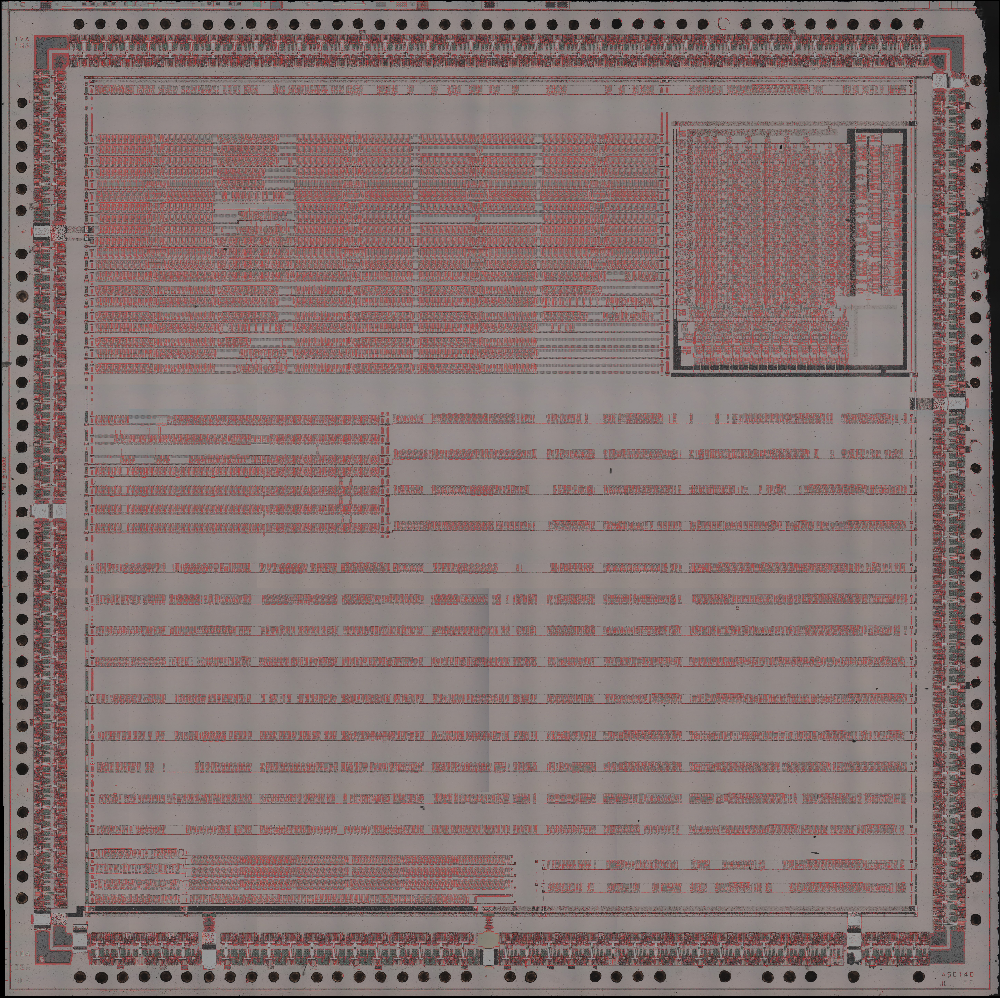</a>
    </td>
  </tr>
  <tr>
    <td align="center"><b>Wires</b></td>
    <td align="center"><b>Wires On Step 5</b></td>
    <td align="center"><b>Poly On Step 5</b></td>
  </tr>
</table>

## Module Hierarchy

| Module | Description | Lines |
|--------|-------------|-------|
| `capcom_cps_b_21.v` | Top-level wrapper: port surface with the chip's pins by name, `CEN` / `CEN_F`, the bidirectional pins as input, output and output enable, the power pads tied | ~419 |
| `capcom_dl0921.v` | Synchronous netlist: the 160 pads; scroll layers 1-3 (ROM data latches, shift registers, color, fine scroll); sprites (graphics data, sprite data bus); stars; video counter and signals; layer assembly (layer control, draw order, priority and transparency, LUT storage); palette copy; raster interrupts; security (configuration key, address decoder, security check); multiplier; pixel output; CPU bus I/O; the clock enables and the charge-storage holds | ~27522 |
| `capcom_dl0921_cells.v` | Cell library: the 74 Ricoh A5C cell types (buffers, gates, AND-OR and OR-AND gates, tri-state drivers, multiplexers, decoders, flip-flops, registers, latches, multiplier), the latches as registers, the cells with enables | ~2638 |

## Traced Netlist

The netlist is a single flat module with the chip's 160 pads as its ports, in package order and named by pin number and signal, where a leading underscore marks an active-low pin. The cells are grouped by functional block, with one connection per line. A separate cell library defines the 74 cell types, one module per type, covering buffers, logic gates, AND-OR and OR-AND gates, tri-state drivers, multiplexers, decoders, flip-flops, registers, latches and the multiplier. Every cell output has a gate delay of 0.1 ns, and every register output a further 2 ns.

The nets are declared by kind.

<small>

- **Nets**: one driver each.
- **Wired-OR Nets**: the 9 nets with several drivers ORed on the die.
- **Charge-Storage Nets**: the 461 tri-state nets that hold their value while no driver is on.
- **Pads**: each pad joined to its net; the CPU data bus (CD0-CD15) and the graphics ROM data (APD-DPD) are bidirectional.

</small>

### Trace Corrections

The netlist starts from Loïc "WydD" Petit's KiCad trace of the DL-0921, published in [cps2-reverse](https://gitlab.com/loic.petit/cps2-reverse) (commit `cbd37b3`). The trace records the cells and their wiring sheet by sheet, but as published it does not work as a chip. Simulated with the CPS-A-01 on a model of the board, it never runs the palette copy, never lets scroll 1 or 2 reach the palette address, and loads no register once a configuration key is used, among the faults below.

Most of the faults showed up when the simulated frames were compared with MAME, and the rest came from reading the die. Each was traced to the wires or cells responsible and then checked on the die photographs, so every correction below is what the silicon shows, not a fit to the emulator. With all of them in place the simulated frames match MAME's, apart from the stars of a flipped screen, where MAME's own placement is a placeholder. The cells the corrections retype or redefine are also marked in the [cell zoo](doc/zoo/README.md).

| Correction | Where | Why |
|------------|-------|-----|
| The object-manager sheet pins TD and ~DEBUG put back in place | The top sheet | As drawn they were swapped against every other sheet, shorting the debug decoder to the sprite read-back buffers |
| The latched address labels renamed LCA1 to LCA5 | The address decoder | The labels also named the bit-reversed CA bus of the key registry, shorting CA1 to CA5 and CA2 to CA4 |
| Pad 88 on WSTLUT, the D input of UCG480 | The pads and the palette control | As traced pad 88 sat on a net that never changes, so the palette copy never ran |
| Clock and clear swapped back on six of the twelve layer-order flip-flops | Layer control, UBE86, UBE90, UBE95, UBE99, UBE104 and UBE108 | As traced draw rows 1 to 3 always selected sprites, and scroll 1 and 2 never reached the palette address |
| The video counter, the 1-pixel blanking terms and the load-strobe phase gates on NOT CLK8M | The 17 video-counter flip-flops, UCJ257 and UCL272, UBK330 and UBK414 | As traced they ran on the 4 MHz clock, half a cycle off, which moved the sprites and the scroll layers against the screen |
| The blanking and sync chain on the 8 MHz pixel clock | UBH331, the clock of the blanking and sync flip-flops | As traced it ran on the 4 MHz net, so each stage delayed two pixels and the picture sat 4 pixels left |
| The long and short fine-scroll delay paths exchanged | Scroll 2 and 3, UAK103 and UAK107, UAV306 and UAV308 | As traced the long path served the wrong half of the fine-scroll values, switching the color 8 pixels from the tile edge |
| The scroll-3 fine-scroll counter loads on GFX-CHNL | Scroll 3, UAF249 | As traced it loaded 6 pixel clocks late, switching the color late at every tile edge |
| The scroll-2 fine-scroll counter loads on the scroll-3 load net | Scroll 2, UAL119 and UAL121 | As traced it took the tile flip bit |
| The key registry's address inputs in reverse order | The 85 comparator inputs of the key registry on the CA bus | As traced no register landed where the game writes it once a key was loaded |
| The graphics ROM data bits reversed at the latch rows | The D pins of the 32 latch rows on the graphics ROM data buses | The leftmost pixel of every tile and sprite is in bit 7, and the shift registers load straight |
| The 32 tri-state latch rows are L8GH | The output rows of the graphics ROM data buses | Their metal swaps the cell's two gate lines, so they are transparent while pin 1 is high |
| The L8 latch is transparent while pin 1 is high | The L8 cell | It was first taken to work like the L8G, transparent while pin 1 is low |
| The ten star gates are XNOR02 | Stars, UBW131 to UBW142 and UBR218 to UBR229 | As XOR02 every star sat at the mirrored position in its block |
| Counter 3's bit 0 is an XOR02 | Raster counter 3, UBW384 | It sets the column of the raster interrupt and the read-back of bit 0 |
| Cell types as the die shows them | Four M125C-X6 with three slices, twelve NBUF02 that are INV01, UCO137 and UCO332 as NBUF03, 27 BUF12 that are BUF01, and six BUF12 that are rows of BUF11 units | The cells as built, with no change of function |
| The star counters clocked from UBR271 | The 24 star-counter flip-flops | The die wires them to UBR271's output, the same signal as traced |
| The layer-control read-back bits in die order | UBU80 and UBU83 | BUS1 goes onto IN0 and BUS2 to BUS5 onto IN1 to IN4, the same logic |

## Cell Zoo

The [cell zoo](doc/zoo/README.md) has a folder for each of the 74 cell types, with one instance of the cell on the die at top metal and after two delayering steps, what it does, how it was read and its model in the cell library. 52 cells are confirmed against their drawings in the trace, 7 are confirmed with fixes, 3 are corrected on the die and 12 are original, read from the die where the trace has no drawing.

<p align="center">
  <a href="doc/zoo/L8GH/L8GH_die.jpg">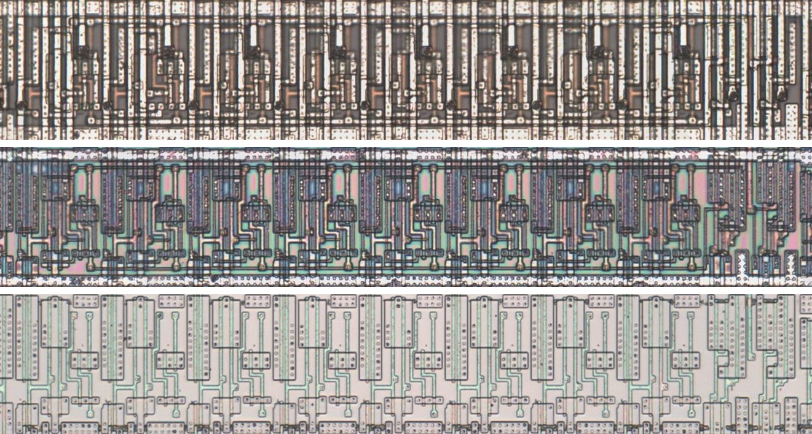</a>
</p>

<p align="center"><i>(<a href="doc/zoo/L8GH/README.md">L8GH, the eight-bit tri-state latch row corrected on the die, at top metal and after delayering steps 3 and 5</a>)</i></p>

## Synchronous Netlist

The synchronous netlist keeps all 1809 cells and their connections in a form that synthesis tools accept. It adds 72 gates, copies of the logic that makes the internal clocks, to build the register enables.

<small>

- **Pads**: Each input and output pad is a port of the same direction. The 48 bidirectional pads, the CPU data bus and the graphics ROM data, each have separate input, output and output-enable ports.
- **Tri-State and Wired-OR Nets**: Each tri-state net is the OR of its enabled drivers, and each of the 9 wired-OR nets is the OR of all its drivers.
- **Latches**: The 28 master / slave latch pairs are registers that load on the rise of their enable. The 21 latches that are read while open, in the pad, raster, security and CPU data groups, pass their input while open and hold the value they had when they closed. The two set / reset latches and the latch formed by two cross-coupled gates hold their state in a register on CLK.
- **Clocks**: Every register is clocked by CLK (see [Clocking](#clocking)).
- **Asynchronous Clears**: Two of the chip's resets are decoded by gates whose inputs can change together, one from RESET and the FI counter for the layer control, priority masks, palette control and raster counters, and one from SEC_E1n and SEC_E2 for the key load. Both are held in registers on CLK that follow them at every edge of the chip clock, so a glitch of either gate cannot reach the 72 registers they clear or set. These registers see each change of their reset at the next edge of the chip clock, and the held resets power up asserted.
- **Charge Storage**: Each of the 461 charge-storage nets follows its drivers while one is enabled and otherwise holds the last driven value, kept in a register that loads on CEN.
- **Delays**: The cell delays apply only when SIMULATION is defined. Net names that contain a vertical bar in the traced netlist use a slash instead.

</small>

## Clocking

CLK, on pin 110, is the chip's 16 MHz clock input. The chip divides it down to 8 and 4 MHz and derives ~CLK8M, /CK10, CK500 and the 4 MHz clocks from those. The remaining registers are clocked by the CPU strobes, LI, FI and the key port, and by gates and decodes of these signals.

In the synchronous netlist CLK is the system clock, at least twice the chip's 16 MHz, and every register loads on its rising edge. CEN is high on the CLK cycles where the chip clock rises and CEN_F on those where it falls. A register on an internally generated clock loads on the CEN where that clock has its edge, through an enable built from copies of the gates that generate the clock. A register on the CPU strobes, LI, FI or the key port loads on the first CEN_F after its clock edge. The key shift register is clocked by the key clock gated by a latch that the key clock itself sets, so its first edge comes after the CEN_F that samples the key clock. The netlist takes that edge on the next CEN_F, and every bit of the key is shifted in. Apart from the registers on the held resets, every register loads the same values on the same chip clock cycles as in the traced netlist, provided the pins meet the [bus timing rules](#bus-timing-rules).

## Configuration Key

The 144-bit configuration key sets the address of each of the chip's registers, the layout of its layer-control bits and the value its CPS-ID register returns. On the silicon it is written through the security pins and kept in battery-backed storage. The netlist takes the key the same way and holds it in registers, so a design loads the key after every power-up and can load it again at any time, as often as needed. With SEC_MODE0 and SEC_MODE1 high the chip runs in its default mode and needs no key.

<small>

- **Mode**: SEC_MODE0 and SEC_MODE1 low for a keyed configuration, high for the default mode.
- **Unlock**: CD0 and CD1 driven low, then SEC_E2 high and SEC_E1n low.
- **Strobes**: Four pulses on SEC_STROBE.
- **Key Bits**: 162 bits on CD0, each placed before CD1 rises and held until after it falls. The first 18 are the preamble 1, 0, 1, 0, 1, 1 and twelve 1s, followed by the 144 key bits, the key's first byte first and each byte most significant bit first.
- **Lock**: SEC_E2 low, then SEC_E1n high, and CD0 and CD1 released.
- **Timing**: Every level held for at least one period of the chip clock (see [Bus Timing Rules](#bus-timing-rules)).
- **VBAT**: Tied high.

</small>

## Control Interface

### Chip Ports (capcom_cps_b_21)

| Signal | Direction | Width | Description |
|--------|-----------|-------|-------------|
| `CLK` | Input | 1 | System clock, at least twice the chip's 16 MHz |
| `CEN` | Input | 1 | Clock enable on the chip's clock rising |
| `CEN_F` | Input | 1 | Clock enable on the chip's clock falling |
| `RESETIn` | Input | 1 | Reset (active low) |
| `CSn` | Input | 1 | CPU chip select (active low) |
| `RDn` | Input | 1 | CPU read strobe (active low) |
| `WRn` | Input | 1 | CPU write strobe (active low) |
| `CA` | Input | [5:1] | CPU address |
| `CD_IN` | Input | 16 | CPU data in |
| `CD_OUT` | Output | 16 | CPU data out |
| `CD_OE` | Output | 1 | CPU data output enable |
| `XS` | Input | 5 | CPS-A-01 XS bus |
| `XSEL` | Input | 1 | CPS-A-01 XSEL |
| `CB` | Input | 5 | CPS-A-01 CB bus |
| `CPC` | Input | 2 | CPS-A-01 CPC |
| `CDEN` | Input | 1 | CPS-A-01 CDEN |
| `FLIP` | Input | 1 | Screen flip |
| `FRAME` | Input | 1 | CPS-A-01 FRAME |
| `OBJEO` | Input | 1 | CPS-A-01 OBJEO |
| `FI` | Input | 1 | Frame interrupt |
| `LI` | Input | 1 | Line interrupt |
| `LUTPRO` | Input | 1 | CPS-A-01 LUTPRO |
| `WSTROMn` | Input | 1 | CPS-A-01 /WSTROM (active low) |
| `WSTLUT` | Input | 1 | CPS-A-01 WSTLUT |
| `REWENn` | Output | 1 | Frame buffer /REWEN (active low) |
| `OBJUPn` | Output | 1 | Raster interrupt /OBJUP (active low) |
| `ASD` | Input | 9 | Frame buffer bank A serial data |
| `BSD` | Input | 9 | Frame buffer bank B serial data |
| `FAD` | Output | 4 | Frame buffer bank A data |
| `FBD` | Output | 4 | Frame buffer bank B data |
| `APD_IN` / `BPD_IN` / `CPD_IN` / `DPD_IN` | Input | 8 each | Graphics ROM data in |
| `APD_OUT` / `BPD_OUT` / `CPD_OUT` / `DPD_OUT` | Output | 8 each | Graphics ROM data out |
| `XPD_OE` | Output | 1 | Graphics ROM data output enable |
| `ROMOEn` | Output | 1 | Graphics ROM output enable (active low) |
| `CK500n` | Output | 1 | /CK500 |
| `LUTA` | Output | 12 | Palette address |
| `LUTOEn` | Output | 1 | Palette RAM output enable (active low) |
| `LUTWRn` | Output | 1 | Palette RAM write (active low) |
| `CLK8Mn` | Output | 1 | ~CLK8M |
| `CK10n` | Output | 1 | /CK10 |
| `HSYNC` | Output | 1 | Horizontal sync |
| `HBLANKn` | Output | 1 | Horizontal blank (active low) |
| `VSYNC` | Output | 1 | Vertical sync |
| `VBLANKn` | Output | 1 | Vertical blank (active low) |
| `SEC_STROBE` | Input | 1 | Security STROBE |
| `SEC_E1n` | Input | 1 | Security /E1 (active low) |
| `SEC_E2` | Input | 1 | Security E2 |
| `SEC_MODE0` / `SEC_MODE1` | Input | 1 each | Security MODE0 / MODE1 |
| `VBAT` | Input | 1 | Battery supply of the key storage |
| `TI` | Input | 4 | Test inputs |
| `TD` | Output | 12 | Test data outputs |

`CD_OE` and `XPD_OE` are the CD0 and APD0 pad enables, each shared by its bus.

## Design Usage

### Clock Enables

CEN and CEN_F are made from the system clock. With a 96 MHz CLK and the chip's 16 MHz clock, CEN is high on one CLK cycle in six and CEN_F three cycles after it, so the two are three cycles apart either way.

```verilog
reg [2:0] cen_cnt = 3'd0;

always @(posedge clk_sys) begin
    cen_cnt <= (cen_cnt == 3'd5) ? 3'd0 : cen_cnt + 3'd1;
end

wire cen16   = (cen_cnt == 3'd0);
wire cen16_f = (cen_cnt == 3'd3);
```

### Instantiation Example

```verilog
capcom_cps_b_21 u_cpsb (
    // Clock and Reset
    .CLK        ( clk_sys      ),
    .CEN        ( cen16        ),
    .CEN_F      ( cen16_f      ),
    .RESETIn    ( reset_n      ),

    // CPU Bus
    .CSn        ( cpsb_cs_n    ),
    .RDn        ( rd_n         ),
    .WRn        ( wr_n         ),
    .CA         ( cpu_a[5:1]   ),
    .CD_IN      ( cpu_dout     ),
    .CD_OUT     ( cpsb_dout    ),
    .CD_OE      ( cpsb_doe     ),

    // CPS-A-01 Interface
    .XS         ( xs           ),
    .XSEL       ( xsel         ),
    .CB         ( cb           ),
    .CPC        ( cpc          ),
    .CDEN       ( cden         ),
    .FLIP       ( flip         ),
    .FRAME      ( frame        ),
    .OBJEO      ( objeo        ),
    .FI         ( fi           ),
    .LI         ( li           ),
    .LUTPRO     ( lutpro       ),
    .WSTROMn    ( wstrom_n     ),
    .WSTLUT     ( wstlut       ),
    .REWENn     ( rewen_n      ),
    .OBJUPn     ( objup_n      ),

    // Frame Buffer
    .ASD        ( asd          ),
    .BSD        ( bsd          ),
    .FAD        ( fad          ),
    .FBD        ( fbd          ),

    // Graphics ROM
    .APD_IN     ( rom_d[7:0]   ),
    .BPD_IN     ( rom_d[15:8]  ),
    .CPD_IN     ( rom_d[23:16] ),
    .DPD_IN     ( rom_d[31:24] ),
    .APD_OUT    (              ),
    .BPD_OUT    (              ),
    .CPD_OUT    (              ),
    .DPD_OUT    (              ),
    .XPD_OE     (              ),
    .ROMOEn     ( rom_oe_n     ),
    .CK500n     ( ck500_n      ),

    // Palette
    .LUTA       ( luta         ),
    .LUTOEn     ( lut_oe_n     ),
    .LUTWRn     ( lut_wr_n     ),

    // Video
    .CLK8Mn     ( clk8m_n      ),
    .CK10n      ( ck10_n       ),
    .HSYNC      ( hsync        ),
    .HBLANKn    ( hblank_n     ),
    .VSYNC      ( vsync        ),
    .VBLANKn    ( vblank_n     ),

    // Configuration
    .SEC_STROBE ( sec_strobe   ),
    .SEC_E1n    ( sec_e1_n     ),
    .SEC_E2     ( sec_e2       ),
    .SEC_MODE0  ( sec_mode0    ),
    .SEC_MODE1  ( sec_mode1    ),
    .VBAT       ( 1'b1         ),

    // Test
    .TI         ( 4'd0         ),
    .TD         (              )
);
```

### Timing Constraints

`capcom_dl0921.qip` adds `hdl/sdc/capcom_dl0921.sdc`, so every design that includes the IP reads it. It finds the netlist by its module name and relaxes the paths between its registers, which all load on CEN or CEN_F. The paths into and out of the chip are left to the design. The design gives one number in its own SDC, the fewest CLK cycles between a CEN and the next CEN_F, which is one half of the chip clock.

```tcl
# ===================================================================================================
# CPS-B-21 clock enables
# ===================================================================================================
# The chip clock runs at 16 MHz on a 96 MHz system clock, so CEN and CEN_F alternate every 3 system
# clocks. capcom_dl0921.sdc relaxes the chip's own paths.
# ===================================================================================================
set capcom_dl0921_cen_div 3
```

| Path | Setup | Hold |
|------|-------|------|
| Netlist registers to each other | `capcom_dl0921_cen_div` | `capcom_dl0921_cen_div` - 1 |

<small>

- **Read Order**: The design's SDC must be read before `capcom_dl0921.sdc`, so its `SDC_FILE` line goes above the `QIP_FILE` line that brings in the IP. A design that does not set `capcom_dl0921_cen_div` gets a critical warning and no relaxation.
- **Ratio**: The shortest gap between a CEN and a CEN_F. With a fractional divider, use the shortest gap.
- **Chip Pins**: The paths into and out of the netlist are constrained in the design's SDC. Registers in the design that load on the same enables can be given the same window.

</small>

### Bus Timing Rules

<small>

- **Inputs**: Every input is sampled on a CEN or CEN_F and is expected to change just after one, as the CPS-A-01 outputs do.
- **Asynchronous Inputs**: The CPU strobes, LI, FI and the key port (SEC_STROBE, SEC_E1n, SEC_E2, and CD0 and CD1 during the key load) must hold each level for at least one period of the chip clock so that a CEN_F samples it. A shorter pulse, which would clock the traced netlist, is not seen.
- **CPU Bus**: Registering CSn, RDn, WRn, CA and CD_IN into the chip, and CD_OUT and CD_OE out of it, on CEN and CEN_F puts every bus path between registers on the same enables, which the design's SDC can relax to the same window.

</small>

## Device Usage

The figures below are from a standalone compile of the synchronous netlist in Quartus 22.1std, with its ports as virtual pins, a 96 MHz clock, and the IP's SDC set for three clocks between CEN and CEN_F (a 16 MHz chip clock). The multiplier maps to one DSP block and a shift register to one M10K.

### Cyclone V 5CSEBA6U23I7

| Module | ALMs | ALUTs | Registers | Block Memory Bits | M10K | DSP |
|--------|------|-------|-----------|-------------------|------|-----|
| `capcom_dl0921` | 893.5 (2.1%) | 1,326 | 1,458 | 36 | 1 | 1 |

Fmax 197.59 MHz. At 96 MHz the setup slack is +16.066 ns and the hold slack +0.140 ns.

### Cyclone V 5CEBA4F23C8

| Module | ALMs | ALUTs | Registers | Block Memory Bits | M10K | DSP |
|--------|------|-------|-----------|-------------------|------|-----|
| `capcom_dl0921` | 881.0 (4.8%) | 1,326 | 1,458 | 36 | 1 | 1 |

Fmax 198.77 MHz. At 96 MHz the setup slack is +16.157 ns and the hold slack +0.163 ns.

## Project Structure

```
capcom_dl0921/
├── doc/
│   ├── die/
│   │   ├── photos/
│   │   │   ├── 5x/
│   │   │   │   ├── battery_area/
│   │   │   │   │   ├── battery_s1-00_5x.jpg                     # Key section, top metal
│   │   │   │   │   ├── battery_s1-03_5x.jpg                     # Key section, delayering step 3
│   │   │   │   │   └── battery_s1-05_5x.jpg                     # Key section, delayering step 5
│   │   │   │   ├── ram_ul/
│   │   │   │   │   └── ram_ul_5x.jpg                            # Upper-left register area, step 5
│   │   │   │   ├── capcom_cps-b-21_1bd_46_mz_5x.jpg             # Whole die, top metal
│   │   │   │   ├── capcom_cps-b-21_1bd_46_s1-03_5x.jpg          # Whole die, delayering step 3
│   │   │   │   ├── capcom_cps-b-21_1bd_46_s1-03_5x_roi.jpg      # Key section, step 3
│   │   │   │   └── capcom_cps-b-21_1bd_46_s1-05_5x.jpg          # Whole die, delayering step 5
│   │   │   └── 20x/
│   │   │       ├── battery_area.zip                             # Key section, three layers
│   │   │       ├── capcom_cps-b-21_1bd_46_mz_mit20x.zip.001     # Whole die, top metal (two parts)
│   │   │       ├── capcom_cps-b-21_1bd_46_mz_mit20x.zip.002
│   │   │       ├── capcom_cps-b-21_1bd_46_s1-03_mit20x.zip.001  # Whole die, delayering step 3 (two parts)
│   │   │       ├── capcom_cps-b-21_1bd_46_s1-03_mit20x.zip.002
│   │   │       ├── capcom_cps-b-21_1bd_46_s1-03_mit20x_roi.zip  # Key section, step 3
│   │   │       ├── capcom_cps-b-21_1bd_46_s1-05_mit20x.zip.001  # Whole die, delayering step 5 (two parts)
│   │   │       ├── capcom_cps-b-21_1bd_46_s1-05_mit20x.zip.002
│   │   │       └── ram_ul.zip                                   # Upper-left register area and its overlay
│   │   └── views/
│   │       ├── capcom_dl0921_die_areas.jpg                      # Cells by function
│   │       ├── capcom_dl0921_die_floorplan.jpg                  # Block floorplan
│   │       ├── capcom_dl0921_die_layers.jpg                     # Extracted layers
│   │       ├── capcom_dl0921_die_poly_on_s1-05_5x.jpg           # Poly over delayering step 5, 5x
│   │       ├── capcom_dl0921_die_wires_5x.jpg                   # Wires, 5x
│   │       └── capcom_dl0921_die_wires_on_s1-05_5x.jpg          # Wires over delayering step 5, 5x
│   ├── readme/
│   │   └── tb_capcom_dl0921_log.md                              # Per-test output of the frame standard
│   └── zoo/
│       ├── <cell>/                                              # One folder per cell type (74)
│       │   ├── README.md                                        # The cell's page
│       │   ├── <cell>_die.jpg                                   # One instance on the die, three layers
│       │   ├── <cell>_drawing.png                               # The drawing it was identified by
│       │   └── <cell>_drawing_pins.png                          # The drawing with pin numbers, where one exists
│       └── README.md                                            # Index of the 74 cell types
├── hdl/
│   ├── capcom_dl0921.v                                          # Synchronous netlist
│   ├── capcom_dl0921_cells.v                                    # Synchronous netlist's cell library
│   ├── sdc/
│   │   └── capcom_dl0921.sdc                                    # Timing constraints (clock enables)
│   └── netlist/
│       ├── capcom_dl0921.json                                   # Traced netlist, flat JSON
│       ├── capcom_dl0921.v                                      # Traced netlist
│       └── capcom_dl0921_cells.v                                # Traced netlist's cell library
├── img/
│   ├── 20261104_capcom_dl0921.png                               # ModelSim wave window, sf2hf
│   ├── coc_banner.png
│   └── sf2hf_3900.png                                           # Standard frame beside MAME's snapshot
├── sim/
│   ├── tb_capcom_dl0921.v                                       # System testbench
│   ├── hitachi_hm53461.v                                        # Frame buffer row model
│   ├── scripts/
│   │   ├── run_tb.py                                            # Prepare, compile, run, render and score
│   │   ├── frames.txt                                           # Standard frames, one per romset
│   │   ├── games.py                                             # Per-romset configuration, from games.json
│   │   ├── games.json                                           # Mapper, CPS-B registers, layer enables and keys
│   │   ├── build_gfxrom.py                                      # Graphics ROM image from the romset zip
│   │   ├── gfxloads.json                                        # Graphics ROM load lists
│   │   ├── dump_frames.lua                                      # MAME script, frame state and snapshot
│   │   ├── ref_render.py                                        # Reference render of a frame state
│   │   ├── render_cap.py                                        # Frame from the testbench captures
│   │   ├── luta_diff.py                                         # Layer scores against the reference
│   │   ├── pal_check.py                                         # Palette score
│   │   ├── prio_check.py                                        # Composite score
│   │   └── compare.py                                           # Frame beside MAME's snapshot
│   └── output/
├── capcom_cps_b_21.v                                            # Top-level wrapper
├── capcom_dl0921.qip                                            # Quartus project include file
└── README.md
```

## Design Verification

The system testbench simulates the CPS1 video system at gate level. It models the A-, B- and C-boards with the CPS-A-01 and CPS-B-21 netlists running from one 16 MHz clock, together with the GFX RAM on the CPU bus, the graphics ROM through the game's PAL, the palette RAM and the sprite frame buffer of four HM53461 rows, two per bank. Each run loads one frame of game state, writes the chip's registers over the CPU bus after reset, and records the palette address on every clock along with the palette RAM and the frame buffer at each frame interrupt.

<ins>**The testbench also takes the CPS-A-01 netlist from the CAPCOM DL-0311 (CPS-A-01) module and runs once that netlist is published.**</ins>

<small>

- **Standard Frames**: One gameplay frame from each of the 156 supported romsets, 32 parents and 124 clones, 110 of them run with their configuration key shifted in before reset and the rest in the chip's default mode. Each frame is rendered, scored layer by layer against a reference frame rendered from the same game state, and set beside MAME's snapshot of that frame. All 156 match their reference exactly in every layer, the palette and the final image, with the stars of Forgotten Worlds and Lost Worlds matched apart from their blink step, which follows each machine's own frame count. Twelve of the frames were also compared with the reference simulation and were identical to it, capture for capture.
- **Configuration Keys**: Ten keys shifted in through the security pins before reset, covering the CPS-B-01, CPS-B-11, CPS-B-15 and CPS-B-18 configurations and six CPS-B-21 configurations.
- **Raster Counters**: Timed register writes and reads on the three raster counters, recording the line and pixel of each /OBJUP edge.
- **Synchronous Netlist**: Frames of the standard, the keys and the raster runs give the same images, scores and captures as the traced netlist, with two differences. Frame buffer words that the traced netlist leaves unknown in the first frame are 0, and the raster counters ignore the pulse of about 1 ns that the CPS-A-01 netlist places on LI before each line, which the traced netlist counts as an edge. With that pulse filtered from LI, the raster runs are identical.

</small>

The testbench is run from the IP root with the user's own MAME romsets and MAME, and takes the CPS-A-01 netlist from the capcom_dl0311 module beside this one. For each romset the script makes the frame state once. The graphics ROM image comes from the romset zip, the GFX RAM and the chip registers at the frame and MAME's snapshot of it come from a MAME run with `dump_frames.lua`, and the reference render follows from them. The output has a folder for each romset, with the frame, its captures, the frame beside MAME's snapshot and the frame state, and a summary of the scores of every run. The scripts need Python 3 with Pillow, ModelSim and MAME, and the romset folder holds MAME's merged romsets, a clone's files in its parent's zip.

```
python sim/scripts/run_tb.py --roms <romsets> --mame <MAME>   prepare, compile, run, render and score
python sim/scripts/run_tb.py --prepare --roms ... --mame ...   the frame states only
python sim/scripts/run_tb.py --only sf2hf sf2ua                any supported setnames
python sim/scripts/run_tb.py --jobs 16                         sixteen at a time (default)
```

<table align="center">
  <tr>
    <td align="center" style="padding: 10px;">
      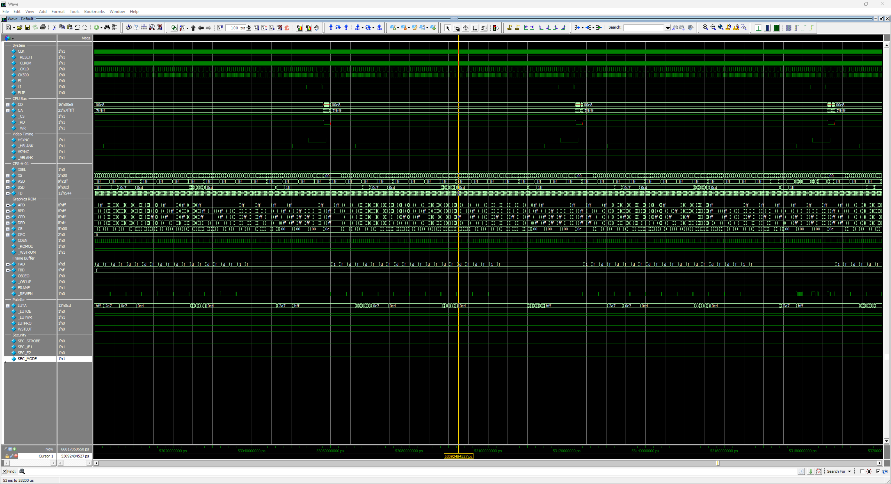
    </td>
  </tr>
</table>

```
=========================================================
  tb_capcom_dl0921 results: 156 / 156 passed (0 failed)
=========================================================
  ALL TESTS PASSED
```

Per-test output: [tb_capcom_dl0921](doc/readme/tb_capcom_dl0921_log.md)

A frame of the standard is shown below, beside MAME's snapshot.

<p align="center">
  <a href="img/sf2hf_3900.png"></a>
</p>

<p align="center"><i>(Street Fighter II': Hyper Fighting, World 921209)</i></p>

## Design References

- [CAPCOM DL-0921 KiCad Die Trace and Ricoh A5C Cell Drawings, cps2-reverse (commit cbd37b3), Loïc "WydD" Petit, CC BY](https://gitlab.com/loic.petit/cps2-reverse)<br>
  <small><i>(Referenced for the cell types and the sheet and net names; every cell, connection and pad of the netlist was retraced and verified against the die)</i></small>
- [CAPCOM DL-0921 (CPS-B-21) Die Photographs, John McMaster](https://siliconpr0n.org/map/capcom/)<br>
  <small><i>(The whole die at top metal and after two delayering steps, traced to verify the netlist)</i></small>
- [ArcadeHacker_CPS1: CPS1 Desuicider, Eduardo Cruz (ArcadeHacker)](https://github.com/ArcadeHacker/ArcadeHacker_CPS1)<br>
  <small><i>(The CPS-B-21 configuration research and the keys used in the gate-level simulation)</i></small>
- [OpenKey-CPS1: CPS-B-21 Configuration Programmer, Jim Westfall (ack)](https://github.com/jwestfall69/openkey-cps1)<br>
  <small><i>(The CPS-B configuration keys of every board type in one table, which the simulation takes its keys from)</i></small>

## License

This work is licensed under the [Creative Commons Attribution-NonCommercial 4.0 International License](../../LICENSE) (CC BY-NC 4.0). You may use, share, and modify this code for non-commercial purposes, provided that proper credit is given.

## Support

Please consider supporting this and future projects by joining the [**Coin-Op Collection Patreon**](https://www.patreon.com/atrac17).

---
