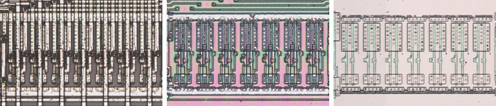

# 8BUF11

Eight buffers, the inputs to the outputs in reverse pin order.

**Original.** The trace has no drawing of this cell; it was read from the die.

<p align="center">
  <a href="8BUF11_die.jpg"></a><br>
  <small>UBF101 at top metal, delayering step 3 and delayering step 5 (left to right)</small>
</p>

- **Instances**: 2 in the netlist

## Model

```verilog
module capcom_dl0921_8BUF11 (
    input  wire p2,
    input  wire p3,
    input  wire p4,
    input  wire p5,
    input  wire p6,
    input  wire p7,
    input  wire p8,
    input  wire p9,
    output wire p11,
    output wire p12,
    output wire p13,
    output wire p14,
    output wire p15,
    output wire p16,
    output wire p17,
    output wire p18
);

assign `D {p11, p12, p13, p14, p15, p16, p17, p18} = {p9, p8, p7, p6, p5, p4, p3, p2};

endmodule
```
