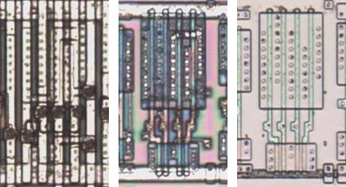
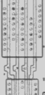

# AOI22

AND-OR-invert, two two-input ANDs into a NOR.

**Confirmed.** Matches its drawing in the trace, checked on the die.

<p align="center">
  <a href="AOI22_die.jpg"></a><br>
  <small>UCL202 at top metal, delayering step 3 and delayering step 5 (left to right)</small>
</p>

- **Instances**: 29 in the netlist
- The input groups follow the symbol geometry.

## Model

```verilog
module capcom_dl0921_AOI22 (
    input  wire p1,
    input  wire p2,
    input  wire p3,
    input  wire p4,
    output wire p5
);

assign `D p5 = ~((p1 & p3) | (p2 & p4));

endmodule
```

## Drawing

<table align="center">
  <tr><td align="center"><a href="AOI22_drawing.png"></a></td></tr>
  <tr><td align="center"><b>Drawing</b></td></tr>
</table>

Loïc "WydD" Petit, [cps2-reverse](https://gitlab.com/loic.petit/cps2-reverse) (CC BY), AOI22.
