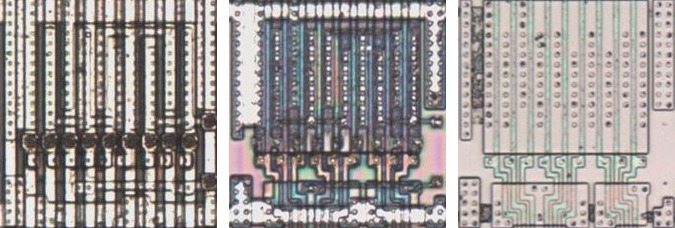
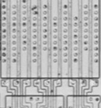

# AOI33

AND-OR-invert, three three-input ANDs into a NOR.

**Confirmed.** Matches its drawing in the trace, checked on the die.

<p align="center">
  <a href="AOI33_die.jpg"></a><br>
  <small>UCG432 at top metal, delayering step 3 and delayering step 5 (left to right)</small>
</p>

- **Instances**: 1 in the netlist
- The input groups follow the symbol geometry.

## Model

```verilog
module capcom_dl0921_AOI33 (
    input  wire p1,
    input  wire p2,
    input  wire p3,
    input  wire p5,
    input  wire p6,
    input  wire p7,
    input  wire p8,
    input  wire p9,
    input  wire p10,
    output wire p4
);

assign `D p4 = ~((p1 & p5 & p8) | (p2 & p6 & p9) | (p3 & p7 & p10));

endmodule
```

## Drawing

<table align="center">
  <tr><td align="center"><a href="AOI33_drawing.png"></a></td></tr>
  <tr><td align="center"><b>Drawing</b></td></tr>
</table>

Loïc "WydD" Petit, [cps2-reverse](https://gitlab.com/loic.petit/cps2-reverse) (CC BY), AOI33.
