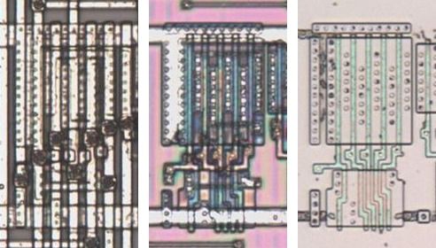

# AOI41

AND-OR-invert, a four-input AND and one input into a NOR.

**Original.** The trace has no drawing of this cell; it was read from the die.

<p align="center">
  <a href="AOI41_die.jpg"></a><br>
  <small>UCG312 at top metal, delayering step 3 and delayering step 5 (left to right)</small>
</p>

- **Instances**: 1 in the netlist
- The input groups follow the symbol geometry.

## Model

```verilog
module capcom_dl0921_AOI41 (
    input  wire p1,
    input  wire p3,
    input  wire p4,
    input  wire p5,
    input  wire p6,
    output wire p2
);

assign `D p2 = ~((p1 & p3 & p4 & p5) | p6);

endmodule
```
