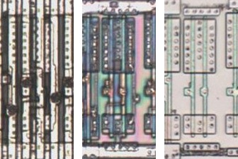
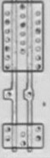

# BUF01

Buffer.

**Confirmed, With Fixes.** Twenty-seven cells traced as BUF12 are this cell on the die, the BUF11 drawing below.

<p align="center">
  <a href="BUF01_die.jpg"></a><br>
  <small>UCL404 at top metal, delayering step 3 and delayering step 5 (left to right)</small>
</p>

- **Instances**: 72 in the netlist

## Model

```verilog
module capcom_dl0921_BUF01 (
    input  wire p1,
    output wire p2
);

assign `D p2 = p1;

endmodule
```

## Drawing

<table align="center">
  <tr><td align="center"><a href="BUF01_drawing.png"></a></td></tr>
  <tr><td align="center"><b>Drawing</b></td></tr>
</table>

Loïc "WydD" Petit, [cps2-reverse](https://gitlab.com/loic.petit/cps2-reverse) (CC BY), BUF11.
