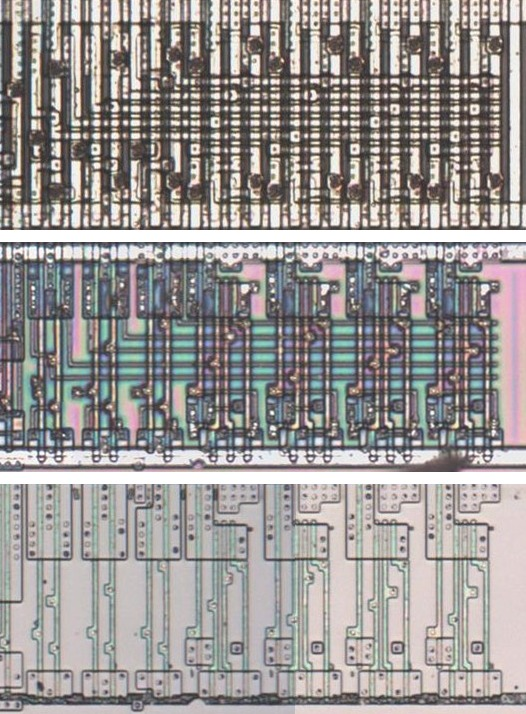
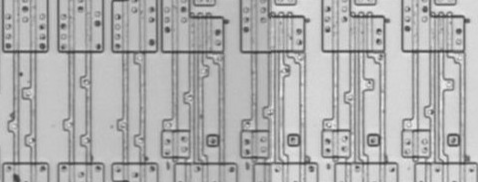
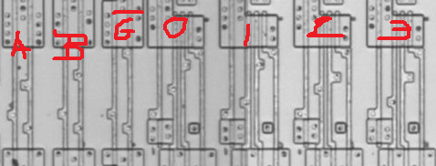

# D24GL

Two-to-four decoder with an enable.

**Confirmed.** Matches its drawing in the trace, checked on the die.

<p align="center">
  <a href="D24GL_die.jpg"></a><br>
  <small>UBW247 at top metal, delayering step 3 and delayering step 5 (top to bottom)</small>
</p>

- **Instances**: 1 in the netlist

## Model

```verilog
module capcom_dl0921_D24GL (
    input  wire p1,
    input  wire p2,
    input  wire p3,
    output wire p7,
    output wire p6,
    output wire p5,
    output wire p4
);

wire [3:0] o = p3 ? 4'hf : ~(4'b1 << {p2, p1});

assign `D {p4, p5, p6, p7} = o;

endmodule
```

## Drawing

<table align="center">
  <tr><td align="center"><a href="D24GL_drawing.png"></a></td><td align="center"><a href="D24GL_drawing_pins.png"></a></td></tr>
  <tr><td align="center"><b>Drawing</b></td><td align="center"><b>Drawing With Pin Numbers</b></td></tr>
</table>

Loïc "WydD" Petit, [cps2-reverse](https://gitlab.com/loic.petit/cps2-reverse) (CC BY), D24GL.
