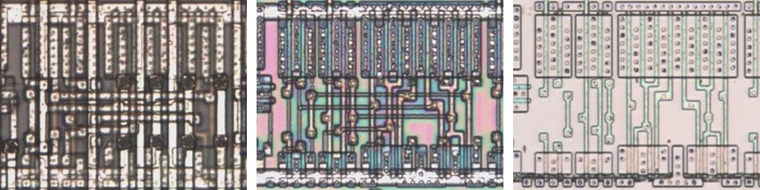
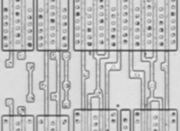
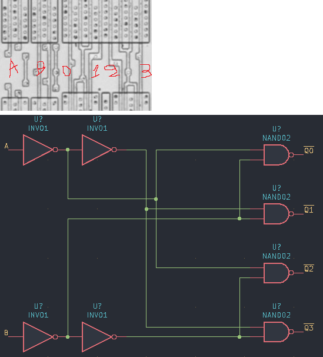

# D24L

Two-to-four decoder with active-low outputs.

**Confirmed.** Matches its drawing in the trace, checked on the die.

<p align="center">
  <a href="D24L_die.jpg"></a><br>
  <small>UBF19 at top metal, delayering step 3 and delayering step 5 (left to right)</small>
</p>

- **Instances**: 4 in the netlist

## Model

```verilog
module capcom_dl0921_D24L (
    input  wire p1,
    input  wire p2,
    output wire p3,
    output wire p4,
    output wire p5,
    output wire p6
);

assign `D p6 = ~(~p2 & ~p1);
assign `D p5 = ~(~p2 & p1);
assign `D p4 = ~(p2 & ~p1);
assign `D p3 = ~(p2 & p1);

endmodule
```

## Drawing

<table align="center">
  <tr><td align="center"><a href="D24L_drawing.png"></a></td><td align="center"><a href="D24L_drawing_pins.png"></a></td></tr>
  <tr><td align="center"><b>Drawing</b></td><td align="center"><b>Drawing With Pin Numbers</b></td></tr>
</table>

Loïc "WydD" Petit, [cps2-reverse](https://gitlab.com/loic.petit/cps2-reverse) (CC BY), D24L.
