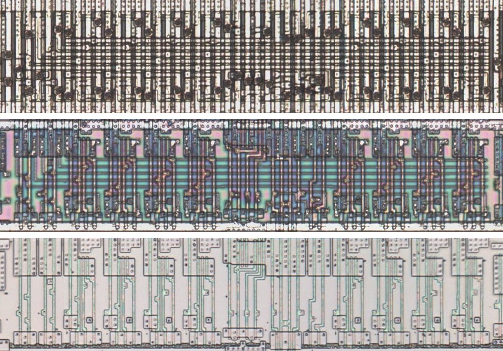
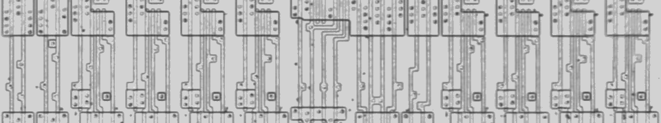
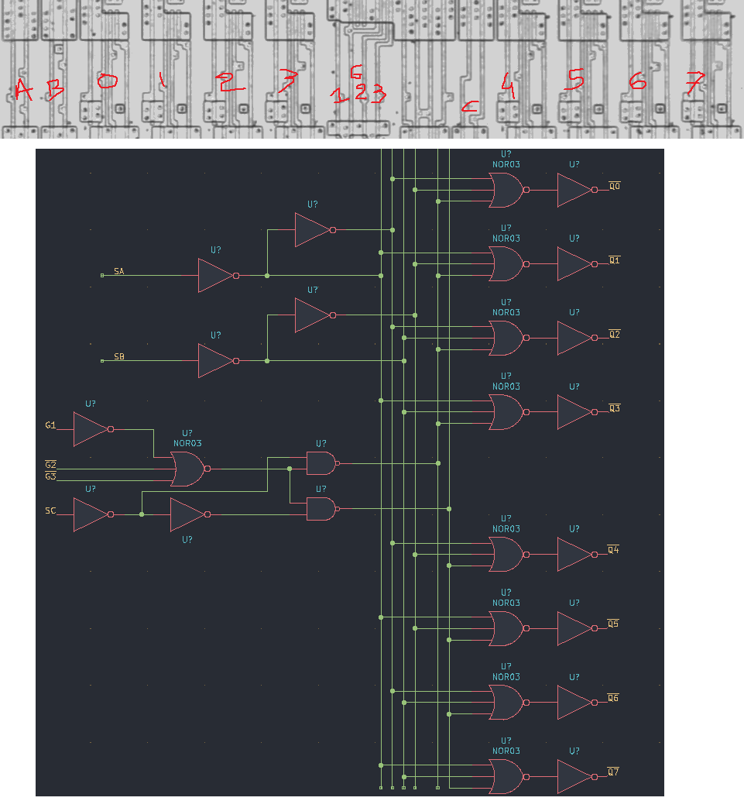

# D38GL

Three-to-eight decoder with enables.

**Confirmed.** Matches its drawing in the trace, checked on the die.

<p align="center">
  <a href="D38GL_die.jpg"></a><br>
  <small>UCR348 at top metal, delayering step 3 and delayering step 5 (top to bottom)</small>
</p>

- **Instances**: 5 in the netlist

## Model

```verilog
module capcom_dl0921_D38GL (
    input  wire p1,
    input  wire p2,
    input  wire p3,
    input  wire p4,
    input  wire p5,
    input  wire p6,
    output wire p15,
    output wire p14,
    output wire p13,
    output wire p12,
    output wire p11,
    output wire p10,
    output wire p9,
    output wire p7
);

wire       en = p4 & ~p5 & ~p6;
wire [2:0] s = {p3, p2, p1};
wire [7:0] o = en ? ~(8'b1 << s) : 8'hff;

assign `D {p7, p9, p10, p11, p12, p13, p14, p15} = o;

endmodule
```

## Drawing

<table align="center">
  <tr><td align="center"><a href="D38GL_drawing.png"></a></td><td align="center"><a href="D38GL_drawing_pins.png"></a></td></tr>
  <tr><td align="center"><b>Drawing</b></td><td align="center"><b>Drawing With Pin Numbers</b></td></tr>
</table>

Loïc "WydD" Petit, [cps2-reverse](https://gitlab.com/loic.petit/cps2-reverse) (CC BY), D38GL.
