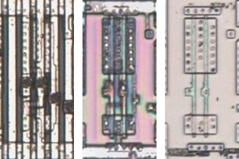
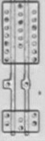

# DBUF

Two inverters in series, with the inverted output after the first and the true output after the second.

**Confirmed.** Matches its drawing in the trace, checked on the die.

<p align="center">
  <a href="DBUF_die.jpg"></a><br>
  <small>UCT310 at top metal, delayering step 3 and delayering step 5 (left to right)</small>
</p>

- **Instances**: 1 in the netlist
- p3 is the output after the first inverter, p4 after the second.

## Model

```verilog
module capcom_dl0921_DBUF (
    input  wire p2,
    output wire p3,
    output wire p4
);

assign `D p3 = ~p2;
assign `D p4 = p2;

endmodule
```

## Drawing

<table align="center">
  <tr><td align="center"><a href="DBUF_drawing.png"></a></td></tr>
  <tr><td align="center"><b>Drawing</b></td></tr>
</table>

Loïc "WydD" Petit, [cps2-reverse](https://gitlab.com/loic.petit/cps2-reverse) (CC BY), BUF11.
