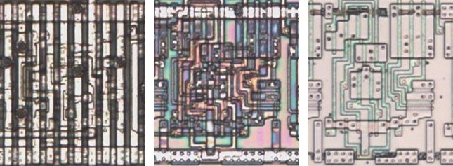
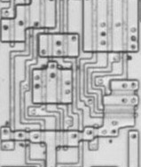
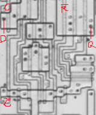

# DFFCOR

D flip-flop with an active-low asynchronous clear and an inverted output.

**Confirmed.** Matches its drawing in the trace, checked on the die.

<p align="center">
  <a href="DFFCOR_die.jpg"></a><br>
  <small>UCQ19 at top metal, delayering step 3 and delayering step 5 (left to right)</small>
</p>

- **Instances**: 93 in the netlist

## Model

```verilog
module capcom_dl0921_DFFCOR (
    input  wire p1,
    input  wire p2,
    input  wire p4,
    output reg  p3,
    output wire p5
);

wire c;

initial p3 = 1'b0;

assign `MPW c = p4;

always @(posedge p1 or negedge c) begin
    if(!c) p3 <= `Q 1'b0;
    else p3 <= `Q p2;
end

assign p5 = ~p3;

endmodule
```

## Drawing

<table align="center">
  <tr><td align="center"><a href="DFFCOR_drawing.png"></a></td><td align="center"><a href="DFFCOR_drawing_pins.png"></a></td></tr>
  <tr><td align="center"><b>Drawing</b></td><td align="center"><b>Drawing With Pin Numbers</b></td></tr>
</table>

Loïc "WydD" Petit, [cps2-reverse](https://gitlab.com/loic.petit/cps2-reverse) (CC BY), DFF-0.
