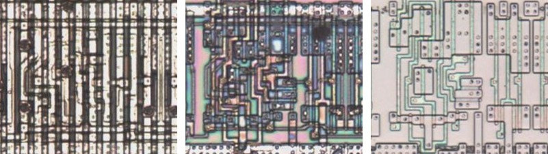
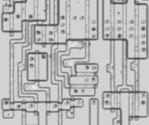

# DFGOO

D flip-flop with a tri-state output on an active-low enable.

**Confirmed.** Matches its drawing in the trace, checked on the die.

<p align="center">
  <a href="DFGOO_die.jpg"></a><br>
  <small>UBZ498 at top metal, delayering step 3 and delayering step 5 (left to right)</small>
</p>

- **Instances**: 27 in the netlist

## Model

```verilog
module capcom_dl0921_DFGOO (
    input  wire p1,
    input  wire p2,
    input  wire p5,
    output wire p3
);

reg q = 1'b0;

always @(posedge p1) begin
    q <= `Q p2;
end

assign `D p3 = p5 ? 1'bz : q;

endmodule
```

## Drawing

<table align="center">
  <tr><td align="center"><a href="DFGOO_drawing.png"></a></td></tr>
  <tr><td align="center"><b>Drawing</b></td></tr>
</table>

Loïc "WydD" Petit, [cps2-reverse](https://gitlab.com/loic.petit/cps2-reverse) (CC BY), DFF-5.
