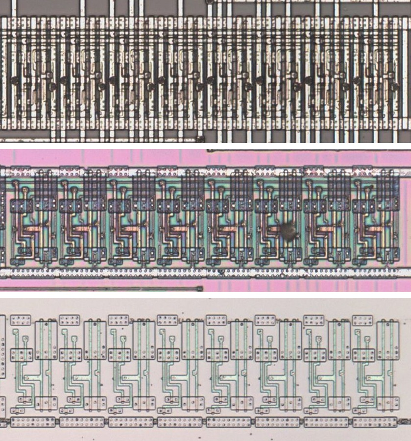

# L8

Eight-bit latch, transparent while pin 1 is high.

**Corrected.** Transparent while pin 1 is high on the die, the reverse of the sense taken from the L8G drawing. The trace has no drawing of this cell.

<p align="center">
  <a href="L8_die.jpg"></a><br>
  <small>UCJ79 at top metal, delayering step 3 and delayering step 5 (top to bottom)</small>
</p>

- **Instances**: 4 in the netlist

## Model

```verilog
module capcom_dl0921_L8 (
    input  wire p1,
    input  wire p2,
    input  wire p4,
    input  wire p6,
    input  wire p8,
    input  wire p10,
    input  wire p12,
    input  wire p14,
    input  wire p16,
    output wire p3,
    output wire p5,
    output wire p7,
    output wire p9,
    output wire p11,
    output wire p13,
    output wire p15,
    output wire p17
);

reg [7:0] q = 8'b0;

always @* begin
    if(p1) q = {p2, p4, p6, p8, p10, p12, p14, p16};
end

assign {p3, p5, p7, p9, p11, p13, p15, p17} = q;

endmodule
```
