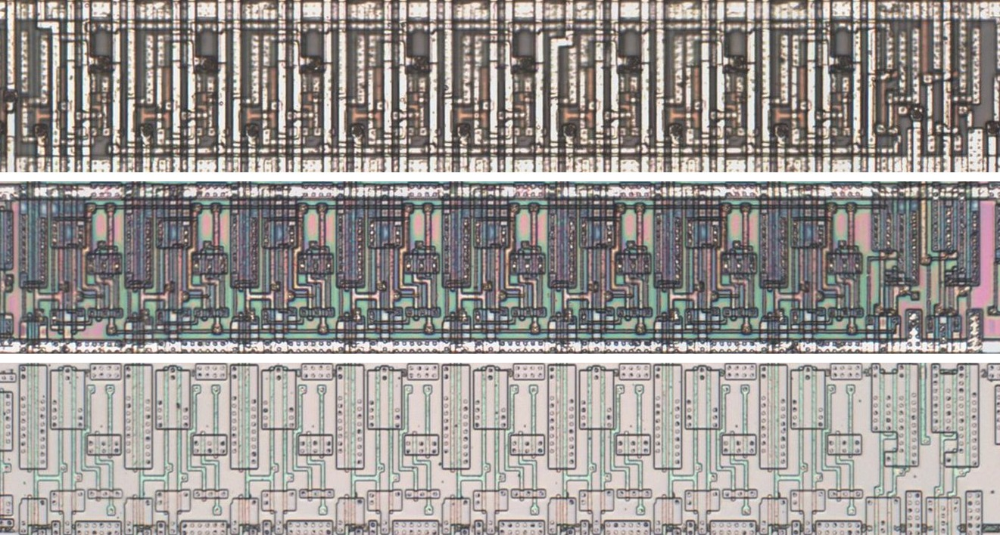
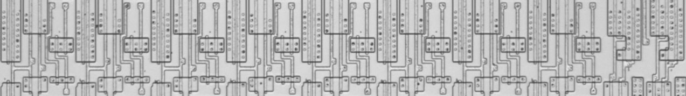
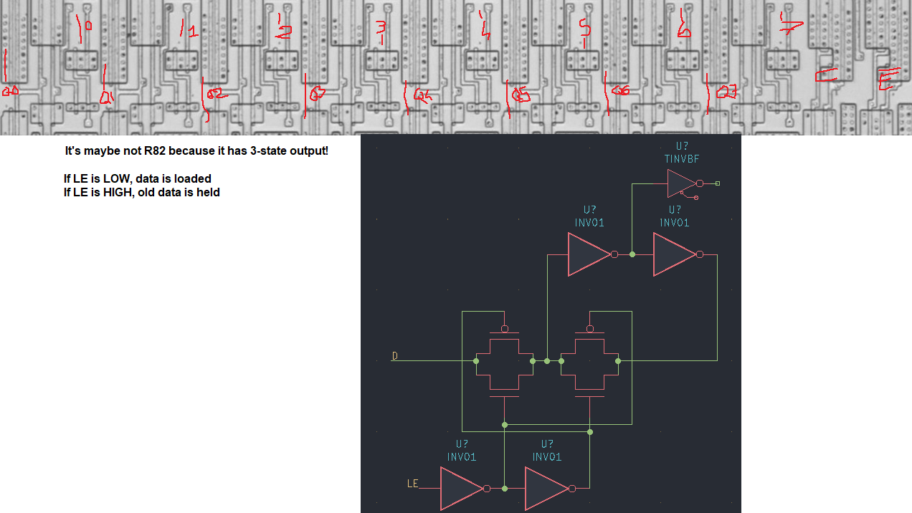

# L8G

Eight-bit latch with tri-state outputs, transparent while pin 1 is low.

**Confirmed.** Matches its drawing in the trace, checked on the die.

<p align="center">
  <a href="L8G_die.jpg"></a><br>
  <small>UAE2 at top metal, delayering step 3 and delayering step 5 (top to bottom)</small>
</p>

- **Instances**: 28 in the netlist
- Loads while LE (pin 1) is low.

## Model

```verilog
module capcom_dl0921_L8G (
    input  wire p1,
    input  wire p18,
    input  wire p2,
    input  wire p4,
    input  wire p6,
    input  wire p8,
    input  wire p10,
    input  wire p12,
    input  wire p14,
    input  wire p16,
    output wire p3,
    output wire p5,
    output wire p7,
    output wire p9,
    output wire p11,
    output wire p13,
    output wire p15,
    output wire p17
);

reg [7:0] q = 8'b0;

always @* begin
    if(!p1) q = {p2, p4, p6, p8, p10, p12, p14, p16};
end

assign `D {p3, p5, p7, p9, p11, p13, p15, p17} = p18 ? 8'bz : q;

endmodule
```

## Drawing

<table align="center">
  <tr><td align="center"><a href="L8G_drawing.png"></a></td><td align="center"><a href="L8G_drawing_pins.png"></a></td></tr>
  <tr><td align="center"><b>Drawing</b></td><td align="center"><b>Drawing With Pin Numbers</b></td></tr>
</table>

Loïc "WydD" Petit, [cps2-reverse](https://gitlab.com/loic.petit/cps2-reverse) (CC BY), L8G.
