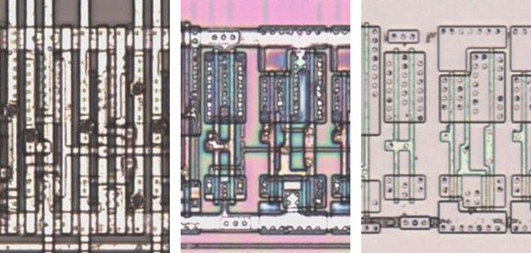

# M125C

Tri-state buffer with an active-low enable, as the 74125.

**Original.** The trace has no drawing of this cell; it was read from the die.

<p align="center">
  <a href="M125C_die.jpg"></a><br>
  <small>UBU80 at top metal, delayering step 3 and delayering step 5 (left to right)</small>
</p>

- **Instances**: 1 in the netlist
- Pin 1 is the active-low output enable.

## Model

```verilog
module capcom_dl0921_M125C (
    input  wire p1,
    input  wire p2,
    output wire p3
);

assign `D p3 = p1 ? 1'bz : p2;

endmodule
```
