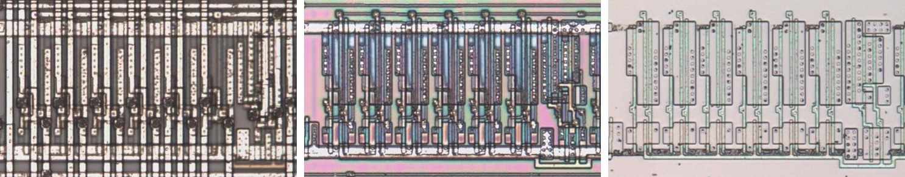

# M125C_X6

Six tri-state buffers on one active-low enable.

**Corrected.** Four of them, UBI12, UBK12, UBM12 and UBN12, have only three slices on the die, with pins 13 to 15 undriven, where the trace has six. The trace has no drawing of this cell.

<p align="center">
  <a href="M125C_X6_die.jpg"></a><br>
  <small>UBN21 at top metal, delayering step 3 and delayering step 5 (left to right)</small>
</p>

- **Instances**: 42 in the netlist
- Pin 1 is the active-low output enable.

## Model

```verilog
module capcom_dl0921_M125C_X6 (
    input  wire p1,
    input  wire p2,
    input  wire p3,
    input  wire p4,
    input  wire p5,
    input  wire p6,
    input  wire p7,
    output wire p13,
    output wire p14,
    output wire p15,
    output wire p16,
    output wire p17,
    output wire p18
);

assign `D {p13, p14, p15, p16, p17, p18} = p1 ? 6'bz : {p7, p6, p5, p4, p3, p2};

endmodule
```
