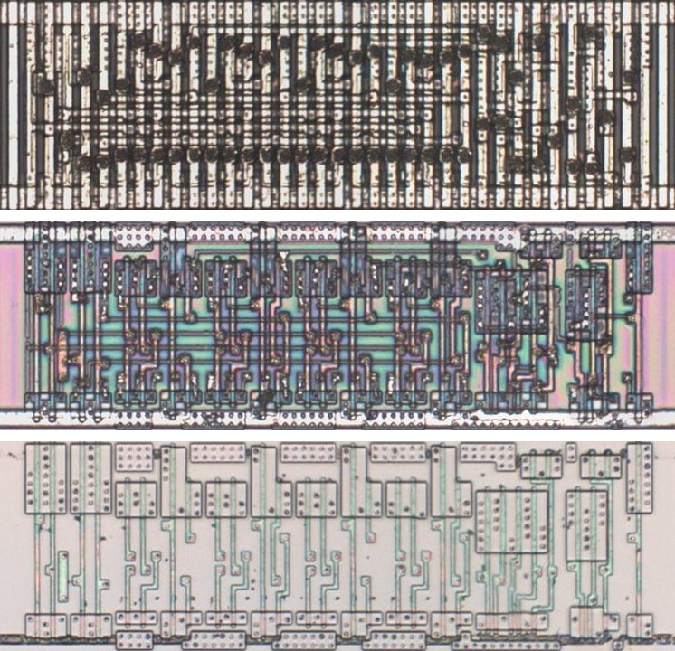
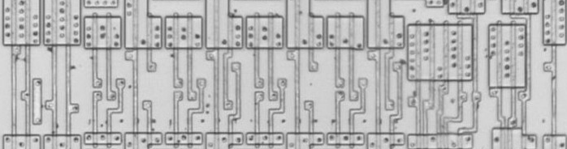
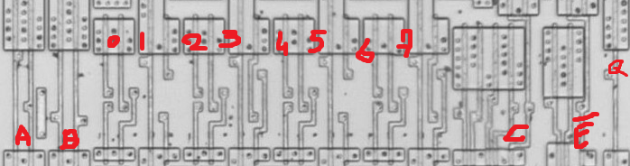

# M151C

Eight-to-one multiplexer whose output is held low while the strobe is high, as the 74151.

**Confirmed.** Matches its drawing in the trace, checked on the die.

<p align="center">
  <a href="M151C_die.jpg"></a><br>
  <small>UCO26 at top metal, delayering step 3 and delayering step 5 (top to bottom)</small>
</p>

- **Instances**: 5 in the netlist

## Model

```verilog
module capcom_dl0921_M151C (
    input  wire p1,
    input  wire p2,
    input  wire p3,
    input  wire p4,
    input  wire p7,
    input  wire p9,
    input  wire p10,
    input  wire p11,
    input  wire p12,
    input  wire p13,
    input  wire p14,
    input  wire p15,
    output wire p5
);

wire [7:0] i = {p12, p13, p14, p15, p1, p2, p3, p4};

assign `D p5 = p7 ? 1'b0 : i[{p9, p10, p11}];

endmodule
```

## Drawing

<table align="center">
  <tr><td align="center"><a href="M151C_drawing.png"></a></td><td align="center"><a href="M151C_drawing_pins.png"></a></td></tr>
  <tr><td align="center"><b>Drawing</b></td><td align="center"><b>Drawing With Pin Numbers</b></td></tr>
</table>

Loïc "WydD" Petit, [cps2-reverse](https://gitlab.com/loic.petit/cps2-reverse) (CC BY), M151C.
