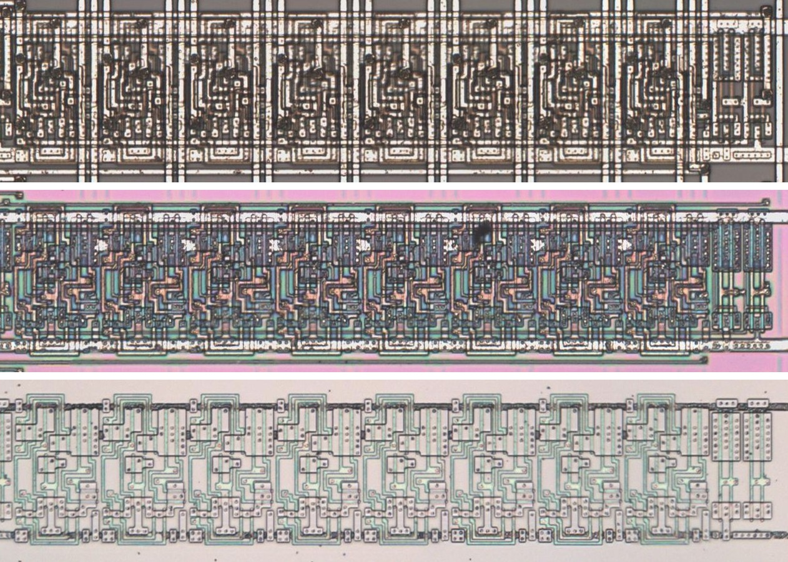

# M164C

Eight-bit serial-in, parallel-out shift register without a clear, as the 74164.

**Original.** The trace has no drawing of this cell; it was read from the die.

<p align="center">
  <a href="M164C_die.jpg"></a><br>
  <small>UCR130 at top metal, delayering step 3 and delayering step 5 (top to bottom)</small>
</p>

- **Instances**: 18 in the netlist
- Q0 takes D and each Qn the one before it, with no clear.
- The security key is held in these registers.

## Model

```verilog
module capcom_dl0921_M164C (
    input  wire p1,
    input  wire p8,
    output wire p3,
    output wire p4,
    output wire p5,
    output wire p6,
    output wire p10,
    output wire p11,
    output wire p12,
    output wire p13
);

reg [7:0] q = 8'b0;

always @(posedge p8) begin
    q <= `Q {q[6:0], p1};
end

assign {p13, p12, p11, p10, p6, p5, p4, p3} = q;

endmodule
```
