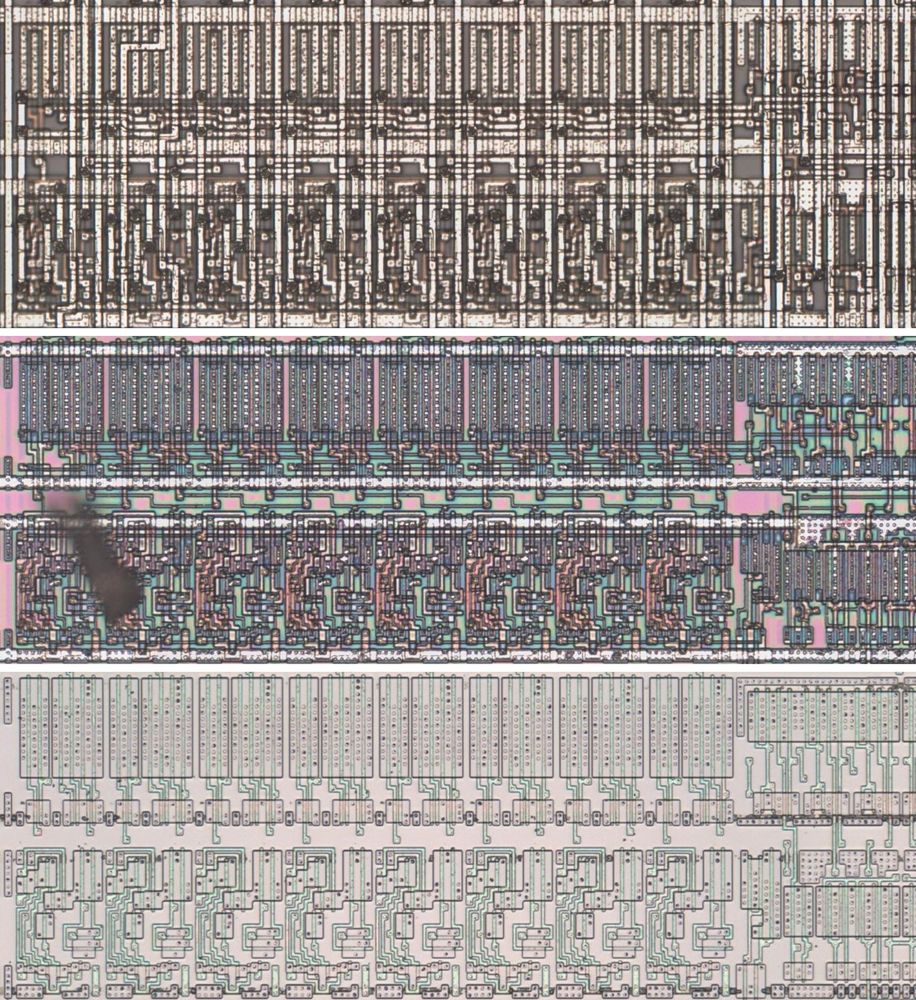
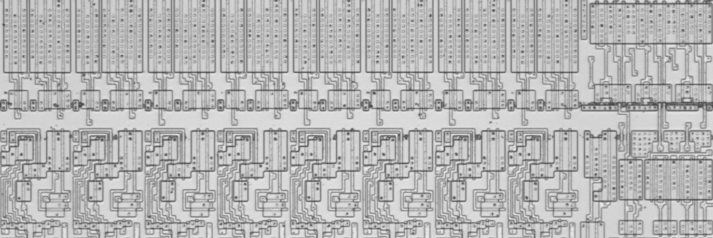
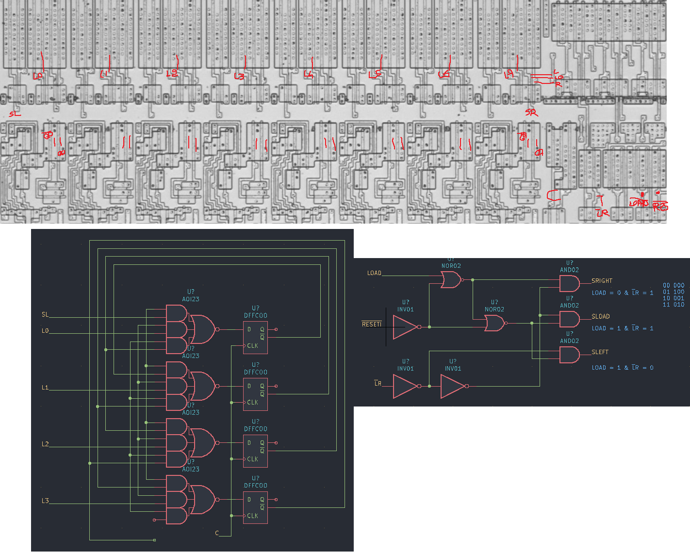

# M198C

Eight-bit shift register that holds, shifts either way or loads, as the 74198.

**Confirmed.** Matches its drawing in the trace, checked on the die.

<p align="center">
  <a href="M198C_die.jpg"></a><br>
  <small>UAP1 at top metal, delayering step 3 and delayering step 5 (top to bottom)</small>
</p>

- **Instances**: 16 in the netlist
- LOAD (p20) and ~LR (p21) select hold (00), shift right with SL (p8) into Q0 (01), shift left with SR (p18) into Q7 (10) and load (11); p22 low holds.

## Model

```verilog
module capcom_dl0921_M198C (
    input  wire p1,
    input  wire p2,
    input  wire p3,
    input  wire p4,
    input  wire p5,
    input  wire p6,
    input  wire p7,
    input  wire p9,
    input  wire p8,
    input  wire p18,
    input  wire p19,
    input  wire p20,
    input  wire p21,
    input  wire p22,
    output wire p10,
    output wire p11,
    output wire p12,
    output wire p13,
    output wire p14,
    output wire p15,
    output wire p16,
    output wire p17
);

reg  [7:0] q = 8'b0;
wire [7:0] l = {p9, p7, p6, p5, p4, p3, p2, p1};

always @(posedge p19) begin
    if(p22) begin
        case({p20, p21})
            2'b01: q <= `Q {q[6:0], p8};
            2'b10: q <= `Q {p18, q[7:1]};
            2'b11: q <= `Q l;
            default: ;
        endcase
    end
end

assign {p17, p16, p15, p14, p13, p12, p11, p10} = q;

endmodule
```

## Drawing

<table align="center">
  <tr><td align="center"><a href="M198C_drawing.png"></a></td><td align="center"><a href="M198C_drawing_pins.png"></a></td></tr>
  <tr><td align="center"><b>Drawing</b></td><td align="center"><b>Drawing With Pin Numbers</b></td></tr>
</table>

Loïc "WydD" Petit, [cps2-reverse](https://gitlab.com/loic.petit/cps2-reverse) (CC BY), M198C.
