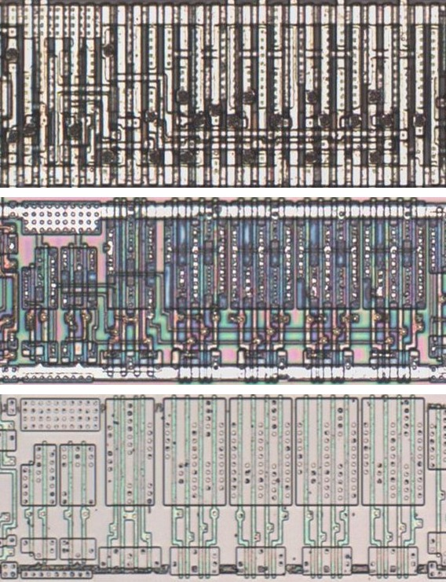
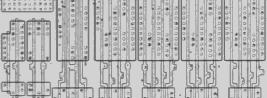
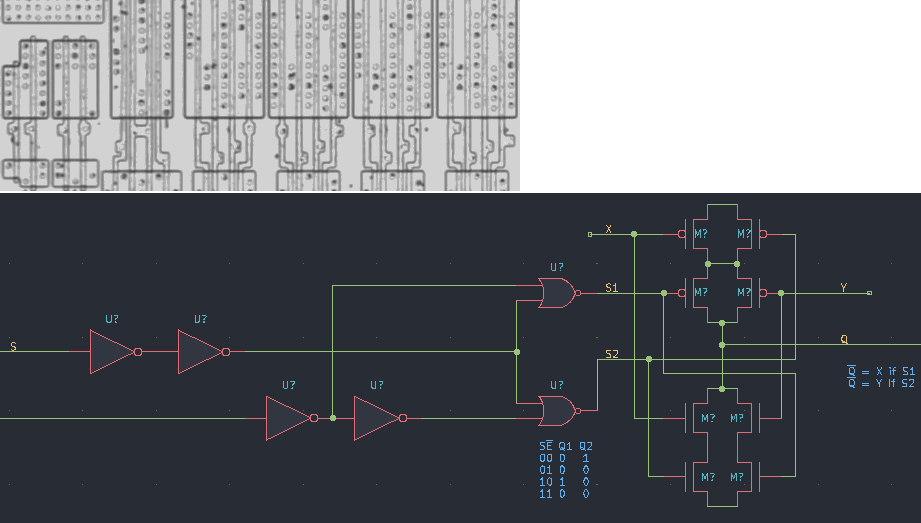

# M258C

Four two-to-one multiplexers with inverted tri-state outputs, as the 74258.

**Confirmed.** Matches its drawing in the trace, checked on the die.

<p align="center">
  <a href="M258C_die.jpg"></a><br>
  <small>UBU125 at top metal, delayering step 3 and delayering step 5 (top to bottom)</small>
</p>

- **Instances**: 9 in the netlist

## Model

```verilog
module capcom_dl0921_M258C (
    input  wire p1,
    input  wire p2,
    input  wire p3,
    input  wire p4,
    input  wire p9,
    input  wire p10,
    input  wire p11,
    input  wire p12,
    input  wire p13,
    input  wire p14,
    output wire p5,
    output wire p6,
    output wire p7,
    output wire p8
);

wire [3:0] a = {p1, p2, p3, p4};
wire [3:0] b = {p10, p11, p12, p13};

assign `D {p8, p7, p6, p5} = p14 ? 4'bz : ~(p9 ? b : a);

endmodule
```

## Drawing

<table align="center">
  <tr><td align="center"><a href="M258C_drawing.png"></a></td><td align="center"><a href="M258C_drawing_pins.png"></a></td></tr>
  <tr><td align="center"><b>Drawing</b></td><td align="center"><b>Drawing With Pin Numbers</b></td></tr>
</table>

Loïc "WydD" Petit, [cps2-reverse](https://gitlab.com/loic.petit/cps2-reverse) (CC BY), M258C.
