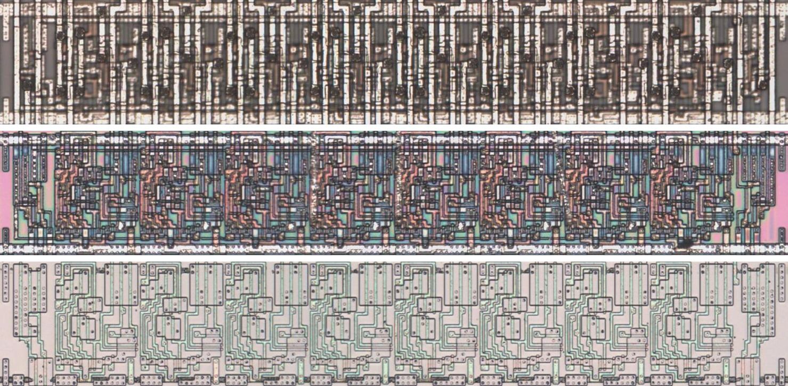
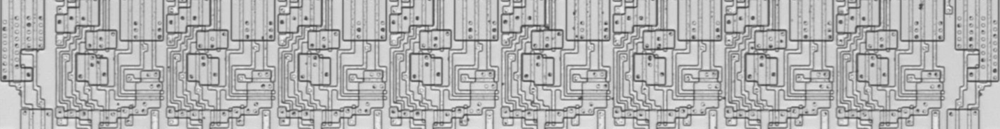
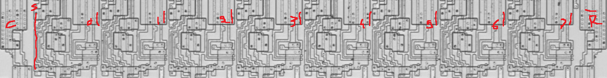

# M273C

Eight-bit register with an active-low asynchronous clear, as the 74273.

**Confirmed.** Matches its drawing in the trace, checked on the die.

<p align="center">
  <a href="M273C_die.jpg"></a><br>
  <small>UAG79 at top metal, delayering step 3 and delayering step 5 (top to bottom)</small>
</p>

- **Instances**: 51 in the netlist

## Model

```verilog
module capcom_dl0921_M273C (
    input  wire p1,
    input  wire p3,
    input  wire p4,
    input  wire p7,
    input  wire p8,
    input  wire p11,
    input  wire p13,
    input  wire p14,
    input  wire p17,
    input  wire p18,
    output reg  p2,
    output reg  p5,
    output reg  p6,
    output reg  p9,
    output reg  p12,
    output reg  p15,
    output reg  p16,
    output reg  p19
);

wire c;

initial {p2, p5, p6, p9, p12, p15, p16, p19} = 8'b0;

assign `MPW c = p1;

always @(posedge p11 or negedge c) begin
    if(!c) {p19, p16, p15, p12, p9, p6, p5, p2} <= `Q 8'b0;
    else {p19, p16, p15, p12, p9, p6, p5, p2} <= `Q {p18, p17, p14, p13, p8, p7, p4, p3};
end

endmodule
```

## Drawing

<table align="center">
  <tr><td align="center"><a href="M273C_drawing.png"></a></td><td align="center"><a href="M273C_drawing_pins.png"></a></td></tr>
  <tr><td align="center"><b>Drawing</b></td><td align="center"><b>Drawing With Pin Numbers</b></td></tr>
</table>

Loïc "WydD" Petit, [cps2-reverse](https://gitlab.com/loic.petit/cps2-reverse) (CC BY), M273C.
