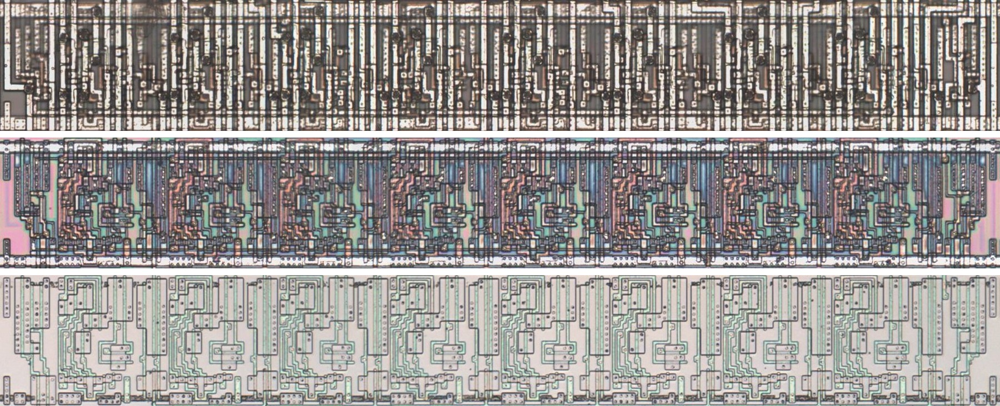
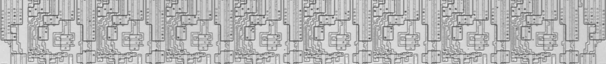

# M273CG

Eight-bit register with tri-state outputs on an active-low enable.

**Confirmed.** Matches its drawing in the trace, checked on the die.

<p align="center">
  <a href="M273CG_die.jpg"></a><br>
  <small>UAO79 at top metal, delayering step 3 and delayering step 5 (top to bottom)</small>
</p>

- **Instances**: 18 in the netlist

## Model

```verilog
module capcom_dl0921_M273CG (
    input  wire p1,
    input  wire p3,
    input  wire p4,
    input  wire p7,
    input  wire p8,
    input  wire p11,
    input  wire p13,
    input  wire p14,
    input  wire p17,
    input  wire p18,
    output wire p2,
    output wire p5,
    output wire p6,
    output wire p9,
    output wire p12,
    output wire p15,
    output wire p16,
    output wire p19
);

reg [7:0] q = 8'b0;

always @(posedge p11) begin
    q <= `Q {p18, p17, p14, p13, p8, p7, p4, p3};
end

assign `D {p19, p16, p15, p12, p9, p6, p5, p2} = p1 ? 8'bz : q;

endmodule
```

## Drawing

<table align="center">
  <tr><td align="center"><a href="M273CG_drawing.png"></a></td></tr>
  <tr><td align="center"><b>Drawing</b></td></tr>
</table>

Loïc "WydD" Petit, [cps2-reverse](https://gitlab.com/loic.petit/cps2-reverse) (CC BY), M273CG.
