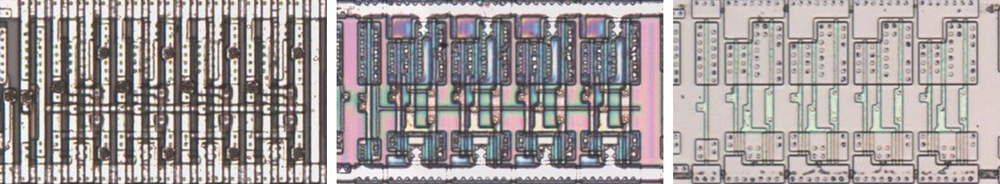
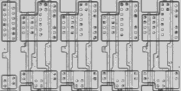

# M367C

Four tri-state buffers on one active-low enable, as the 74367.

**Confirmed.** Matches its drawing in the trace, checked on the die.

<p align="center">
  <a href="M367C_die.jpg"></a><br>
  <small>UBU427 at top metal, delayering step 3 and delayering step 5 (left to right)</small>
</p>

- **Instances**: 11 in the netlist
- Pin 1 is the active-low output enable.

## Model

```verilog
module capcom_dl0921_M367C (
    input  wire p1,
    input  wire p2,
    input  wire p3,
    input  wire p4,
    input  wire p5,
    output wire p18,
    output wire p17,
    output wire p16,
    output wire p15
);

assign `D {p15, p16, p17, p18} = p1 ? 4'bz : {p5, p4, p3, p2};

endmodule
```

## Drawing

<table align="center">
  <tr><td align="center"><a href="M367C_drawing.png"></a></td></tr>
  <tr><td align="center"><b>Drawing</b></td></tr>
</table>

Loïc "WydD" Petit, [cps2-reverse](https://gitlab.com/loic.petit/cps2-reverse) (CC BY), M367C.
