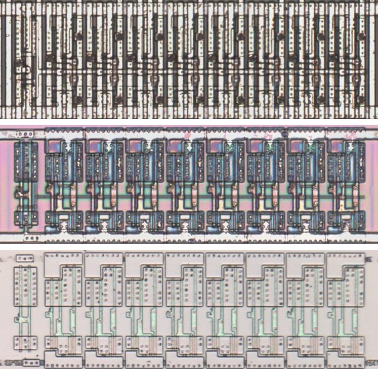
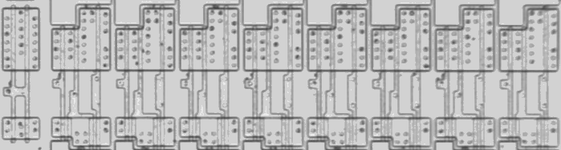
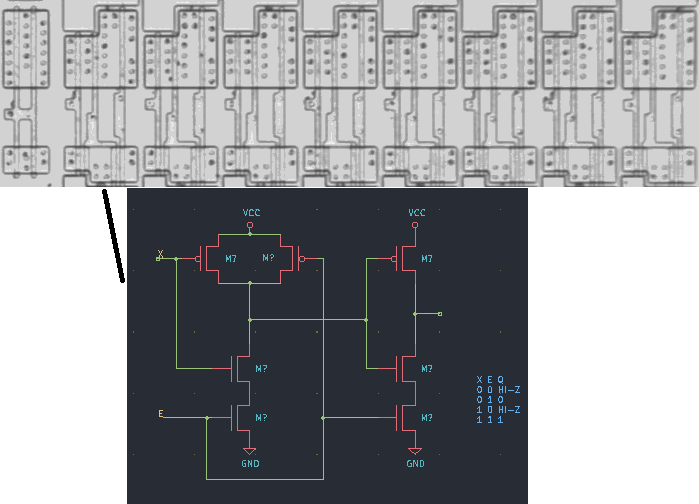

# M541C

Eight tri-state buffers on one active-low enable, as the 74541.

**Confirmed.** Matches its drawing in the trace, checked on the die.

<p align="center">
  <a href="M541C_die.jpg"></a><br>
  <small>UCO383 at top metal, delayering step 3 and delayering step 5 (top to bottom)</small>
</p>

- **Instances**: 14 in the netlist
- Pin 1 is the active-low output enable.

## Model

```verilog
module capcom_dl0921_M541C (
    input  wire p1,
    input  wire p2,
    input  wire p3,
    input  wire p4,
    input  wire p5,
    input  wire p6,
    input  wire p7,
    input  wire p8,
    input  wire p9,
    output wire p11,
    output wire p12,
    output wire p13,
    output wire p14,
    output wire p15,
    output wire p16,
    output wire p17,
    output wire p18
);

assign `D {p11, p12, p13, p14, p15, p16, p17, p18} = p1 ? 8'bz : {p9, p8, p7, p6, p5, p4, p3, p2};

endmodule
```

## Drawing

<table align="center">
  <tr><td align="center"><a href="M541C_drawing.png"></a></td><td align="center"><a href="M541C_drawing_pins.png"></a></td></tr>
  <tr><td align="center"><b>Drawing</b></td><td align="center"><b>Drawing With Pin Numbers</b></td></tr>
</table>

Loïc "WydD" Petit, [cps2-reverse](https://gitlab.com/loic.petit/cps2-reverse) (CC BY), M541C.
