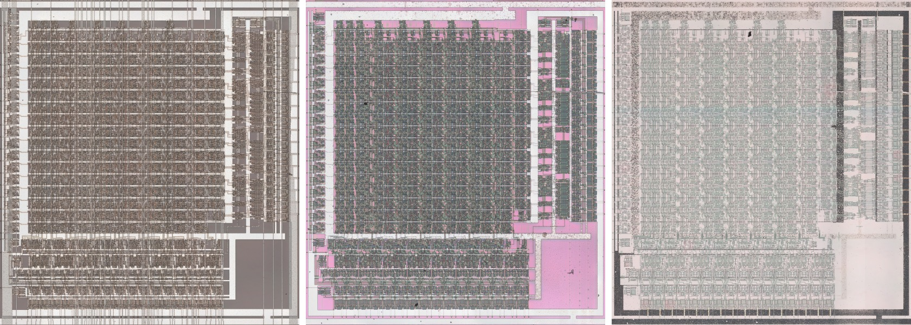

# MULT

Sixteen by sixteen multiplier with input registers, a product register and tri-state output halves.

**Original.** The trace has no drawing of this cell; it was read from the die.

<p align="center">
  <a href="MULT_die.jpg"></a><br>
  <small>UAF386 at top metal, delayering step 3 and delayering step 5 (left to right)</small>
</p>

- **Instances**: 1 in the netlist
- Input registers on CKX and CKY, the product register on CKM, the product in two tri-state halves.

## Model

```verilog
module capcom_dl0921_MULT (
    input  wire p1,
    input  wire p2,
    input  wire p3,
    input  wire p4,
    input  wire p5,
    input  wire p6,
    input  wire p7,
    input  wire p8,
    input  wire p9,
    input  wire p10,
    input  wire p11,
    input  wire p12,
    input  wire p13,
    input  wire p14,
    input  wire p15,
    input  wire p16,
    input  wire p17,
    input  wire p18,
    input  wire p19,
    input  wire p20,
    input  wire p21,
    input  wire p22,
    input  wire p23,
    input  wire p24,
    input  wire p25,
    input  wire p26,
    input  wire p27,
    input  wire p28,
    input  wire p29,
    input  wire p30,
    input  wire p31,
    input  wire p32,
    input  wire p33,
    input  wire p34,
    input  wire p35,
    input  wire p36,
    input  wire p37,
    input  wire p70,
    input  wire p71,
    input  wire p72,
    output wire p38,
    output wire p39,
    output wire p40,
    output wire p41,
    output wire p42,
    output wire p43,
    output wire p44,
    output wire p45,
    output wire p46,
    output wire p47,
    output wire p48,
    output wire p49,
    output wire p50,
    output wire p51,
    output wire p52,
    output wire p53,
    output wire p54,
    output wire p55,
    output wire p56,
    output wire p57,
    output wire p58,
    output wire p59,
    output wire p60,
    output wire p61,
    output wire p62,
    output wire p63,
    output wire p64,
    output wire p65,
    output wire p66,
    output wire p67,
    output wire p68,
    output wire p69
);

reg [15:0] x = 0;
reg [15:0] y = 0;
reg [31:0] p = 0;

always @(posedge p35) begin
    x <= {p16, p15, p14, p13, p12, p11, p10, p9, p8, p7, p6, p5, p4, p3, p2, p1};
end

always @(posedge p36) begin
    y <= {p32, p31, p30, p29, p28, p27, p26, p25, p24, p23, p22, p21, p20, p19, p18, p17};
end

always @(posedge p37) begin
    p <= x * y;
end

assign {p53, p52, p51, p50, p49, p48, p47, p46, p45, p44, p43, p42, p41, p40, p39, p38} = p70 ? 16'bz : p[15:0];
assign {p69, p68, p67, p66, p65, p64, p63, p62, p61, p60, p59, p58, p57, p56, p55, p54} = p71 ? 16'bz : p[31:16];

endmodule
```
