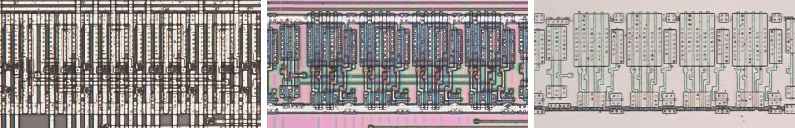

# MUX24H

Two-to-one multiplexer of two 4-bit words.

**Original.** The trace has no drawing of this cell; it was read from the die.

<p align="center">
  <a href="MUX24H_die.jpg"></a><br>
  <small>UBZ398 at top metal, delayering step 3 and delayering step 5 (left to right)</small>
</p>

- **Instances**: 7 in the netlist

## Model

```verilog
module capcom_dl0921_MUX24H (
    input  wire p1,
    input  wire p2,
    input  wire p3,
    input  wire p4,
    input  wire p9,
    input  wire p10,
    input  wire p11,
    input  wire p12,
    input  wire p13,
    output wire p5,
    output wire p6,
    output wire p7,
    output wire p8
);

wire [3:0] a = {p1, p2, p3, p4};
wire [3:0] b = {p10, p11, p12, p13};

assign `D {p8, p7, p6, p5} = p9 ? b : a;

endmodule
```
