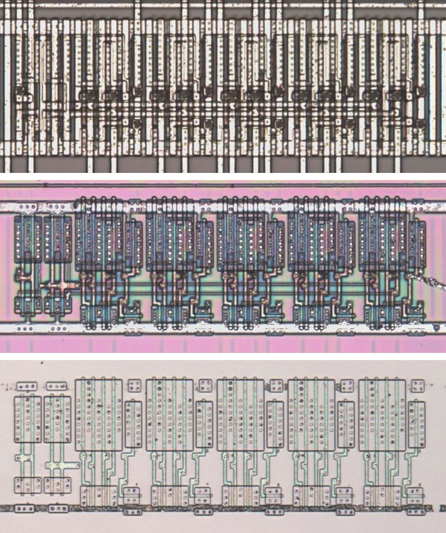

# MUX25H

Two-to-one multiplexer of two 5-bit words.

**Original.** The trace has no drawing of this cell; it was read from the die.

<p align="center">
  <a href="MUX25H_die.jpg"></a><br>
  <small>UBZ106 at top metal, delayering step 3 and delayering step 5 (top to bottom)</small>
</p>

- **Instances**: 4 in the netlist

## Model

```verilog
module capcom_dl0921_MUX25H (
    input  wire p1,
    input  wire p2,
    input  wire p3,
    input  wire p4,
    input  wire p5,
    input  wire p11,
    input  wire p12,
    input  wire p13,
    input  wire p14,
    input  wire p15,
    input  wire p16,
    output wire p6,
    output wire p7,
    output wire p8,
    output wire p9,
    output wire p10
);

wire [4:0] a = {p2, p1, p3, p4, p5};
wire [4:0] b = {p13, p12, p14, p15, p16};

assign `D {p10, p9, p8, p7, p6} = p11 ? b : a;

endmodule
```
