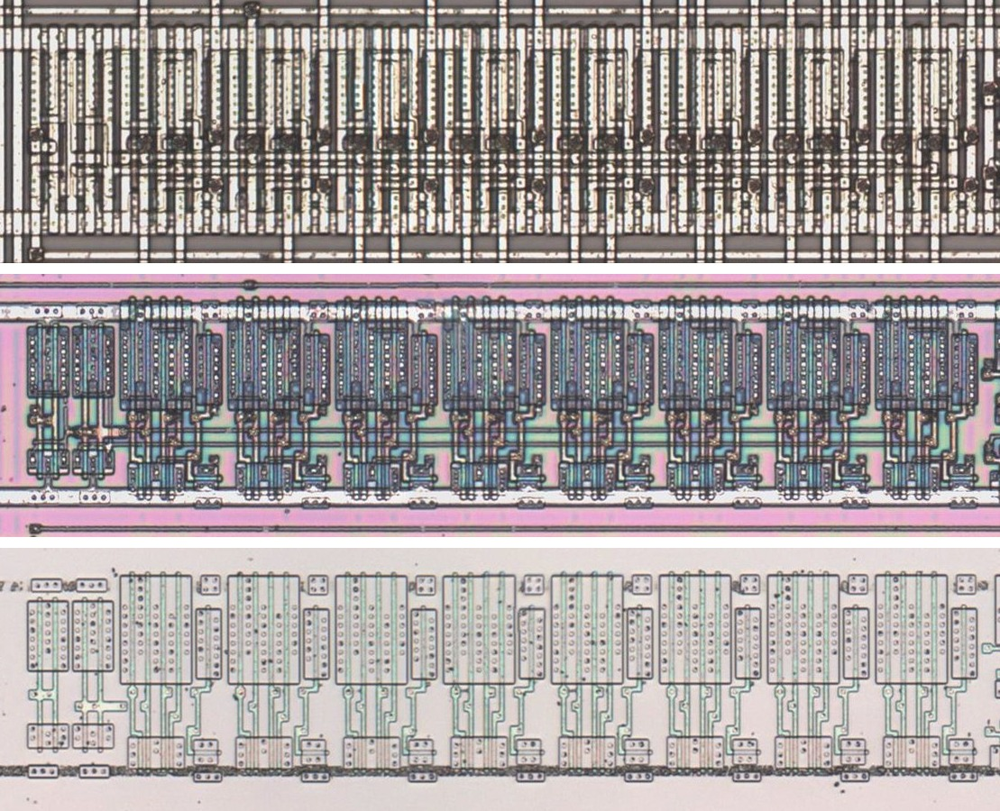

# MUX28H

Two-to-one multiplexer of two 8-bit words.

**Original.** The trace has no drawing of this cell; it was read from the die.

<p align="center">
  <a href="MUX28H_die.jpg"></a><br>
  <small>UBD415 at top metal, delayering step 3 and delayering step 5 (top to bottom)</small>
</p>

- **Instances**: 2 in the netlist

## Model

```verilog
module capcom_dl0921_MUX28H (
    input  wire p1,
    input  wire p2,
    input  wire p3,
    input  wire p4,
    input  wire p5,
    input  wire p6,
    input  wire p7,
    input  wire p8,
    input  wire p9,
    input  wire p10,
    input  wire p11,
    input  wire p12,
    input  wire p13,
    input  wire p14,
    input  wire p15,
    input  wire p16,
    input  wire p25,
    output wire p17,
    output wire p18,
    output wire p19,
    output wire p20,
    output wire p21,
    output wire p22,
    output wire p23,
    output wire p24
);

wire [7:0] a = {p6, p7, p8, p5, p4, p3, p2, p1};
wire [7:0] b = {p15, p13, p16, p14, p12, p11, p10, p9};

assign `D {p24, p21, p23, p22, p20, p19, p18, p17} = p25 ? b : a;

endmodule
```
