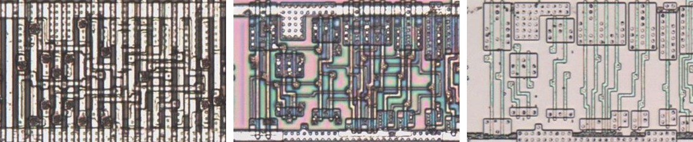
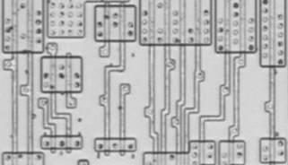
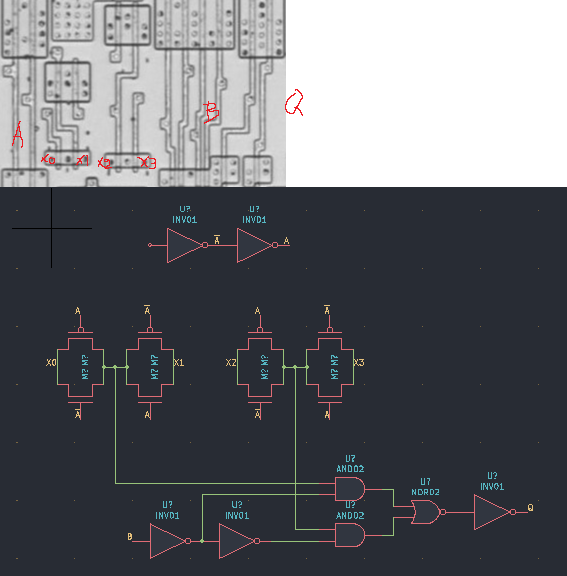

# MUX4H

Four-to-one multiplexer.

**Confirmed.** Matches its drawing in the trace, checked on the die.

<p align="center">
  <a href="MUX4H_die.jpg"></a><br>
  <small>UBW401 at top metal, delayering step 3 and delayering step 5 (left to right)</small>
</p>

- **Instances**: 1 in the netlist

## Model

```verilog
module capcom_dl0921_MUX4H (
    input  wire p1,
    input  wire p2,
    input  wire p3,
    input  wire p4,
    input  wire p5,
    input  wire p6,
    output wire p7
);

wire [3:0] x = {p4, p3, p2, p1};

assign `D p7 = x[{p6, p5}];

endmodule
```

## Drawing

<table align="center">
  <tr><td align="center"><a href="MUX4H_drawing.png"></a></td><td align="center"><a href="MUX4H_drawing_pins.png"></a></td></tr>
  <tr><td align="center"><b>Drawing</b></td><td align="center"><b>Drawing With Pin Numbers</b></td></tr>
</table>

Loïc "WydD" Petit, [cps2-reverse](https://gitlab.com/loic.petit/cps2-reverse) (CC BY), MUX4H.
