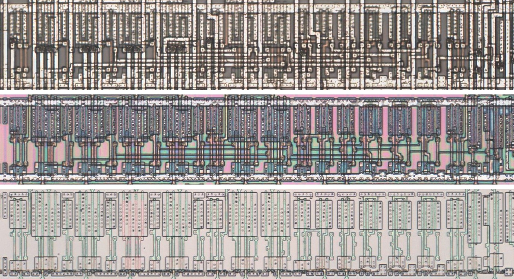
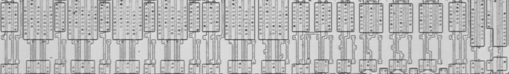
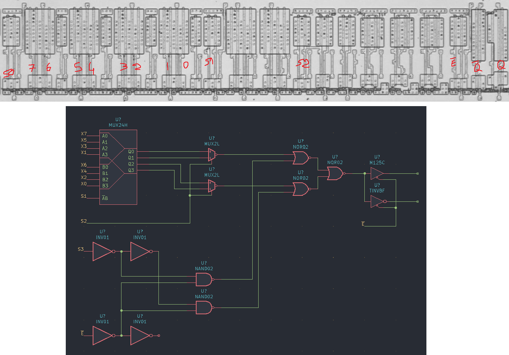

# MUX8GLH

Eight-to-one multiplexer with true and inverted tri-state outputs.

**Confirmed.** Matches its drawing in the trace, checked on the die.

<p align="center">
  <a href="MUX8GLH_die.jpg"></a><br>
  <small>UAR1 at top metal, delayering step 3 and delayering step 5 (top to bottom)</small>
</p>

- **Instances**: 24 in the netlist
- The internal node is the selected input inverted, an inverting two-to-one stage and then a NOR.
- Q (p5) buffers the node and ~Q (p6) is a tri-state inverter, so ~Q carries the selected input true.
- The selects come out inverted, the input chosen being 7 minus the select.

## Model

```verilog
module capcom_dl0921_MUX8GLH (
    input  wire p1,
    input  wire p2,
    input  wire p3,
    input  wire p4,
    input  wire p7,
    input  wire p9,
    input  wire p10,
    input  wire p11,
    input  wire p12,
    input  wire p13,
    input  wire p14,
    input  wire p15,
    output wire p5,
    output wire p6
);

wire [7:0] i = {p12, p13, p14, p15, p1, p2, p3, p4};
wire [2:0] s = ~{p9, p10, p11};
wire       q = i[s];

assign `D p5 = p7 ? 1'bz : ~q;
assign `D p6 = p7 ? 1'bz : q;

endmodule
```

## Drawing

<table align="center">
  <tr><td align="center"><a href="MUX8GLH_drawing.png"></a></td><td align="center"><a href="MUX8GLH_drawing_pins.png"></a></td></tr>
  <tr><td align="center"><b>Drawing</b></td><td align="center"><b>Drawing With Pin Numbers</b></td></tr>
</table>

Loïc "WydD" Petit, [cps2-reverse](https://gitlab.com/loic.petit/cps2-reverse) (CC BY), MUX8GLH.
