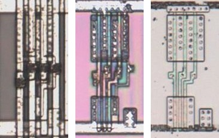
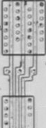

# NAND03

Three-input NAND.

**Confirmed.** Matches its drawing in the trace, checked on the die.

<p align="center">
  <a href="NAND03_die.jpg"></a><br>
  <small>UCS1 at top metal, delayering step 3 and delayering step 5 (left to right)</small>
</p>

- **Instances**: 18 in the netlist

## Model

```verilog
module capcom_dl0921_NAND03 (
    input  wire p1,
    input  wire p2,
    input  wire p3,
    output wire p4
);

assign `D p4 = ~(p1 & p2 & p3);

endmodule
```

## Drawing

<table align="center">
  <tr><td align="center"><a href="NAND03_drawing.png"></a></td></tr>
  <tr><td align="center"><b>Drawing</b></td></tr>
</table>

Loïc "WydD" Petit, [cps2-reverse](https://gitlab.com/loic.petit/cps2-reverse) (CC BY), NAND03.
