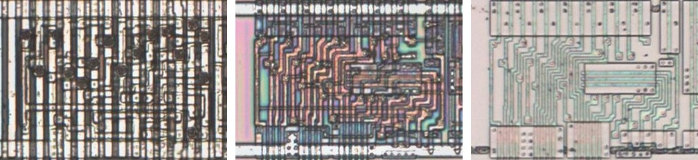
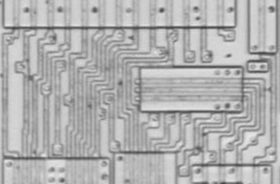
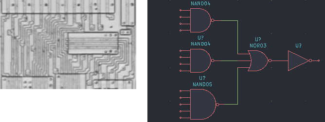

# NAND13

Thirteen-input NAND.

**Confirmed.** Matches its drawing in the trace, checked on the die.

<p align="center">
  <a href="NAND13_die.jpg"></a><br>
  <small>UCT365 at top metal, delayering step 3 and delayering step 5 (left to right)</small>
</p>

- **Instances**: 12 in the netlist

## Model

```verilog
module capcom_dl0921_NAND13 (
    input  wire p1,
    input  wire p2,
    input  wire p3,
    input  wire p4,
    input  wire p5,
    input  wire p6,
    input  wire p7,
    input  wire p8,
    input  wire p9,
    input  wire p10,
    input  wire p11,
    input  wire p12,
    input  wire p13,
    output wire p14
);

assign `D p14 = ~(p1 & p2 & p3 & p4 & p5 & p6 & p7 & p8 & p9 & p10 & p11 & p12 & p13);

endmodule
```

## Drawing

<table align="center">
  <tr><td align="center"><a href="NAND13_drawing.png"></a></td><td align="center"><a href="NAND13_drawing_pins.png"></a></td></tr>
  <tr><td align="center"><b>Drawing</b></td><td align="center"><b>Drawing With Pin Numbers</b></td></tr>
</table>

Loïc "WydD" Petit, [cps2-reverse](https://gitlab.com/loic.petit/cps2-reverse) (CC BY), NAND13.
