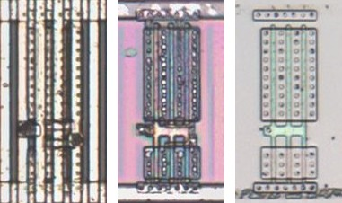
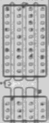

# NBUF03

Inverting buffer.

**Confirmed, With Fixes.** UCO137 and UCO332, traced as NBUF02, are NBUF03 on the die.

<p align="center">
  <a href="NBUF03_die.jpg"></a><br>
  <small>UBD516 at top metal, delayering step 3 and delayering step 5 (left to right)</small>
</p>

- **Instances**: 9 in the netlist

## Model

```verilog
module capcom_dl0921_NBUF03 (
    input  wire p1,
    output wire p2
);

assign `D p2 = ~p1;

endmodule
```

## Drawing

<table align="center">
  <tr><td align="center"><a href="NBUF03_drawing.png"></a></td></tr>
  <tr><td align="center"><b>Drawing</b></td></tr>
</table>

Loïc "WydD" Petit, [cps2-reverse](https://gitlab.com/loic.petit/cps2-reverse) (CC BY), NBUF03.
