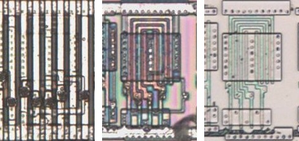
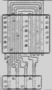

# NOR04

Four-input NOR.

**Confirmed.** Matches its drawing in the trace, checked on the die.

<p align="center">
  <a href="NOR04_die.jpg"></a><br>
  <small>UCT341 at top metal, delayering step 3 and delayering step 5 (left to right)</small>
</p>

- **Instances**: 21 in the netlist

## Model

```verilog
module capcom_dl0921_NOR04 (
    output wire p1,
    input  wire p2,
    input  wire p3,
    input  wire p4,
    input  wire p5
);

assign `D p1 = ~(p2 | p3 | p4 | p5);

endmodule
```

## Drawing

<table align="center">
  <tr><td align="center"><a href="NOR04_drawing.png"></a></td></tr>
  <tr><td align="center"><b>Drawing</b></td></tr>
</table>

Loïc "WydD" Petit, [cps2-reverse](https://gitlab.com/loic.petit/cps2-reverse) (CC BY), NOR04.
