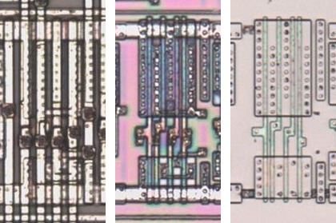

# OAI211

OR-AND-invert, a two-input OR and two inputs into a NAND.

**Original.** The trace has no drawing of this cell; it was read from the die.

<p align="center">
  <a href="OAI211_die.jpg"></a><br>
  <small>UBZ473 at top metal, delayering step 3 and delayering step 5 (left to right)</small>
</p>

- **Instances**: 1 in the netlist
- The input groups follow the symbol geometry.

## Model

```verilog
module capcom_dl0921_OAI211 (
    input  wire p1,
    input  wire p2,
    input  wire p3,
    input  wire p4,
    output wire p5
);

assign `D p5 = ~(p1 & p2 & (p3 | p4));

endmodule
```
