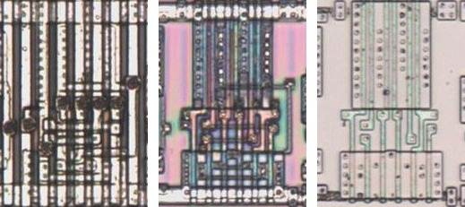
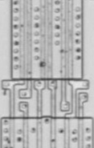

# OAI23

OR-AND-invert, three two-input ORs into a NAND.

**Confirmed.** Matches its drawing in the trace, checked on the die.

<p align="center">
  <a href="OAI23_die.jpg"></a><br>
  <small>UCG462 at top metal, delayering step 3 and delayering step 5 (left to right)</small>
</p>

- **Instances**: 2 in the netlist
- The input groups follow the symbol geometry.

## Model

```verilog
module capcom_dl0921_OAI23 (
    input  wire p1,
    input  wire p2,
    input  wire p3,
    input  wire p4,
    input  wire p5,
    input  wire p6,
    output wire p7
);

assign `D p7 = ~((p1 | p4) & (p2 | p5) & (p3 | p6));

endmodule
```

## Drawing

<table align="center">
  <tr><td align="center"><a href="OAI23_drawing.png"></a></td></tr>
  <tr><td align="center"><b>Drawing</b></td></tr>
</table>

Loïc "WydD" Petit, [cps2-reverse](https://gitlab.com/loic.petit/cps2-reverse) (CC BY), OAI23.
