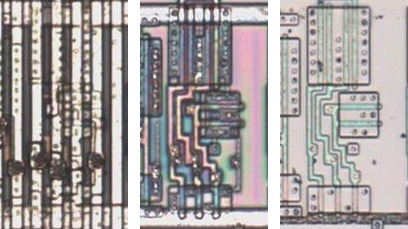
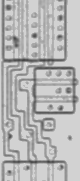

# OR02

Two-input OR.

**Confirmed.** Matches its drawing in the trace, checked on the die.

<p align="center">
  <a href="OR02_die.jpg"></a><br>
  <small>UCR298 at top metal, delayering step 3 and delayering step 5 (left to right)</small>
</p>

- **Instances**: 64 in the netlist

## Model

```verilog
module capcom_dl0921_OR02 (
    input  wire p1,
    input  wire p2,
    output wire p3
);

assign `D p3 = p1 | p2;

endmodule
```

## Drawing

<table align="center">
  <tr><td align="center"><a href="OR02_drawing.png"></a></td></tr>
  <tr><td align="center"><b>Drawing</b></td></tr>
</table>

Loïc "WydD" Petit, [cps2-reverse](https://gitlab.com/loic.petit/cps2-reverse) (CC BY), OR02.
