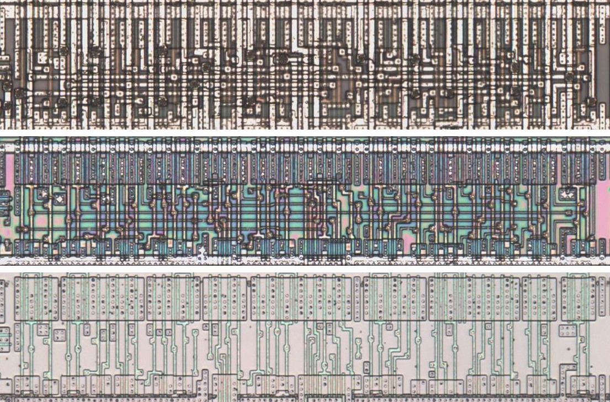
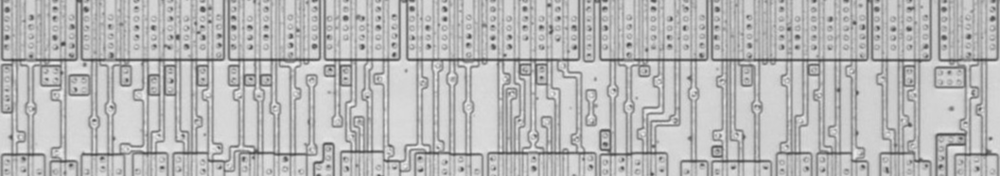
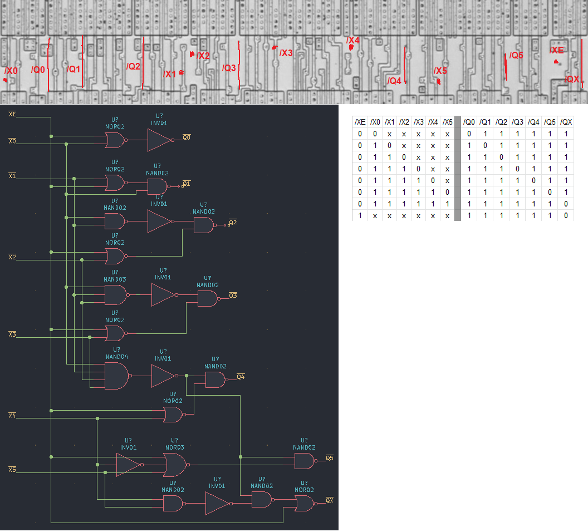

# PRIO

Priority encoder of six inputs with an enable, active-low outputs.

**Confirmed.** Matches its drawing in the trace, checked on the die.

<p align="center">
  <a href="PRIO_die.jpg"></a><br>
  <small>UBH70 at top metal, delayering step 3 and delayering step 5 (top to bottom)</small>
</p>

- **Instances**: 1 in the netlist

## Model

```verilog
module capcom_dl0921_PRIO (
    input  wire p1,
    input  wire p2,
    input  wire p3,
    input  wire p4,
    input  wire p5,
    input  wire p6,
    input  wire p7,
    output wire p8,
    output wire p9,
    output wire p10,
    output wire p11,
    output wire p12,
    output wire p13,
    output wire p14
);

wire [5:0] x = ~{p6, p5, p4, p3, p2, p1};
wire       e = ~p7;

assign `D p8 = ~(e & x[0]);
assign `D p9 = ~(e & x[1] & ~x[0]);
assign `D p10 = ~(e & x[2] & ~|x[1:0]);
assign `D p11 = ~(e & x[3] & ~|x[2:0]);
assign `D p12 = ~(e & x[4] & ~|x[3:0]);
assign `D p13 = ~(e & x[5] & ~|x[4:0]);
assign `D p14 = ~(~e | ~|x);

endmodule
```

## Drawing

<table align="center">
  <tr><td align="center"><a href="PRIO_drawing.png"></a></td><td align="center"><a href="PRIO_drawing_pins.png"></a></td></tr>
  <tr><td align="center"><b>Drawing</b></td><td align="center"><b>Drawing With Pin Numbers</b></td></tr>
</table>

Loïc "WydD" Petit, [cps2-reverse](https://gitlab.com/loic.petit/cps2-reverse) (CC BY), PRIO.
