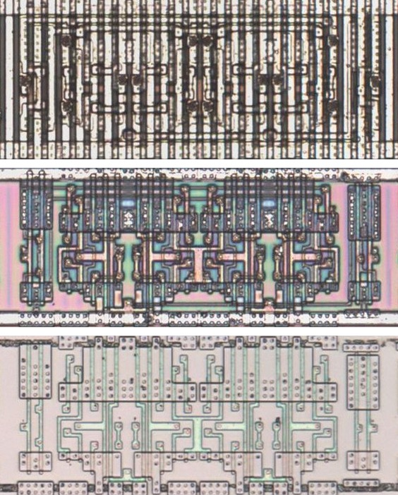
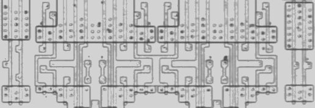
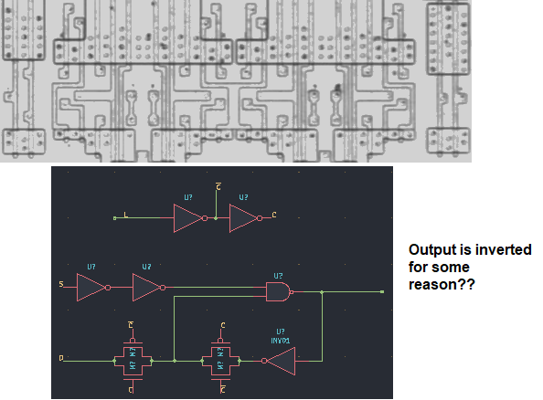

# R42

Four-bit latch of the inverted inputs with an active-low set.

**Confirmed.** Matches its drawing in the trace, checked on the die.

<p align="center">
  <a href="R42_die.jpg"></a><br>
  <small>UCG415 at top metal, delayering step 3 and delayering step 5 (top to bottom)</small>
</p>

- **Instances**: 3 in the netlist
- Q is the inverse of ~D; ~S sets.

## Model

```verilog
module capcom_dl0921_R42 (
    input  wire p1,
    input  wire p2,
    input  wire p3,
    input  wire p4,
    input  wire p5,
    input  wire p6,
    output wire p7,
    output wire p8,
    output wire p9,
    output wire p10
);

reg  [3:0] q = 4'b0;
wire       c;

assign `MPW c = p2;

always @* begin
    if(!c) q = 4'hf;
    else if(p1) q = ~{p6, p5, p4, p3};
end

assign {p10, p9, p8, p7} = q;

endmodule
```

## Drawing

<table align="center">
  <tr><td align="center"><a href="R42_drawing.png"></a></td><td align="center"><a href="R42_drawing_pins.png"></a></td></tr>
  <tr><td align="center"><b>Drawing</b></td><td align="center"><b>Drawing With Pin Numbers</b></td></tr>
</table>

Loïc "WydD" Petit, [cps2-reverse](https://gitlab.com/loic.petit/cps2-reverse) (CC BY), R42.
