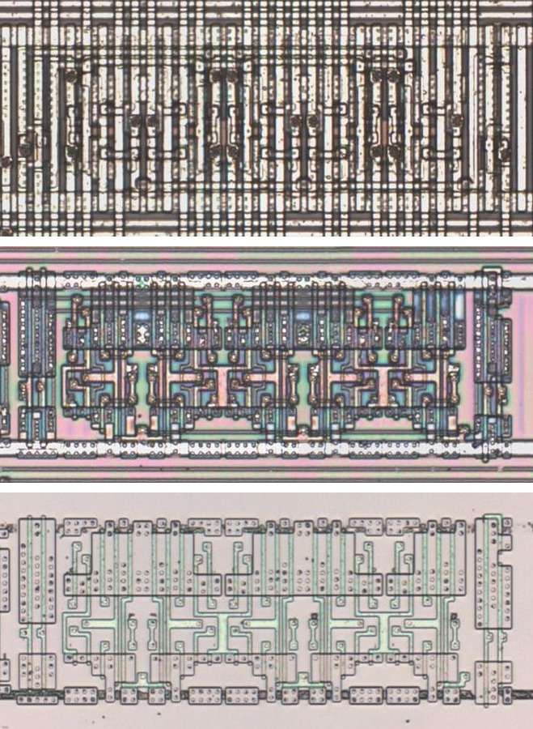

# R52

Five-bit latch of the inverted inputs with an active-low set.

**Original.** The trace has no drawing of this cell; it was read from the die.

<p align="center">
  <a href="R52_die.jpg"></a><br>
  <small>UBU329 at top metal, delayering step 3 and delayering step 5 (top to bottom)</small>
</p>

- **Instances**: 3 in the netlist
- Q is the inverse of ~D; ~S sets.

## Model

```verilog
module capcom_dl0921_R52 (
    input  wire p1,
    input  wire p2,
    input  wire p3,
    input  wire p4,
    input  wire p5,
    input  wire p6,
    input  wire p7,
    output wire p8,
    output wire p9,
    output wire p10,
    output wire p11,
    output wire p12
);

reg  [4:0] q = 5'b0;
wire       c;

assign `MPW c = p2;

always @* begin
    if(!c) q = 5'h1f;
    else if(p1) q = ~{p7, p6, p5, p4, p3};
end

assign {p12, p11, p10, p9, p8} = q;

endmodule
```
