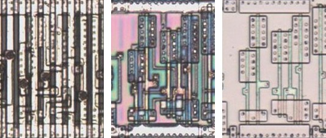
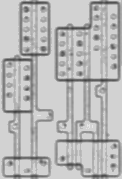

# TINVBF

Tri-state inverter with an active-low enable.

**Confirmed.** Matches its drawing in the trace, checked on the die.

<p align="center">
  <a href="TINVBF_die.jpg"></a><br>
  <small>UCG466 at top metal, delayering step 3 and delayering step 5 (left to right)</small>
</p>

- **Instances**: 8 in the netlist
- Pin 1 is the active-low output enable.

## Model

```verilog
module capcom_dl0921_TINVBF (
    input  wire p1,
    input  wire p2,
    output wire p3
);

assign `D p3 = p1 ? 1'bz : ~p2;

endmodule
```

## Drawing

<table align="center">
  <tr><td align="center"><a href="TINVBF_drawing.png"></a></td><td align="center"><a href="TINVBF_drawing_pins.png"></a></td></tr>
  <tr><td align="center"><b>Drawing</b></td><td align="center"><b>Drawing With Pin Numbers</b></td></tr>
</table>

Loïc "WydD" Petit, [cps2-reverse](https://gitlab.com/loic.petit/cps2-reverse) (CC BY), TINVBF.
