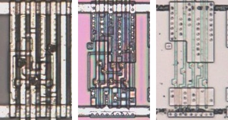
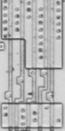

# XNOR02

Two-input exclusive NOR.

**Confirmed, With Fixes.** The ten star gates, UBW131 to UBW142 and UBR218 to UBR229, traced as XOR02, are XNOR02 on the die.

<p align="center">
  <a href="XNOR02_die.jpg"></a><br>
  <small>UCQ1 at top metal, delayering step 3 and delayering step 5 (left to right)</small>
</p>

- **Instances**: 226 in the netlist

## Model

```verilog
module capcom_dl0921_XNOR02 (
    input  wire p1,
    input  wire p2,
    output wire p3
);

assign `D p3 = ~(p1 ^ p2);

endmodule
```

## Drawing

<table align="center">
  <tr><td align="center"><a href="XNOR02_drawing.png"></a></td></tr>
  <tr><td align="center"><b>Drawing</b></td></tr>
</table>

Loïc "WydD" Petit, [cps2-reverse](https://gitlab.com/loic.petit/cps2-reverse) (CC BY), XNOR02.
