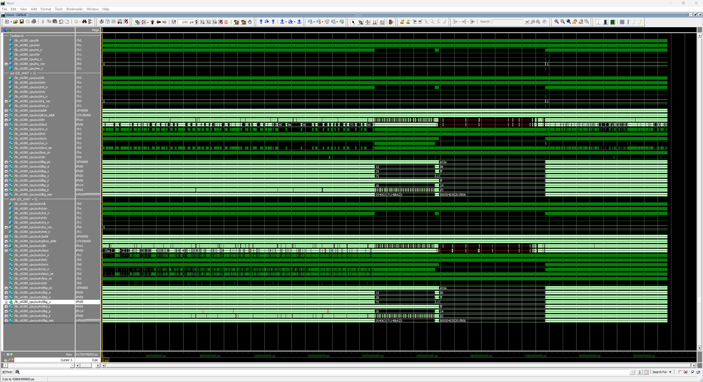
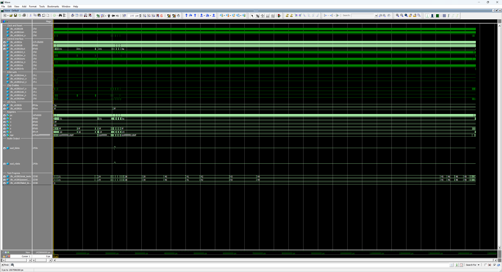
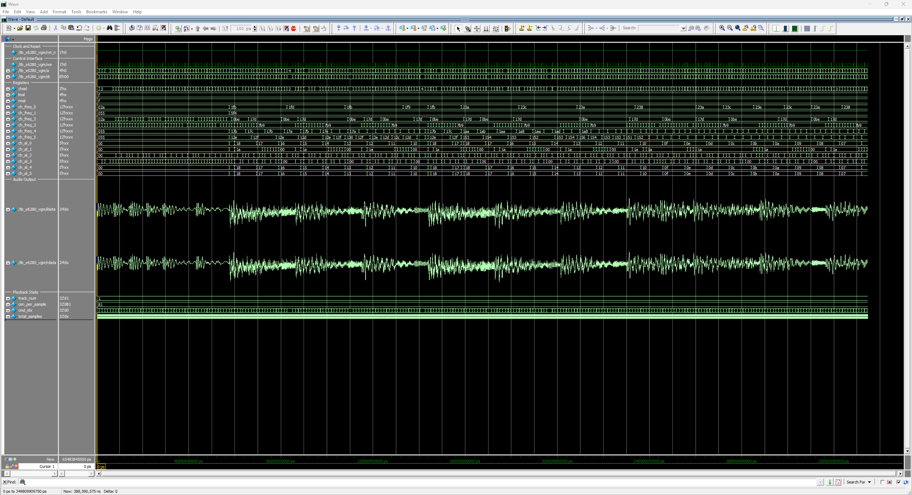

# x6280 - Hudson Soft HuC6280 Verilog Implementation

<table align="center">
  <tr>
    <td align="center" style="padding: 10px;">
      
    </td>
  </tr>
</table>

## x6280 Overview

The **x6280** is a fully synchronous, instruction and bus-cycle accurate Verilog implementation of the Hudson Soft HuC6280 8-bit CMOS microprocessor with its on-chip peripherals. The design is implemented as an explicit per-cycle finite state machine without microcode. The HuC6280 was designed by Hudson Soft and manufactured by NEC for the PC Engine / TurboGrafx-16 and arcade boards; it extends the R65C02 instruction set with eight memory mapping registers, block transfers, the T flag and VDC store instructions, and integrates an interrupt controller, a timer, an I/O port and a six-channel programmable sound generator.

The chip integrator (`x6280`) presents the HuC6280 pins: the 21-bit physical address, RD / WR, the chip enables, the speed output and the stereo PSG output. The CPU (`x6280_cpu`) can also be used alone.

Sources of behavior, in this order:

<small>

- **Hudson manuals**: HuC6280 Hardware Manual [p.HB-N], Software Manual [p.SB-N] and PSG Manual [p.PB-N], and the HuC6280 patents US 5,483,659 (bus cycle, CSH / CSL) and US 5,034,886 (block transfers).
- **Hardware-measured**: the PC-Engine CPU Timing Test, laid out on a PC Engine to whole scanlines.
- **R65C02-derived**: the cycles the HuC6280 shares with the R65C02 keep the R65C02 bus (address, R/W and data of every dummy read, read-modify-write and decimal-mode cycle).

</small>

### Features

<small>

- **Fully Synchronous Design**: All state changes occur on the positive edge of `clk` when `cen` is active. RES, RDY, IRQ and NMI are sampled at `cen` only. No latches or asynchronous logic.
- **Cycle Accurate**: Every opcode takes the cycles of the Hudson instruction map [p.HB-25], with no page-crossing term; branches add 2 when taken, ADC and SBC add 1 in decimal mode, the T-flag operations add 3, block transfers take 17 + 6n.
- **Bus-Cycle Accurate**: The cycles shared with the R65C02 keep its bus; each cycle the HuC6280 adds is an internal cycle (`intc`) that holds the address of the cycle before and drives neither RD nor WR.
- **Complete Instruction Set**: All 234 opcodes of the HuC6280 instruction map: the R65C02 instructions with the Rockwell bit group, plus TAM / TMA, TII / TDD / TIN / TIA / TAI, ST0 / ST1 / ST2, TST, BSR, SET, CSL / CSH, SAX / SAY / SXY and CLA / CLX / CLY. The 22 blank opcodes are 2-cycle NOPs.
- **Memory Mapping**: Eight mapping registers turn the 16-bit logical address into the 21-bit physical address; zero page is logical $20xx and the stack $21xx [p.HB-3], [p.HB-7].
- **T Flag**: After SET, AND / ORA / EOR / ADC operate on the zero-page byte at X instead of A, in every addressing mode [p.HB-5].
- **HuC6280 Flag Rules**: BIT (immediate included), TSB, TRB and TST set N and V from the memory operand; decimal ADC / SBC leave V unchanged; every interrupt entry clears D and T [p.HB-4], [p.HB-5].
- **Interrupts**: NMI, timer, IRQ1 and IRQ2 with their own vectors; BRK shares the IRQ2 vector [p.HB-13]. The on-chip controller has the disable and request registers.
- **Block Transfers**: TII, TDD, TIN, TIA and TAI save and restore Y, A and X on the stack, move up to 65536 bytes and hold interrupts until they end [p.HB-6].
- **VDC and VCE Accesses**: ST0 / ST1 / ST2 write the VDC registers on physical page $FF; with `CE_WAIT = 1`, every access to the VDC or VCE (CE7 / CEK) lasts one more cycle.
- **Clock Speed**: CSH and CSL switch between 7.16 MHz and 1.79 MHz at the start of their third cycle [US5483659, Fig. 5]; `hsm` shows the speed.
- **RDY**: `rdy` low holds any cycle, read, write or internal.
- **On-Chip Peripherals**: interrupt controller, 7-bit timer with 1024 prescaler, Port K / Port O, and the six-channel PSG with noise, LFO and direct D/A modes.
- **Vector Pull Output**: `vp_n` asserts low during the two vector reads of an interrupt or BRK entry.
- **Timing Constraints**: The IP ships an SDC file that relaxes its enable-paced paths from one setting in the core SDC. See [Timing Constraints](#timing-constraints).

</small>

## Table of Contents

| # | Section | Description |
|---|---------|-------------|
| 1 | [System Architecture](#system-architecture) | Top-level block diagram of the chip integrator, CPU, ALU, decoder, peripherals and external bus |
| 2 | [Module Hierarchy](#module-hierarchy) | Source-file listing with each module's role and approximate line count |
| 3 | [Memory Map](#memory-map) | Logical and physical address spaces, zero page and stack, vectors, the internal-I/O page and the mapping registers |
| 4 | [Register Set](#register-set) | Programmer-visible registers (A / X / Y / PC / S / P / MPR0-MPR7) and the processor-status layout with the T flag |
| 5 | [Instruction Set](#instruction-set) | Addressing modes, cycle-timing tables per group (R65C02 groups and the HuC6280 instructions), blank opcodes and the opcode map |
| 6 | [Control Interface](#control-interface) | Verilog port-level reference for the chip integrator (`x6280`) and the CPU (`x6280_cpu`) |
| 7 | [Control Registers](#control-registers) | On-chip registers: interrupt disable / request, timer, I/O port and PSG (R0-R9, channel modes, levels and mix) |
| 8 | [Design Usage](#design-usage) | Parameters, instantiation template, timing constraints, bus signal timing, clock speed, reset, interrupt handling and the `vp_n` vector-pull strobe |
| 9 | [Device Usage](#device-usage) | FPGA resource usage, timing and Fmax of a standalone compile on two Cyclone V parts |
| 10 | [HuC6280-Specific Behavior](#huc6280-specific-behavior) | Notes on every HuC6280 difference from the R65C02: mapping, zero page and stack, T flag, flag rules, decimal mode, block transfers, VDC / VCE accesses, added cycles, clock speed, interrupts, RDY, reset, blank opcodes, register instructions, BSR |
| 11 | [6502 Family Roadmap](#6502-family-roadmap) | Position of x6280 in the 6502 / R65C02 / HuC6280 IP family |
| 12 | [Project Structure](#project-structure) | Directory tree of the IP package |
| 13 | [Design Verification](#design-verification) | Testbench section breakdowns, run commands, ModelSim screenshots, final summary boxes, and external validation against test suites and a hardware-tuned PC Engine test. Per-test logs: [tb_x6280_cpu](doc/readme/tb_x6280_cpu_log.md), [tb_x6280](doc/readme/tb_x6280_log.md); VGM log: [tb_x6280_vgm](doc/readme/tb_x6280_vgm_log.md). |
| 14 | [VGM Playback](#vgm-playback) | Agnostic VGM playback testbench for validating the PSG against captured HuC6280 audio, plus the VGZ-to-WAV toolchain |
| 15 | [Design References](#design-references) | Hudson manuals, patents and hardware tests used as the implementation reference |
| 16 | [License](#license) | Creative Commons Attribution-NonCommercial 4.0 International |
| 17 | [Support](#support) | Back ongoing Coin-Op Collection FPGA core development on Patreon |

## System Architecture

```
┌────────────────────────────────────────────────────────────────────────┐
│                                 x6280                                  │
│                                                                        │
│  ┌────────────────────────┐         ┌──────────────────┐               │
│  │     x6280_cpu          │ <-----> │     x6280_alu    │               │
│  │                        │         │                  │               │
│  │  16-bit PC             │         │ OR,  AND, EOR    │               │
│  │   8-bit A              │         │ ADC, SBC, CMP    │               │
│  │   8-bit X              │         │ ASL, LSR, ROL    │               │
│  │   8-bit Y              │         │ ROR, BIT, TST    │               │
│  │   8-bit S ($21)        │         │ INC, DEC         │               │
│  │   8-bit P (NVT-DIZC)   │         │ TSB, TRB         │               │
│  │  8 x 8-bit MPR         │         │ Binary + BCD     │               │
│  │  Interrupt entry       │         │ (BCD: V kept)    │               │
│  │  Block transfers       │         │                  │               │
│  │  Per-cycle FSM         │         │                  │               │
│  │  234 opcodes           │         │                  │               │
│  └─────────────┬──────────┘         └──────────────────┘               │
│                │                                                       │
│                │  cpu_pa[20:0], cpu_dout[7:0], cpu_rw_n, cpu_intc      │
│                v                                                       │
│  ┌─────────────────────────────────────────────────────────────────┐   │
│  │                          x6280_mem                              │   │
│  │  Internal-page decode ($1FE000-$1FFFFF), CER_N / CE7_N / CEK_N  │   │
│  │  IO_BUF latch, CPU read-data mux from on-chip blocks            │   │
│  └─────┬───────────────┬───────────────┬──────────────┬────────────┘   │
│        │               │               │              │                │
│  ┌─────▼─────┐  ┌──────▼─────┐  ┌──────▼─────┐  ┌─────▼──────┐         │
│  │ x6280_int │  │ x6280_timer│  │  x6280_io  │  │ x6280_psg  │         │
│  │           │  │            │  │            │  │            │         │
│  │ Disable / │  │ 7-bit dn-  │  │ Port K in  │  │ 6-channel  │         │
│  │ request   │  │ counter +  │  │ Port O out │  │ waveform / │         │
│  │ Vector    │  │ 1024       │  │ ($1FF000)  │  │ noise / LFO│         │
│  │ select    │  │ prescaler  │  │            │  │ / DDA      │         │
│  └───────────┘  └────────────┘  └────────────┘  └──────┬─────┘         │
│                                                        │               │
│  ┌─────────────────────────────────────────────────────▼────────────┐  │
│  │                     External Bus Interface                       │  │
│  │  a[20:0], di[7:0], dout[7:0], rd_n, wr_n, sync, vp_n, hsm        │  │
│  │  ce, cek_n, ce7_n, cer_n, pre_rd, pre_wr                         │  │
│  │  irq1_n, irq2_n, nmi_n, rdy, rst_n, cen, clk                     │  │
│  │  k[7:0], o[7:0], aud_ldata[23:0], aud_rdata[23:0]                │  │
│  └──────────────────────────────────────────────────────────────────┘  │
└────────────────────────────────────────────────────────────────────────┘
```

## Module Hierarchy

| Module | Description | Lines |
|--------|-------------|-------|
| `x6280.v` | Chip integrator: CSH / CSL enable, block instances, RD / WR strobes, external bus | ~320 |
| `x6280_cpu.v` | CPU state machine, instruction decode, registers, mapping registers, interrupt entry, block transfers | ~1910 |
| `x6280_alu.v` | Combinational arithmetic logic unit (binary + BCD, HuC6280 flag rules) | ~290 |
| `x6280_int.v` | Interrupt controller: disable / request registers, mask delay, vector select | ~140 |
| `x6280_timer.v` | Timer: 7-bit downcounter, 1024 prescaler, reload register, start / stop | ~150 |
| `x6280_io.v` | Port K input and Port O output latch | ~75 |
| `x6280_mem.v` | Internal-page decode, chip enables, IO_BUF latch, read-data mux | ~160 |
| `x6280_psg.v` | Six-channel programmable sound generator with waveform RAM, noise, LFO, DDA and stereo mix | ~470 |

## Memory Map

The chip integrator (`x6280`) contains the on-chip peripherals and decodes the internal-I/O page. The host system supplies program ROM, RAM, the VDC and the VCE.

```
Logical Address Space (16-bit, before the mapping registers)
$2000-$20FF   Zero Page  (every zero-page mode)
$2100-$21FF   Stack Page (S indexes within this page)

$FFF6-$FFF7   IRQ2 and BRK Vector
$FFF8-$FFF9   IRQ1 Vector
$FFFA-$FFFB   Timer Vector
$FFFC-$FFFD   NMI Vector
$FFFE-$FFFF   Reset Vector (physical $001FFE-$001FFF with MPR7 = $00 after reset)

Physical Address Space (21-bit, after the mapping registers)
$000000-$1EFFFF  External memory / ROM     (host-decoded)
$1F0000-$1F7FFF  RAM                       (CER_N low)
$1FE000-$1FFFFF  HuC6280 internal-I/O page (decoded by x6280_mem)
```

### Internal-I/O Page Layout

Within the internal-I/O page (`phys_addr[20:13] == $FF`), bits `phys_addr[12:10]` select one of seven blocks [p.HB-9]:

| Range | `[12:10]` | Block | Pin | Description |
|-------|-----------|-------|-----|-------------|
| $1FE000 - $1FE3FF | 000 | HuC6270 VDC | CE7_N | External video display controller |
| $1FE400 - $1FE7FF | 001 | HuC6260 VCE | CEK_N | External video color encoder |
| $1FE800 - $1FEBFF | 010 | PSG | - | On-chip programmable sound generator (R0-R9) |
| $1FEC00 - $1FEFFF | 011 | Timer | - | On-chip timer (reload and start / stop) |
| $1FF000 - $1FF3FF | 100 | I/O Port | - | On-chip Port K input / Port O output |
| $1FF400 - $1FF7FF | 101 | Interrupt | - | On-chip interrupt disable / request registers |
| $1FF800 - $1FFFFF | 110-111 | Reserved | - | Reserved |

PSG reads return $00. Timer reads return `{io_buf[7], counter[6:0]}` and the interrupt registers `{io_buf[7:3], register[2:0]}`; the IO_BUF latch holds the last byte on the internal I/O bus. `rd_n` and `wr_n` stay high for the four on-chip blocks.

### Mapping Register Address Translation

Each mapping register (MPR0 - MPR7) maps one 8 KB logical page to an 8 KB physical bank [p.HB-7]:

```
phys_addr[20:0] = { mpr[ logical[15:13] ], logical[12:0] }
```

| Logical Range | Register | Reset Value | Reset Physical Range |
|---------------|----------|-------------|----------------------|
| $0000-$1FFF | MPR0 | $FF | $1FE000-$1FFFFF |
| $2000-$3FFF | MPR1 | $FF | $1FE000-$1FFFFF |
| $4000-$5FFF | MPR2 | $FF | $1FE000-$1FFFFF |
| $6000-$7FFF | MPR3 | $FF | $1FE000-$1FFFFF |
| $8000-$9FFF | MPR4 | $FF | $1FE000-$1FFFFF |
| $A000-$BFFF | MPR5 | $FF | $1FE000-$1FFFFF |
| $C000-$DFFF | MPR6 | $FF | $1FE000-$1FFFFF |
| $E000-$FFFF | MPR7 | $00 | $000000-$001FFF |

Reset sets MPR7 to $00, so the reset vector is read from physical $001FFE [p.HB-18]. The manual leaves MPR0 - MPR6 undefined after reset [p.HB-8]; x6280 sets them to $FF, the internal-I/O page. Software maps the other pages with TAM before it uses them.

### ST0 / ST1 / ST2

ST0, ST1 and ST2 write their operand to physical $1FE000, $1FE002 and $1FE003, the VDC address and data registers; the write cycle uses physical page $FF whatever the mapping registers hold [p.HB-8]. On the bus the logical address is $0000, $0002 or $0003.

## Register Set

| Register | Width | Description |
|----------|-------|-------------|
| A | 8-bit | Accumulator - general purpose arithmetic / logic |
| X | 8-bit | Index Register X - indexed addressing and counter; addresses the T-flag operand |
| Y | 8-bit | Index Register Y - indexed addressing and counter |
| PC | 16-bit | Program Counter - next instruction address (logical) |
| S | 8-bit | Stack Pointer - low byte of the stack address (high byte = $21) |
| P | 8-bit | Processor Status Register (N V T B D I Z C) |
| MPR0-MPR7 | 8-bit | Mapping registers - physical bank of each 8 KB logical page |

### Processor Status Register

```
  7   6   5   4   3   2   1   0
┌───┬───┬───┬───┬───┬───┬───┬───┐
│ N │ V │ T │ B │ D │ I │ Z │ C │
└───┴───┴───┴───┴───┴───┴───┴───┘
  │   │   │   │   │   │   │   └── Carry / Borrow
  │   │   │   │   │   │   └────── Zero
  │   │   │   │   │   └────────── Interrupt Mask
  │   │   │   │   └────────────── Decimal Mode (BCD)
  │   │   │   └────────────────── Break (only in a pushed copy)
  │   │   └────────────────────── Memory Operation (T)
  │   └────────────────────────── Overflow
  └────────────────────────────── Negative
```

T is set by SET and cleared by the fetch of every instruction; the instruction after SET sees it [p.HB-5]. B exists only in a pushed copy of P: PHP and BRK push 1, interrupts push 0 [p.HB-4]. D is cleared at reset and by every interrupt and BRK; decimal ADC and SBC set N, Z and C and leave V unchanged [p.HB-4].

## Instruction Set

### Addressing Modes

| Mode | Syntax | Bytes | Description |
|------|--------|-------|-------------|
| Implied | `NOP` | 1 | No operand; operation on internal registers |
| Accumulator | `ASL A` | 1 | Operation on A register |
| Immediate | `LDA #$nn` | 2 | Operand follows opcode |
| Zero Page | `LDA $nn` | 2 | EA = $20nn |
| Zero Page,X | `LDA $nn,X` | 2 | EA = $2000 + (($nn + X) & $FF) |
| Zero Page,Y | `LDX $nn,Y` | 2 | EA = $2000 + (($nn + Y) & $FF) |
| Absolute | `LDA $nnnn` | 3 | EA = $nnnn |
| Absolute,X | `LDA $nnnn,X` | 3 | EA = $nnnn + X |
| Absolute,Y | `LDA $nnnn,Y` | 3 | EA = $nnnn + Y |
| Indirect | `JMP ($nnnn)` | 3 | PC = mem[$nnnn], full 16-bit pointer increment |
| (Indirect,X) | `LDA ($nn,X)` | 2 | EA = mem[$20xx], xx = ($nn + X) & $FF |
| (Indirect),Y | `LDA ($nn),Y` | 2 | EA = mem[$20nn] + Y |
| (Indirect) | `LDA ($nn)` | 2 | EA = mem[$20nn] |
| (Absolute,X) | `JMP ($nnnn,X)` | 3 | PC = mem[$nnnn + X] |
| Relative | `BEQ $rr` | 2 | PC + 2 + signed 8-bit offset (branches and BSR) |
| Zero Page,Relative | `BBR0 $nn,$rr` | 3 | Test bit n of $20nn; PC + 3 + signed offset |
| Immediate,Memory | `TST #$ii,$nnnn` | 3-4 | Immediate mask and a zp / zp,X / abs / abs,X operand |
| Block | `TII $ssss,$dddd,$llll` | 7 | Source, destination and length |

All addresses above are logical; the mapping registers turn them into physical addresses. The zero page and the stack sit at logical $20xx and $21xx [p.HB-3], [p.SB-11].

### Instruction Timing

Cycle counts are those of the Hudson instruction map [p.HB-25]; none depends on a page crossing.

#### Load / Store / Logical / Arithmetic

| Instruction | IMM | ZP | ZP,X/Y | ABS | ABS,X/Y | (IND,X) | (IND),Y | (IND) |
|-------------|-----|-----|--------|-----|---------|---------|---------|-------|
| LDA / LDX / LDY | 2 | 4 | 4 | 5 | 5 | 7 | 7 | 7 |
| STA / STX / STY / STZ | - | 4 | 4 | 5 | 5 | 7 | 7 | 7 |
| ADC / SBC / AND / ORA / EOR / CMP | 2 | 4 | 4 | 5 | 5 | 7 | 7 | 7 |
| CPX / CPY | 2 | 4 | - | 5 | - | - | - | - |
| BIT | 2 | 4 | 4 | 5 | 5 | - | - | - |

*ADC and SBC add 1 cycle in decimal mode (D = 1). AND, ORA, EOR and ADC after SET add 3 cycles, 4 for ADC in decimal mode [p.SB-17], [p.SB-18].*

#### Read-Modify-Write Operations

| Instruction | A (acc) | ZP | ZP,X | ABS | ABS,X |
|-------------|---------|-----|------|-----|-------|
| ASL / LSR / ROL / ROR | 2 | 6 | 6 | 7 | 7 |
| INC / DEC | 2 | 6 | 6 | 7 | 7 |
| TRB / TSB | - | 6 | - | 7 | - |

*The operand is read twice, then the result is written once, as on the R65C02.*

#### Branch Instructions

| Instruction | Cycles | Condition |
|-------------|--------|-----------|
| BPL | 2 / 4 | N = 0 |
| BMI | 2 / 4 | N = 1 |
| BVC | 2 / 4 | V = 0 |
| BVS | 2 / 4 | V = 1 |
| BCC | 2 / 4 | C = 0 |
| BCS | 2 / 4 | C = 1 |
| BNE | 2 / 4 | Z = 0 |
| BEQ | 2 / 4 | Z = 1 |
| BRA | 4 | Always taken |
| BBR0-7 | 6 / 8 | Branch if zp bit n = 0 |
| BBS0-7 | 6 / 8 | Branch if zp bit n = 1 |

*Not taken / taken, with or without a page cross [p.SB-20]-[p.SB-33]. A taken branch reads PC+2 (PC+3 for BBR / BBS), then runs an internal cycle, or reads that address again on a page cross.*

#### Stack and Subroutine Instructions

| Instruction | Bytes | Cycles | Description |
|-------------|-------|--------|-------------|
| PHA / PHX / PHY | 1 | 3 | Push A / X / Y |
| PHP | 1 | 3 | Push P with B = 1 and T = 0 |
| PLA / PLX / PLY | 1 | 4 | Pull A / X / Y, update N / Z |
| PLP | 1 | 4 | Pull P, T included |
| JSR $nnnn | 3 | 7 | Push the address of the last byte of JSR, load PC |
| BSR $rr | 2 | 8 | Push the address of the last byte of BSR, branch |
| RTS | 1 | 7 | Pull PC, add 1 |
| RTI | 1 | 7 | Pull P (T included) and PC |

#### Jump Instructions

| Instruction | Bytes | Cycles | Description |
|-------------|-------|--------|-------------|
| JMP $nnnn | 3 | 4 | PC = $nnnn |
| JMP ($nnnn) | 3 | 7 | PC = mem[$nnnn], full 16-bit pointer increment |
| JMP ($nnnn,X) | 3 | 7 | PC = mem[$nnnn + X] |

#### Bit Manipulation (Rockwell)

| Instruction | Bytes | Cycles | Description |
|-------------|-------|--------|-------------|
| RMB0 - RMB7 $nn | 2 | 7 | Clear bit n of a zero-page byte |
| SMB0 - SMB7 $nn | 2 | 7 | Set bit n of a zero-page byte |
| BBR0 - BBR7 $nn,$rr | 3 | 6 / 8 | Branch if bit n of a zero-page byte is clear |
| BBS0 - BBS7 $nn,$rr | 3 | 6 / 8 | Branch if bit n of a zero-page byte is set |

#### HuC6280 Mapping Register Access

| Instruction | Opcode | Bytes | Cycles | Description |
|-------------|--------|-------|--------|-------------|
| TAM #$nn | $53 | 2 | 5 | A to every MPR selected by the one-hot mask `nn` |
| TMA #$nn | $43 | 2 | 4 | The selected MPR to A |

#### HuC6280 VDC Stores

| Instruction | Opcode | Bytes | Cycles | Description |
|-------------|--------|-------|--------|-------------|
| ST0 #$nn | $03 | 2 | 4 (5) | Write `nn` to physical $1FE000 (VDC address register) |
| ST1 #$nn | $13 | 2 | 4 (5) | Write `nn` to physical $1FE002 (VDC data low) |
| ST2 #$nn | $23 | 2 | 4 (5) | Write `nn` to physical $1FE003 (VDC data high) |

*4 cycles in the manuals [p.SB-80]-[p.SB-82]; with `CE_WAIT = 1` the VDC write lasts one more cycle, 5 in all, as measured on hardware.*

#### HuC6280 Block Transfers

| Instruction | Opcode | Bytes | Cycles | Source | Destination |
|-------------|--------|-------|--------|--------|-------------|
| TII $ssss,$dddd,$llll | $73 | 7 | 17 + 6n | +1 | +1 |
| TDD $ssss,$dddd,$llll | $C3 | 7 | 17 + 6n | -1 | -1 |
| TIN $ssss,$dddd,$llll | $D3 | 7 | 17 + 6n | +1 | fixed |
| TIA $ssss,$dddd,$llll | $E3 | 7 | 17 + 6n | +1 | +1 / -1 alternating |
| TAI $ssss,$dddd,$llll | $F3 | 7 | 17 + 6n | +1 / -1 alternating | +1 |

*n is the 16-bit length; a length of 0 moves 65536 bytes [p.HB-6], [p.SB-88]-[p.SB-99].*

#### HuC6280 Register, Test, Clock and Flag Instructions

| Instruction | Opcode | Bytes | Cycles | Description |
|-------------|--------|-------|--------|-------------|
| CLA / CLX / CLY | $62 / $82 / $C2 | 1 | 2 | Clear A / X / Y; no flag changes |
| SAX / SAY / SXY | $22 / $42 / $02 | 1 | 3 | Swap A-X / A-Y / X-Y; no flag changes |
| TST #$ii,$nn | $83 | 3 | 7 | N = M7, V = M6, Z = (ii AND M) = 0 |
| TST #$ii,$nn,X | $A3 | 3 | 7 | Same, zero page,X |
| TST #$ii,$nnnn | $93 | 4 | 8 | Same, absolute |
| TST #$ii,$nnnn,X | $B3 | 4 | 8 | Same, absolute,X |
| CSL | $54 | 1 | 3 | Low speed (1.79 MHz) from cycle 3 |
| CSH | $D4 | 1 | 3 | High speed (7.16 MHz) from cycle 3 |
| SET | $F4 | 1 | 2 | Set T for the next instruction |

#### Interrupt and Control Instructions

| Instruction | Bytes | Cycles | Description |
|-------------|-------|--------|-------------|
| BRK | 1 | 8 | Push PC+2 and P (B = 1, T = 0), I = 1, D = 0, T = 0, vector $FFF6/7 |
| RTI | 1 | 7 | Pull P (T included), pull PC |
| IRQ2 / IRQ1 / Timer / NMI | - | 8 | Push PC and P (B = 0, T as it was), I = 1, D = 0, T = 0, own vector |
| Reset | - | 8 | Vector $FFFE/F; I = 1, D = 0, T = 0, MPR7 = $00, low speed |
| NOP | 1 | 2 | No operation |
| Flag set / clear (CLC, SEC, CLI, SEI, CLV, CLD, SED) | 1 | 2 | Modify a single flag |
| Register transfer (TAX, TAY, TXA, TYA, TSX, TXS) | 1 | 2 | Move between registers |
| Increment / decrement (INX, INY, DEX, DEY, INC A, DEC A) | 1 | 2 | Modify X, Y or A |

#### Blank Opcodes

| Opcodes | Bytes | Cycles | Bus |
|---------|-------|--------|-----|
| x3 (33, 63), xB (16 opcodes), E2, 5C, DC, FC | 1 | 2 | PC, PC+1 |

- The 22 opcodes left blank in the instruction map [p.HB-25] run as 2-cycle, 1-byte NOPs: registers, flags and memory are unchanged.

### Opcode Map

```
     0    1    2    3    4    5    6    7    8    9    A    B    C    D    E    F
   ┌────┬────┬────┬────┬────┬────┬────┬────┬────┬────┬────┬────┬────┬────┬────┬────┐
 0 │BRK │ORA │SXY │ST0 │TSB │ORA │ASL │RMB0│PHP │ORA │ASL │ -- │TSB │ORA │ASL │BBR0│
   │    │izx │HuC │HuC │ zp │ zp │ zp │ zp │    │imm │ A  │    │abs │abs │abs │zprl│
   ├────┼────┼────┼────┼────┼────┼────┼────┼────┼────┼────┼────┼────┼────┼────┼────┤
 1 │BPL │ORA │ORA │ST1 │TRB │ORA │ASL │RMB1│CLC │ORA │INC │ -- │TRB │ORA │ASL │BBR1│
   │ rel│izy │izp │HuC │ zp │zpx │zpx │ zp │    │aby │ A  │    │abs │abx │abx │zprl│
   ├────┼────┼────┼────┼────┼────┼────┼────┼────┼────┼────┼────┼────┼────┼────┼────┤
 2 │JSR │AND │SAX │ST2 │BIT │AND │ROL │RMB2│PLP │AND │ROL │ -- │BIT │AND │ROL │BBR2│
   │abs │izx │HuC │HuC │ zp │ zp │ zp │ zp │    │imm │ A  │    │abs │abs │abs │zprl│
   ├────┼────┼────┼────┼────┼────┼────┼────┼────┼────┼────┼────┼────┼────┼────┼────┤
 3 │BMI │AND │AND │ -- │BIT │AND │ROL │RMB3│SEC │AND │DEC │ -- │BIT │AND │ROL │BBR3│
   │ rel│izy │izp │    │zpx │zpx │zpx │ zp │    │aby │ A  │    │abx │abx │abx │zprl│
   ├────┼────┼────┼────┼────┼────┼────┼────┼────┼────┼────┼────┼────┼────┼────┼────┤
 4 │RTI │EOR │SAY │TMA │BSR │EOR │LSR │RMB4│PHA │EOR │LSR │ -- │JMP │EOR │LSR │BBR4│
   │    │izx │HuC │HuC │HuC │ zp │ zp │ zp │    │imm │ A  │    │abs │abs │abs │zprl│
   ├────┼────┼────┼────┼────┼────┼────┼────┼────┼────┼────┼────┼────┼────┼────┼────┤
 5 │BVC │EOR │EOR │TAM │CSL │EOR │LSR │RMB5│CLI │EOR │PHY │ -- │ -- │EOR │LSR │BBR5│
   │ rel│izy │izp │HuC │HuC │zpx │zpx │ zp │    │aby │    │    │    │abx │abx │zprl│
   ├────┼────┼────┼────┼────┼────┼────┼────┼────┼────┼────┼────┼────┼────┼────┼────┤
 6 │RTS │ADC │CLA │ -- │STZ │ADC │ROR │RMB6│PLA │ADC │ROR │ -- │JMP │ADC │ROR │BBR6│
   │    │izx │HuC │    │ zp │ zp │ zp │ zp │    │imm │ A  │    │ind │abs │abs │zprl│
   ├────┼────┼────┼────┼────┼────┼────┼────┼────┼────┼────┼────┼────┼────┼────┼────┤
 7 │BVS │ADC │ADC │TII │STZ │ADC │ROR │RMB7│SEI │ADC │PLY │ -- │JMP │ADC │ROR │BBR7│
   │ rel│izy │izp │HuC │zpx │zpx │zpx │ zp │    │aby │    │    │iax │abx │abx │zprl│
   ├────┼────┼────┼────┼────┼────┼────┼────┼────┼────┼────┼────┼────┼────┼────┼────┤
 8 │BRA │STA │CLX │TST │STY │STA │STX │SMB0│DEY │BIT │TXA │ -- │STY │STA │STX │BBS0│
   │ rel│izx │HuC │HuC │ zp │ zp │ zp │ zp │    │imm │    │    │abs │abs │abs │zprl│
   ├────┼────┼────┼────┼────┼────┼────┼────┼────┼────┼────┼────┼────┼────┼────┼────┤
 9 │BCC │STA │STA │TST │STY │STA │STX │SMB1│TYA │STA │TXS │ -- │STZ │STA │STZ │BBS1│
   │ rel│izy │izp │HuC │zpx │zpx │zpy │ zp │    │aby │    │    │abs │abx │abx │zprl│
   ├────┼────┼────┼────┼────┼────┼────┼────┼────┼────┼────┼────┼────┼────┼────┼────┤
 A │LDY │LDA │LDX │TST │LDY │LDA │LDX │SMB2│TAY │LDA │TAX │ -- │LDY │LDA │LDX │BBS2│
   │imm │izx │imm │HuC │ zp │ zp │ zp │ zp │    │imm │    │    │abs │abs │abs │zprl│
   ├────┼────┼────┼────┼────┼────┼────┼────┼────┼────┼────┼────┼────┼────┼────┼────┤
 B │BCS │LDA │LDA │TST │LDY │LDA │LDX │SMB3│CLV │LDA │TSX │ -- │LDY │LDA │LDX │BBS3│
   │ rel│izy │izp │HuC │zpx │zpx │zpy │ zp │    │aby │    │    │abx │abx │aby │zprl│
   ├────┼────┼────┼────┼────┼────┼────┼────┼────┼────┼────┼────┼────┼────┼────┼────┤
 C │CPY │CMP │CLY │TDD │CPY │CMP │DEC │SMB4│INY │CMP │DEX │ -- │CPY │CMP │DEC │BBS4│
   │imm │izx │HuC │HuC │ zp │ zp │ zp │ zp │    │imm │    │    │abs │abs │abs │zprl│
   ├────┼────┼────┼────┼────┼────┼────┼────┼────┼────┼────┼────┼────┼────┼────┼────┤
 D │BNE │CMP │CMP │TIN │CSH │CMP │DEC │SMB5│CLD │CMP │PHX │ -- │ -- │CMP │DEC │BBS5│
   │ rel│izy │izp │HuC │HuC │zpx │zpx │ zp │    │aby │    │    │    │abx │abx │zprl│
   ├────┼────┼────┼────┼────┼────┼────┼────┼────┼────┼────┼────┼────┼────┼────┼────┤
 E │CPX │SBC │ -- │TIA │CPX │SBC │INC │SMB6│INX │SBC │NOP │ -- │CPX │SBC │INC │BBS6│
   │imm │izx │    │HuC │ zp │ zp │ zp │ zp │    │imm │    │    │abs │abs │abs │zprl│
   ├────┼────┼────┼────┼────┼────┼────┼────┼────┼────┼────┼────┼────┼────┼────┼────┤
 F │BEQ │SBC │SBC │TAI │SET │SBC │INC │SMB7│SED │SBC │PLX │ -- │ -- │SBC │INC │BBS7│
   │ rel│izy │izp │HuC │HuC │zpx │zpx │ zp │    │aby │    │    │    │abx │abx │zprl│
   └────┴────┴────┴────┴────┴────┴────┴────┴────┴────┴────┴────┴────┴────┴────┴────┘
```

*Cells marked `--` are the 22 blank opcodes, 2-cycle NOPs (see [Blank Opcodes](#blank-opcodes)). Addressing-mode keys: `izp` = (zp) indirect, `iax` = (abs,X) indirect, `zprl` = zero-page,relative (BBR / BBS), `HuC` = HuC6280 instruction (see the tables above), all others as on the R65C02.*

## Control Interface

### Parameters

```verilog
// Chip Integrator (x6280)
parameter TIMER_SCALE = 1, // Timer prescaler multiplier
parameter CE_WAIT     = 1, // 1 = CE7 / CEK accesses last one more cycle
parameter INT_RD      = 0, // 1 = rd_n low in internal cycles
parameter PSG         = 1  // 0 = no PSG, audio outputs 0

// CPU (x6280_cpu)
parameter CE_WAIT     = 1  // 1 = CE7 / CEK accesses last one more enable
```

### Chip Integrator (`x6280`)

```verilog
// Clock and Reset
input  wire               clk,       // System clock
input  wire               rst_n,     // Active-low reset (RESET pin), sampled at cen
input  wire               cen,       // OSC1 / 3 enable (7.16 MHz at high speed)
input  wire               rdy,       // Active-high ready (any cycle repeats while low)

// External Bus
output wire        [20:0] a,         // Physical address
input  wire         [7:0] di,        // Data in
output wire         [7:0] dout,      // Data out
output wire               rd_n,      // Read strobe, low for a whole external read cycle
output wire               wr_n,      // Write strobe, low for a whole external write cycle
output wire               sync,      // High during an opcode fetch
output wire               vp_n,      // Vector Pull, low during the interrupt / BRK vector reads

// Interrupt Inputs
input  wire               nmi_n,     // NMI, falling edge
input  wire               irq1_n,    // IRQ1, level low
input  wire               irq2_n,    // IRQ2, level low

// Chip-Select
output wire               ce,        // Enable that ends a CPU cycle
output wire               cek_n,     // HuC6260 VCE select ($1FE400-$1FE7FF)
output wire               ce7_n,     // HuC6270 VDC select ($1FE000-$1FE3FF)
output wire               cer_n,     // RAM select ($1F0000-$1F7FFF)
output wire               pre_rd,    // Enable that ends a read cycle, on-chip blocks included
output wire               pre_wr,    // Enable that ends a write cycle, on-chip blocks included
output wire               hsm,       // High-speed mode (1 = CSH, 0 = CSL)

// I/O Ports
input  wire         [7:0] k,         // Port K input
output wire         [7:0] o,         // Port O output (latched, $FF after reset)

// Audio Output
output wire signed [23:0] aud_ldata, // PSG left
output wire signed [23:0] aud_rdata  // PSG right
```

### CPU (`x6280_cpu`)

The CPU alone, for hosts that supply their own peripherals. It presents the logical and the physical address of every cycle. Used alone, it leaves to the host what the chip integrator does around it:

- **Speed:** `cen` follows `csh`: every OSC1 / 3 enable at high speed, every fourth one at low speed (see Clock Speed (CSL / CSH)).
- **Interrupts:** `irq_n` and `irq_vec` come from the host's masking of IRQ1, IRQ2 and the timer.
- **Bus strobes:** an external read is a cycle with `rw_n` high and `intc` low, an external write one with `rw_n` low. Accesses to the internal-I/O page ($1FE000-$1FFFFF) are for the host to decode.
- **Inputs:** `din`, `rdy`, `irq_n` and `nmi_n` pass through the opcode decode into the registers on the clock of `cen`. A host that latches them a few `clk` before `cen` and delays `cen` to match can relax those paths in its SDC; an input that changes on any `clk`, such as `rdy` from an SDRAM fetch, otherwise needs a single-cycle path through the decode.

```verilog
// Clock and Reset
input  wire        clk,       // System clock
input  wire        cen,       // Clock enable (one bus cycle per pulse)
input  wire        rst_n,     // Active-low reset (RESET pin)
input  wire        rdy,       // Active-high ready (RDY pin)

// Interrupt Inputs
input  wire        irq_n,     // Masked IRQ1 / IRQ2 / timer request
input  wire  [1:0] irq_vec,   // Vector select (00 IRQ2, 01 IRQ1, 10 timer)
input  wire        nmi_n,     // NMI

// CPU Bus Interface
output reg  [15:0] addr,      // Logical address
output wire [20:0] phys_addr, // Physical address (mapping registers)
input  wire  [7:0] din,       // Data in
output reg   [7:0] dout,      // Data out
output reg         rw_n,      // R/W (high = read, low = write)
output reg         intc,      // Internal cycle (no data transfer)
output reg         sync,      // High during an opcode fetch
output reg         vp_n,      // Vector Pull
output reg         dout_oe,   // CPU drives the data bus
output wire        bus_ce,    // Enable that ends the current cycle

// Speed
output reg         csh,       // High-speed mode (CSH / CSL)

// Debug
output wire [15:0] dbg_pc,    // Program counter
output wire  [7:0] dbg_a,     // Accumulator
output wire  [7:0] dbg_x,     // X index
output wire  [7:0] dbg_y,     // Y index
output wire  [7:0] dbg_s,     // Stack pointer
output wire  [7:0] dbg_p,     // Processor status (bit 4 reads 1)
output wire  [7:0] dbg_ir,    // Instruction register
output wire [63:0] dbg_mpr    // MPR7-MPR0
```

## Control Registers

All on-chip registers sit in the internal-I/O page; `rd_n` and `wr_n` stay high for them. The IO_BUF latch holds the last byte on the internal I/O bus and fills the bits a register does not drive.

### Interrupt Disable and Request (IDR $1FF402, IRR $1FF403)

| Bit | IDR (read / write) | IRR (read only) |
|-----|--------------------|-----------------|
| 7-3 | IO_BUF | IO_BUF |
| 2 | TIQD: 1 disables the timer interrupt | TIQ: timer request |
| 1 | IRQ1D: 1 disables IRQ1 | IRQ1: inverted `irq1_n` |
| 0 | IRQ2D: 1 disables IRQ2 | IRQ2: inverted `irq2_n` |

IDR is $00 after reset [p.HB-16]. Any write to IRR clears TIQ; no read clears it [p.HB-14], [p.HB-15]. A new IDR value takes effect one CPU cycle after the write. Of the requests IDR lets through, the timer has priority over IRQ1 and IRQ1 over IRQ2; the CPU latches the selected vector when the entry starts.

### Timer ($1FEC00-$1FEFFF)

| Access | A0 | Function |
|--------|----|----------|
| Write | 0 | Reload register, bits 6-0 |
| Write | 1 | Start / stop, bit 0 |
| Read | x | `{IO_BUF[7], counter[6:0]}` |

The 7-bit downcounter counts once every 1024 x `TIMER_SCALE` enables (`cen`), whatever the CPU speed [p.HB-20]. Start / stop going 0 to 1 loads the counter from the reload register and restarts the prescaler; writing 0 stops the timer. A borrow reloads the counter and sets TIQ [p.HB-21], [p.HB-22]. Reset stops the timer.

### I/O Port ($1FF000-$1FF3FF)

| Access | Function |
|--------|----------|
| Read | Port K, the 8 `k` inputs |
| Write | Port O, the 8 latched `o` outputs |

Port O is $FF after reset [p.HB-19].

### PSG ($1FE800-$1FE809)

| Register | Address | Field | Description |
|----------|---------|-------|-------------|
| R0 | $1FE800 | CHSEL[2:0] | Channel select for R2-R7 |
| R1 | $1FE801 | LMAL[7:4], RMAL[3:0] | Main left / right level (3 dB / step) |
| R2 | $1FE802 | FRQ[7:0] | Channel frequency, low byte |
| R3 | $1FE803 | FRQ[11:8] | Channel frequency, high nibble |
| R4 | $1FE804 | ON[7], DDA[6], AL[4:0] | Channel on, direct D/A, channel level (1.5 dB / step) |
| R5 | $1FE805 | LAL[7:4], RAL[3:0] | Channel left / right level (3 dB / step) |
| R6 | $1FE806 | DATA[4:0] | Waveform RAM data, or the direct D/A sample |
| R7 | $1FE807 | NE[7], NF[4:0] | Noise enable and frequency (channels 4 and 5) |
| R8 | $1FE808 | LFO_FRQ[7:0] | LFO frequency |
| R9 | $1FE809 | LFTRG[7], LFCTL[1:0] | LFO reset and control |

The PSG registers are write only [p.PB-2]-[p.PB-6]; a read returns the I/O buffer, the last byte on the internal I/O bus, and leaves it unchanged. R0 = 6 or 7 selects no channel.

| ON | DDA | NE | Channel output |
|----|-----|----|----------------|
| 0 | 0 | x | Silent; each R6 write stores one sample and steps the waveform address |
| 0 | 1 | x | Silent; the waveform address is held at 0 |
| 1 | 0 | 0 | The 32-sample waveform, one step every 2 x F enables (F from R2 / R3) [p.PB-9] |
| 1 | x | 1 | Noise (channels 4 and 5) |
| 1 | 1 | 0 | Direct D/A: each R6 write is the output sample; the waveform address is held at 0 |

The manual describes R6 writes in the ON = 0 modes [p.PB-3]-[p.PB-5]. With ON set, x6280 also stores an R6 write in waveform RAM at the current address while DDA is clear, and loads the direct D/A latch from every R6 write.

With LFCTL not 0 and channel 1 on, channel 1's current sample less $10 (-16 to +15), shifted left 0, 2 or 4 bits for LFCTL 1, 2 or 3, is added to channel 0's frequency at each of its period reloads [p.PB-6]-[p.PB-8]. R8 extends channel 1's frequency divider, so channel 1 steps once every 2 x F x LFO_FRQ enables, LFO_FRQ = 0 counting 256 [p.PB-9]; channel 1 stays audible [p.PB-6]. An R9 write with LFTRG = 1 returns channel 1 to address 0 and holds it there until LFTRG is cleared; channel 0 stays modulated by that sample [p.PB-6]. Channels 2-5 are not affected.

The levels add in 1.5 dB steps: `atten = 91 - AL - 2 x LMAL - 2 x LAL` (left; RMAL and RAL for right), from 0 = full scale. The output of a channel is its 5-bit sample (offset binary) times `round(2048 x 10^(-1.5 x atten / 20))`; attenuation 30 (45 dB) and more is silent [p.PB-10]. A round-robin mixer sums the six channels into the 24-bit `aud_ldata` / `aud_rdata`.

## Design Usage

### Parameters

| Parameter | Default | Description |
|-----------|---------|-------------|
| `TIMER_SCALE` | 1 | Timer prescaler: 1024 x `TIMER_SCALE` enables per count |
| `CE_WAIT` | 1 | 1 = every VDC / VCE (CE7 / CEK) access lasts one more cycle; 0 = no added cycle |
| `INT_RD` | 0 | 1 = `rd_n` is also low in the CPU's internal cycles |
| `PSG` | 1 | 0 = no PSG; its registers are ignored and the audio outputs are 0 |

### Instantiation Example

```verilog
x6280 #(
    .TIMER_SCALE ( 1 ),
    .CE_WAIT     ( 1 ),
    .INT_RD      ( 0 ),
    .PSG         ( 1 )
) u_cpu (
    // Clock and Reset
    .clk       ( clk_sys   ), // System clock
    .rst_n     ( reset_n   ), // Active-low reset
    .cen       ( cpu_cen   ), // OSC1 / 3 enable
    .rdy       ( rdy       ), // Ready (any cycle repeats when low)

    // External Bus
    .a         ( cpu_a     ), // 21-bit physical address
    .di        ( cpu_di    ), // Data in
    .dout      ( cpu_dout  ), // Data out
    .rd_n      ( cpu_rd_n  ), // Read strobe
    .wr_n      ( cpu_wr_n  ), // Write strobe
    .sync      ( cpu_sync  ), // Opcode fetch
    .vp_n      ( vp_n      ), // Vector Pull

    // Interrupt Inputs
    .nmi_n     ( nmi_n     ), // NMI
    .irq1_n    ( irq1_n    ), // IRQ1
    .irq2_n    ( irq2_n    ), // IRQ2

    // Chip-Select
    .ce        ( cpu_ce    ), // Enable that ends a CPU cycle
    .cek_n     ( cek_n     ), // VCE select
    .ce7_n     ( ce7_n     ), // VDC select
    .cer_n     ( cer_n     ), // RAM select
    .pre_rd    ( pre_rd    ), // Read cycle end
    .pre_wr    ( pre_wr    ), // Write cycle end
    .hsm       ( hsm       ), // High-speed mode

    // I/O Ports
    .k         ( port_k    ), // Port K input
    .o         ( port_o    ), // Port O output

    // Audio Output
    .aud_ldata ( aud_l     ), // PSG left
    .aud_rdata ( aud_r     )  // PSG right
);
```

Unused outputs may be left open.

### Timing Constraints

`x6280.qip` adds `hdl/sdc/x6280.sdc`, so every core that includes the IP reads it. It finds the x6280 blocks by their module names and relaxes the paths that only move on an enable: between the CPU registers, which all load on the CPU enable, with the low-speed counter that gates it; from the CPU into the interrupt, timer, I/O, IO_BUF and PSG registers, which take CPU data only at the end of a bus cycle; and from the interrupt, timer and IO_BUF registers back into the CPU. The PSG generators and mixer and the timer acknowledge pulse run on every `clk` and keep single-cycle checks. The paths into and out of the chip are left to the core. The core gives one number, the fewest `clk` cycles between two `cen` pulses, in its own SDC:

```tcl
# ===================================================================================================
# HuC6280 clock enable
# ===================================================================================================
# The HuC6280 runs on a 7.16 MHz enable (21.47727 MHz / 3), at least 13 system clocks apart at
# 96 MHz. x6280.sdc relaxes its own paths.
# ===================================================================================================
set x6280_cen_div 13
```

| Path | Setup | Hold |
|------|-------|------|
| CPU registers to each other, low-speed counter to CPU registers | `x6280_cen_div` | `x6280_cen_div` - 1 |
| CPU registers to the interrupt, timer, I/O, IO_BUF and PSG registers | `x6280_cen_div` | `x6280_cen_div` - 1 |
| Interrupt, timer and IO_BUF registers to CPU registers | `x6280_cen_div` - 1 | `x6280_cen_div` - 2 |

- **Read order**: the core SDC must be read before `x6280.sdc`, so its `SDC_FILE` line goes above the `QIP_FILE` line that brings in the IP. A core that does not set `x6280_cen_div` gets a critical warning and no relaxation.
- **Ratio**: the shortest gap between two `cen` pulses; low speed only lengthens it. The timer request clears one clock after a write to the request register, so its paths into the CPU take one clock less. A core with several HuC6280s gives the fastest. With an enable on every `clk` (`x6280_cen_div 1`) nothing is relaxed.
- **Core paths**: the address, data, strobes, chip enables and the sampled inputs (`di`, `rdy`, `irq1_n`, `irq2_n`, `nmi_n`, `rst_n`, `k`) cross into the core; their paths are constrained in the core SDC.

### Bus Signal Timing

The CPU registers `addr`, `rw_n`, `sync`, `intc` and `dout` at the enable that starts a bus cycle; they hold for the whole cycle, and `din` is used at the enable that ends it. On the chip, `rd_n` and `wr_n` are low for the whole of an external read or write cycle and stay high for internal cycles (with `INT_RD = 0`) and for the on-chip blocks; `ce` and `pre_rd` / `pre_wr` mark the enable that ends a cycle. RES, RDY, IRQ and NMI are sampled at enables only. `rdy` low repeats the current cycle, read, write or internal, with its address, strobe and data held.

With `CE_WAIT = 1`, a read or write of physical $1FE000-$1FE7FF (CE7 / CEK) lasts one more enable. The manuals give no such cycle; a PC Engine test laid out to whole scanlines needs it on every VCE write, and the VCE has no wait output that could add it.

### Clock Speed (CSL / CSH)

`cen` is the OSC1 / 3 enable: 7.16 MHz from a 21.47727 MHz OSC1. At high speed every `cen` is a CPU cycle; at low speed every fourth one is (1.79 MHz), each low-speed cycle lasting four enables from the CPU cycle before it. CSL and CSH run their opcode fetch and the read of the next byte at the old speed and their third (internal) cycle at the new one; `hsm` changes at the end of the second cycle [US5483659, Fig. 5]. Reset selects low speed. The timer always counts on `cen`, whatever the CPU speed [p.HB-20].

### Reset

- One `cen` with `rst_n` low resets the chip. I is set, D and T cleared, MPR7 set to $00 and MPR0 - MPR6 to $FF, low speed selected, the timer stopped, the interrupt disable register cleared and Port O set to $FF [p.HB-18].
- Hold `rst_n` low across at least one `cen`. The CPU samples `rst_n` only at `cen`, while the timer, the interrupt controller, the I/O port and the PSG reset on any `clk` it is low. The manual's minimum RESET pulse, 28 OSC1 clocks [p.HB-18], always spans a `cen`.
- After release, the CPU reads three stack bytes, then the vector at logical $FFFE / $FFFF (physical $001FFE / $001FFF), then runs one internal cycle; S drops by 3. A, X and Y keep their values.
- Power-up values: A = X = Y = 0, D = T = 0, I = 1 and S = $00, so the first reset leaves S = $FD. The manual leaves S undefined after reset [p.HB-3]; software sets it.

### Interrupt Handling

| Source | Trigger | Vector | Pushed B | Priority |
|--------|---------|--------|----------|----------|
| Reset | Low on `rst_n` | $FFFE/F | - | 1 |
| NMI | Falling edge on `nmi_n` | $FFFC/D | 0 | 2 |
| BRK | Opcode $00 | $FFF6/7 | 1 | 3 |
| Timer | Timer borrow (TIQ), gated by I | $FFFA/B | 0 | 4 |
| IRQ1 | Low on `irq1_n`, gated by I | $FFF8/9 | 0 | 5 |
| IRQ2 | Low on `irq2_n`, gated by I | $FFF6/7 | 0 | 6 |

- Priority as in [p.HB-13]. The disable register at $1FF402 masks the timer, IRQ1 and IRQ2 one by one; the request register at $1FF403 reads their state, and a write to it acknowledges the timer [p.HB-14]-[p.HB-16].
- IRQs (with I clear) and a pending NMI edge are polled at the enable that starts an instruction's last cycle; where the HuC6280 adds an internal cycle before the next fetch, that cycle is the last. Block transfers poll only in their last cycle.
- The entry pushes PCH, PCL and P, reads the vector and runs one internal cycle; I is set and D and T cleared [p.HB-12]-[p.HB-17]. An interrupt between SET and the next instruction pushes T = 1, and RTI restores it [p.HB-5].
- BRK pushes PC+2 and shares the IRQ2 vector; the handler tells them apart by B [p.HB-17]. An interrupt that arrives during BRK does not replace it.

### Vector Pull (`vp_n`)

The `vp_n` output asserts low for the two consecutive bus cycles in which the CPU reads the interrupt vector low and high bytes. This applies to BRK, NMI, the timer, IRQ1 and IRQ2, but **not** to the reset vector fetch. Host logic can use it as a clean strobe to acknowledge interrupt sources without decoding the vector address ranges.

| Cycle | BRK / NMI / Timer / IRQ1 / IRQ2 | Reset |
|-------|---------------------------------|-------|
| Vector low fetch | `vp_n = 0` | `vp_n = 1` |
| Vector high fetch | `vp_n = 0` | `vp_n = 1` |
| All other cycles | `vp_n = 1` | `vp_n = 1` |

## Device Usage

A standalone compile of `x6280` in Quartus 22.1std with its default parameters, its ports as virtual pins, with a 96 MHz clock and the IP's SDC at `x6280_cen_div 13`.

### Cyclone V 5CSEBA6U23I7

| Module | ALMs | ALUTs | Registers | Block Memory Bits | M10K | DSP |
|--------|------|-------|-----------|-------------------|------|-----|
| `x6280` | 2,122.0 (5.1%) | 3,220 | 1,941 | 0 | 0 | 2 |
| `x6280_cpu` | 1,174.5 | 1,808 | 319 | 0 | 0 | 0 |
| `x6280_psg` | 880.3 | 1,310 | 1,569 | 0 | 0 | 2 |
| `x6280_alu` | 103.0 | 166 | 0 | 0 | 0 | 0 |
| `x6280_mem` | 26.0 | 43 | 8 | 0 | 0 | 0 |
| `x6280_timer` | 26.2 | 42 | 28 | 0 | 0 | 0 |
| `x6280_int` | 4.7 | 5 | 7 | 0 | 0 | 0 |
| `x6280_io` | 4.3 | 1 | 8 | 0 | 0 | 0 |

Fmax 104.84 MHz. At 96 MHz: setup slack +0.878 ns, hold slack +0.142 ns.

### Cyclone V 5CEBA4F23C8

| Module | ALMs | ALUTs | Registers | Block Memory Bits | M10K | DSP |
|--------|------|-------|-----------|-------------------|------|-----|
| `x6280` | 2,127.0 (11.5%) | 3,220 | 1,941 | 0 | 0 | 2 |
| `x6280_cpu` | 1,175.1 | 1,808 | 319 | 0 | 0 | 0 |
| `x6280_psg` | 884.8 | 1,310 | 1,569 | 0 | 0 | 2 |
| `x6280_alu` | 102.0 | 166 | 0 | 0 | 0 | 0 |
| `x6280_mem` | 26.4 | 43 | 8 | 0 | 0 | 0 |
| `x6280_timer` | 25.2 | 42 | 28 | 0 | 0 | 0 |
| `x6280_int` | 5.2 | 5 | 7 | 0 | 0 | 0 |
| `x6280_io` | 4.3 | 1 | 8 | 0 | 0 | 0 |

Fmax 100.02 MHz. At 96 MHz: setup slack +0.418 ns, hold slack +0.143 ns.

With `PSG = 0` the chip takes 1,237.5 ALMs (3.0%) on 5CSEBA6U23I7 and 1,227.0 ALMs (6.6%) on 5CEBA4F23C8, with 372 registers and no DSP. Fmax 176.96 MHz and 173.70 MHz. At 96 MHz: setup slack +4.765 ns and +4.659 ns, hold slack +0.165 ns and +0.166 ns.

## HuC6280-Specific Behavior

The sections below describe the differences between the HuC6280 and the R65C02, all of which are implemented by this core.

### Mapping Registers (TAM / TMA)

<small>

The 16-bit logical address selects one of eight mapping registers with its top three bits; the register gives the top eight bits of the 21-bit physical address [p.HB-7]. The operand of TAM and TMA is a one-hot mask: bit n selects MPRn [p.HB-8]. TAM (5 cycles) writes A to every selected register. TMA (4 cycles) reads the selected register; with several bits set it returns their OR, and with mask $00 it returns the last value TAM wrote (the manuals describe neither case). TAM with mask $00 changes nothing.

</small>

### Zero Page and Stack

<small>

Every zero-page mode addresses logical $20xx and every stack access $21xx [p.HB-3], [p.SB-11]. The pointer of (zp), (zp,X) and (zp),Y and the zero-page index of zp,X and zp,Y wrap within page $20.

</small>

### T Flag

<small>

SET sets T; the fetch of the next instruction clears it. If that instruction is AND, ORA, EOR or ADC, in any addressing mode, it operates on the zero-page byte at X instead of A: the byte at $20:X is read, combined with the operand, and written back after one internal cycle; A is unchanged and N, Z (and V, C for ADC) follow the result. This adds 3 cycles, 4 for ADC in decimal mode. Every other instruction ignores T [p.HB-5], [p.SB-17], [p.SB-18]. PHP and BRK push T = 0; an interrupt pushes T as it was and clears it, and RTI and PLP restore it.

</small>

### BIT, TSB, TRB and TST

<small>

BIT in every mode, immediate included, TSB, TRB and TST set N from bit 7 and V from bit 6 of the memory operand, and Z from the AND with A (with the immediate byte for TST) [p.HB-5], [p.SB-25], [p.SB-102]-[p.SB-104]. On the R65C02, BIT # changes only Z and TSB / TRB change only Z.

</small>

### Decimal Mode

<small>

ADC and SBC in decimal mode take one added cycle and set N, Z and C from the decimal result; V is unchanged [p.HB-4], [p.SB-17], [p.SB-74]. The added cycle reads the next instruction's address, as on the R65C02.

</small>

### Block Transfers

<small>

TII, TDD, TIN, TIA and TAI read the source, destination and length, then push Y, A and X to $21:S, $21:S-1 and $21:S-2 without changing S. Each byte takes a read, a write and four internal cycles; the transfer ends by pulling X, A and Y back, so a transfer that overwrites those bytes changes the registers. TIA alternates the destination +1 / -1 starting with +1; TAI alternates the source. A length of $0000 moves 65536 bytes. Interrupts are polled only in the last cycle, so none is taken inside a transfer [p.HB-6], [US5034886, Fig. 4].

</small>

### VDC and VCE Accesses

<small>

ST0, ST1 and ST2 write their operand to the VDC through physical page $FF, after one internal cycle [p.HB-8]. With `CE_WAIT = 1`, every read or write of $1FE000-$1FE7FF (CE7 / CEK: VDC and VCE) lasts one more enable, so ST0 / ST1 / ST2 take 5 cycles and an STA to the VCE one more than the table gives. The manuals do not have this cycle; the PC-Engine CPU Timing Test, laid out on a PC Engine, lines up with it, and the PC Engine's VCE has no wait output that could add it. `CE_WAIT = 0` removes it.

</small>

### Added Cycles

<small>

Most HuC6280 instructions take more cycles than their R65C02 forms (LDA zp 4 against 3, JSR 7 against 6, BRK 8 against 7). x6280 keeps every R65C02 bus cycle and makes each added one an internal cycle: the address of the cycle before is held, `intc` is high and the chip drives neither `rd_n` nor `wr_n`. An added cycle sits before a zero-page or absolute operand access, before the data access through a pointer, and before the fetch at a new PC; where the R65C02 has a page-cross cycle, that cycle takes the added one's place, so no count depends on a page crossing. The manuals give the counts but not the bus of these cycles; `INT_RD = 1` makes `rd_n` low in them.

</small>

### Clock Speed

<small>

CSL selects 1.79 MHz and CSH 7.16 MHz from their third cycle on; `hsm` shows the speed [US5483659, Fig. 5]. Each low-speed cycle lasts four enables counted from the cycle before it, as a PC Engine shows on the CSL loop of the PC-Engine CPU Timing Test. The timer and the PSG keep counting on `cen`.

</small>

### Interrupts and BRK

<small>

The HuC6280 has five vectors: IRQ2 and BRK $FFF6, IRQ1 $FFF8, timer $FFFA, NMI $FFFC and reset $FFFE [p.HB-13]. An interrupt entry takes 8 cycles and clears D and T. The vector of an IRQ is the one the controller selects when the entry starts.

</small>

### RDY

<small>

RDY low holds the current cycle, whatever its kind, with its address, strobe and data; on the PC Engine the VDC's BUSY output drives it.

</small>

### Reset

<small>

Reset sets MPR7 to $00, selects low speed and clears T in addition to the R65C02 rules, and reads its vector at $FFFE / $FFFF [p.HB-18].

</small>

### Blank Opcodes

<small>

The 22 blank opcodes of the instruction map run as 2-cycle, 1-byte NOPs. Most opcodes that are NOPs on the R65C02 are HuC6280 instructions (SXY, SAX, SAY, CLA, CLX, CLY, ST0 / ST1 / ST2, TAM, TMA, BSR, CSL, CSH, SET, TST and the block transfers).

</small>

### Register Instructions

<small>

CLA, CLX and CLY clear a register in 2 cycles; SAX, SAY and SXY swap two registers in 3. None of them changes a flag [p.SB-34], [p.SB-39], [p.SB-40], [p.SB-87].

</small>

### BSR

<small>

BSR $rr (8 cycles) pushes the address of its own last byte and branches by the signed offset; an RTS returns to the next instruction [p.SB-31].

</small>

## 6502 Family Roadmap

Although the HuC6280 is a custom CMOS chip designed by Hudson Soft and manufactured by NEC, its instruction set descends from the R65C02, making x6280 the third release in this set of 6502-architecture-derived cores, after the x6502 (NMOS) and x65c02 (Rockwell R65C02).

| Feature | x6502 | x65c02 | x6280 (Current) |
|---------|-------|--------|-----------------|
| Core ISA | NMOS 6502 | CMOS R65C02 (Rockwell) | HuC6280 (Hudson Soft / NEC) |
| Documented Opcodes | 151 (plus 105 undocumented) | 210 (plus 46 NOPs) | 234 (plus 22 NOPs) |
| Address Bus | 16-bit | 16-bit | 21-bit (via 8 x MPR) |
| Zero Page / Stack | $0000 / $0100 | $0000 / $0100 | $2000 / $2100 |
| BCD Mode | NMOS flag rules | N / Z valid, one added cycle | N / Z valid, V unchanged, one added cycle |
| JMP Indirect Page-Wrap | NMOS bug | Fixed | Fixed |
| Bit Manipulation (RMB/SMB/BBR/BBS) | - | ✓ | ✓ |
| STZ / TRB / TSB | - | ✓ | ✓ |
| BRA (relative) | - | ✓ | ✓ |
| (zp) Indirect | - | ✓ | ✓ |
| JMP (abs,X) | - | ✓ | ✓ |
| INC A / DEC A | - | ✓ | ✓ |
| PHX / PHY / PLX / PLY | - | ✓ | ✓ |
| BIT immediate / zp,X / abs,X | - | ✓ | ✓ |
| MPR (TAM / TMA) | - | - | ✓ |
| Block Transfers (TII / TDD / TIN / TIA / TAI) | - | - | ✓ |
| VDC Stores (ST0 / ST1 / ST2) | - | - | ✓ |
| TST / BSR / SET (T flag) | - | - | ✓ |
| CLA / CLX / CLY / SXY / SAX / SAY | - | - | ✓ |
| CSL / CSH (clock speed) | - | - | ✓ |
| Vectors ($FFF6 IRQ2 / BRK, $FFF8 IRQ1, $FFFA Timer, $FFFC NMI, $FFFE Reset) | - | - | ✓ |
| Interrupt Controller, Timer, I/O Port, PSG | - | - | ✓ |

## Project Structure

```
x6280/
├── doc/
│   ├── 00_MOS_Technology_MCS6500_Hardware_Manual_Jan1976.pdf
│   ├── 01_Rockwell_R65C02_R65C102_R65C112_CPU_Datasheet_Rev6_Jun1987.pdf
│   ├── 02_Hudson_HuC6280_CMOS_8bit_Microprocessor_Hardware_Manual.pdf
│   ├── 03_Hudson_HuC6280_CMOS_8bit_Microprocessor_Software_Manual.pdf
│   ├── 04_Hudson_HuC6280_CMOS_Programmable_Sound_Generator_Manual.pdf
│   └── readme/
│       ├── tb_x6280_cpu_log.md    # CPU testbench output
│       ├── tb_x6280_log.md        # Chip testbench output
│       └── tb_x6280_vgm_log.md    # VGM playback testbench output
├── hdl/
│   ├── x6280.v                    # Chip integrator
│   ├── x6280_alu.v                # Arithmetic logic unit
│   ├── x6280_cpu.v                # CPU state machine, mapping registers, block transfers
│   ├── x6280_int.v                # Interrupt controller
│   ├── x6280_io.v                 # Port K / Port O
│   ├── x6280_mem.v                # Internal-page decode, chip enables, read-data mux
│   ├── x6280_psg.v                # Six-channel programmable sound generator
│   ├── x6280_timer.v              # Timer
│   └── sdc/
│       └── x6280.sdc              # Timing constraints, read from x6280.qip
├── img/
│   ├── 20261014_x6280.png
│   ├── 20261014_x6280_cpu.png
│   ├── 20261014_x6280_vgm.png
│   └── coc_banner.png
├── sim/
│   ├── tb_x6280_cpu.v             # CPU testbench
│   ├── tb_x6280_ops.hex           # Instruction records for BUS Section B
│   ├── tb_x6280.v                 # Chip testbench
│   ├── tb_x6280_vgm.v             # VGM playback testbench
│   ├── scripts/
│   │   ├── vgm2hex.py             # VGZ/VGM to hex playlist converter
│   │   └── wav_batch.py           # Raw PCM (24-bit stereo) to 16-bit WAV converter
│   └── output/
│       ├── vgm/                   # User-supplied VGZ/VGM files
│       ├── vgm_hex/               # Generated playlist and tracklist
│       └── wav/                   # Generated WAV files
├── x6280.qip                      # Quartus project include file
└── README.md
```

## Design Verification

Two testbenches cover the IP package: `tb_x6280_cpu.v` verifies the CPU (466 tests) and `tb_x6280.v` the chip integrator with its peripherals (64 tests).

### CPU Testbench (`tb_x6280_cpu.v`)

Every register is set by real instructions and results are read back through the bus. Expected values come from the directed tests and from single-instruction records of the instruction vectors (`sim/tb_x6280_ops.hex`), each with its initial registers, mapping registers and memory, every bus cycle (kind, physical address, data, CE7 / CEK wait) and the final state:

<small>

- **CPU Section A**: Power-up values and the power-up reset, first reset (bus sequence, vector $FFFE, S - 3, mapping registers), warm reset (A, X, Y kept; D, T and the speed cleared; I set), the bus while RES is low, RES sampled at `cen` only
- **BUS Section B**: Every opcode, cycle by cycle, from the instruction vectors
- **ALU Section D**: Every ALU operation over every input, C and D, with the HuC6280 flag rules
- **CPU Section E**: T cleared by every instruction kind, the T memory operation with PHP and PLP, every block transfer at lengths 1-16 and at length 0, block transfers over their saved registers, mapping registers with TAM / TMA / ST0-ST2, CSL / CSH speed change, BSR / JSR / RTS round trips
- **INT Section F**: Vectors and B of every source, the 8-cycle entry, the poll point, block transfers holding interrupts, no takeover of BRK, NMI before IRQ, the NMI edge, the vector latched when the entry starts, T across an interrupt, T cleared by the entry, the poll in the internal cycle before a fetch
- **BUS Section G**: RDY holding reads, writes and internal cycles; the CE7 / CEK added enable; `CE_WAIT = 0`
- **CLK Section K**: The instruction vectors at other enable ratios and with random stops between enables

</small>

```
vlib work
vlog hdl/x6280_alu.v hdl/x6280_cpu.v sim/tb_x6280_cpu.v
vsim -c tb_x6280_cpu +vec=sim/tb_x6280_ops.hex -do "run -all"
```

<table align="center">
  <tr>
    <td align="center" style="padding: 10px;">
      
    </td>
  </tr>
</table>

```
=============================================================
  x6280 CPU Test Results
=============================================================
  Total Tests:  466
  Passed:       466
  Failed:       0
=============================================================
  *** ALL TESTS PASSED ***
  Cycle-accurate to the HuC6280 Hardware and Software Manuals
=============================================================
```

Per-test output: [tb_x6280_cpu](doc/readme/tb_x6280_cpu_log.md)

### Chip Testbench (`tb_x6280.v`)

<small>

- **Section 1**: External strobes and chip enables: RD / WR on external cycles, none on internal cycles or on-chip blocks, CER / CE7 / CEK decode
- **Section 2**: Interrupt controller: disable and request registers, IRQ1 and IRQ2 priority, timer acknowledge
- **Section 3**: Timer: reload, start, the 1024-enable prescaler, borrow and TIQ
- **Section 4**: I/O ports: Port K read through the bus, Port O written and reset to $FF
- **Section 5**: PSG: register writes and the silent attenuation range, the PSG read, reset, the volume curve, waveform stepping, the LFO rate (LFO_FRQ = 0 included), modulation depth for LFCTL 1-3 and tracking of channel 1's waveform, LFTRG, channel 1 off, channel 1 audible, DDA, noise over DDA, R0 = 6 / 7
- **Section 6**: CSL / CSH: enables per cycle at both speeds, the speed change at every phase of the low-speed count
- **Section 7**: RDY on writes and the CE7 / CEK added enable

</small>

```
vlib work
vlog hdl/x6280_alu.v hdl/x6280_cpu.v hdl/x6280_int.v hdl/x6280_timer.v \
     hdl/x6280_io.v hdl/x6280_mem.v hdl/x6280_psg.v hdl/x6280.v \
     sim/tb_x6280.v
vsim -c tb_x6280 -do "run -all"
```

<table align="center">
  <tr>
    <td align="center" style="padding: 10px;">
      
    </td>
  </tr>
</table>

```
=============================================================
  x6280 Chip Test Results
=============================================================
  Total Tests:  64
  Passed:       64
  Failed:       0
=============================================================
  *** ALL TESTS PASSED ***
=============================================================
```

Per-test output: [tb_x6280](doc/readme/tb_x6280_log.md)

### External Validation

Beyond the testbenches, x6280 was run against published 6502 test suites built for the HuC6280 and against a CPU test laid out on a real PC Engine:

| Suite | Result |
|-------|--------|
| SingleStepTests 65x02 `rockwell65c02/v1`, compared through the instruction model the vectors come from:<br>the 209 opcodes the HuC6280 shares, 10,000 tests each, final registers and memory | 2,090,000 / 2,090,000 (T, B, BIT # / TSB / TRB N and V, and decimal V masked, where the HuC6280 differs) |
| Klaus Dormann 6502 functional test (HuC6280 build) | Pass (success loop reached at cycle 107,933,360) |
| Klaus Dormann 65C02 extended opcodes test (HuC6280 build) | Pass (success loop reached at cycle 83,996,521) |
| Bruce Clark decimal test (N, Z and C checked) | Pass (ERROR = 0 after 63,642,892 cycles) |
| Klaus Dormann 6502 interrupt test (`D_clear = 1`, IRQ on IRQ2) | Pass (success loop reached at cycle 3,439) |
| PC-Engine CPU Timing Test (`CPU_Test_10`):<br>all 8 screens, code in RAM and in ROM | Every raster block a whole number of 455-cycle scanlines within the test's own 1-cycle corrections (the six VDC transfers, which depend on VDC timing, excluded) |

The HuC6280 builds of the Dormann tests map logical $0000-$1FFF onto the zero-page and stack page, move the code to $4000, write the HuC6280 vectors, load and expect T = 0 in the flag macros, and expect the HuC6280's N and V for BIT #, TSB and TRB; the undefined-opcode NOP tests are skipped, since most of those opcodes are HuC6280 instructions.

## VGM Playback

Unlike a discrete sound chip, the HuC6280 is a complete SoC: an R65C02-derived CPU body plus on-chip peripherals (timer, IRQ controller, I/O ports, internal-page decoder, and the six-channel PSG). With `PSG = 1`, the PSG is the on-chip block at physical $1FE800-$1FE80F.

Because [HuC6280 VGM packs](https://vgmrips.net/packs/chip/huc6280) only carry timestamped PSG register writes (VGM command `0xB9`), the agnostic playback testbench drives `x6280_psg` directly rather than running the captures through the CPU bus, MPR, and internal-page decoder. This isolates the PSG block for hardware-comparison validation against real game audio.

<table align="center">
  <tr>
    <td align="center" style="padding: 10px;">
      
    </td>
  </tr>
</table>

Output of a sample run: [tb_x6280_vgm](doc/readme/tb_x6280_vgm_log.md)

### Usage

1. Place VGZ/VGM files in `sim/output/vgm/`
2. Generate the playlist:
```
cd sim
python scripts/vgm2hex.py
```
3. Run the simulation:
```
vlog tb_x6280_vgm.v ../hdl/x6280_psg.v
vsim -c tb_x6280_vgm -do "run -all; quit -f"
```
4. Convert to WAV:
```
python scripts/wav_batch.py
```

WAV files are written to `sim/output/wav/` with names derived from the source VGM filenames. The testbench automatically detects the HuC6280 PSG clock from each VGM file (header offset `0xA4`, added in VGM 1.61) and adjusts timing accordingly. Files without a recorded PSG clock fall back to the standard 7.16 MHz rate. Loop expansion (`LOOP_COUNT` in `vgm2hex.py`, default 2) and analog-style output gain (`GAIN` in `wav_batch.py`, default 64) are tunable at the top of each script.

### Pipeline

| Step | Input | Output |
|------|-------|--------|
| `vgm2hex.py` | VGZ/VGM files | `playlist.hex` + `tracklist.txt` |
| `tb_x6280_vgm.v` | `playlist.hex` | `track_NN.raw` (24-bit signed stereo PCM at 44100 Hz) |
| `wav_batch.py` | `track_NN.raw` + `tracklist.txt` | Named 16-bit stereo WAV files |

## Design References

- [Hudson Soft HuC6280 CMOS 8-bit Microprocessor Hardware Manual](doc/02_Hudson_HuC6280_CMOS_8bit_Microprocessor_Hardware_Manual.pdf)<br>
  <small><i>(Registers and flags [p.HB-3]-[p.HB-6]; mapping registers and decode [p.HB-7]-[p.HB-10]; interrupts [p.HB-12]-[p.HB-17]; reset [p.HB-18]; I/O port [p.HB-19]; timer [p.HB-20]-[p.HB-22]; register map [p.HB-24]; instruction map [p.HB-25])</i></small>
- [Hudson Soft HuC6280 CMOS 8-bit Microprocessor Software Manual](doc/03_Hudson_HuC6280_CMOS_8bit_Microprocessor_Software_Manual.pdf)<br>
  <small><i>(Addressing modes [p.SB-11]-[p.SB-14]; instructions [p.SB-17]-[p.SB-108])</i></small>
- [Hudson Soft HuC6280 CMOS Programmable Sound Generator Manual](doc/04_Hudson_HuC6280_CMOS_Programmable_Sound_Generator_Manual.pdf)<br>
  <small><i>(Registers [p.PB-2]-[p.PB-8]; frequencies [p.PB-9]; levels [p.PB-10])</i></small>
- [US Patent 5,483,659: Apparatus for Controlling a Signal Processing System to Operate in High and Low Speed Modes](https://patents.google.com/patent/US5483659A)<br>
  <small><i>(Bus cycle, RD / WR, CSH / CSL, Fig. 3-5)</i></small>
- [US Patent 5,034,886: Computer System for Executing a Block Transfer Instruction](https://patents.google.com/patent/US5034886A)<br>
  <small><i>(Block transfer sequence, Fig. 3-6)</i></small>
- [Rockwell R65C02 / R65C102 / R65C112 CMOS Microprocessor Datasheet, Revision 6, June 1987](doc/01_Rockwell_R65C02_R65C102_R65C112_CPU_Datasheet_Rev6_Jun1987.pdf)<br>
  <small><i>(The bus of the cycles shared with the R65C02)</i></small>
- [MOS Technology MCS6500 Microcomputer Family Hardware Manual, January 1976](doc/00_MOS_Technology_MCS6500_Hardware_Manual_Jan1976.pdf)

## License

This work is licensed under the [Creative Commons Attribution-NonCommercial 4.0 International License](../../LICENSE) (CC BY-NC 4.0). You may use, share, and modify this code for non-commercial purposes, provided that proper credit is given.

## Support

Please consider supporting this and future projects by joining the [**Coin-Op Collection Patreon**](https://www.patreon.com/atrac17).

---
