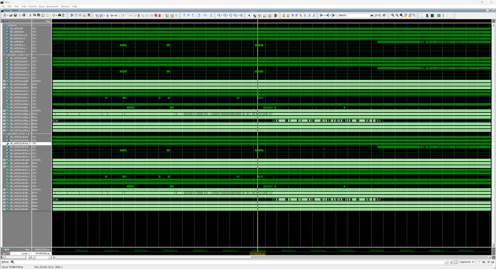

# x6502 - MOS Technology MCS6502 Verilog Implementation

<table align="center">
  <tr>
    <td align="center" style="padding: 10px;">
      
    </td>
  </tr>
</table>

## x6502 Overview

The **x6502** is a fully synchronous, instruction and bus-cycle accurate Verilog implementation of the MOS Technology NMOS 6502 8-bit microprocessor. The design is implemented as an explicit per-cycle finite state machine without microcode. Every opcode, the reset sequence, interrupt recognition, RDY and SO follow the MCS6500 Hardware Manual and, where the manual is silent, the transistor-level netlist of the NMOS 6502 die, against which the design is verified cycle by cycle.

### Features

<small>

- **Fully Synchronous Design**: All state changes occur on the positive edge of `clk` when `cen` is active. RES, RDY, IRQ and NMI are sampled at `cen` only. No latches or asynchronous logic.
- **Bus-Cycle Accurate**: Every read, write, dummy access, stack access and vector fetch appears on the external bus on the cycle the NMOS 6502 drives it, including the dummy reads of indexed, branch and read-modify-write cycles. Verified pin by pin against the NMOS 6502 netlist, except in the reset window (see [Reset](#reset)).
- **Half-Cycle Mode**: With `HALF_CYCLE = 1`, a second enable (`cen_p2`) marks phase 2 of each cycle, so the data bus drive window (`dout_oe`) and the SO sample point match the silicon within the cycle.
- **Complete Instruction Set**: All 256 opcodes: the 151 documented instructions across 13 addressing modes and the 105 undocumented opcodes, with their full bus patterns and the 12 JAM opcodes.
- **Authentic NMOS Behavior**: JMP indirect page-wrap, NMOS decimal-mode flags, the reset sequence as a BRK with writes inhibited (S - 3, registers kept), interrupt recognition at the last cycle, the branch interrupt delay, CLI / SEI / PLP latency and NMI takeover of a BRK or IRQ entry.
- **RDY and SO**: `rdy` low repeats read cycles and never stops a write cycle; a falling edge on `so_n` sets V one cycle later, with the netlist's collision rules.
- **Status Output**: `jam` reports a JAM halt.
- **Vector Pull Output**: `vp_n` asserts low during the two vector reads of an IRQ / NMI / BRK entry (an extension; pin 5 is not connected on the NMOS 6502).
- **Timing Constraints**: The IP ships an SDC file that relaxes its enable-paced paths from one setting in the core SDC. See [Timing Constraints](#timing-constraints).

</small>

## Table of Contents

| # | Section | Description |
|---|---------|-------------|
| 1 | [System Architecture](#system-architecture) | Top-level block diagram of the CPU, ALU, and external bus interface |
| 2 | [Module Hierarchy](#module-hierarchy) | Source-file listing with each module's role and approximate line count |
| 3 | [Memory Map](#memory-map) | Architectural fixed addresses: zero page, stack page, and the NMI / Reset / IRQ-BRK vectors |
| 4 | [Register Set](#register-set) | Programmer-visible registers (A / X / Y / PC / S / P) and the processor-status flag layout |
| 5 | [Instruction Set](#instruction-set) | Thirteen addressing modes, per-group cycle-timing tables (load / store / RMW / branch / stack / jump / interrupt / undocumented), and the full annotated NMOS 6502 opcode map |
| 6 | [Control Interface](#control-interface) | Verilog port-level reference: external bus, interrupts, clock, reset, RDY, half-cycle mode, status |
| 7 | [Design Usage](#design-usage) | Parameters, instantiation template, timing constraints, bus signal timing, reset, and interrupt handling |
| 8 | [Device Usage](#device-usage) | FPGA resource usage, timing and Fmax of a standalone compile on two Cyclone V parts |
| 9 | [6502 Family Roadmap](#6502-family-roadmap) | Position of x6502 in the 6502 / R65C02 / HuC6280 IP family |
| 10 | [Project Structure](#project-structure) | Directory tree of the IP package |
| 11 | [Design Verification](#design-verification) | Testbench section breakdown, run command, ModelSim screenshot, final summary box, and external validation against test suites and the netlist. Per-test log: [tb_x6502](doc/readme/tb_x6502_log.md). |
| 12 | [Design References](#design-references) | Hardware manual and die netlist used as the implementation reference |
| 13 | [License](#license) | Creative Commons Attribution-NonCommercial 4.0 International |
| 14 | [Support](#support) | Back ongoing Coin-Op Collection FPGA core development on Patreon |

## System Architecture

```
┌─────────────────────────────────────────────────────────────────┐
│                                x6502                            │
│  ┌───────────────────────────────────────────────────────────┐  │
│  │                                                           │  │
│  │   ┌──────────────────────┐         ┌──────────────────┐   │  │
│  │   │   x6502 (CPU)        │ <-----> │    x6502_alu     │   │  │
│  │   │                      │         │                  │   │  │
│  │   │  16-bit PC           │         │ OR,  AND, EOR    │   │  │
│  │   │   8-bit A            │         │ ADC, SBC, CMP    │   │  │
│  │   │   8-bit X            │         │ ASL, LSR, ROL    │   │  │
│  │   │   8-bit Y            │         │ ROR, BIT         │   │  │
│  │   │   8-bit S ($01)      │         │ INC, DEC         │   │  │
│  │   │   8-bit P (NV-BDIZC) │         │ EQ1, EQ2         │   │  │
│  │   │                      │         │                  │   │  │
│  │   │  Per-cycle FSM       │         │ Binary + BCD     │   │  │
│  │   └────────┬─────────────┘         └──────────────────┘   │  │
│  │            │                                              │  │
│  │            v                                              │  │
│  │     ┌──────────────────────────────────────────────┐      │  │
│  │     │           External Bus Interface             │      │  │
│  │     │                                              │      │  │
│  │     │  addr[15:0], din[7:0], dout[7:0], rw_n, sync │      │  │
│  │     │     irq_n, nmi_n, so_n, rdy, rst_n, vp_n     │      │  │
│  │     │          cen, cen_p2, dout_oe, jam           │      │  │
│  │     └──────────────────────────────────────────────┘      │  │
│  │                                                           │  │
│  └───────────────────────────────────────────────────────────┘  │
└─────────────────────────────────────────────────────────────────┘
```

## Module Hierarchy

| Module | Description | Lines |
|--------|-------------|-------|
| `x6502.v` | CPU state machine, instruction decode, register file | ~1570 |
| `x6502_alu.v` | Combinational arithmetic logic unit (binary + BCD) | ~380 |

## Memory Map

The x6502 is a CPU only and does not include internal memory. The host system supplies all memory and peripheral mapping. The CPU enforces the following architectural fixed addresses:

```
$0000-$00FF   Zero Page (architectural - faster addressing modes)
$0100-$01FF   Stack Page (S register indexes within this page)

$FFFA-$FFFB   NMI Vector (taken after a falling edge on nmi_n)
$FFFC-$FFFD   Reset Vector (read at the end of the reset sequence)
$FFFE-$FFFF   IRQ / BRK Vector (shared between IRQ and BRK)
```

## Register Set

| Register | Width | Description |
|----------|-------|-------------|
| A | 8-bit | Accumulator - general purpose arithmetic/logic |
| X | 8-bit | Index Register X - indexed addressing and counter |
| Y | 8-bit | Index Register Y - indexed addressing and counter |
| PC | 16-bit | Program Counter - next instruction address ($0000-$FFFF) |
| S | 8-bit | Stack Pointer - low byte of stack address (high byte = $01) |
| P | 8-bit | Processor Status Register (N V - B D I Z C) |

### Processor Status Register

```
  7   6   5   4   3   2   1   0
┌───┬───┬───┬───┬───┬───┬───┬───┐
│ N │ V │ 1 │ B │ D │ I │ Z │ C │
└───┴───┴───┴───┴───┴───┴───┴───┘
  │   │   │   │   │   │   │   └── Carry / Borrow
  │   │   │   │   │   │   └────── Zero
  │   │   │   │   │   └────────── Interrupt Mask
  │   │   │   │   └────────────── Decimal Mode (BCD)
  │   │   │   └────────────────── Break (exists only in a pushed copy)
  │   │   └────────────────────── 1 in every pushed copy
  │   └────────────────────────── Overflow
  └────────────────────────────── Negative
```

PHP and BRK push bits 5 and 4 as 1 and 1; IRQ and NMI push 1 and 0. PLP and RTI ignore both bits.

## Instruction Set

### Addressing Modes

| Mode | Syntax | Bytes | Description |
|------|--------|-------|-------------|
| Implied | `NOP` | 1 | No operand; operation on internal registers |
| Accumulator | `ASL A` | 1 | Operation on A register |
| Immediate | `LDA #$nn` | 2 | Operand follows opcode |
| Zero Page | `LDA $nn` | 2 | EA = $00nn |
| Zero Page,X | `LDA $nn,X` | 2 | EA = ($00nn + X) & $00FF |
| Zero Page,Y | `LDX $nn,Y` | 2 | EA = ($00nn + Y) & $00FF |
| Absolute | `LDA $nnnn` | 3 | EA = $nnnn |
| Absolute,X | `LDA $nnnn,X` | 3 | EA = $nnnn + X |
| Absolute,Y | `LDA $nnnn,Y` | 3 | EA = $nnnn + Y |
| Indirect | `JMP ($nnnn)` | 3 | EA = mem[$nnnn] (NMOS page-wrap on high byte) |
| (Indirect,X) | `LDA ($nn,X)` | 2 | EA = mem[($nn + X) & $FF] |
| (Indirect),Y | `LDA ($nn),Y` | 2 | EA = mem[$nn] + Y |
| Relative | `BEQ $rr` | 2 | PC + 2 + signed 8-bit offset (branches only) |

### Instruction Timing

#### Load / Store / Logical / Arithmetic

| Instruction | IMM | ZP | ZP,X/Y | ABS | ABS,X/Y | (IND,X) | (IND),Y |
|-------------|-----|-----|--------|-----|---------|---------|---------|
| LDA / LDX / LDY | 2 | 3 | 4 | 4 | 4 (+1*) | 6 | 5 (+1*) |
| STA / STX / STY | - | 3 | 4 | 4 | 5 | 6 | 6 |
| ADC / SBC / AND / ORA / EOR / CMP | 2 | 3 | 4 | 4 | 4 (+1*) | 6 | 5 (+1*) |
| CPX / CPY | 2 | 3 | - | 4 | - | - | - |
| BIT | - | 3 | - | 4 | - | - | - |

*\*Add 1 cycle if the indexed effective address crosses a page boundary*

#### Read-Modify-Write Operations

| Instruction | A (acc) | ZP | ZP,X | ABS | ABS,X |
|-------------|---------|-----|------|-----|-------|
| ASL / LSR / ROL / ROR | 2 | 5 | 6 | 6 | 7 |
| INC / DEC | - | 5 | 6 | 6 | 7 |

*ABS,X read-modify-write is fixed at 7 cycles regardless of page cross. The first write stores the unmodified value, the second the result.*

#### Branch Instructions

| Instruction | Cycles | Condition |
|-------------|--------|-----------|
| BPL | 2 / 3 / 4 | N = 0 |
| BMI | 2 / 3 / 4 | N = 1 |
| BVC | 2 / 3 / 4 | V = 0 |
| BVS | 2 / 3 / 4 | V = 1 |
| BCC | 2 / 3 / 4 | C = 0 |
| BCS | 2 / 3 / 4 | C = 1 |
| BNE | 2 / 3 / 4 | Z = 0 |
| BEQ | 2 / 3 / 4 | Z = 1 |

*2 cycles not taken, 3 cycles taken, 4 cycles taken with page cross. A taken branch reads PC+2; on a page cross it then reads {PCH, PCL + offset} before the fetch at the carried target.*

#### Stack and Subroutine Instructions

| Instruction | Bytes | Cycles | Description |
|-------------|-------|--------|-------------|
| PHA | 1 | 3 | Push A to stack |
| PHP | 1 | 3 | Push P to stack (bits 5 and 4 = 1) |
| PLA | 1 | 4 | Pull A from stack |
| PLP | 1 | 4 | Pull P from stack (bits 5 and 4 ignored) |
| JSR $nnnn | 3 | 6 | Push PC+2, load PC from absolute |
| RTS | 1 | 6 | Pull PC, increment, resume |

#### Jump Instructions

| Instruction | Bytes | Cycles | Description |
|-------------|-------|--------|-------------|
| JMP $nnnn | 3 | 3 | PC = $nnnn |
| JMP ($nnnn) | 3 | 5 | PC = mem[$nnnn] (NMOS page-wrap bug on high byte) |

#### Interrupt and Control Instructions

| Instruction | Bytes | Cycles | Description |
|-------------|-------|--------|-------------|
| BRK | 1 | 7 | Force interrupt: push PC+2, push P (bits 5 and 4 = 1), vector $FFFE/F |
| RTI | 1 | 6 | Pull P (bits 5 and 4 ignored), pull PC |
| Hardware IRQ | - | 7 | Vector $FFFE/F, pushed P with bit 4 = 0 |
| Hardware NMI | - | 7 | Vector $FFFA/B, pushed P with bit 4 = 0 |
| NOP | 1 | 2 | No operation |
| Flag set/clear (CLC, SEC, CLI, SEI, CLV, CLD, SED) | 1 | 2 | Modify single flag |
| Register transfer (TAX, TAY, TXA, TYA, TSX, TXS) | 1 | 2 | Move between registers |
| Increment / decrement (INX, INY, DEX, DEY) | 1 | 2 | Modify X or Y |

#### Undocumented Opcodes

| Instruction | IMM | ZP | ZP,X/Y | ABS | ABS,X/Y | (IND,X) | (IND),Y |
|-------------|-----|-----|--------|-----|---------|---------|---------|
| SLO / RLA / SRE / RRA / DCP / ISC | - | 5 | 6 | 6 | 7 | 8 | 8 |
| LAX | - | 3 | 4 | 4 | 4 (+1*) | 6 | 5 (+1*) |
| SAX | - | 3 | 4 | 4 | - | 6 | - |
| ANC / ALR / ARR / ANE / LXA / SBX / SBC ($EB) | 2 | - | - | - | - | - | - |
| LAS | - | - | - | - | 4 (+1*) | - | - |
| SHA | - | - | - | - | 5 | - | 6 |
| SHX / SHY / TAS | - | - | - | - | 5 | - | - |
| NOP (multi-byte) | 2 | 3 | 4 | 4 | 4 (+1*) | - | - |

*\*Add 1 cycle if the indexed effective address crosses a page boundary*

- ANE and LXA use the constant $EE in `(A | constant) & X & operand` and `(A | constant) & operand`.
- SHA, SHX, SHY and TAS AND the stored value with the base address high byte + 1, unless RDY held the dummy read before the write; on a page cross the write address high byte is the stored value.
- The 12 JAM opcodes ($02, $12, $22, $32, $42, $52, $62, $72, $92, $B2, $D2, $F2) halt the CPU: the bus reads $FFFF and $FFFE with SYNC low, IRQ and NMI are ignored, `jam` goes high, and only RES restarts the CPU.

### Opcode Map

```
     0    1    2    3    4    5    6    7    8    9    A    B    C    D    E    F
   ┌────┬────┬────┬────┬────┬────┬────┬────┬────┬────┬────┬────┬────┬────┬────┬────┐
 0 │BRK │ORA │jam │slo │nop │ORA │ASL │slo │PHP │ORA │ASL │anc │nop │ORA │ASL │slo │
   │    │izx │    │izx │ zp │ zp │ zp │ zp │    │imm │ A  │imm │abs │abs │abs │abs │
   ├────┼────┼────┼────┼────┼────┼────┼────┼────┼────┼────┼────┼────┼────┼────┼────┤
 1 │BPL │ORA │jam │slo │nop │ORA │ASL │slo │CLC │ORA │nop │slo │nop │ORA │ASL │slo │
   │ rel│izy │    │izy │zpx │zpx │zpx │zpx │    │aby │    │aby │abx │abx │abx │abx │
   ├────┼────┼────┼────┼────┼────┼────┼────┼────┼────┼────┼────┼────┼────┼────┼────┤
 2 │JSR │AND │jam │rla │BIT │AND │ROL │rla │PLP │AND │ROL │anc │BIT │AND │ROL │rla │
   │abs │izx │    │izx │ zp │ zp │ zp │ zp │    │imm │ A  │imm │abs │abs │abs │abs │
   ├────┼────┼────┼────┼────┼────┼────┼────┼────┼────┼────┼────┼────┼────┼────┼────┤
 3 │BMI │AND │jam │rla │nop │AND │ROL │rla │SEC │AND │nop │rla │nop │AND │ROL │rla │
   │ rel│izy │    │izy │zpx │zpx │zpx │zpx │    │aby │    │aby │abx │abx │abx │abx │
   ├────┼────┼────┼────┼────┼────┼────┼────┼────┼────┼────┼────┼────┼────┼────┼────┤
 4 │RTI │EOR │jam │sre │nop │EOR │LSR │sre │PHA │EOR │LSR │alr │JMP │EOR │LSR │sre │
   │    │izx │    │izx │ zp │ zp │ zp │ zp │    │imm │ A  │imm │abs │abs │abs │abs │
   ├────┼────┼────┼────┼────┼────┼────┼────┼────┼────┼────┼────┼────┼────┼────┼────┤
 5 │BVC │EOR │jam │sre │nop │EOR │LSR │sre │CLI │EOR │nop │sre │nop │EOR │LSR │sre │
   │ rel│izy │    │izy │zpx │zpx │zpx │zpx │    │aby │    │aby │abx │abx │abx │abx │
   ├────┼────┼────┼────┼────┼────┼────┼────┼────┼────┼────┼────┼────┼────┼────┼────┤
 6 │RTS │ADC │jam │rra │nop │ADC │ROR │rra │PLA │ADC │ROR │arr │JMP │ADC │ROR │rra │
   │    │izx │    │izx │ zp │ zp │ zp │ zp │    │imm │ A  │imm │ind │abs │abs │abs │
   ├────┼────┼────┼────┼────┼────┼────┼────┼────┼────┼────┼────┼────┼────┼────┼────┤
 7 │BVS │ADC │jam │rra │nop │ADC │ROR │rra │SEI │ADC │nop │rra │nop │ADC │ROR │rra │
   │ rel│izy │    │izy │zpx │zpx │zpx │zpx │    │aby │    │aby │abx │abx │abx │abx │
   ├────┼────┼────┼────┼────┼────┼────┼────┼────┼────┼────┼────┼────┼────┼────┼────┤
 8 │nop │STA │nop │sax │STY │STA │STX │sax │DEY │nop │TXA │ane │STY │STA │STX │sax │
   │imm │izx │imm │izx │ zp │ zp │ zp │ zp │    │imm │    │imm │abs │abs │abs │abs │
   ├────┼────┼────┼────┼────┼────┼────┼────┼────┼────┼────┼────┼────┼────┼────┼────┤
 9 │BCC │STA │jam │sha │STY │STA │STX │sax │TYA │STA │TXS │tas │shy │STA │shx │sha │
   │ rel│izy │    │izy │zpx │zpx │zpy │zpy │    │aby │    │aby │abx │abx │aby │aby │
   ├────┼────┼────┼────┼────┼────┼────┼────┼────┼────┼────┼────┼────┼────┼────┼────┤
 A │LDY │LDA │LDX │lax │LDY │LDA │LDX │lax │TAY │LDA │TAX │lxa │LDY │LDA │LDX │lax │
   │imm │izx │imm │izx │ zp │ zp │ zp │ zp │    │imm │    │imm │abs │abs │abs │abs │
   ├────┼────┼────┼────┼────┼────┼────┼────┼────┼────┼────┼────┼────┼────┼────┼────┤
 B │BCS │LDA │jam │lax │LDY │LDA │LDX │lax │CLV │LDA │TSX │las │LDY │LDA │LDX │lax │
   │ rel│izy │    │izy │zpx │zpx │zpy │zpy │    │aby │    │aby │abx │abx │aby │aby │
   ├────┼────┼────┼────┼────┼────┼────┼────┼────┼────┼────┼────┼────┼────┼────┼────┤
 C │CPY │CMP │nop │dcp │CPY │CMP │DEC │dcp │INY │CMP │DEX │sbx │CPY │CMP │DEC │dcp │
   │imm │izx │imm │izx │ zp │ zp │ zp │ zp │    │imm │    │imm │abs │abs │abs │abs │
   ├────┼────┼────┼────┼────┼────┼────┼────┼────┼────┼────┼────┼────┼────┼────┼────┤
 D │BNE │CMP │jam │dcp │nop │CMP │DEC │dcp │CLD │CMP │nop │dcp │nop │CMP │DEC │dcp │
   │ rel│izy │    │izy │zpx │zpx │zpx │zpx │    │aby │    │aby │abx │abx │abx │abx │
   ├────┼────┼────┼────┼────┼────┼────┼────┼────┼────┼────┼────┼────┼────┼────┼────┤
 E │CPX │SBC │nop │isc │CPX │SBC │INC │isc │INX │SBC │NOP │sbc │CPX │SBC │INC │isc │
   │imm │izx │imm │izx │ zp │ zp │ zp │ zp │    │imm │    │imm │abs │abs │abs │abs │
   ├────┼────┼────┼────┼────┼────┼────┼────┼────┼────┼────┼────┼────┼────┼────┼────┤
 F │BEQ │SBC │jam │isc │nop │SBC │INC │isc │SED │SBC │nop │isc │nop │SBC │INC │isc │
   │ rel│izy │    │izy │zpx │zpx │zpx │zpx │    │aby │    │aby │abx │abx │abx │abx │
   └────┴────┴────┴────┴────┴────┴────┴────┴────┴────┴────┴────┴────┴────┴────┴────┘
```

*Uppercase cells are the 151 documented instructions; lowercase cells are the 105 undocumented opcodes. All 256 run their full NMOS bus patterns.*

## Control Interface

### Parameters

```verilog
parameter HALF_CYCLE = 0 // 0 = one enable per bus cycle, 1 = cen_p2 adds phase 2
```

### Bus Interface

```verilog
output reg  [15:0] addr,   // Address bus (registered at the cen that starts a cycle)
input  wire  [7:0] din,    // Data input (used at the cen that ends a cycle)
output reg   [7:0] dout,   // Data output (registered)
output reg         rw_n,   // Read/Write (1 = read, 0 = write)
output reg         sync,   // High during opcode fetch cycles
output reg         dout_oe // CPU drives the data bus (whole write cycle, or phase 2 with HALF_CYCLE = 1)
```

### Interrupts

```verilog
input  wire irq_n, // IRQ - level-sensitive, gated by the I flag
input  wire nmi_n, // NMI - falling edge latched, non-maskable
input  wire so_n,  // Set-Overflow - a falling edge sets V one cycle later
output reg  vp_n   // Vector Pull - low during the two IRQ / NMI / BRK vector reads
```

### Clock and Reset

```verilog
input  wire clk,    // System clock
input  wire cen,    // Clock enable (one bus cycle per pulse)
input  wire cen_p2, // Phase 2 enable (read only when HALF_CYCLE = 1)
input  wire rst_n,  // Active-low reset (RES pin), sampled at cen
input  wire rdy     // Active-high ready (read cycles repeat while low)
```

### Status

```verilog
output reg jam // Halted by a JAM opcode
```

## Design Usage

### Parameters

| Parameter | Default | Description |
|-----------|---------|-------------|
| `HALF_CYCLE` | 0 | 0 = one `cen` per bus cycle, 1 = `cen` plus `cen_p2` for phase-2 accurate `dout_oe` and SO sampling |

### Instantiation Example

```verilog
x6502 #(
    .HALF_CYCLE ( 0 )
) u_cpu (
    // Clock and Reset
    .clk     ( clk_sys  ), // System clock
    .cen     ( cpu_cen  ), // Clock enable (one bus cycle per pulse)
    .rst_n   ( reset_n  ), // Active-low reset
    .rdy     ( rdy      ), // Ready (read cycles repeat when low)

    // Interrupt Inputs
    .irq_n   ( irq_n    ), // IRQ (level-sensitive, gated by I flag)
    .nmi_n   ( nmi_n    ), // NMI (falling edge)
    .so_n    ( so_n     ), // Set-Overflow input

    // CPU Bus Interface
    .addr    ( cpu_addr ), // 16-bit address out
    .din     ( cpu_din  ), // 8-bit data in
    .dout    ( cpu_dout ), // 8-bit data out
    .rw_n    ( cpu_rw_n ), // Read/Write
    .sync    ( cpu_sync ), // High during opcode fetch
    .vp_n    ( vp_n     ), // Vector Pull (low during vector reads)

    // Half-Cycle Mode
    .cen_p2  ( 1'b0     ), // Unused when HALF_CYCLE = 0
    .dout_oe ( dout_oe  ), // CPU drives the data bus

    // Status
    .jam     (          )  // JAM halt
);
```

Unused outputs may be left open, and `cen_p2` may be tied low when `HALF_CYCLE = 0`.

### Timing Constraints

`x6502.qip` adds `hdl/sdc/x6502.sdc`, so every core that includes the IP reads it. It finds each x6502 instance by its module name and relaxes the paths between its registers, which all load on `cen`, or also on `cen_p2` with `HALF_CYCLE = 1`; no register loads on every `clk`. The paths into and out of the CPU are left to the core. The core gives one number, the fewest `clk` cycles between two enables, in its own SDC:

```tcl
# ===================================================================================================
# 6502 clock enable
# ===================================================================================================
# The 6502 runs on a 1.5 MHz enable, once every 64 system clocks. x6502.sdc relaxes its own paths.
# ===================================================================================================
set x6502_cen_div 64
```

| Path | Setup | Hold |
|------|-------|------|
| Enable-paced registers to each other | `x6502_cen_div` | `x6502_cen_div` - 1 |

- **Read order**: the core SDC must be read before `x6502.sdc`, so its `SDC_FILE` line goes above the `QIP_FILE` line that brings in the IP. A core that does not set `x6502_cen_div` gets a critical warning and no relaxation.
- **Ratio**: with `HALF_CYCLE = 0` the gap between two `cen` pulses; with `HALF_CYCLE = 1` the gap between a `cen` and the next `cen_p2`. A core with several 6502s gives the fastest; with a fractional divider use the shortest gap. With an enable on every `clk` (`x6502_cen_div 1`) nothing is relaxed.
- **Core paths**: the address, data, R/W, SYNC and the sampled inputs (`din`, `rdy`, `irq_n`, `nmi_n`, `so_n`, `rst_n`) cross into the core; their paths are constrained in the core SDC.

### Bus Signal Timing

Each FSM state registers `addr`, `rw_n`, `sync` and `dout` at the `cen` that starts a bus cycle; they hold for the whole cycle. `din` is used at the `cen` that ends the cycle. RES, RDY, IRQ and NMI are sampled at `cen` only; nothing is captured between enables. With `HALF_CYCLE = 1`, `cen_p2` marks the rising clock edge inside the cycle: `dout_oe` covers phase 2 of a write cycle and SO is sampled at `cen_p2`. The CPU advances exactly one bus cycle per `cen` pulse, allowing fractional clock divisions for cycle-accurate host integration.

### Reset

- One `cen` with `rst_n` low resets the CPU. The cycle in progress keeps its write; the next cycle runs without a write or SYNC, then the bus holds the program counter with writes inhibited.
- After release, the sequence is a BRK with writes inhibited: three cycles at the held address (SYNC on the second), three stack reads, then $FFFC and $FFFD. S drops by 3 and I is set; A, X, Y, D and the other flags keep their values.
- RDY holds the reset sequence's read cycles like any other read. RES first seen inside a running reset sequence follows the netlist: at the third stack read the sequence ends after the $FFFC read; at the $FFFC read alone it has no effect.
- S drops by 3 when the first instance of the third stack read ends, so a sequence that RES cuts after that point, with or without RDY holding it, leaves S already lowered, as on silicon.
- Power-up values: A = X = Y = 0, D = 0 and S = $00, so the first reset leaves S = $FD.
- Reset window: while RES is low, and in the cycles where RES cuts an instruction, the NMOS 6502 drives some addresses from its internal buses and can finish part of the cut instruction. x6502 holds the program counter on the bus there and does not repeat the cut step, so the addresses read in that window and the registers the cut instruction changes can differ from silicon. The reset sequence that follows and the vector fetch match.

### Interrupt Handling

| Source | Trigger | Vector | Pushed Bit 4 |
|--------|---------|--------|--------------|
| BRK | Software (opcode $00) | $FFFE/F | 1 |
| IRQ | Level-low on `irq_n`, gated by I flag | $FFFE/F | 0 |
| NMI | Falling edge on `nmi_n` | $FFFA/B | 0 |
| Reset | Low on `rst_n` | $FFFC/D | - |

- IRQ (with I clear) and a latched NMI edge are polled at the `cen` that starts an instruction's last cycle. Branches poll at the start of their second cycle, and of their fourth on a page cross.
- CLI, SEI and PLP change I at the next opcode fetch; RTI at the start of its fifth cycle. A RDY repeat of the last cycle of CLI or SEI already polls with the new I.
- The vector is chosen at the push of P: an NMI by then takes over a BRK or IRQ entry with the pushed bit 4 kept. I is set with the second vector read; a RDY repeat of that read polls, so a pending NMI is taken before the handler's first instruction, which otherwise always runs.
- BRK pushes `PC+2` (skipping the byte after the opcode).

### Vector Pull (`vp_n`)

The `vp_n` output asserts low for the two consecutive bus cycles in which the CPU reads the interrupt vector low and high bytes. This applies to all three interrupt sources (BRK, IRQ, NMI) but **not** to the reset vector fetch. `vp_n` is an extension: pin 5 is not connected on the NMOS 6502. Host logic can use it as a clean strobe to acknowledge interrupt sources without decoding the vector address ranges.

| Cycle | BRK / IRQ / NMI | Reset |
|-------|-----------------|-------|
| Vector low fetch | `vp_n = 0` | `vp_n = 1` |
| Vector high fetch | `vp_n = 0` | `vp_n = 1` |
| All other cycles | `vp_n = 1` | `vp_n = 1` |

## Device Usage

A standalone compile of `x6502` in Quartus 22.1std with `HALF_CYCLE = 0`, the setting every core uses, its ports as virtual pins and the `dbg_*` outputs unconnected, with a 96 MHz clock and the IP's SDC at `x6502_cen_div 64`. Every register is enable-paced.

### Cyclone V 5CSEBA6U23I7

| Module | ALMs | ALUTs | Registers | Block Memory Bits | M10K | DSP |
|--------|------|-------|-----------|-------------------|------|-----|
| `x6502` | 874.0 (2.1%) | 1,337 | 153 | 0 | 0 | 0 |
| `x6502_alu` | 118.3 | 181 | 0 | 0 | 0 | 0 |

Fmax 625.00 MHz. At 96 MHz: setup slack +645.656 ns, hold slack +0.165 ns.

### Cyclone V 5CEBA4F23C8

| Module | ALMs | ALUTs | Registers | Block Memory Bits | M10K | DSP |
|--------|------|-------|-----------|-------------------|------|-----|
| `x6502` | 878.5 (4.8%) | 1,340 | 153 | 0 | 0 | 0 |
| `x6502_alu` | 115.8 | 180 | 0 | 0 | 0 | 0 |

Fmax 557.41 MHz. At 96 MHz: setup slack +642.094 ns, hold slack +0.166 ns.

With `HALF_CYCLE = 1`, at `x6502_cen_div 32` (the gap between a `cen` and the next `cen_p2`), the CPU takes 881.0 ALMs (2.1%) on 5CSEBA6U23I7 and 880.5 ALMs (4.8%) on 5CEBA4F23C8, with 153 registers, and closes at 96 MHz with setup slack +311.775 ns and +308.242 ns.

## 6502 Family Roadmap

The x6502 NMOS core is the first release in a family of three 6502-architecture-derived cores. The R65C02 (x65c02) and HuC6280 (x6280) extend the ISA with the CMOS additions and Hudson Soft / NEC custom-chip extensions respectively.

| Feature | x6502 (Current) | x65c02 | x6280 |
|---------|-----------------|--------|-------|
| Core ISA | NMOS 6502 | CMOS R65C02 (Rockwell) | HuC6280 (Hudson Soft / NEC) |
| Documented Opcodes | 151 (plus 105 undocumented) | 210 (plus 46 NOPs) | 234 |
| Address Bus | 16-bit | 16-bit | 21-bit (via 8 x MPR) |
| Zero Page / Stack | $0000 / $0100 | $0000 / $0100 | $2000 / $2100 |
| BCD Mode | NMOS flag rules | N / Z valid, one added cycle | Full N / V / Z / C valid |
| JMP Indirect Page-Wrap | NMOS bug | Fixed | Fixed |
| Bit Manipulation (RMB/SMB/BBR/BBS) | - | ✓ | ✓ |
| STZ / TRB / TSB | - | ✓ | ✓ |
| BRA (relative) | - | ✓ | ✓ |
| (zp) Indirect | - | ✓ | ✓ |
| JMP (abs,X) | - | ✓ | ✓ |
| INC A / DEC A | - | ✓ | ✓ |
| PHX / PHY / PLX / PLY | - | ✓ | ✓ |
| BIT immediate / zp,X / abs,X | - | ✓ | ✓ |
| MPR (TAM / TMA) | - | - | ✓ |
| Block Transfers (TII / TDD / TIN / TIA / TAI) | - | - | ✓ |
| VDC Port Writes (ST0 / ST1 / ST2) | - | - | ✓ |
| TST #imm,addr / BSR / SET (T-flag) | - | - | ✓ |
| CLA / CLX / CLY / SXY / SAX / SAY | - | - | ✓ |
| CSL / CSH (clock speed flag) | - | - | ✓ |
| Multi-Vector IRQ ($FFF6 IRQ2 / $FFF8 IRQ1 / $FFFA Timer / $FFFE BRK) | - | - | ✓ |

**Not planned:**

- **Ricoh RP2A03 / RP2A07 (NES / Famicom)**: the NMOS 6502 core with decimal mode disconnected, on one die with the APU, sprite and sample DMA and the controller ports. x6502 always runs decimal mode and models none of the on-die peripherals; the NES variant was not validated.
- **MOS 6510 / 8500 (Commodore 64)**: the NMOS 6502 core with an on-chip 6-bit I/O port at $0000-$0001 and an AEC input that floats the address bus. x6502 has neither; the Lorenz suite was run against the CPU core only, with its 6510 I/O port, C64 PLA and CIA tests excluded.

## Project Structure

```
x6502/
├── doc/
│   ├── 00_MOS_Technology_MCS6500_Hardware_Manual_Jan1976.pdf
│   └── readme/
│       └── tb_x6502_log.md   # Per-test testbench output
├── hdl/
│   ├── x6502.v               # CPU state machine and instruction decoder
│   ├── x6502_alu.v           # Arithmetic logic unit
│   └── sdc/
│       └── x6502.sdc         # Timing constraints, read from x6502.qip
├── img/                      # README images
├── sim/
│   ├── tb_x6502.v            # Comprehensive testbench
│   └── tb_x6502_ops.hex      # Netlist-recorded scenarios read by the testbench
└── x6502.qip                 # Quartus project include file
```

## Design Verification

The testbench (`tb_x6502.v`) provides comprehensive verification - 996 self-checking assertions across 52 sections. Two CPUs run side by side - `HALF_CYCLE = 0` and `HALF_CYCLE = 1` - each with its own 64 KB memory model, with every register set by real instructions and results read back through the bus. Expected values come from the directed tests and from scenarios recorded on the transistor-level netlist of the NMOS 6502 (`sim/tb_x6502_ops.hex`):

<small>

- **CPU Section A**: Power-up values, first and warm reset, the stack reads and S - 3, the bus while RES is low, RES sampled at `cen` only, writes in the cycle RES falls, RES at every cycle, RDY during the reset protocol, RES inside a running reset sequence, S and the vector read of a cut reset sequence
- **BUS Section B**: Every opcode variant per cycle and per half cycle, addressing-mode groups, data bus drive window
- **CPU Section C**: All 256 opcodes (results, flags, cycle counts), random instruction streams
- **ALU Section D**: Every ALU operation over every input; decimal ADC, SBC, SBC $EB, ISC and RRA through the CPU over every A x operand x C
- **CPU Section E**: Undocumented opcodes: ANE / LXA constant, ANC, ALR, ARR, SBX, LAS, SHA / SHX / SHY / TAS with page cross and RDY
- **INT Section F**: Recognition point, branch interrupt delay, CLI / SEI / PLP / RTI latency, entry sequence and pushed P, NMI takeover, NMI edge latch, NMI across RES, interrupt sweeps, held last cycle of CLI and SEI
- **BUS Section G**: RDY: held reads, writes not held, held dummy reads, interrupts during holds, RDY sweeps, NMI during held vector and stack reads of an entry
- **CPU Section H**: SO: sampling point in both modes, width, collisions with V loads, during RDY holds, SO sweeps, SO before BVC and BVS, CLV with the next fetch held
- **CPU Section I**: JAM: bus pattern, `jam` output, PC + 2, interrupts ignored, recovery by RES
- **BUS Section J**: SYNC on opcode fetches only, `vp_n` on entry vectors
- **CLK Section K**: Enable ratios 1-16, random stops between enables, CYCLE / HALF lockstep, outputs change only at enables

</small>

```
vlib work
vlog hdl/x6502_alu.v hdl/x6502.v sim/tb_x6502.v
vsim -c tb_x6502 -do "run -all"
```

<table align="center">
  <tr>
    <td align="center" style="padding: 10px;">
      
    </td>
  </tr>
</table>

```
=============================================================
  x6502 Test Results
=============================================================
  Total Tests:  996
  Passed:       996
  Failed:       0
=============================================================
  *** ALL TESTS PASSED ***
  Cycle-accurate to the MCS6500 Hardware Manual and the NMOS 6502 netlist
=============================================================
```

Per-test output: [tb_x6502](doc/readme/tb_x6502_log.md)

### External Validation

Beyond the testbench, x6502 was run against published 6502 test suites and against the transistor-level netlist of the NMOS 6502. The suites and the netlist carry their own licenses, so their harnesses are not part of this package; the netlist-recorded scenarios the testbench needs ship in `sim/tb_x6502_ops.hex`. Where a suite and the netlist disagree, the netlist is followed:

| Suite | Result |
|-------|--------|
| SingleStepTests 6502:<br>All 256 opcode files, 10,000 tests each, with every bus cycle, the cycle count, the registers and memory; four clock configurations | 2,560,000 / 2,560,000 in each (JAM: the final PC + 2 the netlist shows; ANE / LXA constant $EE) |
| Klaus Dormann 6502 functional test | Pass in each clock configuration (success loop reached at cycle 96,241,364) |
| Bruce Clark decimal test (NMOS N, V, Z and C checked) | Pass in each clock configuration (ERROR = 0 after 53,953,825 cycles) |
| Klaus Dormann 6502 interrupt test | Bus trace identical to the netlist's, 2,721 / 2,721 cycles, in each clock configuration |
| Wolfgang Lorenz C64 Emulator Test Suite 2.15:<br>Every program that needs no C64 hardware | 240 / 240 in each clock configuration |
| Netlist golden vectors:<br>Every pin on every enable | 11,670 records, 0 mismatched |
| Netlist co-simulation:<br>Every bus-cycle type, interrupts, RDY / RES / SO / IRQ / NMI swept across every cycle, 400 random streams; pins and registers | 0 mismatched |

## Design References

- [MOS Technology MCS6500 Microcomputer Family Hardware Manual, January 1976](doc/00_MOS_Technology_MCS6500_Hardware_Manual_Jan1976.pdf)<br>
  <small><i>(System Timing, pp. 28-30; Interrupts, pp. 36-40; RDY, RES, IRQ and NMI, pp. 50-53; Pins and SYNC, pp. 55-58; Summary of Single Cycle Execution, pp. 168-180)</i></small>
- [Visual6502: NMOS 6502 Netlist](https://github.com/trebonian/visual6502)

## License

This work is licensed under the Creative Commons Attribution-NonCommercial 4.0 International License (CC BY-NC 4.0). You may use, share, and modify this code for non-commercial purposes, provided that proper credit is given. To view a copy of this license, visit **http://creativecommons.org/licenses/by-nc/4.0/**.

## Support

Please consider supporting this and future projects by joining the [**Coin-Op Collection Patreon**](https://www.patreon.com/atrac17).

---
