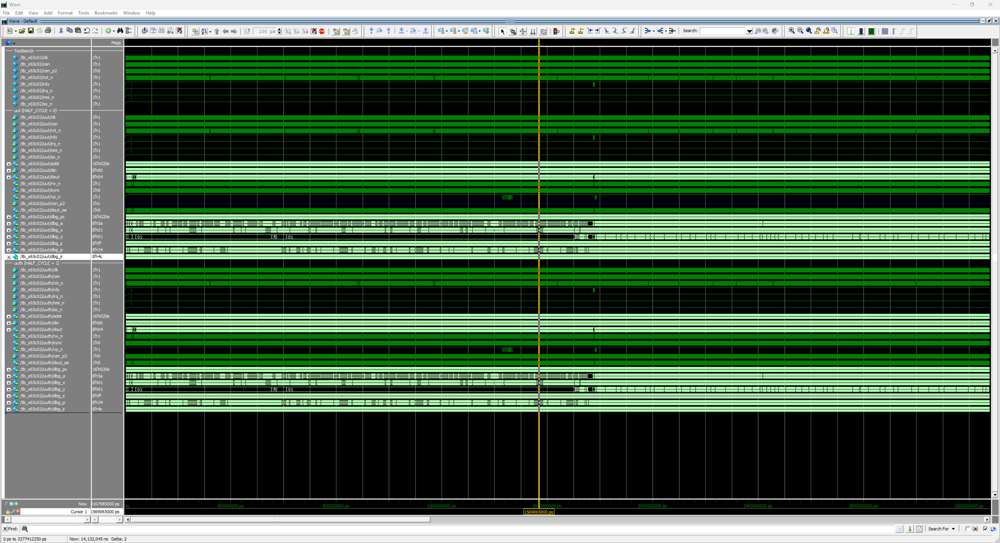

# x65c02 - Rockwell R65C02 Verilog Implementation

<table align="center">
  <tr>
    <td align="center" style="padding: 10px;">
      
    </td>
  </tr>
</table>

## x65c02 Overview

The **x65c02** is a fully synchronous, instruction and bus-cycle accurate Verilog implementation of the Rockwell R65C02 8-bit CMOS microprocessor. The design is implemented as an explicit per-cycle finite state machine without microcode. Every opcode, the reset sequence, interrupt recognition, RDY and SO follow the Rockwell R65C02 datasheet and bus recordings of a real R65C02P2, the recordings taking precedence where the two differ in a bus cycle, and the design is verified against the recordings cycle by cycle. The R65C02 is the Rockwell variant of the 6502 family, extending the NMOS 6502 instruction set with the CMOS additions and the Rockwell bit-manipulation group (RMB / SMB / BBR / BBS).

Sources of behavior, in this order:

<small>

- **Datasheet**: Rockwell R65C02 / R65C102 / R65C112 datasheet, Rev. 6, June 1987, cited by printed page as [p.1-N].
- **Bus cycles**: bus recordings of a real R65C02P2 first, then the datasheet, then the SingleStepTests (SST) `rockwell65c02/v1` vectors, then Klaus Dormann's tests. See [External Validation](#external-validation).
- **NMOS-derived**: where neither the datasheet nor the recordings say anything, x65c02 keeps the NMOS 6502 rule (MCS6500 manual and the NMOS transistor-level netlist): the branch interrupt delay, CLI / SEI / PLP latency, the NMI edge latch, NMI across RES, the RES protocol, the reset-sequence addresses and the registers a reset keeps, and the SO / V timing.

</small>

### Features

<small>

- **Fully Synchronous Design**: All state changes occur on the positive edge of `clk` when `cen` is active. RES, RDY, IRQ and NMI are sampled at `cen` only. No latches or asynchronous logic.
- **Bus-Cycle Accurate**: Every read, write, dummy access, stack access and vector fetch appears on the external bus on the cycle the R65C02 drives it, including the dummy reads of indexed, branch, read-modify-write and decimal-mode cycles. Verified against bus recordings of a real R65C02P2.
- **Half-Cycle Mode**: With `HALF_CYCLE = 1`, a second enable (`cen_p2`) marks phase 2 of each cycle, so the data bus drive window (`dout_oe`) and the SO sample point follow the datasheet within the cycle [p.1-4].
- **Complete Instruction Set**: All 210 opcodes of the R65C02 matrix across 16 addressing modes: the 151 NMOS instructions, the 27 CMOS additions and the 32 Rockwell bit instructions (RMB / SMB / BBR / BBS). The 46 undefined opcodes run as NOPs [p.1-10].
- **CMOS Behavior**: JMP indirect page increment, valid N and Z in decimal mode with one added cycle, two reads and one write in read-modify-write, D cleared at reset and on every interrupt entry, BRK executed before an interrupt that follows it [p.1-10].
- **RDY and SO**: `rdy` low repeats any cycle, read or write [p.1-4], [p.1-6]; a falling edge on `so_n` sets V one cycle later.
- **Vector Pull Output**: `vp_n` asserts low during the two vector reads of an IRQ / NMI / BRK entry (an extension; pin 5 is not connected on the R65C02 [p.1-5]).
- **Timing Constraints**: The IP ships an SDC file that relaxes its enable-paced paths from one setting in the core SDC. See [Timing Constraints](#timing-constraints).

</small>

## Table of Contents

| # | Section | Description |
|---|---------|-------------|
| 1 | [System Architecture](#system-architecture) | Top-level block diagram of the CPU, ALU, and external bus interface |
| 2 | [Module Hierarchy](#module-hierarchy) | Source-file listing with each module's role and approximate line count |
| 3 | [Memory Map](#memory-map) | Architectural fixed addresses: zero page, stack page, and the NMI / Reset / IRQ-BRK vectors |
| 4 | [Register Set](#register-set) | Programmer-visible registers (A / X / Y / PC / S / P) and the processor-status flag layout |
| 5 | [Instruction Set](#instruction-set) | Sixteen addressing modes, per-group cycle-timing tables (load / store / RMW / branch / stack / jump / Rockwell bit / CMOS / interrupt / undefined), and the full annotated R65C02 opcode map with the CMOS additions |
| 6 | [Control Interface](#control-interface) | Verilog port-level reference: external bus, interrupts, clock, reset, RDY, half-cycle mode, and the vector-pull output |
| 7 | [Design Usage](#design-usage) | Parameters, instantiation template, timing constraints, bus signal timing, reset, interrupt handling, and the `vp_n` vector-pull strobe |
| 8 | [Device Usage](#device-usage) | FPGA resource usage, timing and Fmax of a standalone compile on two Cyclone V parts |
| 9 | [CMOS-Specific Behavior](#cmos-specific-behavior) | Notes on every R65C02 difference from the NMOS 6502: JMP page increment, decimal mode, read-modify-write, indexed page crossing, RDY on writes, undefined opcodes, BRK and interrupts, BRA, Rockwell bit group, STZ / TRB / TSB, stack extensions, INC A / DEC A, (zp) indirect, JMP (abs,X) |
| 10 | [6502 Family Roadmap](#6502-family-roadmap) | Position of x65c02 in the 6502 / R65C02 / HuC6280 IP family |
| 11 | [Project Structure](#project-structure) | Directory tree of the IP package |
| 12 | [Design Verification](#design-verification) | Testbench section breakdown, run command, ModelSim screenshot, final summary box, and external validation against test suites and R65C02P2 bus recordings. Per-test log: [tb_x65c02](doc/readme/tb_x65c02_log.md). |
| 13 | [Design References](#design-references) | Datasheet, hardware manual and bus recordings used as the implementation reference |
| 14 | [License](#license) | Creative Commons Attribution-NonCommercial 4.0 International |
| 15 | [Support](#support) | Back ongoing Coin-Op Collection FPGA core development on Patreon |

## System Architecture

```
┌─────────────────────────────────────────────────────────────────┐
│                               x65c02                            │
│  ┌───────────────────────────────────────────────────────────┐  │
│  │                                                           │  │
│  │   ┌──────────────────────┐         ┌──────────────────┐   │  │
│  │   │   x65c02 (CPU)       │ <-----> │    x65c02_alu    │   │  │
│  │   │                      │         │                  │   │  │
│  │   │  16-bit PC           │         │ OR,  AND, EOR    │   │  │
│  │   │   8-bit A            │         │ ADC, SBC, CMP    │   │  │
│  │   │   8-bit X            │         │ ASL, LSR, ROL    │   │  │
│  │   │   8-bit Y            │         │ ROR, BIT         │   │  │
│  │   │   8-bit S ($01)      │         │ INC, DEC         │   │  │
│  │   │   8-bit P (NV-BDIZC) │         │ TSB, TRB         │   │  │
│  │   │                      │         │                  │   │  │
│  │   │  Per-cycle FSM       │         │ Binary + BCD     │   │  │
│  │   │  210 op codes        │         │ (CMOS N / Z)     │   │  │
│  │   └────────┬─────────────┘         └──────────────────┘   │  │
│  │            │                                              │  │
│  │            v                                              │  │
│  │     ┌──────────────────────────────────────────────┐      │  │
│  │     │           External Bus Interface             │      │  │
│  │     │                                              │      │  │
│  │     │  addr[15:0], din[7:0], dout[7:0], rw_n, sync │      │  │
│  │     │     irq_n, nmi_n, so_n, rdy, rst_n, vp_n     │      │  │
│  │     │             cen, cen_p2, dout_oe             │      │  │
│  │     └──────────────────────────────────────────────┘      │  │
│  │                                                           │  │
│  └───────────────────────────────────────────────────────────┘  │
└─────────────────────────────────────────────────────────────────┘
```

## Module Hierarchy

| Module | Description | Lines |
|--------|-------------|-------|
| `x65c02.v` | CPU state machine, instruction decode, register file | ~1550 |
| `x65c02_alu.v` | Combinational arithmetic logic unit (binary + BCD) | ~300 |

## Memory Map

The x65c02 is a CPU only and does not include internal memory. The host system supplies all memory and peripheral mapping. The CPU enforces the following architectural fixed addresses:

```
$0000-$00FF   Zero Page (architectural - faster addressing modes)
$0100-$01FF   Stack Page (S register indexes within this page)

$FFFA-$FFFB   NMI Vector (read after a falling edge on nmi_n)
$FFFC-$FFFD   Reset Vector (read at the end of the reset sequence)
$FFFE-$FFFF   IRQ / BRK Vector (shared between IRQ and BRK)
```

## Register Set

| Register | Width | Description |
|----------|-------|-------------|
| A | 8-bit | Accumulator - general purpose arithmetic/logic |
| X | 8-bit | Index Register X - indexed addressing and counter |
| Y | 8-bit | Index Register Y - indexed addressing and counter |
| PC | 16-bit | Program Counter - next instruction address ($0000-$FFFF) |
| S | 8-bit | Stack Pointer - low byte of stack address (high byte = $01) |
| P | 8-bit | Processor Status Register (N V - B D I Z C) |

### Processor Status Register

```
  7   6   5   4   3   2   1   0
┌───┬───┬───┬───┬───┬───┬───┬───┐
│ N │ V │ 1 │ B │ D │ I │ Z │ C │
└───┴───┴───┴───┴───┴───┴───┴───┘
  │   │   │   │   │   │   │   └── Carry / Borrow
  │   │   │   │   │   │   └────── Zero
  │   │   │   │   │   └────────── Interrupt Mask
  │   │   │   │   └────────────── Decimal Mode (BCD)
  │   │   │   └────────────────── Break (only meaningful when pushed)
  │   │   └────────────────────── Always 1
  │   └────────────────────────── Overflow
  └────────────────────────────── Negative
```

On the R65C02, N and Z follow the decimal result after ADC and SBC in decimal mode (D = 1), at the cost of one added cycle [p.1-10], [p.1-11]; on the NMOS 6502 they are invalid. D is cleared at reset and by every BRK, IRQ and NMI entry [p.1-6], [p.1-10].

## Instruction Set

### Addressing Modes

| Mode | Syntax | Bytes | Description |
|------|--------|-------|-------------|
| Implied | `NOP` | 1 | No operand; operation on internal registers |
| Accumulator | `ASL A` | 1 | Operation on A register |
| Immediate | `LDA #$nn` | 2 | Operand follows opcode |
| Zero Page | `LDA $nn` | 2 | EA = $00nn |
| Zero Page,X | `LDA $nn,X` | 2 | EA = ($00nn + X) & $00FF |
| Zero Page,Y | `LDX $nn,Y` | 2 | EA = ($00nn + Y) & $00FF |
| Absolute | `LDA $nnnn` | 3 | EA = $nnnn |
| Absolute,X | `LDA $nnnn,X` | 3 | EA = $nnnn + X |
| Absolute,Y | `LDA $nnnn,Y` | 3 | EA = $nnnn + Y |
| Indirect | `JMP ($nnnn)` | 3 | EA = mem[$nnnn] (CMOS - no page-wrap, full 16-bit increment) |
| (Indirect,X) | `LDA ($nn,X)` | 2 | EA = mem[($nn + X) & $FF] |
| (Indirect),Y | `LDA ($nn),Y` | 2 | EA = mem[$nn] + Y |
| (Indirect) | `LDA ($nn)` | 2 | EA = mem[$nn] (CMOS-only, no index) |
| (Absolute,X) | `JMP ($nnnn,X)` | 3 | EA = mem[($nnnn + X)] (CMOS-only) |
| Relative | `BEQ $rr` | 2 | PC + 2 + signed 8-bit offset (branches only) |
| Zero Page,Relative | `BBR0 $nn,$rr` | 3 | Test bit n of $nn; PC + 3 + signed offset (BBR/BBS only) |

### Instruction Timing

#### Load / Store / Logical / Arithmetic

| Instruction | IMM | ZP | ZP,X/Y | ABS | ABS,X/Y | (IND,X) | (IND),Y | (IND) |
|-------------|-----|-----|--------|-----|---------|---------|---------|-------|
| LDA / LDX / LDY | 2 | 3 | 4 | 4 | 4 (+1*) | 6 | 5 (+1*) | 5 |
| STA / STX / STY | - | 3 | 4 | 4 | 5 | 6 | 6 | 5 |
| ADC / SBC / AND / ORA / EOR / CMP | 2 | 3 | 4 | 4 | 4 (+1*) | 6 | 5 (+1*) | 5 |
| CPX / CPY | 2 | 3 | - | 4 | - | - | - | - |
| BIT | 2 | 3 | 4 | 4 | 4 (+1*) | - | - | - |

*\*Add 1 cycle if the indexed effective address crosses a page boundary. ADC and SBC add 1 cycle in decimal mode (D = 1) [p.1-11].*

#### Read-Modify-Write Operations

| Instruction | A (acc) | ZP | ZP,X | ABS | ABS,X |
|-------------|---------|-----|------|-----|-------|
| ASL / LSR / ROL / ROR | 2 | 5 | 6 | 6 | 6 (+1*) |
| INC / DEC | 2 (CMOS) | 5 | 6 | 6 | 7 |
| TRB / TSB | - | 5 | - | 6 | - |

*The operand is read twice, then the result is written once [p.1-10]. \*ASL, LSR, ROL and ROR abs,X take 6 cycles, 7 across a page, as the R65C02P2 does; INC and DEC abs,X take 7 cycles with or without a page cross. INC A and DEC A are CMOS-only accumulator-mode additions.*

#### Branch Instructions

| Instruction | Cycles | Condition |
|-------------|--------|-----------|
| BPL | 2 / 3 / 4 | N = 0 |
| BMI | 2 / 3 / 4 | N = 1 |
| BVC | 2 / 3 / 4 | V = 0 |
| BVS | 2 / 3 / 4 | V = 1 |
| BCC | 2 / 3 / 4 | C = 0 |
| BCS | 2 / 3 / 4 | C = 1 |
| BNE | 2 / 3 / 4 | Z = 0 |
| BEQ | 2 / 3 / 4 | Z = 1 |
| BRA | 3 / 4 | Always taken (CMOS) |
| BBR0-7 | 5 / 6 / 7 | Branch if zp bit n = 0 |
| BBS0-7 | 5 / 6 / 7 | Branch if zp bit n = 1 |

*Conditional branches: 2 not taken, 3 taken, 4 with page cross. BRA: 3 no-cross, 4 with cross. BBR/BBS: 5 not taken, 6 taken, 7 with page cross. A taken branch reads PC+2, and on a page cross reads it again before the fetch at the carried target.*

#### Stack and Subroutine Instructions

| Instruction | Bytes | Cycles | Description |
|-------------|-------|--------|-------------|
| PHA | 1 | 3 | Push A to stack |
| PHP | 1 | 3 | Push P to stack (bits 5 and 4 = 1) |
| PHX | 1 | 3 | Push X to stack (CMOS) |
| PHY | 1 | 3 | Push Y to stack (CMOS) |
| PLA | 1 | 4 | Pull A from stack |
| PLP | 1 | 4 | Pull P from stack (bits 5 and 4 ignored) |
| PLX | 1 | 4 | Pull X from stack, update N/Z (CMOS) |
| PLY | 1 | 4 | Pull Y from stack, update N/Z (CMOS) |
| JSR $nnnn | 3 | 6 | Push PC+2, load PC from absolute |
| RTS | 1 | 6 | Pull PC, increment, resume |

#### Jump Instructions

| Instruction | Bytes | Cycles | Description |
|-------------|-------|--------|-------------|
| JMP $nnnn | 3 | 3 | PC = $nnnn |
| JMP ($nnnn) | 3 | 6 | PC = mem[$nnnn] (CMOS - 6 cycles, no page-wrap bug) |
| JMP ($nnnn,X) | 3 | 6 | PC = mem[$nnnn + X] (CMOS-only) |

#### Bit Manipulation (Rockwell)

| Instruction | Bytes | Cycles | Description |
|-------------|-------|--------|-------------|
| RMB0 - RMB7 $nn | 2 | 5 | Clear bit n of zero-page byte |
| SMB0 - SMB7 $nn | 2 | 5 | Set bit n of zero-page byte |
| BBR0 - BBR7 $nn,$rr | 3 | 5 / 6 / 7 | Branch if bit n of zp byte is clear |
| BBS0 - BBS7 $nn,$rr | 3 | 5 / 6 / 7 | Branch if bit n of zp byte is set |

#### CMOS-Specific Memory Operations

| Instruction | Bytes | Cycles | Description |
|-------------|-------|--------|-------------|
| STZ $nn | 2 | 3 | Store $00 to zero page |
| STZ $nn,X | 2 | 4 | Store $00 to zero page,X |
| STZ $nnnn | 3 | 4 | Store $00 to absolute |
| STZ $nnnn,X | 3 | 5 | Store $00 to absolute,X (fixed, no cross penalty) |
| TRB $nn | 2 | 5 | Test and reset bits in zp using A as mask |
| TRB $nnnn | 3 | 6 | Test and reset bits in absolute using A as mask |
| TSB $nn | 2 | 5 | Test and set bits in zp using A as mask |
| TSB $nnnn | 3 | 6 | Test and set bits in absolute using A as mask |

#### Interrupt and Control Instructions

| Instruction | Bytes | Cycles | Description |
|-------------|-------|--------|-------------|
| BRK | 1 | 7 | Force interrupt: push PC+2, push P (bits 5 and 4 = 1), I = 1, D = 0, vector $FFFE/F |
| RTI | 1 | 6 | Pull P (bits 5 and 4 ignored), pull PC |
| Hardware IRQ | - | 7 | Vector $FFFE/F, pushed P with bit 4 = 0, I = 1, D = 0 |
| Hardware NMI | - | 7 | Vector $FFFA/B, pushed P with bit 4 = 0, I = 1, D = 0 |
| NOP | 1 | 2 | No operation |
| Flag set/clear (CLC, SEC, CLI, SEI, CLV, CLD, SED) | 1 | 2 | Modify single flag |
| Register transfer (TAX, TAY, TXA, TYA, TSX, TXS) | 1 | 2 | Move between registers |
| Increment / decrement (INX, INY, DEX, DEY, INC A, DEC A) | 1 | 2 | Modify X, Y, or A |

#### Undefined Opcodes

| Opcodes | Bytes | Cycles | Bus |
|---------|-------|--------|-----|
| x3, xB (except CB) | 1 | 1 | PC |
| CB | 1 | 2 | PC, PC+1 |
| 02, 22, 42, 62, 82, C2, E2 | 2 | 2 | PC, PC+1 |
| 44 | 2 | 3 | PC, PC+1, zp |
| 54, D4, F4 | 2 | 4 | PC, PC+1, PC+1, zp+X |
| DC, FC | 3 | 4 | PC, PC+1, PC+2, {AH, AL} |
| 5C | 3 | 8 | PC, PC+1, PC+2, {$FF, AL}, then $FFFF four times |

- All 46 undefined opcodes are NOPs [p.1-10]: registers, flags and memory are unchanged.
- The datasheet gives no lengths or cycles for them; the shapes above are those of the recorded R65C02P2 where the recordings contain them (02, 44, 54, D4, F4, DC, FC, 5C) and of the SST vectors otherwise. DB is 1 byte and 1 cycle, as the Dormann 65C02 extended test requires.

### CMOS Additions over NMOS 6502

The R65C02 adds 59 opcodes to the 151 NMOS instructions, 210 in total [p.1-11]: 27 CMOS additions and the 32 Rockwell bit instructions.

| Group | Opcodes | Description |
|-------|---------|-------------|
| New addressing mode | 8'h12, 32, 52, 72, 92, B2, D2, F2 | (zp) indirect for ORA/AND/EOR/ADC/STA/LDA/CMP/SBC |
| Indexed indirect jump | 8'h7C | JMP ($nnnn,X) |
| Always-take branch | 8'h80 | BRA $rr |
| Accumulator INC/DEC | 8'h1A, 3A | INC A / DEC A |
| Stack push/pull (X/Y) | 8'h5A, 7A, DA, FA | PHY / PLY / PHX / PLX |
| Store zero | 8'h64, 74, 9C, 9E | STZ zp / zp,X / abs / abs,X |
| Test and reset bits | 8'h14, 1C | TRB zp / abs |
| Test and set bits | 8'h04, 0C | TSB zp / abs |
| BIT extensions | 8'h89, 34, 3C | BIT # / BIT zp,X / BIT abs,X |
| Reset memory bit | 8'h07, 17, 27, 37, 47, 57, 67, 77 | RMB0-7 zp |
| Set memory bit | 8'h87, 97, A7, B7, C7, D7, E7, F7 | SMB0-7 zp |
| Branch on bit reset | 8'h0F, 1F, 2F, 3F, 4F, 5F, 6F, 7F | BBR0-7 zp,rel |
| Branch on bit set | 8'h8F, 9F, AF, BF, CF, DF, EF, FF | BBS0-7 zp,rel |

### Opcode Map

```
     0    1    2    3    4    5    6    7    8    9    A    B    C    D    E    F
   ┌────┬────┬────┬────┬────┬────┬────┬────┬────┬────┬────┬────┬────┬────┬────┬────┐
 0 │BRK │ORA │ -- │ -- │TSB │ORA │ASL │RMB0│PHP │ORA │ASL │ -- │TSB │ORA │ASL │BBR0│
   │    │izx │    │    │ zp │ zp │ zp │ zp │    │imm │ A  │    │abs │abs │abs │zprl│
   ├────┼────┼────┼────┼────┼────┼────┼────┼────┼────┼────┼────┼────┼────┼────┼────┤
 1 │BPL │ORA │ORA │ -- │TRB │ORA │ASL │RMB1│CLC │ORA │INC │ -- │TRB │ORA │ASL │BBR1│
   │ rel│izy │izp │    │ zp │zpx │zpx │ zp │    │aby │ A  │    │abs │abx │abx │zprl│
   ├────┼────┼────┼────┼────┼────┼────┼────┼────┼────┼────┼────┼────┼────┼────┼────┤
 2 │JSR │AND │ -- │ -- │BIT │AND │ROL │RMB2│PLP │AND │ROL │ -- │BIT │AND │ROL │BBR2│
   │abs │izx │    │    │ zp │ zp │ zp │ zp │    │imm │ A  │    │abs │abs │abs │zprl│
   ├────┼────┼────┼────┼────┼────┼────┼────┼────┼────┼────┼────┼────┼────┼────┼────┤
 3 │BMI │AND │AND │ -- │BIT │AND │ROL │RMB3│SEC │AND │DEC │ -- │BIT │AND │ROL │BBR3│
   │ rel│izy │izp │    │zpx │zpx │zpx │ zp │    │aby │ A  │    │abx │abx │abx │zprl│
   ├────┼────┼────┼────┼────┼────┼────┼────┼────┼────┼────┼────┼────┼────┼────┼────┤
 4 │RTI │EOR │ -- │ -- │ -- │EOR │LSR │RMB4│PHA │EOR │LSR │ -- │JMP │EOR │LSR │BBR4│
   │    │izx │    │    │    │ zp │ zp │ zp │    │imm │ A  │    │abs │abs │abs │zprl│
   ├────┼────┼────┼────┼────┼────┼────┼────┼────┼────┼────┼────┼────┼────┼────┼────┤
 5 │BVC │EOR │EOR │ -- │ -- │EOR │LSR │RMB5│CLI │EOR │PHY │ -- │ -- │EOR │LSR │BBR5│
   │ rel│izy │izp │    │    │zpx │zpx │ zp │    │aby │    │    │    │abx │abx │zprl│
   ├────┼────┼────┼────┼────┼────┼────┼────┼────┼────┼────┼────┼────┼────┼────┼────┤
 6 │RTS │ADC │ -- │ -- │STZ │ADC │ROR │RMB6│PLA │ADC │ROR │ -- │JMP │ADC │ROR │BBR6│
   │    │izx │    │    │ zp │ zp │ zp │ zp │    │imm │ A  │    │ind │abs │abs │zprl│
   ├────┼────┼────┼────┼────┼────┼────┼────┼────┼────┼────┼────┼────┼────┼────┼────┤
 7 │BVS │ADC │ADC │ -- │STZ │ADC │ROR │RMB7│SEI │ADC │PLY │ -- │JMP │ADC │ROR │BBR7│
   │ rel│izy │izp │    │zpx │zpx │zpx │ zp │    │aby │    │    │iax │abx │abx │zprl│
   ├────┼────┼────┼────┼────┼────┼────┼────┼────┼────┼────┼────┼────┼────┼────┼────┤
 8 │BRA │STA │ -- │ -- │STY │STA │STX │SMB0│DEY │BIT │TXA │ -- │STY │STA │STX │BBS0│
   │ rel│izx │    │    │ zp │ zp │ zp │ zp │    │imm │    │    │abs │abs │abs │zprl│
   ├────┼────┼────┼────┼────┼────┼────┼────┼────┼────┼────┼────┼────┼────┼────┼────┤
 9 │BCC │STA │STA │ -- │STY │STA │STX │SMB1│TYA │STA │TXS │ -- │STZ │STA │STZ │BBS1│
   │ rel│izy │izp │    │zpx │zpx │zpy │ zp │    │aby │    │    │abs │abx │abx │zprl│
   ├────┼────┼────┼────┼────┼────┼────┼────┼────┼────┼────┼────┼────┼────┼────┼────┤
 A │LDY │LDA │LDX │ -- │LDY │LDA │LDX │SMB2│TAY │LDA │TAX │ -- │LDY │LDA │LDX │BBS2│
   │imm │izx │imm │    │ zp │ zp │ zp │ zp │    │imm │    │    │abs │abs │abs │zprl│
   ├────┼────┼────┼────┼────┼────┼────┼────┼────┼────┼────┼────┼────┼────┼────┼────┤
 B │BCS │LDA │LDA │ -- │LDY │LDA │LDX │SMB3│CLV │LDA │TSX │ -- │LDY │LDA │LDX │BBS3│
   │ rel│izy │izp │    │zpx │zpx │zpy │ zp │    │aby │    │    │abx │abx │aby │zprl│
   ├────┼────┼────┼────┼────┼────┼────┼────┼────┼────┼────┼────┼────┼────┼────┼────┤
 C │CPY │CMP │ -- │ -- │CPY │CMP │DEC │SMB4│INY │CMP │DEX │ -- │CPY │CMP │DEC │BBS4│
   │imm │izx │    │    │ zp │ zp │ zp │ zp │    │imm │    │    │abs │abs │abs │zprl│
   ├────┼────┼────┼────┼────┼────┼────┼────┼────┼────┼────┼────┼────┼────┼────┼────┤
 D │BNE │CMP │CMP │ -- │ -- │CMP │DEC │SMB5│CLD │CMP │PHX │ -- │ -- │CMP │DEC │BBS5│
   │ rel│izy │izp │    │    │zpx │zpx │ zp │    │aby │    │    │    │abx │abx │zprl│
   ├────┼────┼────┼────┼────┼────┼────┼────┼────┼────┼────┼────┼────┼────┼────┼────┤
 E │CPX │SBC │ -- │ -- │CPX │SBC │INC │SMB6│INX │SBC │NOP │ -- │CPX │SBC │INC │BBS6│
   │imm │izx │    │    │ zp │ zp │ zp │ zp │    │imm │    │    │abs │abs │abs │zprl│
   ├────┼────┼────┼────┼────┼────┼────┼────┼────┼────┼────┼────┼────┼────┼────┼────┤
 F │BEQ │SBC │SBC │ -- │ -- │SBC │INC │SMB7│SED │SBC │PLX │ -- │ -- │SBC │INC │BBS7│
   │ rel│izy │izp │    │    │zpx │zpx │ zp │    │aby │    │    │    │abx │abx │zprl│
   └────┴────┴────┴────┴────┴────┴────┴────┴────┴────┴────┴────┴────┴────┴────┴────┘
```

*Cells marked `--` are the 46 undefined opcodes, all NOPs (see [Undefined Opcodes](#undefined-opcodes)). Addressing-mode keys: `izp` = (zp) indirect, `iax` = (abs,X) indirect, `zprl` = zero-page,relative (BBR/BBS), all others as on the NMOS 6502.*

## Control Interface

### Parameters

```verilog
parameter HALF_CYCLE = 0 // 0 = one enable per bus cycle, 1 = cen_p2 adds phase 2
```

### Bus Interface

```verilog
output reg  [15:0] addr,   // Address bus (registered at the cen that starts a cycle)
input  wire  [7:0] din,    // Data input (used at the cen that ends a cycle)
output reg   [7:0] dout,   // Data output (registered)
output reg         rw_n,   // Read/Write (1 = read, 0 = write)
output reg         sync,   // High during opcode fetch cycles
output reg         dout_oe // CPU drives the data bus (whole write cycle, or phase 2 with HALF_CYCLE = 1)
```

### Interrupts

```verilog
input  wire irq_n, // IRQ - level-sensitive, gated by the I flag
input  wire nmi_n, // NMI - falling edge latched, non-maskable
input  wire so_n,  // Set-Overflow - a falling edge sets V one cycle later
output reg  vp_n   // Vector Pull - low during the two IRQ / NMI / BRK vector reads
```

### Clock and Reset

```verilog
input  wire clk,    // System clock
input  wire cen,    // Clock enable (one bus cycle per pulse)
input  wire cen_p2, // Phase 2 enable (read only when HALF_CYCLE = 1)
input  wire rst_n,  // Active-low reset (RES pin), sampled at cen
input  wire rdy     // Active-high ready (read and write cycles repeat while low)
```

## Design Usage

### Parameters

| Parameter | Default | Description |
|-----------|---------|-------------|
| `HALF_CYCLE` | 0 | 0 = one `cen` per bus cycle, 1 = `cen` plus `cen_p2` for phase-2 accurate `dout_oe` and SO sampling |

### Instantiation Example

```verilog
x65c02 #(
    .HALF_CYCLE ( 0 )
) u_cpu (
    // Clock and Reset
    .clk     ( clk_sys  ), // System clock
    .cen     ( cpu_cen  ), // Clock enable (one bus cycle per pulse)
    .rst_n   ( reset_n  ), // Active-low reset
    .rdy     ( rdy      ), // Ready (read and write cycles repeat when low)

    // Interrupt Inputs
    .irq_n   ( irq_n    ), // IRQ (level-sensitive, gated by I flag)
    .nmi_n   ( nmi_n    ), // NMI (falling edge)
    .so_n    ( so_n     ), // Set-Overflow input

    // CPU Bus Interface
    .addr    ( cpu_addr ), // 16-bit address out
    .din     ( cpu_din  ), // 8-bit data in
    .dout    ( cpu_dout ), // 8-bit data out
    .rw_n    ( cpu_rw_n ), // Read/Write
    .sync    ( cpu_sync ), // High during opcode fetch
    .vp_n    ( vp_n     ), // Vector Pull (low during vector reads)

    // Half-Cycle Mode
    .cen_p2  ( 1'b0     ), // Unused when HALF_CYCLE = 0
    .dout_oe ( dout_oe  )  // CPU drives the data bus
);
```

Unused outputs may be left open, and `cen_p2` may be tied low when `HALF_CYCLE = 0`.

### Timing Constraints

`x65c02.qip` adds `hdl/sdc/x65c02.sdc`, so every core that includes the IP reads it. It finds each x65c02 instance by its module name and relaxes the paths between its registers, which all load on `cen`, or also on `cen_p2` with `HALF_CYCLE = 1`; no register loads on every `clk`. The paths into and out of the CPU are left to the core. The core gives one number, the fewest `clk` cycles between two enables, in its own SDC:

```tcl
# ===================================================================================================
# 65C02 clock enable
# ===================================================================================================
# The 65C02 runs on a 1.5 MHz enable, once every 64 system clocks. x65c02.sdc relaxes its own paths.
# ===================================================================================================
set x65c02_cen_div 64
```

| Path | Setup | Hold |
|------|-------|------|
| Enable-paced registers to each other | `x65c02_cen_div` | `x65c02_cen_div` - 1 |

- **Read order**: the core SDC must be read before `x65c02.sdc`, so its `SDC_FILE` line goes above the `QIP_FILE` line that brings in the IP. A core that does not set `x65c02_cen_div` gets a critical warning and no relaxation.
- **Ratio**: with `HALF_CYCLE = 0` the gap between two `cen` pulses; with `HALF_CYCLE = 1` the gap between a `cen` and the next `cen_p2`. A core with several 65C02s gives the fastest; with a fractional divider use the shortest gap. With an enable on every `clk` (`x65c02_cen_div 1`) nothing is relaxed.
- **Core paths**: the address, data, R/W, SYNC and the sampled inputs (`din`, `rdy`, `irq_n`, `nmi_n`, `so_n`, `rst_n`) cross into the core; their paths are constrained in the core SDC.

### Bus Signal Timing

Each FSM state registers `addr`, `rw_n`, `sync` and `dout` at the `cen` that starts a bus cycle; they hold for the whole cycle. `din` is used at the `cen` that ends the cycle. RES, RDY, IRQ and NMI are sampled at `cen` only; nothing is captured between enables. With `HALF_CYCLE = 1`, `cen_p2` marks the rising clock edge inside the cycle: `dout_oe` covers phase 2 of a write cycle and SO is sampled at `cen_p2` [p.1-4]. The CPU advances exactly one bus cycle per `cen` pulse, allowing fractional clock divisions for cycle-accurate host integration.

### Reset

- One `cen` with `rst_n` low resets the CPU. The cycle in progress keeps its write; the next cycle runs without a write or SYNC, then the bus holds the program counter with writes inhibited (NMOS-derived).
- After release, the sequence follows the NMOS 6502 (NMOS-derived): three cycles at the held address (SYNC on the second), three stack reads, then $FFFC and $FFFD. I is set and D cleared [p.1-6], [p.1-10]; S drops by 3; A, X, Y and the other flags keep their values.
- RDY holds the reset sequence's read cycles like any other read. RES first seen inside a running reset sequence starts a new sequence; one cut at or after its third stack read leaves S already lowered by 3.
- Power-up values: A = X = Y = 0, D = 0, I = 1 and S = $00, so the first reset leaves S = $FD.
- Reset window: while RES is low, x65c02 holds the program counter on the bus, and the cycle after RES is first seen low runs at the instruction's own address without a write. The datasheet gives no bus for this window and the recordings have no address bus, so the addresses read in that window and the registers a cut instruction changes can differ from silicon. The reset sequence that follows and the vector fetch match.

### Interrupt Handling

| Source | Trigger | Vector | Pushed Bit 4 |
|--------|---------|--------|--------------|
| BRK | Software (opcode $00) | $FFFE/F | 1 |
| IRQ | Level-low on `irq_n`, gated by I flag | $FFFE/F | 0 |
| NMI | Falling edge on `nmi_n` | $FFFA/B | 0 |
| Reset | Low on `rst_n` | $FFFC/D | - |

- IRQ (with I clear) and a latched NMI edge are polled at the `cen` that starts an instruction's last cycle, with RDY high [p.1-4]; for ADC and SBC in decimal mode that is the added cycle, and a 1-cycle NOP is polled at the `cen` that starts it. Branches poll at the start of their second cycle, and of their fourth on a page cross (NMOS-derived).
- CLI, SEI and PLP change I at the next opcode fetch; RTI at the start of its fifth cycle (NMOS-derived).
- The vector is fixed at the end of the entry's first cycle. An interrupt that arrives after the fetch of BRK does not replace it: BRK executes, then the interrupt [p.1-10]. An NMI that arrives later in an IRQ entry stays pending and is taken after the handler's first instruction. I is set and D cleared with the second vector read [p.1-10].
- BRK pushes `PC+2` (skipping the byte after the opcode).

### Vector Pull (`vp_n`)

The `vp_n` output asserts low for the two consecutive bus cycles in which the CPU reads the interrupt vector low and high bytes. This applies to all three interrupt sources (BRK, IRQ, NMI) but **not** to the reset vector fetch. `vp_n` is an extension: pin 5 is not connected on the R65C02 [p.1-5]. Host logic can use it as a clean strobe to acknowledge interrupt sources without decoding the vector address ranges.

| Cycle | BRK / IRQ / NMI | Reset |
|-------|-----------------|-------|
| Vector low fetch | `vp_n = 0` | `vp_n = 1` |
| Vector high fetch | `vp_n = 0` | `vp_n = 1` |
| All other cycles | `vp_n = 1` | `vp_n = 1` |

## Device Usage

A standalone compile of `x65c02` in Quartus 22.1std with `HALF_CYCLE = 0`, the setting every core uses, its ports as virtual pins and the `dbg_*` outputs unconnected, with a 96 MHz clock and the IP's SDC at `x65c02_cen_div 64`. Every register is enable-paced.

### Cyclone V 5CSEBA6U23I7

| Module | ALMs | ALUTs | Registers | Block Memory Bits | M10K | DSP |
|--------|------|-------|-----------|-------------------|------|-----|
| `x65c02` | 840.9 (2.0%) | 1,286 | 148 | 0 | 0 | 0 |
| `x65c02_alu` | 101.3 | 162 | 0 | 0 | 0 | 0 |

Fmax 625.78 MHz. At 96 MHz: setup slack +645.520 ns, hold slack +0.167 ns.

### Cyclone V 5CEBA4F23C8

| Module | ALMs | ALUTs | Registers | Block Memory Bits | M10K | DSP |
|--------|------|-------|-----------|-------------------|------|-----|
| `x65c02` | 842.0 (4.6%) | 1,286 | 148 | 0 | 0 | 0 |
| `x65c02_alu` | 101.0 | 162 | 0 | 0 | 0 | 0 |

Fmax 556.79 MHz. At 96 MHz: setup slack +639.236 ns, hold slack +0.167 ns.

With `HALF_CYCLE = 1`, at `x65c02_cen_div 32` (the gap between a `cen` and the next `cen_p2`), the CPU takes 840.5 ALMs (2.0%) on 5CSEBA6U23I7 and 841.0 ALMs (4.6%) on 5CEBA4F23C8, with 148 registers, and closes at 96 MHz with setup slack +311.635 ns and +307.941 ns.

## CMOS-Specific Behavior

The sections below describe the differences between the R65C02 and the NMOS 6502 listed in the datasheet [p.1-10], all of which are implemented by this core.

### JMP Indirect Page-Wrap Fix

<small>

On the NMOS 6502, `JMP ($xxFF)` reads the high byte of the target from `$xx00` (high byte of pointer wraps within the same page). The R65C02 fixes this so the high byte is read from `$(xx+1)00`, with a full 16-bit pointer increment, and adds one cycle (5 -> 6 cycles total) [p.1-10].

</small>

### Decimal Mode

<small>

On the NMOS 6502, the N, V and Z flags after a decimal ADC or SBC are invalid. The R65C02 sets N and Z from the decimal result and adds one cycle to ADC and SBC in decimal mode [p.1-10], [p.1-11]. ADC corrects each nibble above 9 by 6, with C from the high-nibble correction and V from the corrected low nibble and the binary high nibble. SBC subtracts $60 when the binary difference is negative and $06 when the low-nibble difference is negative, with C and V from the binary subtraction.

</small>

### Decimal Mode on Reset and Interrupt Entry

<small>

The R65C02 clears D at reset and on entry to any interrupt handler (BRK / IRQ / NMI) to prevent stale BCD state from corrupting interrupt arithmetic [p.1-6], [p.1-10]. The original D value is preserved on the stack as part of the pushed P byte and restored by RTI / PLP.

</small>

### Read-Modify-Write

<small>

The R65C02 reads the operand twice, then writes the result once [p.1-10]; the NMOS 6502 writes the unmodified value before the result.

</small>

### Indexed Addressing across a Page

<small>

On a page cross, abs,X and abs,Y read the last instruction byte (PC+2) again instead of an invalid address [p.1-10]. The (zp),Y extra cycle reads the pointer high byte (zp+1) again, as the R65C02P2 does.

</small>

### RDY on Write Cycles

<small>

RDY low repeats write cycles as well as reads, with the address, R/W and data held [p.1-4], [p.1-6]; the NMOS 6502 ignores RDY during writes.

</small>

### Undefined Opcodes

<small>

All 46 undefined opcodes are NOPs of 1 to 3 bytes and 1 to 8 cycles [p.1-10] (see [Undefined Opcodes](#undefined-opcodes)); none of them halts the CPU.

</small>

### BRK and Interrupts

<small>

On the NMOS 6502, an interrupt that arrives after the fetch of BRK takes over its vector and the BRK is lost. The R65C02 executes the BRK, then the interrupt [p.1-10].

</small>

### Always-Take Branch (BRA)

<small>

`BRA $rr` ($80) is taken unconditionally, like an unconditional jump but with a signed 8-bit relative offset and 3 / 4 cycle timing (no-cross / cross). It executes regardless of any flag.

</small>

### Bit-Manipulation Group (Rockwell)

<small>

The Rockwell R65C02 adds 32 bit-level zero-page operations:
- **RMBn $nn**: Clear bit n of the byte at zero-page address $nn (5 cycles, no flags affected).
- **SMBn $nn**: Set bit n of the byte at zero-page address $nn (5 cycles, no flags affected).
- **BBRn $nn,$rr**: Branch by signed offset if bit n of byte at $nn is 0 (5 / 6 / 7 cycles).
- **BBSn $nn,$rr**: Branch by signed offset if bit n of byte at $nn is 1 (5 / 6 / 7 cycles).

The bit number n (0-7) is encoded in opcode bits 6-4 (`ir[6:4]`), and the operation type in bit 7 (`ir[7]` = 0 for RMB / BBR, 1 for SMB / BBS).

</small>

### CMOS Memory Operations

<small>

- **STZ**: Store $00 to memory in zp / zp,X / abs / abs,X.
- **TRB**: Test-and-reset - clears the bits in memory that are set in A (`M = M AND NOT A`); Z = `(M AND A) == 0`.
- **TSB**: Test-and-set - sets the bits in memory that are set in A (`M = M OR A`); Z = `(M AND A) == 0` (uses pre-write M).

</small>

### CMOS Stack Extensions

<small>

- **PHX / PHY** push X / Y to the stack (3 cycles each).
- **PLX / PLY** pull X / Y from the stack and update N / Z flags (4 cycles each).

</small>

### Accumulator INC / DEC

<small>

- **INC A** ($1A) and **DEC A** ($3A) operate on the accumulator in 2 cycles, updating N and Z.

</small>

### (zp) Indirect Addressing Mode

<small>

The R65C02 adds the bare (zp) indirect mode - effective address is read from a zero-page pointer with 8-bit ZP wrap on the pointer increment. Available for ORA, AND, EOR, ADC, STA, LDA, CMP, SBC (5 cycles each).

</small>

### JMP (abs,X) Addressing Mode

<small>

`JMP ($nnnn,X)` ($7C) computes the indirect pointer as base + X with full 16-bit arithmetic, then reads the target from that pointer with full 16-bit pointer increment. 6 cycles.

</small>

## 6502 Family Roadmap

The x65c02 R65C02 core is the second release in a family of three 6502-architecture-derived cores, sitting between the x6502 NMOS core and the x6280 HuC6280 core. It introduces the CMOS additions inherited by the HuC6280.

| Feature | x6502 | x65c02 (Current) | x6280 |
|---------|-------|------------------|-------|
| Core ISA | NMOS 6502 | CMOS R65C02 (Rockwell) | HuC6280 (Hudson Soft / NEC) |
| Documented Opcodes | 151 (plus 105 undocumented) | 210 (plus 46 NOPs) | 234 |
| Address Bus | 16-bit | 16-bit | 21-bit (via 8 x MPR) |
| Zero Page / Stack | $0000 / $0100 | $0000 / $0100 | $2000 / $2100 |
| BCD Mode | NMOS flag rules | N / Z valid, one added cycle | Full N / V / Z / C valid |
| JMP Indirect Page-Wrap | NMOS bug | Fixed | Fixed |
| Bit Manipulation (RMB/SMB/BBR/BBS) | - | ✓ | ✓ |
| STZ / TRB / TSB | - | ✓ | ✓ |
| BRA (relative) | - | ✓ | ✓ |
| (zp) Indirect | - | ✓ | ✓ |
| JMP (abs,X) | - | ✓ | ✓ |
| INC A / DEC A | - | ✓ | ✓ |
| PHX / PHY / PLX / PLY | - | ✓ | ✓ |
| BIT immediate / zp,X / abs,X | - | ✓ | ✓ |
| MPR (TAM / TMA) | - | - | ✓ |
| Block Transfers (TII / TDD / TIN / TIA / TAI) | - | - | ✓ |
| VDC Port Writes (ST0 / ST1 / ST2) | - | - | ✓ |
| TST #imm,addr / BSR / SET (T-flag) | - | - | ✓ |
| CLA / CLX / CLY / SXY / SAX / SAY | - | - | ✓ |
| CSL / CSH (clock speed flag) | - | - | ✓ |
| Multi-Vector IRQ ($FFF6 IRQ2 / $FFF8 IRQ1 / $FFFA Timer / $FFFE BRK) | - | - | ✓ |

## Project Structure

```
x65c02/
├── doc/
│   ├── 00_MOS_Technology_MCS6500_Hardware_Manual_Jan1976.pdf
│   ├── 01_Rockwell_R65C02_R65C102_R65C112_CPU_Datasheet_Rev6_Jun1987.pdf
│   └── readme/
│       └── tb_x65c02_log.md   # Per-test testbench output
├── hdl/
│   ├── x65c02.v               # CPU state machine and instruction decoder
│   ├── x65c02_alu.v           # Arithmetic logic unit
│   └── sdc/
│       └── x65c02.sdc         # Timing constraints, read from x65c02.qip
├── img/                       # README images
├── sim/
│   ├── tb_x65c02.v            # Comprehensive testbench
│   └── tb_x65c02_ops.hex      # Instruction vectors read by the testbench
└── x65c02.qip                 # Quartus project include file
```

## Design Verification

The testbench (`tb_x65c02.v`) provides comprehensive verification - 687 self-checking assertions across 48 sections. Two CPUs run side by side - `HALF_CYCLE = 0` and `HALF_CYCLE = 1` - each with its own 64 KB memory model, with every register set by real instructions and results read back through the bus. Expected values come from the directed tests and from single-instruction records of the SST `rockwell65c02/v1` vectors, with the R65C02P2 bus cycles applied (`sim/tb_x65c02_ops.hex`):

<small>

- **CPU Section A**: Power-up values, first and warm reset, the stack reads and S - 3, I set and D cleared, the bus while RES is low, RES sampled at `cen` only, writes in the cycle RES falls, RES at every cycle, RES inside a running reset sequence, RDY during the reset protocol
- **BUS Section B**: Every opcode per cycle, addressing-mode groups, data bus drive window
- **CPU Section C**: All 256 opcodes (results, flags, cycle counts), random instruction streams
- **ALU Section D**: Every ALU operation over every input; decimal ADC and SBC through the CPU over every A x operand x C
- **CPU Section E**: R65C02 bus: read-modify-write, indexed extra cycles, the decimal cycle, JMP (abs) and JMP (abs,X), BBR / BBS / BRA, the undefined opcodes, BIT #, TSB, TRB, RMB, SMB, STZ
- **INT Section F**: Recognition point, branch interrupt delay, CLI / SEI / PLP / RTI latency, entry sequence, pushed P and D cleared, BRK before an interrupt, NMI edge latch, NMI across RES, the poll point of every instruction kind
- **BUS Section G**: RDY: held reads and writes, held fetches, held dummy reads, interrupts only with RDY high, every cycle held
- **CPU Section H**: SO: sampling point in both modes, width, collisions with V loads, during RDY holds, SO before BVS, CLV with the next fetch held
- **BUS Section J**: SYNC on opcode fetches only, `vp_n` on entry vectors
- **CLK Section K**: Enable ratios 1-16, random stops between enables, CYCLE / HALF lockstep, outputs change only at enables

</small>

```
vlib work
vlog hdl/x65c02_alu.v hdl/x65c02.v sim/tb_x65c02.v
vsim -c tb_x65c02 +vec=sim/tb_x65c02_ops.hex -do "run -all"
```

<table align="center">
  <tr>
    <td align="center" style="padding: 10px;">
      
    </td>
  </tr>
</table>

```
=============================================================
  x65c02 Test Results
=============================================================
  Total Tests:  687
  Passed:       687
  Failed:       0
=============================================================
  *** ALL TESTS PASSED ***
  Cycle-accurate to the Rockwell R65C02 datasheet and R65C02P2 bus recordings
=============================================================
```

Per-test output: [tb_x65c02](doc/readme/tb_x65c02_log.md)

### External Validation

Beyond the testbench, x65c02 was run against published 65C02 test suites and replayed against bus recordings of a real Rockwell R65C02P2. Where a suite and the recordings disagree, the recordings are followed:

| Suite | Result |
|-------|--------|
| SingleStepTests 65x02 `rockwell65c02/v1`:<br>All 256 opcode files, 10,000 tests each, with every bus cycle, the cycle count, the registers and memory | 2,540,000 / 2,540,000 (the DB and 5C files excluded; the cycles below compared with address and data masked) |
| Klaus Dormann 6502 functional test | Pass (success loop reached at cycle 96,567,355) |
| Klaus Dormann 65C02 extended opcodes test (Rockwell build) | Pass (success loop reached at cycle 66,916,127) |
| Bruce Clark decimal test (65C02 N, V, Z and C checked) | Pass (ERROR = 0 after 56,640,801 cycles) |
| Klaus Dormann 6502 interrupt test (`D_clear = 1`) | Pass (success loop reached at cycle 3,055) |
| 6502Decoder R65C02P2 bus captures:<br>MOS 1.20 boot, Dormann functional, Dormann 65C02 extended, Clark decimal | 267,851,324 cycles replayed: R/W, SYNC and every checked read address identical; written bytes identical except 2 pushes of the chip's power-on V |

The SST vectors and the recorded R65C02P2 differ in these bus cycles; x65c02 follows the chip:

| Instruction | R65C02P2 (x65c02) | SST |
|-------------|-------------------|-----|
| ADC / SBC in decimal mode | Added cycle reads the next instruction's address | Operand address again; a fixed address for `#` |
| Branch taken across a page | Cycle 4 reads PC+2 again | Uncarried target |
| JMP ($nnnn) | PC+2 again, then the pointer and the carried pointer + 1 | Pointer, uncarried pointer + 1, carried pointer + 1 |
| JMP ($nnnn,X) | Cycle 4 reads PC+2 again | PC+1 |
| STA / STZ abs,X / abs,Y, INC / DEC abs,X without a page cross | Extra cycle reads the effective address | PC+2 |
| (zp),Y stores, and reads across a page | Extra cycle reads zp+1 again | PC+1 |
| zp,X / zp,Y, (zp,X) | Cycle 3 reads PC+1 again | Zero-page base |
| NOP DC, FC / 5C | Cycle 4 reads {AH, AL} / 8 cycles: {$FF, AL}, then $FFFF four times | PC+2 again / 4 cycles |

ASL, LSR, ROL and ROR abs,X take 6 cycles without a page cross on the R65C02P2 and in the SST; the datasheet prints 7 [p.1-11].

## Design References

- [Rockwell R65C02 / R65C102 / R65C112 CMOS Microprocessor Datasheet, Revision 6, June 1987](doc/01_Rockwell_R65C02_R65C102_R65C112_CPU_Datasheet_Rev6_Jun1987.pdf)<br>
  <small><i>(Pin Descriptions [p.1-4]-[p.1-6]; Operational Enhancements, Table 4 [p.1-10]; Op Code Matrix [p.1-11]; Instruction Summary [p.1-12])</i></small>
- [MOS Technology MCS6500 Microcomputer Family Hardware Manual, January 1976](doc/00_MOS_Technology_MCS6500_Hardware_Manual_Jan1976.pdf)<br>
  <small><i>(NMOS base for the bus cycles and the NMOS-derived rules: System Timing, pp. 28-30; Interrupts, pp. 36-40; RDY, RES, IRQ and NMI, pp. 50-53; Pins and SYNC, pp. 55-58; Summary of Single Cycle Execution, pp. 168-180)</i></small>
- [6502Decoder: R65C02P2 Bus Captures](https://github.com/hoglet67/6502Decoder)
- [Visual6502: NMOS 6502 Netlist](https://github.com/trebonian/visual6502)

## License

This work is licensed under the Creative Commons Attribution-NonCommercial 4.0 International License (CC BY-NC 4.0). You may use, share, and modify this code for non-commercial purposes, provided that proper credit is given. To view a copy of this license, visit **http://creativecommons.org/licenses/by-nc/4.0/**.

## Support

Please consider supporting this and future projects by joining the [**Coin-Op Collection Patreon**](https://www.patreon.com/atrac17).

---
