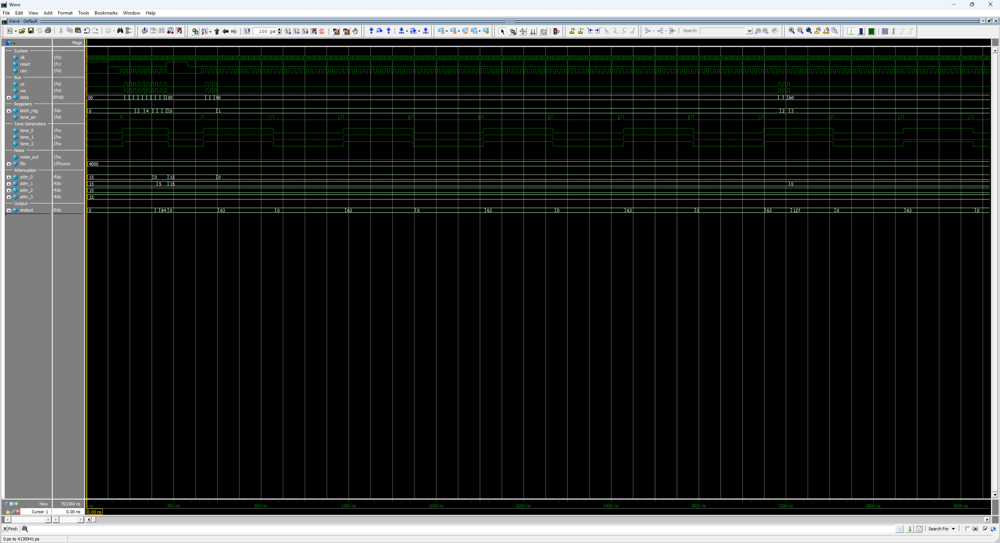
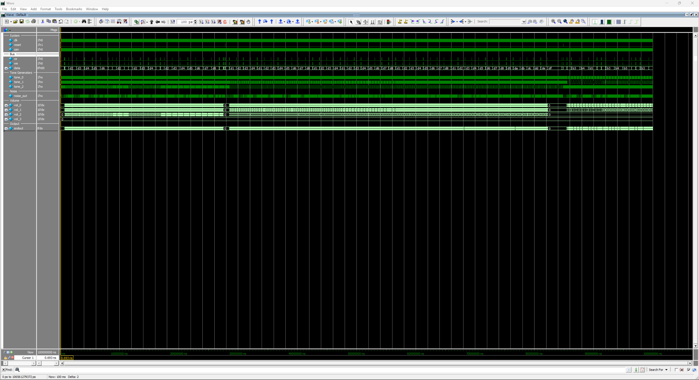

# x76489 - TI SN76489AN Verilog Implementation

<table align="center">
  <tr>
    <td align="center" style="padding: 10px;">
      
    </td>
  </tr>
</table>

## x76489 Overview

The **x76489** is a fully synchronous Verilog implementation of the Texas Instruments SN76489AN digital complex sound generator. It implements the three programmable tone generators, the white and periodic noise generator, the four attenuators in 2 dB steps and the summed audio output, with the latch and data byte register interface. This implementation provides a functional equivalent of the SN76489AN silicon for FPGA-based applications.

### Features

<small>

- **Fully Synchronous Design**: All state changes occur on the positive edge of `CLK`. Chip timing counts `CEN`, one pulse per input clock, and a byte is written on a `CLK` with `CEN` high. No latches or asynchronous logic.
- **Three Tone Generators**: 10-bit periods, f = N / 32n for an input clock N, a period of 0 counting 1024.
- **Noise Generator**: A 15-stage shift register, white or periodic, shifted at N/512, N/1024, N/2048 or on the tone 3 output.
- **Four Attenuators**: 2 dB steps from 0 to 28 dB, and OFF.
- **Register Interface**: A latch byte selects one of eight registers and loads its low bits; data bytes alone load the six high bits of a latched frequency or a latched attenuation, so a frequency can be swept with one byte per step.
- **Audio Output**: `AOUT`, the four channels summed, 8 bits unsigned.
- **VGM Playback Validation**: A VGM playback testbench (`tb_x76489_vgm`) plays SN76489 VGM streams (command `0x50`), and `wav_batch.py` writes 8-bit mono WAV files. See [VGM Playback](#vgm-playback).

</small>

## Table of Contents

| # | Section | Description |
|---|---------|-------------|
| 1 | [System Architecture](#system-architecture) | Block diagram of the control registers, prescaler, tone and noise generators, attenuators and output |
| 2 | [Module Hierarchy](#module-hierarchy) | Source-file listing with each module's role and approximate line count |
| 3 | [Register Map](#register-map) | Register select, data formats, reset values, attenuation and noise control |
| 4 | [Sound Generation](#sound-generation) | Clock division, tone generators, noise generator and attenuators |
| 5 | [Audio Output](#audio-output) | `AOUT` and the chip's output amplifier |
| 6 | [Control Interface](#control-interface) | Verilog port-level reference: `x76489` ports |
| 7 | [Design Usage](#design-usage) | Instantiation example and bus timing rules |
| 8 | [Implementation Notes](#implementation-notes) | Sources of the undocumented behavior and where the implementation and the TI documents differ |
| 9 | [SN76489 Family Roadmap](#sn76489-family-roadmap) | Position of x76489 among the SN76489AN, SN76494 and SN76496 |
| 10 | [Project Structure](#project-structure) | Directory tree of the IP package |
| 11 | [Design Verification](#design-verification) | Testbench section breakdown, run command, ModelSim screenshot, final summary box. Per-test log: [tb_x76489](doc/readme/tb_x76489_log.md). |
| 12 | [VGM Playback](#vgm-playback) | VGM playback testbench and the VGM-to-WAV toolchain |
| 13 | [Design References](#design-references) | TI documents, the die schematics and the VGM specification |
| 14 | [License](#license) | Creative Commons Attribution-NonCommercial 4.0 International |
| 15 | [Support](#support) | Back ongoing Coin-Op Collection FPGA core development on Patreon |

## System Architecture

```
┌──────────────────────────────────────────────────────────────────────────┐
│                                  x76489                                  │
│                                                                          │
│  ┌─────────────────────┐    ┌──────────────┐                             │
│  │  Control Registers  │───>│ x76489_tone  │──> Attenuation 1 ──┐        │
│  │                     │    │ tone 1       │                    │        │
│  │ CSn WRn D0-D7       │    ├──────────────┤                    │        │
│  │ latch / data byte   │───>│ x76489_tone  │──> Attenuation 2 ──┤        │
│  │ 8 registers         │    │ tone 2       │                    │        │
│  │                     │    ├──────────────┤                    ├──> Sum ┼─> AOUT
│  │  Prescaler          │───>│ x76489_tone  │──> Attenuation 3 ──┤        │
│  │ CEN / 16 = pre_cen  │    │ tone 3       │──┐                 │        │
│  └──────────┬──────────┘    └──────────────┘  │ tone 3          │        │
│             │               ┌──────────────┐  │                 │        │
│             └──────────────>│ x76489_noise │<─┘                 │        │
│                             │ 15 stages    │──> Attenuation 4 ──┘        │
│                             │ x76489_edge  │                             │
│                             └──────────────┘                             │
│                                                                          │
└──────────────────────────────────────────────────────────────────────────┘
```

## Module Hierarchy

| Module | Description | Lines |
|--------|-------------|-------|
| `x76489.v` | Top level: instantiates the submodules; prescaler, control registers, attenuation levels, output sum | ~287 |
| `x76489_tone.v` | Tone generator: 10-bit down counter and output toggle | ~74 |
| `x76489_noise.v` | Noise generator: shift-rate divider and select, 15-stage shift register | ~122 |
| `x76489_edge.v` | Rising edge detector for the shift-rate source | ~46 |

## Register Map

Page references are from the Advanced Circuits SN76489AN data sheet (`doc/02`).

| R0 R1 R2 | Register | Bits | Reference |
|----------|----------|------|-----------|
| 000 | Tone 1 frequency | F0-F9 | [p.4] |
| 001 | Tone 1 attenuation | A0-A3 | [p.4] |
| 010 | Tone 2 frequency | F0-F9 | [p.4] |
| 011 | Tone 2 attenuation | A0-A3 | [p.4] |
| 100 | Tone 3 frequency | F0-F9 | [p.4] |
| 101 | Tone 3 attenuation | A0-A3 | [p.4] |
| 110 | Noise control | FB, NF0, NF1 | [p.3-4] |
| 111 | Noise attenuation | A0-A3 | [p.4] |

### Data Formats

TI numbers the data bus from D0, the MSB, to D7, so `DIN[7]` is D0 and `DIN[0]` is D7 [p.4], [p.6]. F0 is the MSB of a period and F9 its LSB [p.2].

```
TI bit:                    D0  D1  D2  D3  D4  D5  D6  D7
DIN bit:                    7   6   5   4   3   2   1   0

Frequency, latch byte:      1  R0  R1  R2  F6  F7  F8  F9
Frequency, data byte:       0   x  F0  F1  F2  F3  F4  F5
Noise control:              1   1   1   0   x  FB NF0 NF1
Attenuation:                1  R0  R1  R2  A0  A1  A2  A3
```

A latch byte (D0 = 1) selects the register by R0-R2 and loads its low bits; a data byte (D0 = 0) loads F0-F5 of the latched tone frequency, or A0-A3 of the latched attenuation, which the data sheet does not show (see [Implementation Notes](#implementation-notes)). The register address stays latched, so data bytes alone change the six high bits of a frequency for sweeps [p.3]. A latch byte to the noise control register also reseeds the shift register [p.3].

The chip has no reset pin [p.6]. `RESETn` sets each tone register to 1, each attenuation to 1111 (OFF), the noise control to FB = 1 and NF0, NF1 = 00 (white noise at N/512) and the address latch to 000, so the output starts silent.

### Attenuation

A0-A3 weigh 16, 8, 4 and 2 dB and add, 0 to 28 dB; 1111 is OFF (Table 1 [p.2]). The levels are ideal 2 dB steps, 1023 x 10^(-step / 10) rounded down; the chip holds each weight within 1 dB [p.7].

| A0-A3 | Attenuation | Level | A0-A3 | Attenuation | Level |
|-------|-------------|-------|-------|-------------|-------|
| 0000 | 0 dB | 1023 | 1000 | 16 dB | 162 |
| 0001 | 2 dB | 812 | 1001 | 18 dB | 128 |
| 0010 | 4 dB | 645 | 1010 | 20 dB | 102 |
| 0011 | 6 dB | 512 | 1011 | 22 dB | 81 |
| 0100 | 8 dB | 407 | 1100 | 24 dB | 64 |
| 0101 | 10 dB | 323 | 1101 | 26 dB | 51 |
| 0110 | 12 dB | 256 | 1110 | 28 dB | 40 |
| 0111 | 14 dB | 204 | 1111 | OFF | 0 |

### Noise Control

| FB | Noise | Sequence |
|----|-------|----------|
| 0 | Periodic | 15 shifts, the output high for one |
| 1 | White | 32767 shifts |

| NF0 NF1 | Shift Rate | At 3.579545 MHz |
|---------|------------|-----------------|
| 00 | N/512 | 6991 Hz |
| 01 | N/1024 | 3496 Hz |
| 10 | N/2048 | 1748 Hz |
| 11 | Tone 3 output | One shift per tone 3 period |

Table 2 and Table 3 [p.3]; the sequence lengths are from the die and the 15-stage register.

## Sound Generation

### Clock Division

A /16 prescaler gives `pre_cen`, which steps the three tone counters and a separate noise divider (Block Diagram [p.10], Figure 4 [p.11]):

```
CEN ──> /16 ──> pre_cen ─┬──> /n ──> /2 ──> tone 1
                         ├──> /n ──> /2 ──> tone 2
                         ├──> /n ──> /2 ──> tone 3 ───────────────┐
                         │                                        v
                         └──> /16 ──> /2, /4, /8 ──> N/512, N/1024, N/2048 or tone 3 ──> noise shift
```

### Tone Generators

Each tone is a 10-bit down counter stepped by `pre_cen`. At zero it reloads with n - 1 and toggles the output, so the output holds for n steps and the tone is f = N / 32n for an input clock N [p.2]. A new period takes effect at the next reload. n = 0 counts 1024, the lowest tone; the data sheet does not define it.

| n | At 3.579545 MHz |
|---|-----------------|
| 1 | 111.9 kHz |
| 254 | 440.4 Hz |
| 1023 | 109.3 Hz |
| 0 | 109.2 Hz |

### Noise Generator

A 15-stage shift register (TI-99/4A Servicing Manual, p. 74) shifts on each rising edge of the selected rate. The output is the last stage. With FB = 1 the stage shifted in is the XOR of the last two stages, a 32767-shift sequence; with FB = 0 the register rotates, so the seed returns every 15 shifts and the output is high for one shift in 15. A latch byte to the noise control register, and `RESETn`, reseed the register with one stage opposite to the other fourteen, which the data sheet calls clearing it [p.3].

### Attenuators

Each channel, the three tones and the noise, has its own 4-bit attenuation, applied to the output of its generator [p.2-3]. A channel is its level while its output is high and 0 while it is low.

## Audio Output

- **`AOUT`**: the sum of the four channel levels, each 0-1023, bits 11-4, registered on every `CLK`. One channel at 0 dB moves between 0 and 63, and all four together reach 255. Silence is 0.
- **The chip**: the four attenuator outputs are summed as one internally generated current of 0 to -160 uA into an operational amplifier with 17 kOhm feedback and a +1.5 V typical reference (Figure 2 [p.8], Figure 4 [p.11]), which drives up to 10 mA on AUDIO OUT [p.3]. Silence is a DC level, and the board couples the output to its amplifier through a capacitor (Figure 2 [p.8]); pin 7 is decoupled with 10 Ohm and 0.1 uF to ground [p.3].

## Control Interface

### Chip Ports (x76489)

```verilog
// Clock and Reset
input  wire       CLK,
input  wire       RESETn, // no chip pin: tones 1, attenuations OFF, noise white at N/512
input  wire       CEN,    // one pulse per input clock (CLOCK)

// Control Interface
input  wire [7:0] DIN,    // D0-D7: DIN[7] is D0, the latch flag; DIN[0] is D7
input  wire       CSn,    // CE
input  wire       WRn,    // WE

// Audio Output
output reg  [7:0] AOUT    // AUDIO OUT: the four channels summed, unsigned
```

The chip's READY output (pin 4) is not provided; see [Implementation Notes](#implementation-notes).

## Design Usage

### Instantiation Example

```verilog
x76489 u_psg (
    // Clock and Reset
    .CLK    ( clk_sys   ),
    .RESETn ( ~reset    ),
    .CEN    ( psg_cen   ),

    // Control Interface
    .DIN    ( cpu_dout  ),
    .CSn    ( ~psg_cs   ),
    .WRn    ( ~cpu_wr   ),

    // Audio Output
    .AOUT   ( psg_audio )
);
```

### Bus Timing Rules

- `CEN` is high for one `CLK` per input clock of the chip (3.579 MHz typ, 4 MHz max [p.9]); every chip timing counts it. `CLK` is the system clock, faster than `CEN` or equal to it.
- `RESETn` is synchronous and acts on any `CLK` it is low.
- A byte is written on every `CLK` on which `CEN` is high and `CSn` and `WRn` are both low. A `CSn` and `WRn` low period with no `CEN` pulse in it writes nothing; one with several writes the byte on each, which leaves the registers the same but reseeds the noise register again on a noise control write.
- Bytes may follow each other on consecutive `CEN` pulses: the 32 clocks the chip takes per byte, and READY, are not modeled [p.5].
- `AOUT` is unsigned with silence at 0; a tone moves between 0 and its level, so `AOUT` carries a DC part, as the chip's output does.

## Implementation Notes

The data sheets give the register formats, the tone formula, the shift rates, the attenuation weights and the bus timing, but not what a period of 0 does, what a data byte does to an attenuation, the shift register taps, its seed, how periodic noise is made or the state at power-up. These follow the TI SN76489AN die schematic (`doc/05`); the register length is also given in the TI-99/4A Servicing Manual. Where the implementation and the TI documents differ:

| Item | x76489 | TI Documents |
|------|--------|--------------|
| Byte transfer | A byte is written on a `CLK` with `CEN` high while `CSn` and `WRn` are low; there is no READY | About 32 clocks per byte, with READY low until the byte is loaded; CE and WE are held low until READY rises [p.5] (SN76494/SN76496 Data Sheet, p. 4-40) |
| Reset | `RESETn` sets the tone registers to 1, the attenuations OFF and the noise control to white noise at N/512 | No reset pin [p.6]; the state at power-up is not given |
| Period 0 | Counts 1024 (die) | Not defined [p.2] |
| Data byte to an attenuation | Loads A0-A3; on the die every byte strobes the latched register | An attenuation is shown only as a single latch byte [p.3-4] |
| Noise reseed | One stage opposite to the other fourteen (die) | The register is cleared [p.3] |
| Periodic noise | The register rotates; the seed returns every 15 shifts | Not described; on the die a constant is shifted in and a detector on all 15 stages reseeds the register |
| Attenuation | Ideal 2 dB steps | Each weight within 1 dB [p.7] |
| Output | `AOUT`, the sum, unsigned, silence at 0 | A current-summing amplifier; silence is a DC level [p.8] |

- **Document conflicts**: the maximum attenuation is 28 dB [p.2]; the SN76494/SN76496 Data Sheet (p. 4-40) and the TI-99/4A Servicing Manual (p. 73) give 30 dB, the sum of the four weights, though 1111 is OFF. The typeset SN76489AN data sheet (`doc/00`) prints the second row of Table 3 as 00 (`doc/02` [p.3]: 01) and the second row of Table 4 as 000 (`doc/02` [p.4]: 001), labels pin 6 OE (`doc/02` [p.1], [p.6]: CE) and titles Figure 2 an input interface (`doc/02` [p.8]: output). The SN76494/SN76496 Data Sheet (p. 4-37) says the divide-by-eight stage is deleted from the SN76496, where it means the SN76494. The Servicing Manual clears the noise register when FB changes (p. 74); the data sheet does so whenever the noise control register is changed [p.3], as on the die.
- **Noise output polarity**: the die schematic does not settle whether the noise output is high for one shift in 15 in periodic mode, as here, or low for one; the two are the same waveform inverted, differing in the DC level and the sign of the noise channel.

## SN76489 Family Roadmap

The x76489 implements the SN76489AN. The SN76494 is the same chip without the divide-by-eight stage [p.1]; the SN76494 and SN76496 add an audio input on pin 9, summed with the tones (SN76494/SN76496 Data Sheet, p. 4-37, p. 4-41).

| Feature | SN76489AN (Current) | SN76494 / SN76494A | SN76496 / SN76496A |
|---------|---------------------|--------------------|--------------------|
| Input Clock | 4 MHz max | 500 kHz max | 4 MHz max |
| Prescaler | /16 | /2 | /16 |
| Tone | N / 32n | N / 4n | N / 32n |
| Noise Rates | N/512, N/1024, N/2048 | N/64, N/128, N/256 | Not listed |
| Clocks per Byte | 32 | 4 | 32 |
| Audio Input (pin 9) | - | ✓ | ✓ |

The SN76494/SN76496 Data Sheet's one Table 3 (p. 4-41) gives N/64, N/128 and N/256 for all four of its parts; these match the SN76494's /2 prescaler, and no rates are given for the SN76496's /16.

## Project Structure

```
x76489/
├── doc/
│   ├── 00_SN76489AN_Datasheet.pdf
│   ├── 01_SN76494_SN76496_Datasheet.pdf
│   ├── 02_TI_SN76489AN_Datasheet_Advanced_Circuits_Nov1981.pdf
│   ├── 03_TI_99-4A_Servicing_Manual_TMS9919_Section_Oct1983.pdf
│   ├── 04_TI_99-4_New_Technician_Guide_TMS9919_Pages_1979.pdf
│   ├── 05_TI_SN76489AN_RE_Schematic.pdf
│   └── readme/
│       └── tb_x76489_log.md        # Full regression log
├── hdl/
│   ├── x76489.v                    # Top level: registers, attenuation, output sum
│   ├── x76489_tone.v               # Tone generator
│   ├── x76489_noise.v              # Noise generator
│   └── x76489_edge.v               # Rising edge detector
├── img/
│   ├── 20260329_x76489.png
│   ├── 20260329_x76489_vgm.png
│   └── coc_banner.png
├── sim/
│   ├── tb_x76489.v                 # Comprehensive testbench
│   ├── tb_x76489_vgm.v             # VGM playback testbench
│   ├── scripts/
│   │   ├── vgm2hex.py              # VGM/VGZ to hex playlist
│   │   └── wav_batch.py            # AOUT streams to WAV
│   └── output/
│       ├── vgm/                    # User-supplied VGM/VGZ files
│       ├── vgm_hex/                # Generated playlist and tracklist
│       └── wav/                    # Generated AOUT streams and WAV files
├── x76489.qip                      # Quartus project include file
└── README.md
```

## Design Verification

The testbench (`tb_x76489.v`) provides comprehensive verification - 29 self-checking assertions across 14 sections covering the control registers through the chip bus, the tone and noise generators, and the attenuators and channels on `AOUT`. The full chip runs on its bus with a `CEN` pulse every second `CLK`:

<small>

- **REG Section A**: Attenuators after reset, tone frequency latch and data bytes, attenuation and noise control writes (11 tests)
- **TONE Section B**: Each tone generator toggling, period 1 faster than period 8 (4 tests)
- **NOISE Section C**: White and periodic noise, the reseed on a noise control write, tone 3 as the shift source (5 tests)
- **ATTN Section D**: All channels OFF, a tone at 0 dB, OFF again (3 tests)
- **MIX Section E**: Each channel alone on `AOUT` (4 tests)
- **WRITE Section F**: Attenuation and frequency writes while a tone plays (2 tests)

</small>

From the IP root:

```
vlib work
vlog hdl/*.v sim/tb_x76489.v
vsim -c tb_x76489 -do "run -all"
```

<table align="center">
  <tr>
    <td align="center" style="padding: 10px;">
      
    </td>
  </tr>
</table>

```
=========================================================
  tb_x76489 results: 29 / 29 passed (0 failed)
=========================================================
  ALL TESTS PASSED
```

Per-test output: [tb_x76489](doc/readme/tb_x76489_log.md)

## VGM Playback

A VGM playback testbench is included for validating the chip against real game audio. VGM files carry timestamped SN76489 writes (command `0x50`, clock at header offset `0x0C`). The testbench replays the writes through the x76489 on its bus and captures `AOUT` at 44.1 kHz; `wav_batch.py` writes the WAV files. Each write holds `CSn` and `WRn` low for one `CEN` pulse, outside the sample count, and each 44.1 kHz sample is floor(chip clock / 44100) `CEN` pulses (81 when the header gives no clock).

<table align="center">
  <tr>
    <td align="center" style="padding: 10px;">
      
    </td>
  </tr>
</table>

### Usage

1. Place VGZ/VGM files in `sim/output/vgm/`
2. Generate the playlist:
```
python sim/scripts/vgm2hex.py
```
3. Run the simulation from the IP root:
```
vlib work
vlog hdl/*.v sim/tb_x76489_vgm.v
vsim -c tb_x76489_vgm -do "run -all; quit -f"
```
4. Convert to WAV:
```
python sim/scripts/wav_batch.py
```

WAV files are written to `sim/output/wav/` with names derived from the source VGM filenames. The testbench takes the chip clock of each track from its VGM header, or 3.58 MHz when the header gives none.

### Pipeline

| Step | Input | Output |
|------|-------|--------|
| `vgm2hex.py` | VGZ/VGM files | `playlist.hex` + `tracklist.txt` |
| `tb_x76489_vgm.v` | `playlist.hex` | `track_NN.raw` (8-bit unsigned samples at 44100 Hz) |
| `wav_batch.py` | `track_NN.raw` + `tracklist.txt` | 8-bit mono WAV files |

## Design References

- [TI SN76489AN Data Sheet, Advanced Circuits, November 1981](doc/02_TI_SN76489AN_Datasheet_Advanced_Circuits_Nov1981.pdf)<br>
  <small><i>(Features, p. 1; Tone Generators, Table 1, Noise Generator, p. 2; Tables 2 and 3, Output Buffer/Amplifier, CPU to SN76489AN Interface, p. 3; Control Registers, Table 4, Data Formats, p. 4; Data Transfer, Figure 1, Table 5, p. 5; Pin Assignment, p. 6; Electrical Characteristics, p. 7; External Audio Output Interface, Figure 2, p. 8; Switching Characteristics, Figure 3, p. 9; Block Diagram, p. 10; Figure 4, p. 11)</i></small>
- [TI SN76489AN Data Sheet](doc/00_SN76489AN_Datasheet.pdf)<br>
  <small><i>(The typeset edition of the same data sheet)</i></small>
- [TI SN76494, SN76494A, SN76496, SN76496A Programmable Tone/Noise Generator, D2801, June 1984, revised January 1989](doc/01_SN76494_SN76496_Datasheet.pdf)<br>
  <small><i>(Description and Functional Block Diagram, p. 4-37; Pin Assignments and Functions, Tone Generators, p. 4-40; Table 1, Noise Generator, Tables 2 and 3, Output Buffer/Amplifier, p. 4-41)</i></small>
- [TI-99/4A Servicing Manual, October 1983, TMS 9919 Section](doc/03_TI_99-4A_Servicing_Manual_TMS9919_Section_Oct1983.pdf)<br>
  <small><i>(Key Features, p. 6; Sound Generation Controller, pp. 73-77)</i></small>
- [TI-99/4 New Technician Guide, 1979, TMS 9919 Pages](doc/04_TI_99-4_New_Technician_Guide_TMS9919_Pages_1979.pdf)<br>
  <small><i>(TIM 9919 Architecture, Figure 6; Sound Generation; Test Set Error Tables)</i></small>
- [VGM File Format Specification 1.71](https://vgmrips.net/wiki/VGM_Specification)<br>
  <small><i>(Header offset 0x0C, command 0x50)</i></small>
- [TI SN76489AN Die Schematic](doc/05_TI_SN76489AN_RE_Schematic.pdf)<br>
  <small><i>(TONE: the period of 0; NOISE: the register length, taps, seed and periodic mode; DATA WRITE CONTROL: the write timer, READY and the register strobe on every byte)</i></small>

## License

This work is licensed under the [Creative Commons Attribution-NonCommercial 4.0 International License](../../LICENSE) (CC BY-NC 4.0). You may use, share, and modify this code for non-commercial purposes, provided that proper credit is given.

## Support

Please consider supporting this and future projects by joining the [**Coin-Op Collection Patreon**](https://www.patreon.com/atrac17).

---
