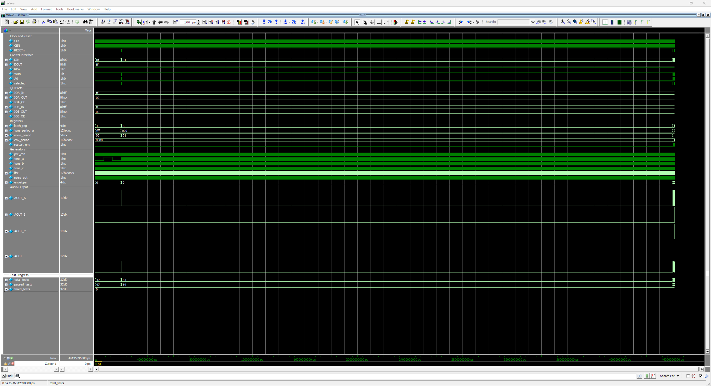
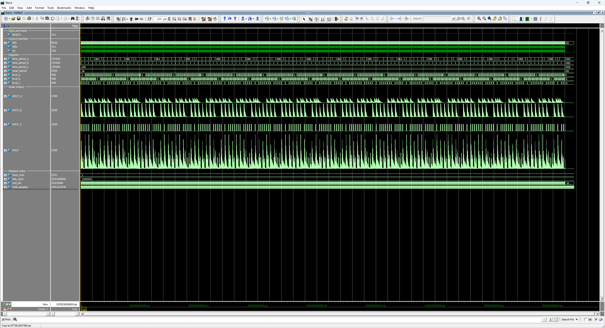

# x8910 - GI AY-3-8910 Verilog Implementation

<table align="center">
  <tr>
    <td align="center" style="padding: 10px;">
      
    </td>
  </tr>
</table>

## x8910 Overview

The **x8910** is a fully synchronous Verilog implementation of the General Instrument AY-3-8910 programmable sound generator. It implements the three tone generators, the noise generator, the mixer, the envelope generator and the three D/A converters, set through sixteen registers. This implementation provides a functional equivalent of the AY-3-8910 for FPGA-based applications.

### Features

<small>

- **Fully Synchronous Design**: All state changes occur on the positive edge of `CLK`. Chip timing counts `CEN`, one pulse per input clock; the bus is sampled on every `CLK`. No latches or asynchronous logic.
- **Three Tone Generators**: 12-bit periods, f = f_CLOCK / (16 TP).
- **Noise Generator**: A 5-bit period, f = f_CLOCK / (16 NP), and a 17-bit shift register with taps at bits 0 and 3.
- **Envelope Generator**: A 16-bit period, sixteen steps of 16 EP input clocks, ten shapes set by R13.
- **Mixer**: Tone and noise per channel, each turned on or off by R7.
- **D/A Converters**: Sixteen levels in ideal 3 dB steps, fixed or from the envelope.
- **Audio Output**: `AOUT_A`, `AOUT_B` and `AOUT_C`, the three D/A outputs, 10 bits each, and `AOUT`, their sum, 12 bits unsigned.
- **Bus and I/O Ports**: Reads on `RDn`, chip select by the address byte, and both I/O ports as input, output and output-enable pins.
- **VGM Playback Validation**: A VGM playback testbench (`tb_x8910_vgm`) plays AY-3-8910 VGM streams (command `0xA0`), and `wav_batch.py` writes 16-bit mono WAV files. See [VGM Playback](#vgm-playback).

</small>

## Table of Contents

| # | Section | Description |
|---|---------|-------------|
| 1 | [System Architecture](#system-architecture) | Block diagram of the registers, prescaler, tone, noise and envelope generators, mixer, D/A converters and output |
| 2 | [Module Hierarchy](#module-hierarchy) | Source-file listing with each module's role and approximate line count |
| 3 | [Register Map](#register-map) | R0-R15, the mixer, amplitude and envelope shape fields, reset, chip select and the I/O ports |
| 4 | [Sound Generation](#sound-generation) | Clock division, tone, noise and envelope generators, and the mixer |
| 5 | [Audio Output](#audio-output) | The D/A levels, `AOUT_A`-`AOUT_C` and `AOUT` |
| 6 | [Control Interface](#control-interface) | Verilog port-level reference: `x8910` ports |
| 7 | [Design Usage](#design-usage) | Instantiation example and bus timing rules |
| 8 | [Device Usage](#device-usage) | FPGA resource usage, timing and Fmax of a standalone compile on two Cyclone V parts |
| 9 | [Implementation Notes](#implementation-notes) | Sources of the undocumented behavior and where the implementation and the GI documents differ |
| 10 | [Project Structure](#project-structure) | Directory tree of the IP package |
| 11 | [Design Verification](#design-verification) | Testbench section breakdown, run command, ModelSim screenshot, final summary box. Per-test log: [tb_x8910](doc/readme/tb_x8910_log.md); VGM log: [tb_x8910_vgm](doc/readme/tb_x8910_vgm_log.md). |
| 12 | [VGM Playback](#vgm-playback) | VGM playback testbench and the VGM-to-WAV toolchain |
| 13 | [Design References](#design-references) | GI documents, the die schematic and the VGM specification |
| 14 | [License](#license) | Creative Commons Attribution-NonCommercial 4.0 International |
| 15 | [Support](#support) | Back ongoing Coin-Op Collection FPGA core development on Patreon |

## System Architecture

```
┌──────────────────────────────────────────────────────────────────────────────┐
│                                    x8910                                     │
│                                                                              │
│  ┌─────────────────┐ pre_cen                                                 │
│  │ Prescaler, /8   │─────────┐                                               │
│  └─────────────────┘         │                                               │
│                              │                                               │
│  ┌─────────────────┐ R0-R5   │    ┌────────────────┐   ┌───────────┐         │
│  │ Registers       │─────────┼───>│ x8910_tone     │   │           │         │
│  │                 │         ├───>│ A, B, C        │──>│           │         │
│  │ A0 RDn WRn      │ R7      │    └────────────────┘   │  Mixer    │         │
│  │ DIN DOUT        │─────────┼────────────────────────>│           │         │
│  │ R0-R15          │ R6      │    ┌────────────────┐   │           │         │
│  │                 │─────────┼───>│ x8910_noise    │   │           │         │
│  │ IOA, IOB        │         ├───>│ x8910_edge     │──>│           │         │
│  │ I/O ports       │         │    └────────────────┘   └─────┬─────┘         │
│  │                 │         │                               v               │
│  │                 │ R11-R13 │    ┌────────────────┐   ┌───────────┐         │
│  │                 │─────────┼───>│ x8910_envelope │──>│ Amplitude │         │
│  │                 │         └───>│ x8910_edge     │   │ D/A       ├──> Sum ─┼─> AOUT
│  │                 │ R8-R10       └────────────────┘   │ A, B, C   │         │
│  │                 │──────────────────────────────────>│           ├──> Ch ──┼─> AOUT_A-C
│  └─────────────────┘                                   └───────────┘         │
│                                                                              │
└──────────────────────────────────────────────────────────────────────────────┘
```

## Module Hierarchy

| Module | Description | Lines |
|--------|-------------|-------|
| `x8910.v` | Top level: registers, chip select, I/O ports, prescaler, mixer, D/A levels, outputs; instantiates the submodules | ~359 |
| `x8910_tone.v` | Tone generator: 12-bit up counter and output toggle | ~75 |
| `x8910_noise.v` | Noise generator: 5-bit period counter, 17-bit shift register | ~107 |
| `x8910_envelope.v` | Envelope generator: 16-bit period counter, step counter and shape | ~131 |
| `x8910_edge.v` | Rising edge detector for the noise and envelope steps | ~49 |

## Register Map

Page references are from the AY-3-8910/8912 Programmable Sound Generator Data Manual. Registers are numbered in decimal here; GI numbers them in octal, R0-R17 (Figure 2 [p.8]).

| Register | GI | Function | Bits |
|----------|----|----------|------|
| R0, R1 | R0, R1 | Channel A tone period | 8-bit fine, 4-bit coarse |
| R2, R3 | R2, R3 | Channel B tone period | 8-bit fine, 4-bit coarse |
| R4, R5 | R4, R5 | Channel C tone period | 8-bit fine, 4-bit coarse |
| R6 | R6 | Noise period | 5 bits |
| R7 | R7 | Mixer and I/O enable | 8 bits |
| R8-R10 | R10-R12 | Channel A-C amplitude | M, L3-L0 |
| R11, R12 | R13, R14 | Envelope period | 8-bit fine, 8-bit coarse |
| R13 | R15 | Envelope shape | Continue, Attack, Alternate, Hold |
| R14, R15 | R16, R17 | I/O port A and B data | 8 bits |

Unused bits read as 0. `RESETn` clears every register [p.13], so every tone and noise is on in the mixer with every amplitude 0.

### Chip Select and Reads

An address write (`A0` = 0) loads the address latch only when `DIN[7:4]` is 0000, the chip's address; any other value deselects the chip and keeps the address. A deselected chip ignores data writes and reads $FF, and reset deselects it, so the first access after reset is an address write. A read is `RDn` low with `A0` = 0; `DOUT` is $FF otherwise.

### I/O Ports

R7 bit 6 puts port A in output mode, bit 7 port B [p.28]. `IOA_OUT` and `IOB_OUT` are R14 and R15, `IOA_OE` and `IOB_OE` the two mode bits. A read of R14 or R15 returns the pins, `IOA_IN` or `IOB_IN`, in either mode. In output mode a pin is pulled low where its `IOx_OUT` bit is 0 and released where it is 1, with the board's pull-up; in input mode every pin is released.

### Mixer (R7)

```
  7   6   5   4   3   2   1   0
┌───┬───┬───┬───┬───┬───┬───┬───┐
│IOB│IOA│ NC│ NB│ NA│ TC│ TB│ TA│
└───┴───┴───┴───┴───┴───┴───┴───┘
  │   │   │   │   │   │   │   └── Tone A off (1)
  │   │   │   │   │   │   └────── Tone B off (1)
  │   │   │   │   │   └────────── Tone C off (1)
  │   │   │   │   └────────────── Noise A off (1)
  │   │   │   └────────────────── Noise B off (1)
  │   │   └────────────────────── Noise C off (1)
  │   └────────────────────────── Port A output mode (1)
  └────────────────────────────── Port B output mode (1)
```

### Amplitude (R8-R10)

```
  7   6   5   4   3   2   1   0
┌───┬───┬───┬───┬───┬───┬───┬───┐
│ - │ - │ - │ M │L3 │L2 │L1 │L0 │
└───┴───┴───┴───┴───┴───┴───┴───┘
              │   └───┴───┴───┴── Fixed level, 0-15
              └────────────────── 1 = envelope, 0 = fixed level
```

### Envelope Shape (R13)

| Continue | Attack | Alternate | Hold | Shape |
|----------|--------|-----------|------|-------|
| 0 | 0 | x | x | `\___` decay, then 0 |
| 0 | 1 | x | x | `/___` attack, then 0 |
| 1 | 0 | 0 | 0 | `\\\\` repeated decay |
| 1 | 0 | 0 | 1 | `\___` decay, then 0 |
| 1 | 0 | 1 | 0 | `\/\/` decay and attack alternating |
| 1 | 0 | 1 | 1 | `\‾‾‾` decay, then 15 |
| 1 | 1 | 0 | 0 | `////` repeated attack |
| 1 | 1 | 0 | 1 | `/‾‾‾` attack, then 15 |
| 1 | 1 | 1 | 0 | `/\/\` attack and decay alternating |
| 1 | 1 | 1 | 1 | `/___` attack, then 0 |

Envelope Shape/Cycle Control [p.25]. A write to R13 restarts the envelope.

## Sound Generation

### Clock Division

A /8 prescaler gives `pre_cen`, which steps the tone, noise and envelope period counters. Each counter output toggles at its period, a further /2:

```
CEN ──> /8 ──> pre_cen ─┬──> /TP ──> /2 ──> tone A, B, C
                        ├──> /NP ──> /2 ──> noise shift
                        └──> /EP ──> /2 ──> envelope step ──> /16 ──> cycle
```

| Generator | Rate |
|-----------|------|
| Tone | f = f_CLOCK / (16 TP) [p.18] |
| Noise shift | f = f_CLOCK / (16 NP) [p.20] |
| Envelope step | f = f_CLOCK / (16 EP) |
| Envelope cycle | f = f_CLOCK / (256 EP) [p.24] |

### Tone Generators

Each tone is a 12-bit counter stepped by `pre_cen`. It counts up; at or past the period it returns to 1 and toggles the output, so the output holds for TP steps. A period of 0 acts as 1, and a period written below the count takes effect on the next step.

### Noise Generator

A 5-bit period counter, built as the tone counter, steps a 17-bit shift register on each rising edge of its output. The register shifts toward bit 0 and takes in the XOR of bits 0 and 3, or a 1 while every stage is 0, so it leaves the all-zero state that reset loads; the sequence repeats every 131071 shifts. The noise is the inverse of bit 0. A noise period of 0 acts as 1, the fastest, and the first shift after reset comes a full period later.

### Envelope Generator

A 16-bit period counter, built as the tone counter, steps a 4-bit counter on each rising edge of its output. The envelope is the count, or 15 minus the count for a decay; Attack sets the starting direction, Alternate reverses it at the end of each cycle, and Hold stops the count after one cycle. Shapes with Continue = 0 act as 1001 and 1111 [p.25]. A write to R13 restarts both counters, and the first step comes a full step, 16 EP input clocks, later.

### Mixer

Each channel's mixer output is high while its tone, or a tone turned off, and the noise, or a noise turned off, are high. With tone and noise both off, the output stays high and the channel is its amplitude alone [p.21].

## Audio Output

Each channel is its D/A level while its mixer output is high and 0 while it is low; the level is the fixed L3-L0, or the envelope when M = 1 [p.22]. The levels are ideal 3 dB steps, 1023 x (1 / sqrt(2))^(15 - level) rounded down, level 0 OFF (D/A Converter Operation [p.29]).

| Level | dB | 10-bit |
|-------|----|--------|
| 15 | 0 | 1023 |
| 14 | -3 | 723 |
| 13 | -6 | 512 |
| 12 | -9 | 362 |
| 11 | -12 | 256 |
| 10 | -15 | 181 |
| 9 | -18 | 128 |
| 8 | -21 | 91 |
| 7 | -24 | 64 |
| 6 | -27 | 45 |
| 5 | -30 | 32 |
| 4 | -33 | 23 |
| 3 | -36 | 16 |
| 2 | -39 | 11 |
| 1 | -42 | 8 |
| 0 | OFF | 0 |

- **`AOUT_A`, `AOUT_B`, `AOUT_C`**: the three D/A outputs, as on the chip [p.34], each 0-1023, registered on every `CLK`. Silence is 0.
- **`AOUT`**: their sum, 12 bits, 0-3069, registered with them. One channel at level 15 moves between 0 and 1023.

## Control Interface

### Chip Ports (x8910)

```verilog
// Clock and Reset
input  wire        CLK,
input  wire        RESETn,  // RESET: clears every register
input  wire        CEN,     // one pulse per input clock (CLOCK)

// Control Interface
input  wire [7:0]  DIN,     // DA0-DA7 in
output reg  [7:0]  DOUT,    // DA0-DA7 out: the latched register while RDn is low with A0 = 0, else $FF
input  wire        RDn,     // read
input  wire        WRn,     // write: the address latch (A0 = 0) or the latched register (A0 = 1)
input  wire        A0,      // address (0) or data (1)

// I/O Ports
input  wire [7:0]  IOA_IN,  // IOA0-IOA7 pin levels
output wire [7:0]  IOA_OUT, // R14
output wire        IOA_OE,  // R7 bit 6: output mode
input  wire [7:0]  IOB_IN,  // IOB0-IOB7 pin levels
output wire [7:0]  IOB_OUT, // R15
output wire        IOB_OE,  // R7 bit 7: output mode

// Audio Output
output reg  [9:0]  AOUT_A,  // ANALOG CHANNEL A
output reg  [9:0]  AOUT_B,  // ANALOG CHANNEL B
output reg  [9:0]  AOUT_C,  // ANALOG CHANNEL C
output reg  [11:0] AOUT     // the three summed, unsigned
```

## Design Usage

### Instantiation Example

```verilog
x8910 u_psg (
    // Clock and Reset
    .CLK     ( clk_sys     ),
    .RESETn  ( ~reset      ),
    .CEN     ( psg_cen     ),

    // Control Interface
    .DIN     ( cpu_dout    ),
    .DOUT    ( psg_dout    ),
    .RDn     ( ~psg_rd     ),
    .WRn     ( ~psg_wr     ),
    .A0      ( cpu_a0      ),

    // I/O Ports
    .IOA_IN  ( dsw_a       ),
    .IOA_OUT ( psg_ioa_out ),
    .IOA_OE  ( psg_ioa_oe  ),
    .IOB_IN  ( dsw_b       ),
    .IOB_OUT ( psg_iob_out ),
    .IOB_OE  ( psg_iob_oe  ),

    // Audio Output
    .AOUT_A  ( psg_a       ),
    .AOUT_B  ( psg_b       ),
    .AOUT_C  ( psg_c       ),
    .AOUT    ( psg_audio   )
);
```

### Bus Timing Rules

- `CEN` is high for one `CLK` per input clock of the chip; every chip timing counts it. `CLK` is the system clock, faster than `CEN` or equal to it.
- `RESETn` is synchronous and acts on any `CLK` it is low.
- Each `CLK` on which `WRn` is low is a write: with `A0` = 0 an address write, which loads the address latch from `DIN[3:0]` and selects the chip when `DIN[7:4]` is 0000, or deselects it; with `A0` = 1 a data write to the latched register of a selected chip. A register write is an address write, then a data write.
- A write to R13 restarts the envelope on every `CLK` it lasts; hold `WRn` low for one `CLK` per R13 write.
- `DOUT` is the latched register while `RDn` is low with `A0` = 0 and the chip selected, and $FF otherwise; it is combinational.
- For an input port, drive `IOx_IN` from the pins. For an output port, the pin is low where `IOx_OUT` is 0 and `IOx_OE` is 1; `IOx_IN` reads the pin, so tie it to that level ANDed with whatever else drives the pin.
- `AOUT_A`-`AOUT_C` and `AOUT` are unsigned with silence at 0.

## Device Usage

A standalone compile of `x8910` in Quartus 22.1std, its ports as virtual pins, with a 96 MHz clock. The IP needs no SDC: every path meets timing in one clock.

### Cyclone V 5CSEBA6U23I7

| Module | ALMs | ALUTs | Registers | Block Memory Bits | M10K | DSP |
|--------|------|-------|-----------|-------------------|------|-----|
| `x8910` | 255.0 (0.6%) | 321 | 266 | 0 | 0 | 0 |
| `x8910_envelope` | 27.2 | 49 | 24 | 0 | 0 | 0 |
| `x8910_tone` (A) | 15.2 | 30 | 13 | 0 | 0 | 0 |
| `x8910_tone` (B) | 14.9 | 29 | 13 | 0 | 0 | 0 |
| `x8910_tone` (C) | 15.2 | 29 | 13 | 0 | 0 | 0 |
| `x8910_noise` | 10.2 | 19 | 24 | 0 | 0 | 0 |
| `x8910_edge` (envelope) | 0.5 | 1 | 1 | 0 | 0 | 0 |
| `x8910_edge` (noise) | 0.3 | 1 | 1 | 0 | 0 | 0 |

Fmax 144.55 MHz. At 96 MHz: setup slack +3.498 ns, hold slack +0.164 ns.

### Cyclone V 5CEBA4F23C8

| Module | ALMs | ALUTs | Registers | Block Memory Bits | M10K | DSP |
|--------|------|-------|-----------|-------------------|------|-----|
| `x8910` | 256.5 (1.4%) | 321 | 266 | 0 | 0 | 0 |
| `x8910_envelope` | 26.8 | 49 | 24 | 0 | 0 | 0 |
| `x8910_tone` (A) | 15.2 | 30 | 13 | 0 | 0 | 0 |
| `x8910_tone` (B) | 15.2 | 29 | 13 | 0 | 0 | 0 |
| `x8910_tone` (C) | 14.8 | 29 | 13 | 0 | 0 | 0 |
| `x8910_noise` | 12.3 | 19 | 24 | 0 | 0 | 0 |
| `x8910_edge` (envelope) | 0.3 | 1 | 1 | 0 | 0 | 0 |
| `x8910_edge` (noise) | 0.7 | 1 | 1 | 0 | 0 | 0 |

Fmax 139.00 MHz. At 96 MHz: setup slack +3.222 ns, hold slack +0.167 ns.

## Implementation Notes

The Data Manual gives the registers, the rates, the mixer, the envelope shapes and the D/A curve, but not how the counters count, what a period of 0 does, the noise register's length, taps and seed, how the envelope holds, or what the chip does with an address byte above 15. These follow the AY-3-8910 die schematic:

- the /8 prescaler; the Data Manual gives only the /16 and /256 rates [p.18], [p.24];
- counters that count up, compare with greater-or-equal and restart at 1, so a period of 0 acts as 1;
- the 17-bit noise register with taps at bits 0 and 3 and its zero detect;
- the envelope's invert and stop flags;
- the generator outputs and edge detectors set at reset and restart, so the first noise shift and the first envelope step come a full period later;
- chip select by `DIN[7:4]` = 0000 on an address write.

Where the implementation and the GI documents differ:

| Item | x8910 | GI Documents |
|------|-------|--------------|
| Bus | `A0`, `WRn` and `RDn`; each write lasts one `CLK` | BDIR, BC2 and BC1 decode [p.13], [p.15-17] |
| Chip select | `DIN[7:4]` = 0000 on an address write; A8 and /A9 are left to the board's decode | A8 and /A9 select the chip [p.13] |
| Reads | `DOUT` is $FF outside a read | The data bus is high impedance outside a read [p.17] |
| I/O ports | `IOx_IN`, `IOx_OUT` and `IOx_OE` in place of the bidirectional pins | Two 8-bit bidirectional ports [p.10], [p.28] |
| D/A levels | Ideal 3 dB steps | The measured curve of Figure 9 [p.29] differs at levels 12 and 10 |

The GI documents also disagree with the die in places, where the die is followed:

- **Noise period 0**: Figure 29 [p.54] calls R6 = 0 the maximum noise period; on the die it acts as 1, the fastest.
- **Register numbers**: GI numbers the registers in octal, R0-R17 (Figure 2 [p.8]); this README and the HDL use decimal, R0-R15.

## Project Structure

```
x8910/
├── doc/
│   ├── 00_GI_AY-3-8910_Datasheet.pdf
│   ├── 01_AY-3-8910_8912_Programmable_Sound_Generator_Data_Manual.pdf
│   ├── 02_AY-3-8910_RE_Schematic.pdf
│   ├── 03_AY-3-8910_RE_Schematic_Sheet.pdf
│   └── readme/
│       ├── tb_x8910_log.md          # Full regression log
│       └── tb_x8910_vgm_log.md      # VGM playback testbench output
├── hdl/
│   ├── x8910.v                      # Top level: registers, mixer, D/A, output sum
│   ├── x8910_tone.v                 # Tone generator
│   ├── x8910_noise.v                # Noise generator
│   ├── x8910_envelope.v             # Envelope generator
│   └── x8910_edge.v                 # Rising edge detector
├── img/
│   ├── 20261009_x8910.png
│   ├── 20261009_x8910_vgm.png
│   └── coc_banner.png
├── sim/
│   ├── tb_x8910.v                   # Comprehensive testbench
│   ├── tb_x8910_vgm.v               # VGM playback testbench
│   ├── scripts/
│   │   ├── vgm2hex.py               # VGM/VGZ to hex playlist
│   │   └── wav_batch.py             # AOUT streams to WAV
│   └── output/
│       ├── vgm/                     # User-supplied VGM/VGZ files
│       ├── vgm_hex/                 # Generated playlist and tracklist
│       └── wav/                     # Generated AOUT streams and WAV files
├── x8910.qip                        # Quartus project include file
└── README.md
```

## Design Verification

The testbench (`tb_x8910.v`) provides comprehensive verification - 116 self-checking assertions across 15 sections covering the registers through the chip bus, chip select and the I/O ports, the tone, noise and envelope generators with their exact timing, the mixer, the D/A levels on each channel output, and `AOUT`. The full chip runs on its bus with a `CEN` pulse every second `CLK`:

<small>

- **REG Section A**: Writes and reads of R0 and R7, `DOUT` outside a read, the read masks, the reset value of every register, a deselected chip, chip select by `DIN[7:4]`, the I/O ports (39 tests)
- **TONE Section B**: Each tone generator toggling, period 1 faster than period 4, period 0, the half periods of TP = 1, 5, 0 and 4095 (9 tests)
- **NOISE Section C**: The shift register running, the noise output changing, noise period 1 faster than 16, no shift in the first period after reset, the shift intervals of NP = 0 and 5, the 131071-shift sequence (8 tests)
- **MIX Section D**: Tone and noise off, tone only, noise only, both, and amplitude 0 (5 tests)
- **AMP Section E**: Level 15 on each channel, all off, levels 11, 7 and 1 on `AOUT`; every level on `AOUT_A`, `AOUT_B`, `AOUT_C` and their sum (26 tests)
- **ENV Section F**: Shapes $00, $04 and $08-$0F, restart, a slow period, the first step and the step interval after an R13 write (20 tests)
- **OUT Section G**: Three channels at level 15, all off, each channel alone, A and B (6 tests)
- **WRITE Section H**: Amplitude, period and envelope mode writes while a channel plays (3 tests)

</small>

From the IP root:

```
vlib work
vlog hdl/*.v sim/tb_x8910.v
vsim -c tb_x8910 -do "run -all"
```

<table align="center">
  <tr>
    <td align="center" style="padding: 10px;">
      
    </td>
  </tr>
</table>

```
=========================================================
  tb_x8910 results: 116 / 116 passed (0 failed)
=========================================================
  ALL TESTS PASSED
```

Per-test output: [tb_x8910](doc/readme/tb_x8910_log.md)

## VGM Playback

A VGM playback testbench is included for validating the chip against real game audio. VGM files carry timestamped AY-3-8910 register writes (command `0xA0`, clock at header offset `0x74`). The testbench replays the writes through the x8910 on its bus and captures `AOUT` x 8 at 44.1 kHz as 16-bit samples; `wav_batch.py` writes the WAV files. Each 44.1 kHz sample runs the chip clock over 44100 in `CEN` pulses with the remainder carried, so the chip runs at its clock on average, and each track starts from reset. A VGM whose header gives another chip type (0x78: the AY8930 or the YM2149 family) is skipped with the reason; writes to the second chip of a dual-chip file and to registers above 15 are skipped and counted.

<table align="center">
  <tr>
    <td align="center" style="padding: 10px;">
      
    </td>
  </tr>
</table>

Output of a sample run: [tb_x8910_vgm](doc/readme/tb_x8910_vgm_log.md)

### Usage

1. Place VGZ/VGM files in `sim/output/vgm/`
2. Generate the playlist:
```
python sim/scripts/vgm2hex.py
```
3. Run the simulation from the IP root:
```
vlib work
vlog hdl/*.v sim/tb_x8910_vgm.v
vsim -c tb_x8910_vgm -do "run -all; quit -f"
```
4. Convert to WAV:
```
python sim/scripts/wav_batch.py
```

WAV files are written to `sim/output/wav/` with names derived from the source VGM filenames. The testbench takes the chip clock of each track from its VGM header.

### Pipeline

| Step | Input | Output |
|------|-------|--------|
| `vgm2hex.py` | VGZ/VGM files | `playlist.hex` + `tracklist.txt` |
| `tb_x8910_vgm.v` | `playlist.hex` | `track_NN.raw` (16-bit samples, `AOUT` x 8, at 44100 Hz) |
| `wav_batch.py` | `track_NN.raw` + `tracklist.txt` | 16-bit mono WAV files |

## Design References

- [AY-3-8910/8912 Programmable Sound Generator Data Manual, General Instrument, February 1979](doc/01_AY-3-8910_8912_Programmable_Sound_Generator_Data_Manual.pdf)<br>
  <small><i>(Basic Functional Blocks, Figure 2, pp. 7-11; Pin Functions, p. 13; Bus Timing, p. 15; State Timing, pp. 16-17; Tone Generator Control, p. 18; Noise Generator Control, p. 20; Mixer Control, p. 21; Amplitude Control, p. 22; Envelope Generator Control, pp. 24-25; I/O Port Data Store, p. 28; D/A Converter Operation, Figure 9, p. 29; Audio Output Interface, p. 34; Noise Only Effects, Figure 29, p. 54)</i></small>
- [GI AY-3-8910 Data Sheet](doc/00_GI_AY-3-8910_Datasheet.pdf)
- [VGM File Format Specification 1.71](https://vgmrips.net/wiki/VGM_Specification)<br>
  <small><i>(Header offsets 0x74 and 0x78, command 0xA0)</i></small>
- [AY-3-8910 Die Schematic](https://github.com/lvd2/ay-3-8910_reverse_engineered/tree/master/sch)<br>
  <small><i>(The /8 prescaler, the period counters, the noise register and its taps, the envelope invert and stop flags, the reset and restart states, chip select, the read path and the I/O ports)</i></small>
- [AY-3-8910 Die Schematic Sheets](doc/03_AY-3-8910_RE_Schematic_Sheet.pdf)<br>
  <small><i>(The die schematic redrawn on 16 sheets: Pinout & Block Overview, sheet 1; Clock & Reset, sheet 2; Bus Control, sheet 3; Data Bus Interface, sheet 4; Register Address Latch & Decoder, sheet 5; Channel A, B and C Tone, sheets 6-8; Noise Generator, sheet 9; Mixer Control, sheet 10; Channel A, B and C Amplitude & D/A, sheets 11-13; Envelope Period, sheet 14; Envelope Shape/Cycle, sheet 15; I/O Ports A & B, sheet 16)</i></small>

## License

This work is licensed under the [Creative Commons Attribution-NonCommercial 4.0 International License](../../LICENSE) (CC BY-NC 4.0). You may use, share, and modify this code for non-commercial purposes, provided that proper credit is given.

## Support

Please consider supporting this and future projects by joining the [**Coin-Op Collection Patreon**](https://www.patreon.com/atrac17).

---
